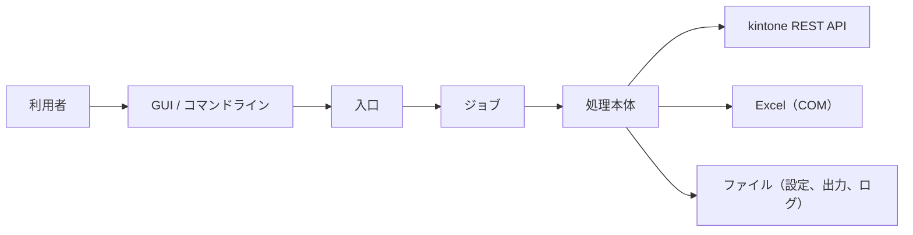

# アーキテクチャ設計

## 1. 概要

本ツールは、kintone に登録された業務日誌とパルスサーベイのレコードを日付単位で取得し、グループ（クラス）ごとに集計してアラートを検知し、その結果を kintone のスレッドに投稿するツールです。

処理は次の層で構成されています。

| 通番 | 層 | 内容 |
|---|---|---|
| 1 | 入口 | 引数の解釈、日付の既定値、グループの列挙 |
| 2 | ジョブ | グループごとの設定読み込み、処理の起動、終了判定 |
| 3 | 処理本体 | kintone API の呼び出し、Excel / JSON の入出力、集計ロジック |

- 全体構成



## 2. 実行環境と前提

| 通番 | 項目 | 内容 |
|---|---|---|
| 1 | 基本ソフトウェア | Windows の cmd と PowerShell 5.1 で動作します。 |
| 2 | 表計算ソフト | 集計データ、受講生一覧、スケジュールの読み書きに Excel を使います。Excel がインストールされている必要があります。 |
| 3 | 通信 | kintone REST API と HTTPS で通信します。 |
| 4 | 認証 | kintone のログイン名とパスワードで認証します（パスワードは、グループ別の設定に平文で保存されます）。 |

## 3. ディレクトリ構成

```
ルート/
├─ 入口のバッチ                bats本体の呼び出し
├─ bats/                      各処理のバッチと処理本体、共通設定、GUI 本体
│  └─ library/                共通の処理（kintone 接続、Excel、GUI 部品など）
├─ clients/                   グループ別の設定と雛形
├─ template/                  アラート結果の出力テンプレート
├─ output/                    処理結果
└─ logs/                      実行ログ
```

## 4. 処理概要

| 通番 | 処理 | 入力 | 出力 |
|---|---|---|---|
| 1 | アプリデータ作成 | 業務日誌（kintone）、パルスサーベイ（kintone）、共通設定、グループ別の設定 | 集計用データ |
| 2 | アプリデータ集計 | 集計用データ、集計データの列定義 | 統合データ |
| 3 | アラート集計 | 統合データ、受講生一覧、スケジュール | アラート結果、バックアップ |
| 4 | 投稿 | アラート結果、バックアップ | 投稿 |
| 5 | ユーザーマスター同期 | ユーザーマスター（kintone）、グループ別の設定 | 受講生一覧 |

## 5. 共通ライブラリ

| 通番 | 機能 | 内容 |
|---|---|---|
| 1 | kintone 連携 | kintone の REST 呼び出し、レコードの取得、スレッドへのコメント投稿、スペース・アプリ・ACL の設定を行います。 |
| 2 | Excel 操作 | Excel の読み込み、書き込み、色付け、列幅、フィルタ、シートの操作を行います。 |
| 3 | ファイル入出力 | 配列のファイルへの書き出しと読み込みを行います。 |
| 4 | 集計用データ | 科目、ユーザー、科目のスケジュールを作成します。 |
| 5 | ログ | 処理本体用のログ出力と、ログファイルのパスの作成を行います。 |
| 6 | 共通処理 | 排他制御、型変換、改行の変換を行います。 |
| 7 | GUI 部品 | GUI の共通部品を作成します。 |

## 6. 外部連携

| 通番 | 連携先 | 用途 | 通信内容 |
|---|---|---|---|
| 1 | kintone REST API | レコードの取得、スレッドへのコメント投稿、ユーザーマスターの読み込み | ログイン名とパスワードによる認証、HTTPS |
| 2 | Excel（COM） | アラート結果、受講生一覧、スケジュールの読み書き | ローカルの Excel を操作 |

## 7. エラー処理

- 処理が失敗すると、画面の状態に「失敗」と表示され、実行ログに記録されます。

## 8. 運用上の注意

- 実行前に対象の Excel ファイルを閉じてください。後始末の処理は表示ウィンドウのない Excel を終了しますが、開いたままのファイルは扱えません。
- 処理中はクリップボードを使うため、コピー操作を行わないでください。
- グループ別の設定ファイルにはパスワードが平文で保存されます。共有フォルダに置く場合は、アクセス権を制限してください。
- 同じグループの同じ処理を、並行して実行しないでください。
