# 処理フロー

## 1. 概要

画面のボタンごとに、押したときに行われる処理の流れを示します。

- 処理の一覧

| 通番 | 画面名 | ボタン名 | 内容 |
|---|---|---|---|
| 1 | 実行（一括実行） | 実行 | 選んだ処理を順に実行します。 |
| 2 | 実行（アプリデータ作成） | 実行（業務日誌） | 業務日誌の集計用データを作成します。 |
| 3 | 実行（アプリデータ作成） | 実行（パルスサーベイ） | パルスサーベイの集計用データを作成します。 |
| 4 | 実行（アプリデータ集計） | 実行（業務日誌・パルスサーベイ） | 集計用データを統合します。 |
| 5 | 実行（アラート集計） | 実行（業務日誌・パルスサーベイ） | 統合データからアラートや提出状況を検知します。 |
| 6 | 実行（アラート集計） | 実行（投稿） | アラート集計の結果をスレッドに投稿します。 |
| 7 | ログ | すべて削除 | ログの出力先の .log ファイルを削除します。削除の前に確認を求めます。 |
| 8 | 環境設定（共通） | 保存 | 入力した内容を保存します。 |
| 9 | 環境設定（共通） | 再読込 | 保存されている内容を読み込み直します。 |
| 10 | 環境設定（共通） | 削除（アプリデータ集計の列定義） | 選んだ行を削除します。 |
| 11 | 環境設定（共通） | 追加（アプリデータ集計の列定義） | 表の末尾に、空の行を追加します。 |
| 12 | 環境設定（グループ別） | 新規作成 | 新しいグループを作成します。 |
| 13 | 環境設定（グループ別） | コピー | 既存のグループの設定をコピーして、新しいグループを作成します。 |
| 14 | 環境設定（グループ別） | 保存 | 入力した内容を保存します。 |
| 15 | 環境設定（グループ別） | 再読込 | 保存されている内容を読み込み直します。 |
| 16 | 環境設定（グループ別） | テスト接続（認証情報） | kintone に接続できるかを確認します。 |
| 17 | 環境設定（グループ別） | テスト接続（ユーザー） | kintone のアプリに接続できるかを確認します。 |
| 18 | 環境設定（グループ別） | テスト接続（業務日誌） | 業務日誌のアプリIDに接続できるかを確認します。 |
| 19 | 環境設定（グループ別） | テスト接続（パルスサーベイ） | パルスサーベイのアプリIDに接続できるかを確認します。 |
| 20 | 環境設定（グループ別） | テスト投稿 | テスト用のコメントを、投稿先のスレッドに投稿します。 |
| 21 | 環境設定（マスター） | 保存 | 入力した内容を保存します。 |
| 22 | 環境設定（マスター） | 再読込 | 保存されている内容を読み込み直します。 |
| 23 | 環境設定（マスター） | 同期実行 | ユーザーマスターの内容を、受講生一覧のシートに書き込みます。 |
| 24 | 環境設定（マスター） | 削除（スケジュール） | 選んだ行を削除します。 |
| 25 | 環境設定（マスター） | 追加（スケジュール） | 表の末尾に、空の行を追加します。 |

## 2. 各ボタンの処理フロー

### 2.1 実行（一括実行）[実行]
1. 対象日と対象のグループを確認します。
2. 対象日が空の場合は、「対象日 を設定してください」と表示して終了します。対象のグループが空の場合はすべてのグループを対象にします。
3. 選んだ処理を、アプリデータ作成、アプリデータ集計、アラート集計、投稿の順に実行します。チェックを外した処理はスキップします。
4. 処理ごとに、状態を「成功」「警告」「失敗」「スキップ」のいずれかで表示します。
5. 状態を表示し、実行ログを画面下部に出力します。

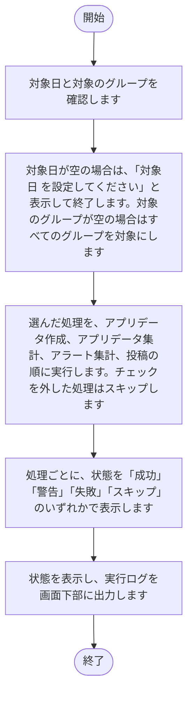

<div class="pagebreak"></div>

### 2.2 実行（アプリデータ作成）[実行（業務日誌）]
1. 対象日と対象のグループを確認します。
2. 対象日が空の場合は、「対象日 を設定してください」と表示して終了します。対象のグループが空の場合はすべてのグループを対象にします。
3. 対象のグループごとに、業務日誌のレコードを取得します。
4. レコードを集計用データに変換し、出力先に保存します。
5. 状態を表示し、実行ログを画面下部に出力します。

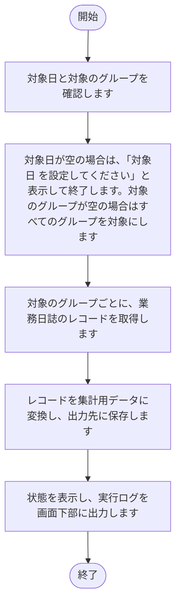

<div class="pagebreak"></div>

### 2.3 実行（アプリデータ作成）[実行（パルスサーベイ）]
1. 対象日と対象のグループを確認します。
2. 対象日が空の場合は、「対象日 を設定してください」と表示して終了します。対象のグループが空の場合はすべてのグループを対象にします。
3. 対象のグループごとに、パルスサーベイのレコードを取得します。
4. レコードを集計用データに変換し、出力先に保存します。
5. 状態を表示し、実行ログを画面下部に出力します。

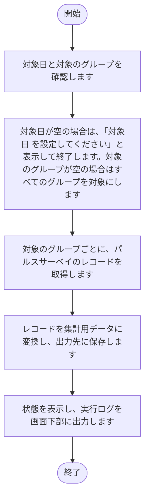

<div class="pagebreak"></div>

### 2.4 実行（アプリデータ集計）[実行（業務日誌・パルスサーベイ）]
1. 対象日と対象のグループを確認します。
2. 対象日が空の場合は、「対象日 を設定してください」と表示して終了します。対象のグループが空の場合はすべてのグループを対象にします。
3. 業務日誌とパルスサーベイの集計用データを読み込みます。
4. 列名の変換を適用して、統合データを作成します。
5. 統合データを出力先に保存します。
6. 状態を表示し、実行ログを画面下部に出力します。

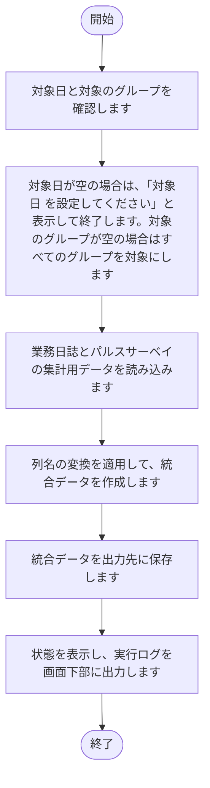

<div class="pagebreak"></div>

### 2.5 実行（アラート集計）[実行（業務日誌・パルスサーベイ）]
1. 対象日と対象のグループを確認します。
2. 対象日が空の場合は、「対象日 を設定してください」と表示して終了します。対象のグループが空の場合はすべてのグループを対象にします。
3. 統合データを読み込みます。
4. 受講生ごとにアラートと提出状況を判定します。
5. クラスごとに集計し、アラート結果（Excel と JSON）を出力します。
6. バックアップを出力します。
7. 状態を表示し、実行ログを画面下部に出力します。

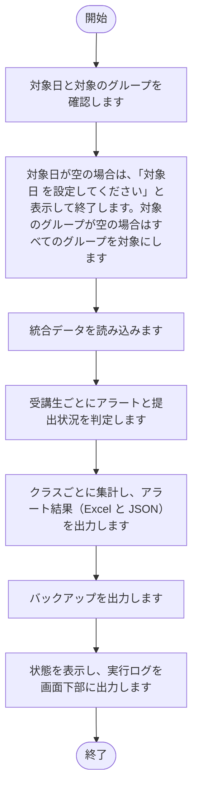

<div class="pagebreak"></div>

### 2.6 実行（アラート集計）[実行（投稿）]
1. 対象日と対象のグループを確認します。
2. 対象日が空の場合は、「対象日 を設定してください」と表示して終了します。対象のグループが空の場合はすべてのグループを対象にします。
3. アラート結果の JSON と Excel を読み込みます。
4. バックアップの Excel を添付ファイルとして用意します。
5. 投稿コメント文言と投稿集計文言を組み立てます。
6. 投稿先のスレッドにコメントを投稿します。
7. 状態を表示し、実行ログを画面下部に出力します。

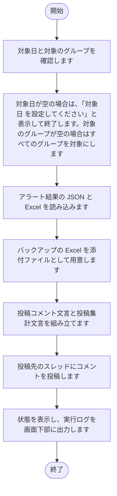

<div class="pagebreak"></div>

### 2.7 ログ[すべて削除]
1. 削除の対象のログファイルがない場合は、「削除対象のログファイルがありません。」と表示して終了します。
2. 削除するかを確認し、「いいえ」を選んだ場合は終了します。
3. ログの出力先の .log ファイルを削除します。
4. ログの表示を更新します。

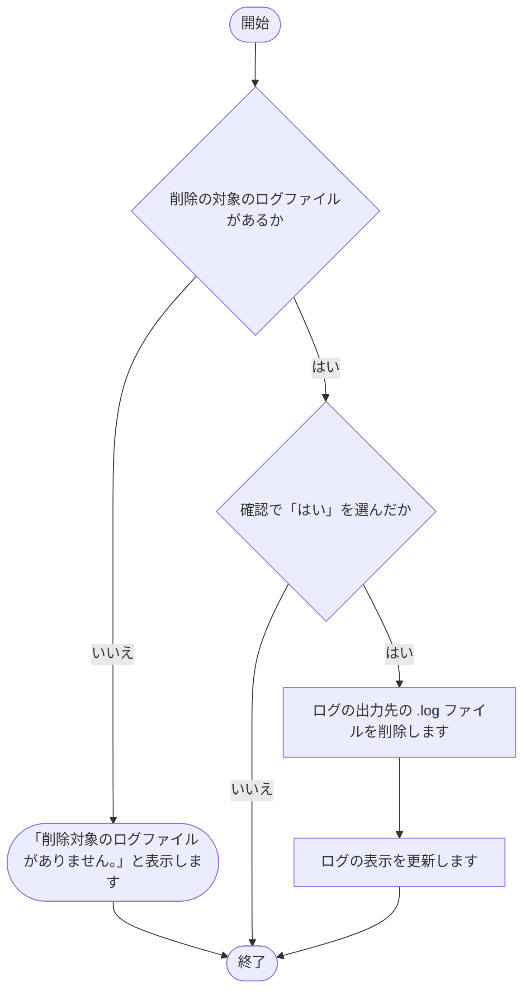

<div class="pagebreak"></div>

### 2.8 環境設定（共通）[保存]
1. 入力された内容を確認します。
2. 入力された内容を、共通の設定ファイルと集計データの列定義に書き込みます。
3. 画面の表示を、保存後の内容に更新します。
4. 状態（保存）を表示します。

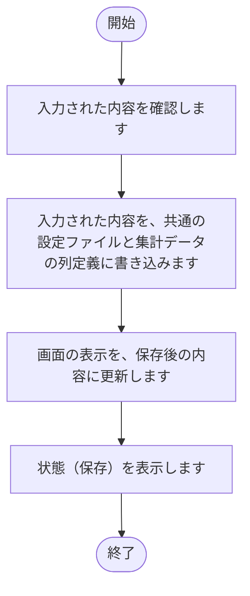

<div class="pagebreak"></div>

### 2.9 環境設定（共通）[再読込]
1. 共通の設定ファイルと集計データの列定義の内容を読み込みます。
2. 読み込んだ内容で、画面の入力欄を表示し直します。
3. 状態（再読込）を表示します。

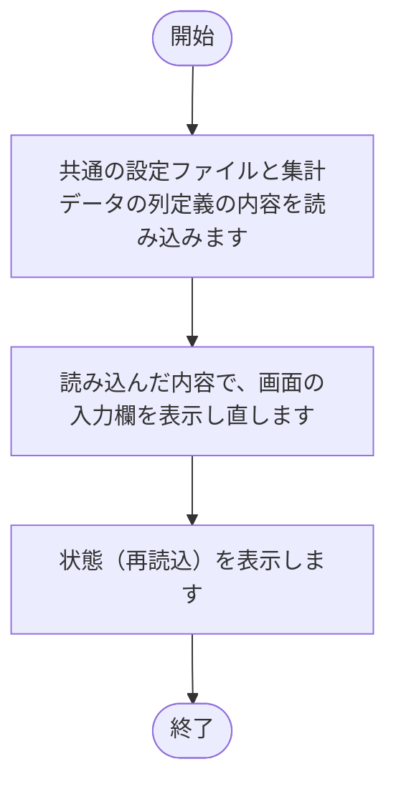

<div class="pagebreak"></div>

### 2.10 環境設定（共通）[削除（アプリデータ集計の列定義）]
1. 削除の対象の行を確認します。
2. 選んだ行を削除します。

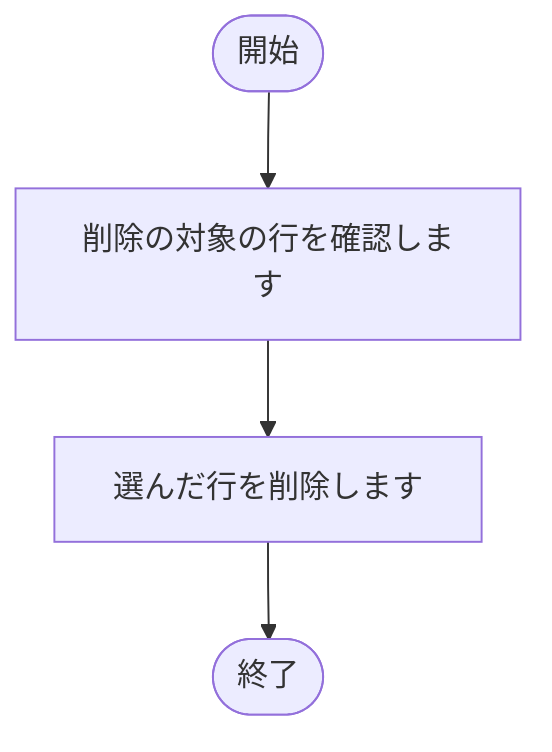

<div class="pagebreak"></div>

### 2.11 環境設定（共通）[追加（アプリデータ集計の列定義）]
1. 表の末尾に、空の行を追加します。
2. 画面の表示を、追加後の内容に更新します。

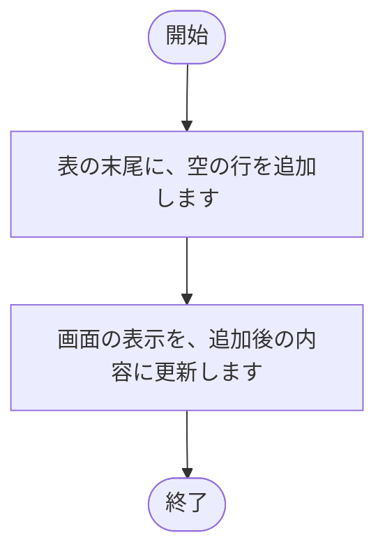

<div class="pagebreak"></div>

### 2.12 環境設定（グループ別）[新規作成]
1. グループ名を入力する画面を表示します。
2. 名前が空のとき、または「キャンセル」を押したときは、何も作らずに閉じます。
3. 入力された名前が既存のグループと重複している場合は、「（入力した名前）は既に存在します。」と表示して終了します。
4. 重複していなければ、新しいグループを一覧に追加して、選んだ状態にします。

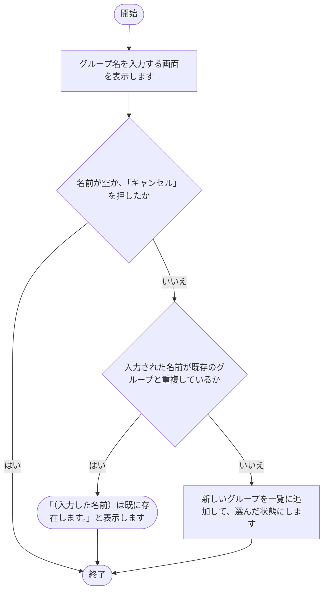

<div class="pagebreak"></div>

### 2.13 環境設定（グループ別）[コピー]
1. 選ばれているグループの設定ファイルが存在するかを確認します。存在しなければ、「コピー元のグループが存在しません。」と表示して終了します。
2. コピー先のグループ名を入力する画面を表示します。
3. 入力された名前が、既存のグループと重複していないかを確認します。
4. 重複している場合は、「（入力した名前）は既に存在します。」と表示して終了します。
5. 重複していなければ、設定ファイルと Excel ファイルをコピーします。
6. コピー先のグループを一覧に追加して選びます。

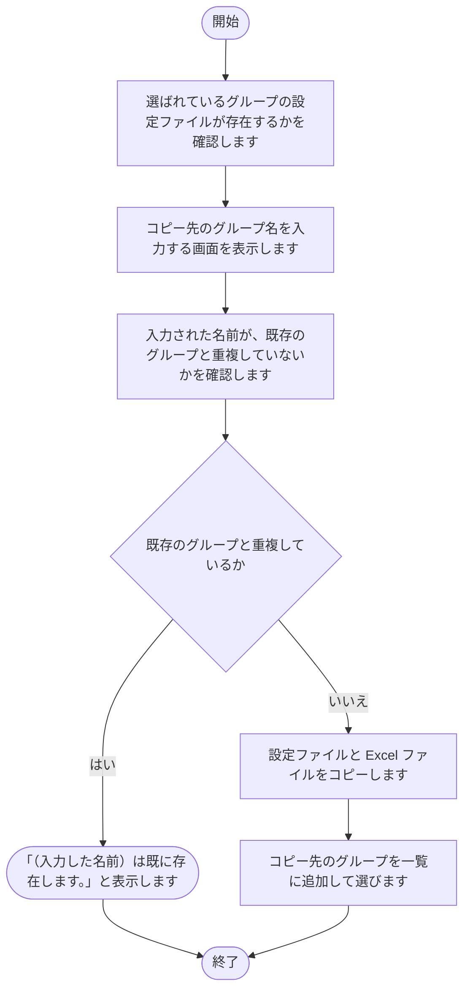

<div class="pagebreak"></div>

### 2.14 環境設定（グループ別）[保存]
1. 入力された内容を確認します。
2. 入力された内容を、対象のグループの設定ファイルに書き込みます。
3. 画面の表示を、保存後の内容に更新します。
4. 状態（保存）を表示します。

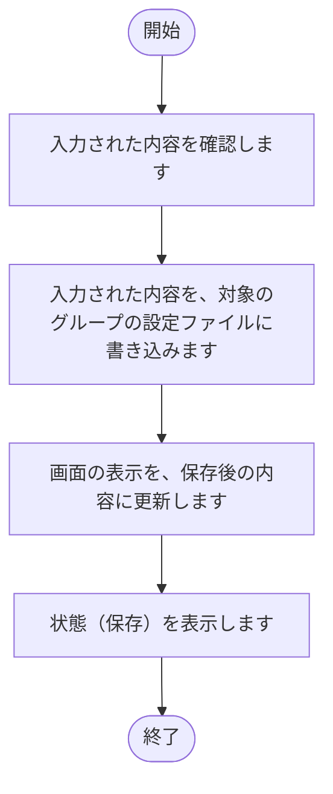

<div class="pagebreak"></div>

### 2.15 環境設定（グループ別）[再読込]
1. 対象のグループの設定ファイルの内容を読み込みます。
2. 読み込んだ内容で、画面の入力欄を表示し直します。
3. 状態（再読込）を表示します。

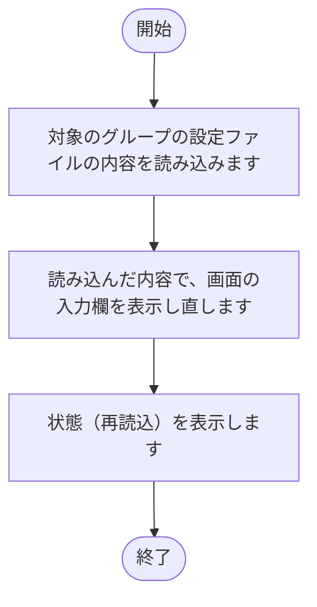

<div class="pagebreak"></div>

### 2.16 環境設定（グループ別）[テスト接続（認証情報）]
1. サブドメイン、ログイン名、パスワードを確認します。
2. サブドメイン、ログイン名、パスワードのいずれかが入力されていない場合は、「サブドメイン・ログイン名・パスワードをすべて入力してください。」と表示し、状態を失敗にして終了します。
3. kintone に接続し、接続できるかを確認します。
4. 状態（認証情報）を表示します。

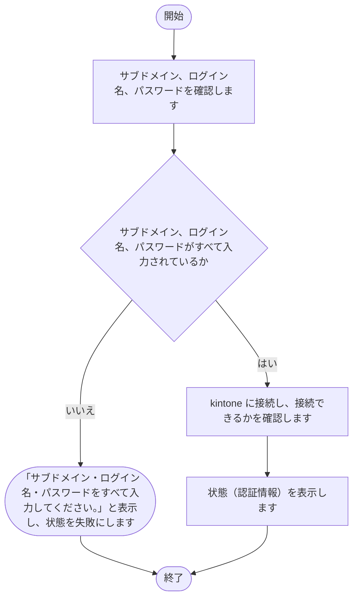

<div class="pagebreak"></div>

### 2.17 環境設定（グループ別）[テスト接続（ユーザー）]
1. 対象アプリID（ユーザー）を確認します。
2. 対象アプリIDが入力されていない場合は、「対象アプリIDを入力してください。」と表示し、状態を失敗にして終了します。
3. kintone のアプリに接続し、接続できるかを確認します。
4. 状態（ユーザー）を表示します。

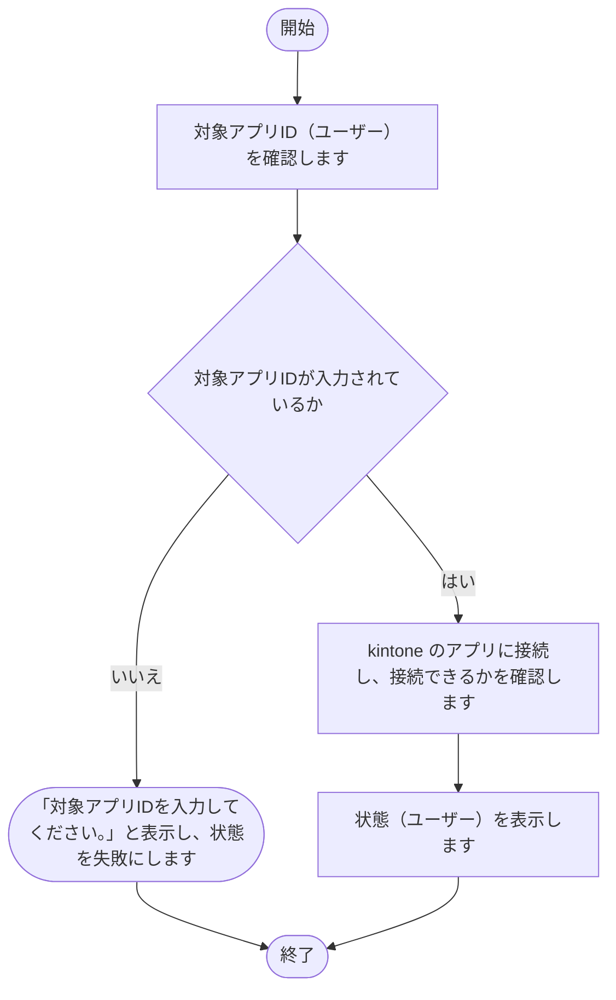

<div class="pagebreak"></div>

### 2.18 環境設定（グループ別）[テスト接続（業務日誌）]
1. 対象アプリID（業務日誌）を確認します。
2. 対象アプリIDが入力されていない場合は、「対象アプリIDを入力してください。」と表示し、状態を失敗にして終了します。
3. kintone のアプリに接続し、接続できるかを確認します。
4. 状態（業務日誌）を表示します。


<div class="pagebreak"></div>

### 2.19 環境設定（グループ別）[テスト接続（パルスサーベイ）]
1. 対象アプリID（パルスサーベイ）を確認します。
2. 対象アプリIDが入力されていない場合は、「対象アプリIDを入力してください。」と表示し、状態を失敗にして終了します。
3. kintone のアプリに接続し、接続できるかを確認します。
4. 状態（パルスサーベイ）を表示します。

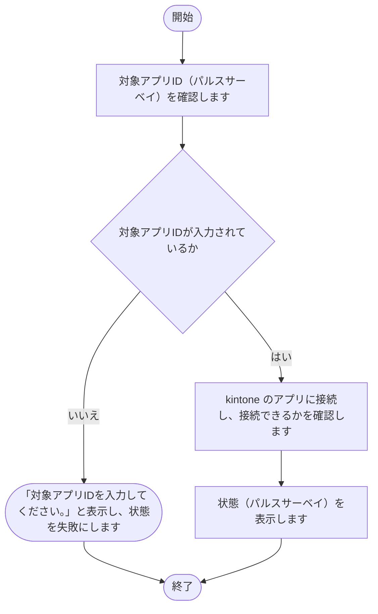

<div class="pagebreak"></div>

### 2.20 環境設定（グループ別）[テスト投稿]
1. 投稿先スペースIDと投稿先スレッドIDを確認します。
2. 投稿先スペースIDまたは投稿先スレッドIDが入力されていない場合は、「スペースID／スレッドIDを入力してください。」と表示し、状態を失敗にして終了します。
3. テスト用のコメントを、投稿先のスレッドに投稿します。
4. 状態（テスト投稿）を表示します。

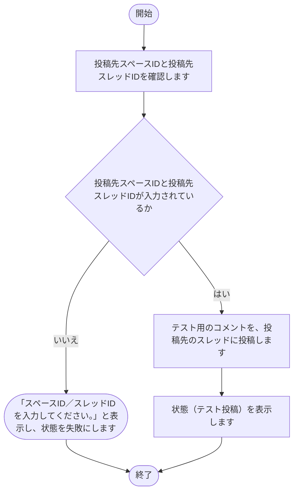

<div class="pagebreak"></div>

### 2.21 環境設定（マスター）[保存]
1. 入力された内容を確認します。
2. 入力された内容を、対象のグループのデータに書き込みます。
3. 画面の表示を、保存後の内容に更新します。
4. 状態（保存）を表示します。

```mermaid
flowchart TD
    S(["開始"])
    E(["終了"])
    N1["入力された内容を確認します"]
    S --> N1
    N2["入力された内容を、対象のグループのデータに書き込みます"]
    N1 --> N2
    N3["画面の表示を、保存後の内容に更新します"]
    N2 --> N3
    N4["状態（保存）を表示します"]
    N3 --> N4
    N4 --> E
```

<div class="pagebreak"></div>

### 2.22 環境設定（マスター）[再読込]
1. 対象のグループのデータを読み込みます。
2. 読み込んだ内容で、画面の表を表示し直します。
3. 状態（再読込）を表示します。

```mermaid
flowchart TD
    S(["開始"])
    E(["終了"])
    N1["対象のグループのデータを読み込みます"]
    S --> N1
    N2["読み込んだ内容で、画面の表を表示し直します"]
    N1 --> N2
    N3["状態（再読込）を表示します"]
    N2 --> N3
    N3 --> E
```

<div class="pagebreak"></div>

### 2.23 環境設定（マスター）[同期実行]
1. 対象のグループを確認します。
2. アプリIDが入力されていない場合は、「対象アプリIDが入力されていません。」と表示し、状態を失敗にして終了します。
3. ユーザーマスターの内容を、受講生一覧のシートに書き込みます。
4. 状態（同期実行）を表示します。

```mermaid
flowchart TD
    S(["開始"])
    E(["終了"])
    N1["対象のグループを確認します"]
    S --> N1
    N2{"アプリIDが入力されているか"}
    X2(["「対象アプリIDが入力されていません。」と表示し、状態を失敗にします"])
    X2 --> E
    N2 -- いいえ --> X2
    N1 --> N2
    N3["ユーザーマスターの内容を、受講生一覧のシートに書き込みます"]
    N2 -- はい --> N3
    N4["状態（同期実行）を表示します"]
    N3 --> N4
    N4 --> E
```

<div class="pagebreak"></div>

### 2.24 環境設定（マスター）[削除（スケジュール）]
1. 削除の対象の行を確認します。
2. 選んだ行を削除します。

```mermaid
flowchart TD
    S(["開始"])
    E(["終了"])
    N1["削除の対象の行を確認します"]
    S --> N1
    N2["選んだ行を削除します"]
    N1 --> N2
    N2 --> E
```

<div class="pagebreak"></div>

### 2.25 環境設定（マスター）[追加（スケジュール）]
1. 表の末尾に、空の行を追加します。
2. 画面の表示を、追加後の内容に更新します。

```mermaid
flowchart TD
    S(["開始"])
    E(["終了"])
    N1["表の末尾に、空の行を追加します"]
    S --> N1
    N2["画面の表示を、追加後の内容に更新します"]
    N1 --> N2
    N2 --> E
```

## 3. 注意事項

- 失敗した処理があっても、後続の処理は実行されます（一括実行）。
- 出力先のファイルを開いたままにすると、書き込みに失敗する可能性があります。
