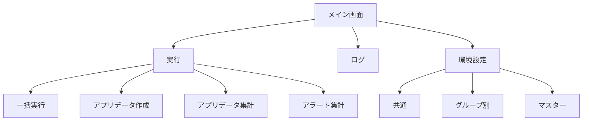

# 画面設計

## 1. 概要

本ツールの操作画面は、1 つのウィンドウに「実行」「ログ」「環境設定」のタブを置いた構成です。本書では、各タブの画面と、その中の項目や操作を示します。

### 1.1 画面の一覧

| 通番 | 画面 | 内容 |
|---|---|---|
| 1 | 実行（一括実行） | 対象日と対象のグループを指定し、選んだ処理をまとめて実行します。 |
| 2 | 実行（アプリデータ作成） | 対象日と対象のグループを指定して、業務日誌とパルスサーベイのデータを作成します。 |
| 3 | 実行（アプリデータ集計） | 対象日と対象のグループを指定して、集計用データを統合します。 |
| 4 | 実行（アラート集計） | 対象日と対象のグループを指定して、アラートの検知と結果の投稿を行います。 |
| 5 | ログ | グループと処理を選び、実行ログを表示します。 |
| 6 | 環境設定（共通） | 基本設定のフォルダ、項目コード、アプリデータ集計の列定義を編集します。 |
| 7 | 環境設定（グループ別） | グループごとの接続情報、投稿先、対象アプリを編集します。 |
| 8 | 環境設定（マスター） | ユーザーの同期とスケジュールを編集します。 |

### 1.2 画面遷移図

- 実行中は、実行の操作（実行ボタン）が使えなくなります。
- 「状態」は、処理の結果を表示するラベルです。表示する文言は、「未実行」（初期表示）、「実行中...」、「成功」、「警告」、「失敗」、「スキップ」（一括実行でチェックを外した処理）です。

## 2. 各画面

### 2.1 実行（一括実行）

| 通番 | 項目 | 種類 | 内容 |
|---|---|---|---|
| 1 | 対象日 | テキスト | 処理の対象日を指定します（yyyy-MM-dd）。既定値は今日の日付を入れます。 |
| 2 | 対象のグループ | コンボボックス | 対象のグループを選びます。 |
| 3 | アプリデータ作成-業務日誌 | チェックボックス | チェックを外すと、この処理をスキップします。 |
| 4 | 状態 | ラベル | 処理の結果を表示します。初期表示は「未実行」と表示します。 |
| 5 | 開く | リンク | 処理の出力先のフォルダを開きます。 |
| 6 | アプリデータ作成-パルスサーベイ | チェックボックス | チェックを外すと、この処理をスキップします。 |
| 7 | 状態 | ラベル | 処理の結果を表示します。初期表示は「未実行」と表示します。 |
| 8 | 開く | リンク | 処理の出力先のフォルダを開きます。 |
| 9 | アプリデータ集計-業務日誌・パルスサーベイ | チェックボックス | チェックを外すと、この処理をスキップします。 |
| 10 | 状態 | ラベル | 処理の結果を表示します。初期表示は「未実行」と表示します。 |
| 11 | 開く | リンク | 処理の出力先のフォルダを開きます。 |
| 12 | アラート集計-業務日誌・パルスサーベイ | チェックボックス | チェックを外すと、この処理をスキップします。 |
| 13 | 状態 | ラベル | 処理の結果を表示します。初期表示は「未実行」と表示します。 |
| 14 | 開く | リンク | 処理の出力先のフォルダを開きます。 |
| 15 | アラート集計-投稿 | チェックボックス | チェックを外すと、この処理をスキップします。 |
| 16 | 状態 | ラベル | 処理の結果を表示します。初期表示は「未実行」と表示します。 |
| 17 | 開く | リンク | 対象のスレッドを開きます。 |
| 18 | 実行 | ボタン | 選んだ処理を順に実行します。 |
| 19 | 状態 | ラベル | 一括実行の結果を表示します。 |

### 2.2 実行（アプリデータ作成）

#### 業務日誌

| 通番 | 項目 | 種類 | 内容 |
|---|---|---|---|
| 1 | 対象日 | テキスト | 処理の対象日を指定します（yyyy-MM-dd）。既定値は今日の日付を入れます。 |
| 2 | 対象のグループ | コンボボックス | 対象のグループを選びます。 |
| 3 | 実行 | ボタン | 業務日誌の集計用データを作成します。 |
| 4 | 状態 | ラベル | 処理の状態を表示します。初期表示は「未実行」と表示します。 |
| 5 | 開く | リンク | 作成したデータのフォルダを開きます。 |

#### パルスサーベイ

| 通番 | 項目 | 種類 | 内容 |
|---|---|---|---|
| 1 | 対象日 | テキスト | 処理の対象日を指定します（yyyy-MM-dd）。既定値は今日の日付を入れます。 |
| 2 | 対象のグループ | コンボボックス | 対象のグループを選びます。 |
| 3 | 実行 | ボタン | パルスサーベイの集計用データを作成します。 |
| 4 | 状態 | ラベル | 処理の状態を表示します。初期表示は「未実行」と表示します。 |
| 5 | 開く | リンク | 作成したデータのフォルダを開きます。 |

### 2.3 実行（アプリデータ集計）

#### 業務日誌・パルスサーベイ

| 通番 | 項目 | 種類 | 内容 |
|---|---|---|---|
| 1 | 対象日 | テキスト | 処理の対象日を指定します（yyyy-MM-dd）。既定値は今日の日付を入れます。 |
| 2 | 対象のグループ | コンボボックス | 対象のグループを選びます。 |
| 3 | 実行 | ボタン | 集計用データを統合します。 |
| 4 | 状態 | ラベル | 処理の状態を表示します。初期表示は「未実行」と表示します。 |
| 5 | 開く | リンク | 統合したデータのフォルダを開きます。 |

### 2.4 実行（アラート集計）

#### 業務日誌・パルスサーベイ

| 通番 | 項目 | 種類 | 内容 |
|---|---|---|---|
| 1 | 対象日 | テキスト | 処理の対象日を指定します（yyyy-MM-dd）。既定値は今日の日付を入れます。 |
| 2 | 対象のグループ | コンボボックス | 対象のグループを選びます。 |
| 3 | 実行 | ボタン | 統合データからアラートや提出状況を検知します。 |
| 4 | 状態 | ラベル | 処理の状態を表示します。初期表示は「未実行」と表示します。 |
| 5 | 開く | リンク | 検知結果のフォルダを開きます。 |

#### 投稿

| 通番 | 項目 | 種類 | 内容 |
|---|---|---|---|
| 1 | 対象日 | テキスト | 処理の対象日を指定します（yyyy-MM-dd）。既定値は今日の日付を入れます。 |
| 2 | 対象のグループ | コンボボックス | 対象のグループを選びます。 |
| 3 | 実行 | ボタン | アラート集計の結果をスレッドに投稿します。 |
| 4 | 状態 | ラベル | 処理の状態を表示します。初期表示は「未実行」と表示します。 |
| 5 | 開く | リンク | 対象のスレッドを開きます。 |

### 2.5 ログ

| 通番 | 項目 | 種類 | 内容 |
|---|---|---|---|
| 1 | 対象のグループ | コンボボックス | 表示するログのグループを選びます。 |
| 2 | すべて削除 | ボタン | ログの出力先の .log ファイルを、確認の後に削除します。 |
| 3 | アプリデータ作成-業務日誌 | ラジオボタン | 表示するログの処理を選びます。 |
| 4 | アプリデータ作成-パルスサーベイ | ラジオボタン | 表示するログの処理を選びます。 |
| 5 | アプリデータ集計-業務日誌・パルスサーベイ | ラジオボタン | 表示するログの処理を選びます。 |
| 6 | アラート集計-業務日誌・パルスサーベイ | ラジオボタン | 表示するログの処理を選びます。 |
| 7 | アラート集計-投稿 | ラジオボタン | 表示するログの処理を選びます。 |
| 8 | マスター同期 | ラジオボタン | 表示するログの処理を選びます。 |
| 9 | ログ | テキストエリア | 選んだグループと処理の実行ログを表示します。 |

### 2.6 環境設定（共通）

| 通番 | 項目 | 種類 | 内容 |
|---|---|---|---|
| 1 | 保存 | ボタン | 入力した内容を保存します。 |
| 2 | 再読込 | ボタン | 保存されている内容を読み込み直します。 |
| 3 | 基本設定 | テキスト | グループデータのフォルダ、テンプレートのフォルダ、ログの出力先、出力のルートフォルダ、各出力先を設定します。各項目に参照ボタンを置きます。 |
| 4 | 業務日誌（共通） | テキスト | 日付フィールドコード、受講生IDフィールドコードを設定します。 |
| 5 | パルスサーベイ（共通） | テキスト | 日付フィールドコード、受講生IDフィールドコードを設定します。 |
| 6 | アプリデータ集計の列定義 | 表 | 「タイプ」「変更前」「変更後」の列で、集計用データの列名の変換を設定します。 |
| 7 | 削除 | ボタン | 表の行を削除します。 |
| 8 | 追加 | ボタン | 表に行を追加します。 |

### 2.7 環境設定（グループ別）

| 通番 | 項目 | 種類 | 内容 |
|---|---|---|---|
| 1 | 対象のグループ | コンボボックス | 対象のグループを選びます。 |
| 2 | 新規作成 | ボタン | 新しいグループを作成します。 |
| 3 | 保存 | ボタン | 入力した内容を保存します。 |
| 4 | 再読込 | ボタン | 保存されている内容を読み込み直します。 |
| 5 | 認証情報 | テキスト | サブドメイン、ログイン名、パスワードを入力します。 |
| 6 | テスト接続（認証情報） | ボタン | 認証情報で kintone に接続できるかを確認します。 |
| 7 | 投稿先 | テキスト | 投稿先スペースID、投稿先スレッドID、メンション対象を入力します。 |
| 8 | 投稿コメント文言 | テキストエリア | 投稿の本文の文言を入力します。 |
| 9 | 投稿集計文言 | テキストエリア | 投稿の要約の文言を入力します。 |
| 10 | テスト投稿（投稿先） | ボタン | テスト用のコメントを投稿して、投稿先を確認します。 |
| 11 | 対象アプリID（ユーザー） | テキスト | ユーザーマスターのアプリIDを入力します。 |
| 12 | テスト接続（ユーザー） | ボタン | ユーザーマスターのアプリIDに接続できるかを確認します。 |
| 13 | 対象アプリID（業務日誌） | テキスト | 業務日誌のアプリIDを入力します。 |
| 14 | テスト接続（業務日誌） | ボタン | 業務日誌のアプリIDに接続できるかを確認します。 |
| 15 | 対象アプリID（パルスサーベイ） | テキスト | パルスサーベイのアプリIDを入力します。 |
| 16 | テスト接続（パルスサーベイ） | ボタン | パルスサーベイのアプリIDに接続できるかを確認します。 |

### 2.8 環境設定（マスター）

| 通番 | 項目 | 種類 | 内容 |
|---|---|---|---|
| 1 | 対象のグループ | コンボボックス | 対象のグループを選びます。 |
| 2 | 開く | リンク | 対象のグループの Excel を開きます。 |
| 3 | 保存 | ボタン | 入力した内容を保存します。 |
| 4 | 再読込 | ボタン | 保存されている内容を読み込み直します。 |
| 5 | 同期実行（ユーザー） | ボタン | ユーザーマスターを受講生一覧に同期します。 |
| 6 | スケジュール | 表 | 通番、科目名、開始日、終了日の列で、科目の日程を編集します。 |
| 7 | 削除 | ボタン | 表の行を削除します。 |
| 8 | 追加 | ボタン | 表に行を追加します。 |
