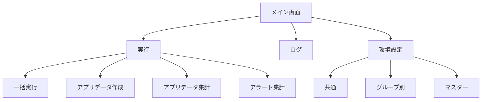
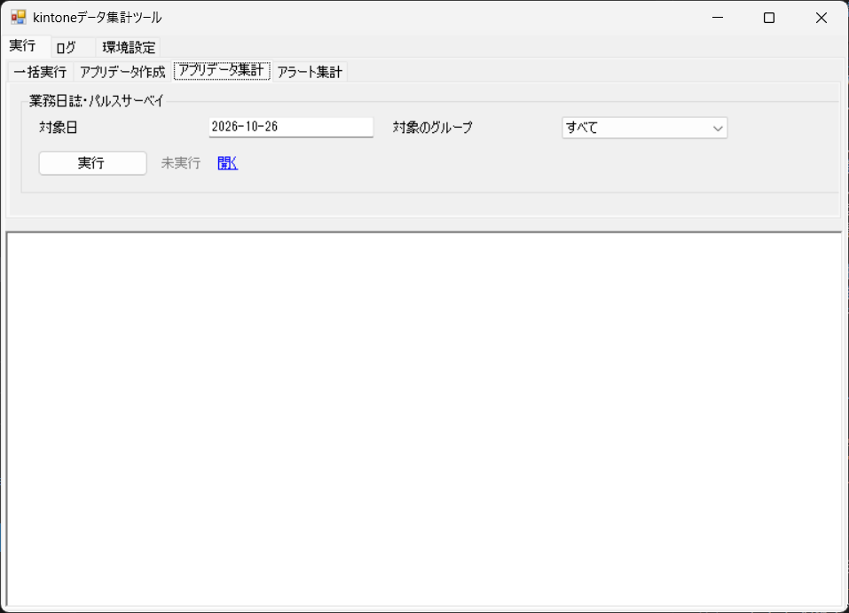
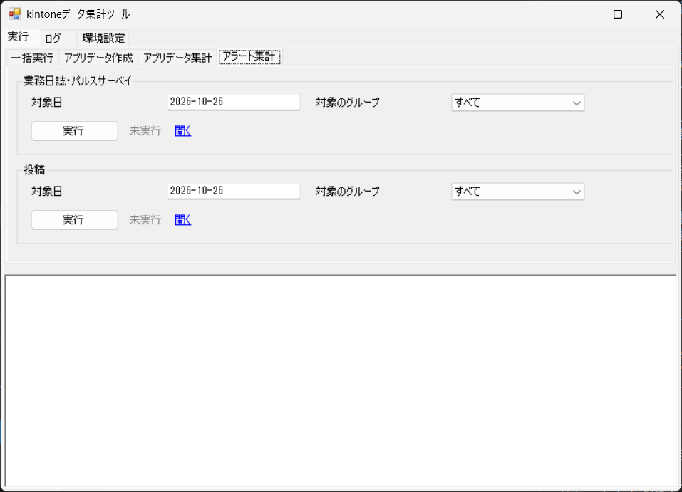
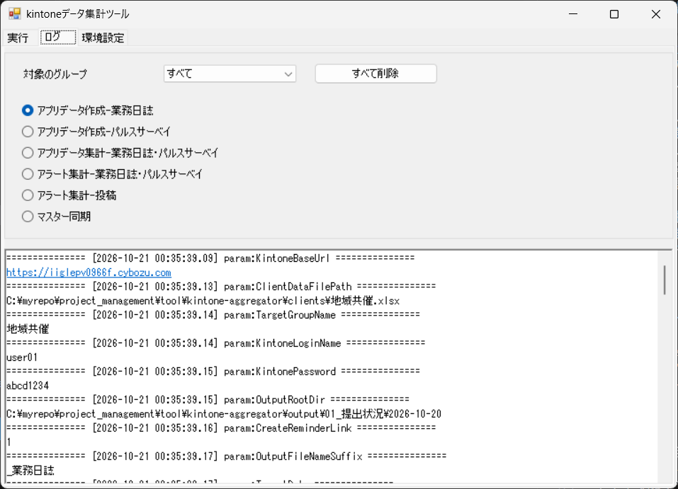
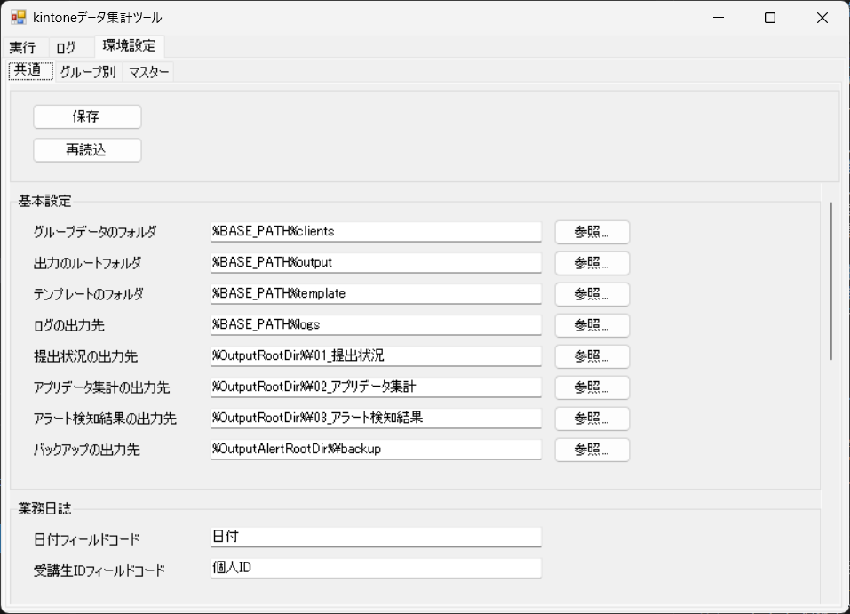
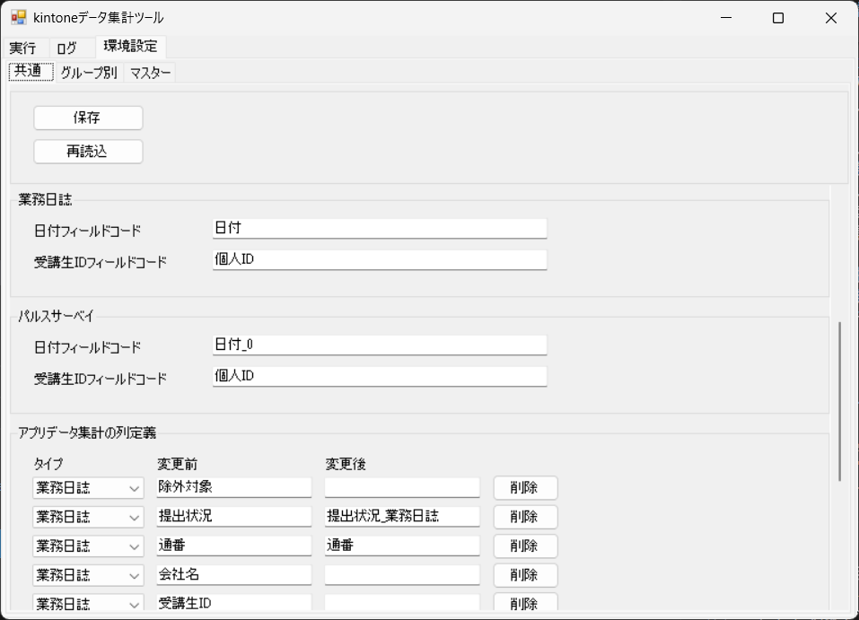
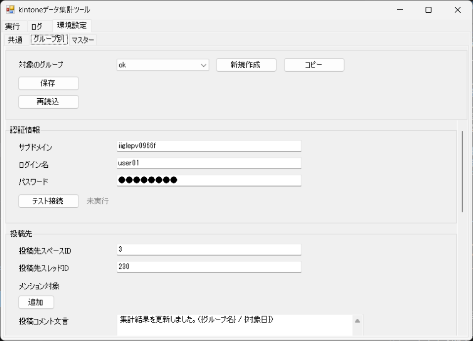
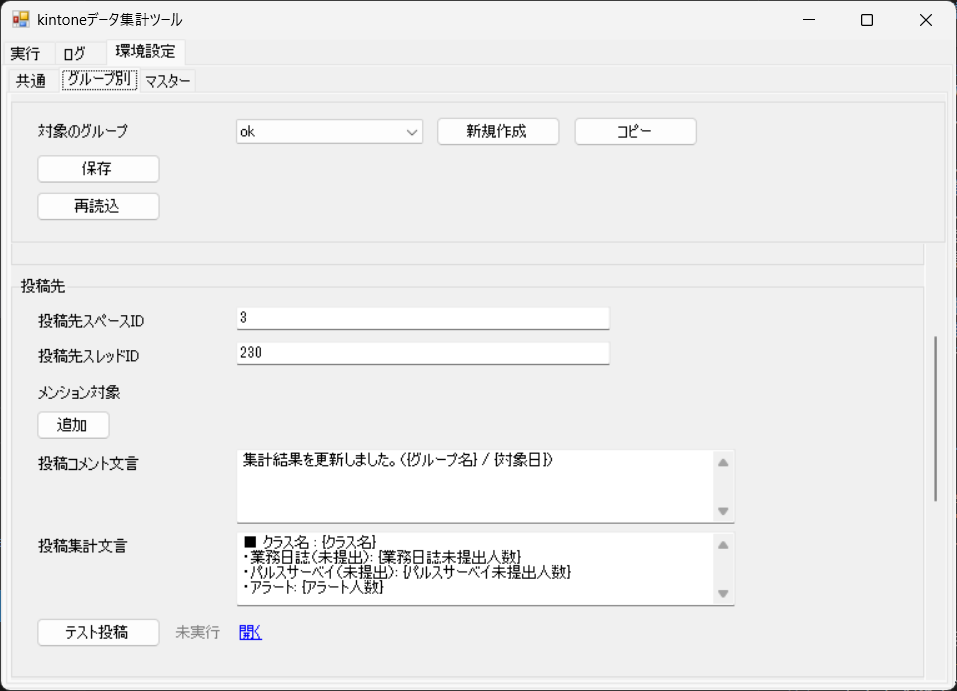
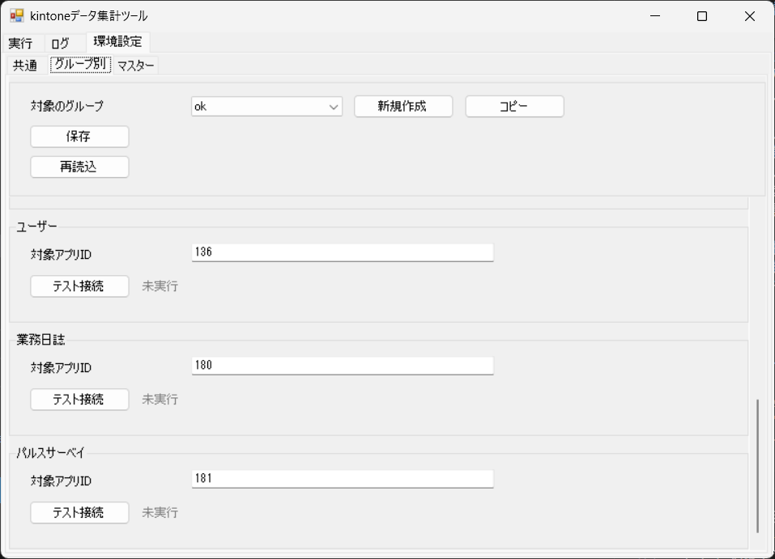

# 画面設計

## 1. 概要

本ツールの操作画面は、1 つのウィンドウに「実行」「ログ」「環境設定」のタブを置いた構成です。本書では、各タブの画面と、その中の項目や操作を示します。

- 画面の一覧

| 通番 | 画面 | 内容 |
|---|---|---|
| 1 | 実行（一括実行） | 対象日と対象のグループを指定し、選んだ処理をまとめて実行します。 |
| 2 | 実行（アプリデータ作成） | 対象日と対象のグループを指定して、業務日誌とパルスサーベイのデータを作成します。 |
| 3 | 実行（アプリデータ集計） | 対象日と対象のグループを指定して、集計用データを統合します。 |
| 4 | 実行（アラート集計） | 対象日と対象のグループを指定して、アラートの検知と結果の投稿を行います。 |
| 5 | ログ | 実行ログを表示し、ログを削除します。 |
| 6 | 環境設定（共通） | 共通の設定を編集します。 |
| 7 | 環境設定（グループ別） | グループごとの設定を編集します。 |
| 8 | 環境設定（マスター） | ユーザーの同期とスケジュールを編集します。 |

## 2. 画面遷移図

- 実行中は、実行の操作（実行ボタン）が使えなくなります。
- 「状態」は、処理の結果を表示するラベルです。表示する文言は、「未実行」（初期表示）、「実行中...」、「成功」、「警告」、「失敗」、「スキップ」（一括実行でチェックを外した処理）、「完了」（保存・再読込の結果）です。

## 3. 各画面

### 3.1 実行（一括実行）

#### 一括実行

  

| 通番 | 項目 | 種類 | 内容 |
|---|---|---|---|
| 1 | 対象日 | テキスト | 処理の対象日を指定します（yyyy-MM-dd）。既定値は今日の日付を入れます。 |
| 2 | 対象のグループ | コンボボックス | 対象のグループを選びます。 |
| 3 | アプリデータ作成-業務日誌 | チェックボックス | 処理を実行するかを選びます。チェックを外した処理はスキップします。 |
| 4 | 状態（アプリデータ作成-業務日誌） | ラベル | アプリデータ作成-業務日誌の結果を表示します。 |
| 5 | 開く（アプリデータ作成-業務日誌） | リンク | 処理の出力先のフォルダを開きます。 |
| 6 | アプリデータ作成-パルスサーベイ | チェックボックス | 処理を実行するかを選びます。チェックを外した処理はスキップします。 |
| 7 | 状態（アプリデータ作成-パルスサーベイ） | ラベル | アプリデータ作成-パルスサーベイの結果を表示します。 |
| 8 | 開く（アプリデータ作成-パルスサーベイ） | リンク | 処理の出力先のフォルダを開きます。 |
| 9 | アプリデータ集計-業務日誌・パルスサーベイ | チェックボックス | 処理を実行するかを選びます。チェックを外した処理はスキップします。 |
| 10 | 状態（アプリデータ集計-業務日誌・パルスサーベイ） | ラベル | アプリデータ集計-業務日誌・パルスサーベイの結果を表示します。 |
| 11 | 開く（アプリデータ集計-業務日誌・パルスサーベイ） | リンク | 処理の出力先のフォルダを開きます。 |
| 12 | アラート集計-業務日誌・パルスサーベイ | チェックボックス | 処理を実行するかを選びます。チェックを外した処理はスキップします。 |
| 13 | 状態（アラート集計-業務日誌・パルスサーベイ） | ラベル | アラート集計-業務日誌・パルスサーベイの結果を表示します。 |
| 14 | 開く（アラート集計-業務日誌・パルスサーベイ） | リンク | 処理の出力先のフォルダを開きます。 |
| 15 | アラート集計-投稿 | チェックボックス | 処理を実行するかを選びます。チェックを外した処理はスキップします。 |
| 16 | 状態（アラート集計-投稿） | ラベル | アラート集計-投稿の結果を表示します。 |
| 17 | 開く（アラート集計-投稿） | リンク | 対象のスレッドを開きます。 |
| 18 | 実行 | ボタン | 選んだ処理を順に実行します。 |
| 19 | 状態 | ラベル | 一括実行の全体の結果を表示します。 |
| 20 | ログ | テキストエリア | 実行結果のログを表示します。 |

### 3.2 実行（アプリデータ作成）

#### 業務日誌

  

| 通番 | 項目 | 種類 | 内容 |
|---|---|---|---|
| 1 | 対象日 | テキスト | 処理の対象日を指定します（yyyy-MM-dd）。既定値は今日の日付を入れます。 |
| 2 | 対象のグループ | コンボボックス | 対象のグループを選びます。 |
| 3 | 実行（業務日誌） | ボタン | 業務日誌の集計用データを作成します。 |
| 4 | 状態（業務日誌） | ラベル | 処理の結果を表示します。 |
| 5 | 開く（業務日誌） | リンク | 出力先のフォルダを開きます。 |
| 6 | ログ | テキストエリア | 実行結果のログを表示します。 |

#### パルスサーベイ

  

| 通番 | 項目 | 種類 | 内容 |
|---|---|---|---|
| 1 | 対象日 | テキスト | 処理の対象日を指定します（yyyy-MM-dd）。既定値は今日の日付を入れます。 |
| 2 | 対象のグループ | コンボボックス | 対象のグループを選びます。 |
| 3 | 実行（パルスサーベイ） | ボタン | パルスサーベイの集計用データを作成します。 |
| 4 | 状態（パルスサーベイ） | ラベル | 処理の結果を表示します。 |
| 5 | 開く（パルスサーベイ） | リンク | 出力先のフォルダを開きます。 |
| 6 | ログ | テキストエリア | 実行結果のログを表示します。 |

### 3.3 実行（アプリデータ集計）

#### 業務日誌・パルスサーベイ

  

| 通番 | 項目 | 種類 | 内容 |
|---|---|---|---|
| 1 | 対象日 | テキスト | 処理の対象日を指定します（yyyy-MM-dd）。既定値は今日の日付を入れます。 |
| 2 | 対象のグループ | コンボボックス | 対象のグループを選びます。 |
| 3 | 実行 | ボタン | 集計用データを統合します。 |
| 4 | 状態 | ラベル | 処理の結果を表示します。 |
| 5 | 開く | リンク | 統合したデータのフォルダを開きます。 |
| 6 | ログ | テキストエリア | 実行結果のログを表示します。 |

### 3.4 実行（アラート集計）

#### 業務日誌・パルスサーベイ

  

| 通番 | 項目 | 種類 | 内容 |
|---|---|---|---|
| 1 | 対象日 | テキスト | 処理の対象日を指定します（yyyy-MM-dd）。既定値は今日の日付を入れます。 |
| 2 | 対象のグループ | コンボボックス | 対象のグループを選びます。 |
| 3 | 実行（業務日誌・パルスサーベイ） | ボタン | 統合データからアラートや提出状況を検知します。 |
| 4 | 状態（業務日誌・パルスサーベイ） | ラベル | 処理の結果を表示します。 |
| 5 | 開く（業務日誌・パルスサーベイ） | リンク | 出力先のフォルダを開きます。 |
| 6 | ログ | テキストエリア | 実行結果のログを表示します。 |

#### 投稿

  

| 通番 | 項目 | 種類 | 内容 |
|---|---|---|---|
| 1 | 対象日 | テキスト | 処理の対象日を指定します（yyyy-MM-dd）。既定値は今日の日付を入れます。 |
| 2 | 対象のグループ | コンボボックス | 対象のグループを選びます。 |
| 3 | 実行（投稿） | ボタン | アラート集計の結果をスレッドに投稿します。 |
| 4 | 状態（投稿） | ラベル | 処理の結果を表示します。 |
| 5 | 開く（投稿） | リンク | 対象のスレッドを開きます。 |
| 6 | ログ | テキストエリア | 実行結果のログを表示します。 |

### 3.5 ログ

  

| 通番 | 項目 | 種類 | 内容 |
|---|---|---|---|
| 1 | 対象のグループ | コンボボックス | 表示するログのグループを選びます。 |
| 2 | すべて削除 | ボタン | ログの出力先の .log ファイルを削除します。削除の前に確認を求めます。 |
| 3 | アプリデータ作成-業務日誌 | ラジオボタン | 表示するログの処理を選びます。 |
| 4 | アプリデータ作成-パルスサーベイ | ラジオボタン | 表示するログの処理を選びます。 |
| 5 | アプリデータ集計-業務日誌・パルスサーベイ | ラジオボタン | 表示するログの処理を選びます。 |
| 6 | アラート集計-業務日誌・パルスサーベイ | ラジオボタン | 表示するログの処理を選びます。 |
| 7 | アラート集計-投稿 | ラジオボタン | 表示するログの処理を選びます。 |
| 8 | マスター同期 | ラジオボタン | 表示するログの処理を選びます。 |
| 9 | ログ | テキストエリア | 選んだグループと処理の実行結果のログを表示します。 |

### 3.6 環境設定（共通）

#### ヘッダー

  

| 通番 | 項目 | 種類 | 内容 |
|---|---|---|---|
| 1 | 保存 | ボタン | 入力した内容を保存します。 |
| 2 | 状態（保存） | ラベル | 保存の結果を表示します。 |
| 3 | 再読込 | ボタン | 保存されている内容を読み込み直します。 |
| 4 | 状態（再読込） | ラベル | 再読込の結果を表示します。 |

#### 基本設定

  

| 通番 | 項目 | 種類 | 内容 |
|---|---|---|---|
| 1 | グループデータのフォルダ | テキスト | グループごとのデータを置くフォルダを入力します。 |
| 2 | 出力のルートフォルダ | テキスト | 処理の出力を置くフォルダを入力します。 |
| 3 | テンプレートのフォルダ | テキスト | テンプレートファイルを置くフォルダを入力します。 |
| 4 | ログの出力先 | テキスト | 実行ログを出力するフォルダを入力します。 |
| 5 | 提出状況の出力先 | テキスト | 業務日誌の集計用データを出力するフォルダを入力します。 |
| 6 | アプリデータ集計の出力先 | テキスト | 統合データを出力するフォルダを入力します。 |
| 7 | アラート検知結果の出力先 | テキスト | アラート結果（Excel と JSON）を出力するフォルダを入力します。 |
| 8 | バックアップの出力先 | テキスト | バックアップを出力するフォルダを入力します。 |

#### 業務日誌

  

| 通番 | 項目 | 種類 | 内容 |
|---|---|---|---|
| 1 | 日付フィールドコード | テキスト | 業務日誌の日付を表すフィールドのコードを入力します。 |
| 2 | 受講生IDフィールドコード | テキスト | 業務日誌の受講生IDを表すフィールドのコードを入力します。 |

#### パルスサーベイ

  

| 通番 | 項目 | 種類 | 内容 |
|---|---|---|---|
| 1 | 日付フィールドコード | テキスト | パルスサーベイの日付を表すフィールドのコードを入力します。 |
| 2 | 受講生IDフィールドコード | テキスト | パルスサーベイの受講生IDを表すフィールドのコードを入力します。 |

#### アプリデータ集計の列定義

  

| 通番 | 項目 | 種類 | 内容 |
|---|---|---|---|
| 1 | アプリデータ集計の列定義 | 表 | `collect-data-defs.json` の内容を表示し、編集します。kintone の項目名と、集計用データの項目名の対応を設定します。 |
| 2 | 削除（アプリデータ集計の列定義） | ボタン | 各行の「削除」を押すと、その行を削除します。 |
| 3 | 追加（アプリデータ集計の列定義） | ボタン | 表の末尾に、空の行を追加します。 |

### 3.7 環境設定（グループ別）

#### ヘッダー

  

| 通番 | 項目 | 種類 | 内容 |
|---|---|---|---|
| 1 | 対象のグループ | コンボボックス | 対象のグループを選びます。 |
| 2 | 新規作成 | ボタン | 新しいグループを作成します。 |
| 3 | コピー | ボタン | 既存のグループの設定をコピーして、新しいグループを作成します。 |
| 4 | 保存 | ボタン | 入力した内容を保存します。 |
| 5 | 状態（保存） | ラベル | 保存の結果を表示します。 |
| 6 | 再読込 | ボタン | 保存されている内容を読み込み直します。 |
| 7 | 状態（再読込） | ラベル | 再読込の結果を表示します。 |

#### 認証情報

  

| 通番 | 項目 | 種類 | 内容 |
|---|---|---|---|
| 1 | サブドメイン | テキスト | kintone のサブドメインを入力します。 |
| 2 | ログイン名 | テキスト | kintone にログインするための名前を入力します。 |
| 3 | パスワード | テキスト | kintone にログインするためのパスワードを入力します。 |
| 4 | テスト接続（認証情報） | ボタン | kintone に接続できるかを確認します。 |
| 5 | 状態（認証情報） | ラベル | テスト接続の結果を表示します。 |

#### 投稿先

  

| 通番 | 項目 | 種類 | 内容 |
|---|---|---|---|
| 1 | 投稿先スペースID | テキスト | 投稿先の kintone スペースのIDを入力します。 |
| 2 | 投稿先スレッドID | テキスト | 投稿先のスレッドのIDを入力します。 |
| 3 | メンション対象 | 表 | メンションする対象を、種類（USER など）とコードの組で一覧にして設定します。 |
| 4 | 追加（メンション対象） | ボタン | メンション対象の行を追加します。 |
| 5 | 削除（メンション対象） | ボタン | 各行の「削除」を押すと、その行を削除します。 |
| 6 | 投稿コメント文言 | テキストエリア | 投稿するコメントの文言を入力します。 |
| 7 | 投稿集計文言 | テキストエリア | 集計結果の投稿に使う文言を入力します。 |
| 8 | テスト投稿 | ボタン | テスト用のコメントを、投稿先のスレッドに投稿します。 |
| 9 | 状態（テスト投稿） | ラベル | テスト投稿の結果を表示します。 |
| 10 | 開く | リンク | 投稿先のスレッドを開きます。 |

#### ユーザー

  

| 通番 | 項目 | 種類 | 内容 |
|---|---|---|---|
| 1 | 対象アプリID（ユーザー） | テキスト | 接続するアプリのIDを入力します。 |
| 2 | テスト接続（ユーザー） | ボタン | kintone のアプリに接続できるかを確認します。 |
| 3 | 状態（ユーザー） | ラベル | テスト接続の結果を表示します。 |

#### 業務日誌

  

| 通番 | 項目 | 種類 | 内容 |
|---|---|---|---|
| 1 | 対象アプリID（業務日誌） | テキスト | 接続するアプリのIDを入力します。 |
| 2 | テスト接続（業務日誌） | ボタン | kintone のアプリに接続できるかを確認します。 |
| 3 | 状態（業務日誌） | ラベル | テスト接続の結果を表示します。 |

#### パルスサーベイ

  

| 通番 | 項目 | 種類 | 内容 |
|---|---|---|---|
| 1 | 対象アプリID（パルスサーベイ） | テキスト | 接続するアプリのIDを入力します。 |
| 2 | テスト接続（パルスサーベイ） | ボタン | kintone のアプリに接続できるかを確認します。 |
| 3 | 状態（パルスサーベイ） | ラベル | テスト接続の結果を表示します。 |

### 3.8 環境設定（マスター）

#### ヘッダー

  

| 通番 | 項目 | 種類 | 内容 |
|---|---|---|---|
| 1 | 対象のグループ | コンボボックス | 対象のグループを選びます。 |
| 2 | 開く | リンク | 対象のグループの Excel を開きます。 |
| 3 | 保存 | ボタン | 入力した内容を保存します。 |
| 4 | 状態（保存） | ラベル | 保存の結果を表示します。 |
| 5 | 再読込 | ボタン | 保存されている内容を読み込み直します。 |
| 6 | 状態（再読込） | ラベル | 再読込の結果を表示します。 |

#### ユーザー

  

| 通番 | 項目 | 種類 | 内容 |
|---|---|---|---|
| 1 | 同期実行 | ボタン | ユーザーマスターの内容を、受講生一覧のシートに書き込みます。 |
| 2 | 状態（同期実行） | ラベル | 同期実行の結果を表示します。 |

#### スケジュール

  

| 通番 | 項目 | 種類 | 内容 |
|---|---|---|---|
| 1 | スケジュール | 表 | 通番、科目名、開始日、終了日の列で、スケジュールを表示し、編集します。 |
| 2 | 削除（スケジュール） | ボタン | 各行の「削除」を押すと、その行を削除します。 |
| 3 | 追加（スケジュール） | ボタン | 表の末尾に、空の行を追加します。 |
