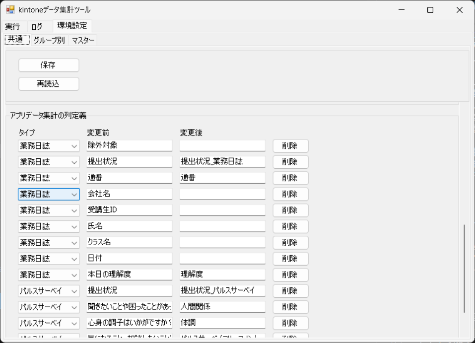
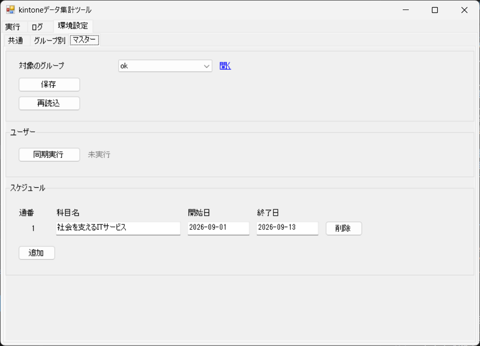
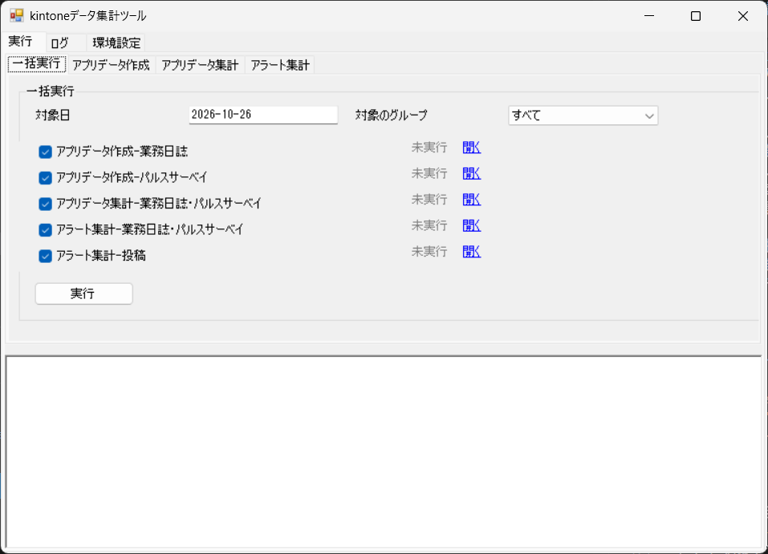
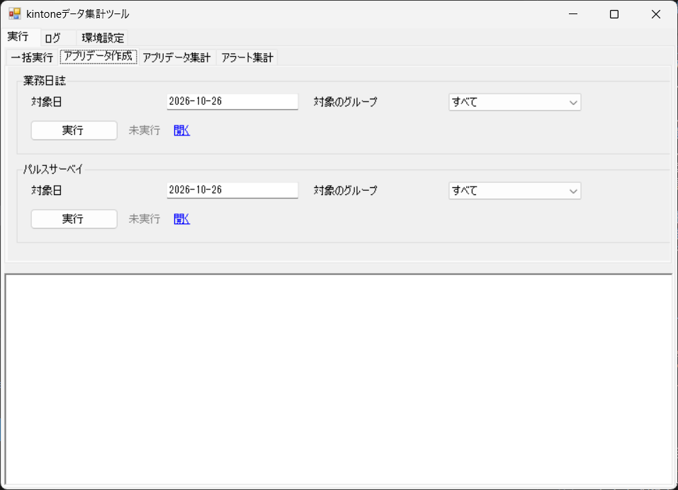

# 操作マニュアル

## 1. 目的と対象

　対象は、kintoneデータ集計ツール（業務日誌とパルスサーベイを集計し、アラートを投稿するツール）です。 
　ツールの画面の操作と、日々の集計の確認方法を説明します。

## 2. 画面の構成

　ツールの画面は、次のタブで構成されています。

- 画面の一覧

| 通番 | メインタブ名 | サブタブ名 | 内容 |
|---|---|---|---|
| 1 | 実行 | 一括実行 | 対象日とグループを指定して、選んだ処理をまとめて実行します。 |
| 2 | 実行 | アプリデータ作成 | 業務日誌とパルスサーベイのレコードから、集計用データを作ります。 |
| 3 | 実行 | アプリデータ集計 | 業務日誌とパルスサーベイの集計用データを統合します。 |
| 4 | 実行 | アラート集計 | 統合データからアラート結果を作り、kintone のスレッドに投稿します。 |
| 5 | ログ |  | 実行結果を確認します。 |
| 6 | 環境設定 | 共通 | ツール全体で使うフォルダと、フィールドコードを設定します。 |
| 7 | 環境設定 | グループ別 | グループごとの接続情報と、対象のアプリを設定します。 |
| 8 | 環境設定 | マスター | ユーザーマスターの同期と、スケジュールを編集します。 |

## 3. 初期設定

　環境設定の「共通」「グループ別」「マスター」の各タブで、ツールの設定を行います。

### 3.1 共通

　環境設定の「共通」タブで、「基本設定」の項目を設定します。

  

  

#### 項目

| 通番 | 区分 | 項目 | 種類 | 内容 |
|---|---|---|---|---|
| 1 | 共通 | 保存 | ボタン | 設定を保存します。 |
| 2 | 共通 | 状態（保存） | 表示 | 保存の状態を表示します。 |
| 3 | 共通 | 再読込 | ボタン | 保存した内容を読み直します。 |
| 4 | 共通 | 状態（再読込） | 表示 | 再読込の状態を表示します。 |
| 5 | 基本設定 | グループデータのフォルダ | 入力欄 | グループの設定ファイルとマスター定義ファイルを置くフォルダを指定します。 |
| 6 | 基本設定 | 出力のルートフォルダ | 入力欄 | 集計の結果を出力するフォルダのもとになるフォルダを指定します。 |
| 7 | 基本設定 | テンプレートのフォルダ | 入力欄 | アラート結果の出力テンプレートを置くフォルダを指定します。 |
| 8 | 基本設定 | ログの出力先 | 入力欄 | 実行結果のログを保存するフォルダを指定します。 |
| 9 | 基本設定 | 提出状況の出力先 | 入力欄 | 提出状況を出力するフォルダを指定します。 |
| 10 | 基本設定 | アプリデータ集計の出力先 | 入力欄 | 集計用データを出力するフォルダを指定します。 |
| 11 | 基本設定 | アラート検知結果の出力先 | 入力欄 | アラート結果を出力するフォルダを指定します。 |
| 12 | 基本設定 | バックアップの出力先 | 入力欄 | アラート結果のバックアップを保存するフォルダを指定します。 |
| 13 | 業務日誌 | 日付フィールドコード | 入力欄 | kintone のアプリで、日付を入れている項目のコードを入力します。 |
| 14 | 業務日誌 | 受講生IDフィールドコード | 入力欄 | kintone のアプリで、受講生 ID を入れている項目のコードを入力します。 |
| 15 | パルスサーベイ | 日付フィールドコード | 入力欄 | kintone のアプリで、日付を入れている項目のコードを入力します。 |
| 16 | パルスサーベイ | 受講生IDフィールドコード | 入力欄 | kintone のアプリで、受講生 ID を入れている項目のコードを入力します。 |
| 17 | アプリデータ集計の列定義 | タイプ | プルダウン | 集計するデータの種類を選びます。 |
| 18 | アプリデータ集計の列定義 | 変更前 | 入力欄 | kintone の項目名を入力します。 |
| 19 | アプリデータ集計の列定義 | 変更後 | 入力欄 | 集計用データの項目名を入力します。 |
| 20 | アプリデータ集計の列定義 | 削除 | ボタン | 各行の「削除」を押すと、その行を削除します。 |
| 21 | アプリデータ集計の列定義 | 追加 | ボタン | 表の末尾に、空の行を追加します。 |

#### 操作方法

1. 「アプリデータ集計の列定義」の表で、必要な行を「追加」で増やします。
2. 行の「タイプ」「変更前」「変更後」を入力します。
3. 不要な行は、行の「削除」を押して削除します。
4. 設定を変えたら、「保存」を押します。
   - 保存した内容を読み直すときは、「再読込」を押します。

### 3.2 グループ別

　環境設定の「グループ別」タブで、グループごとの接続情報と、対象のアプリを設定します。

  

#### 項目

| 通番 | 区分 | 項目 | 種類 | 内容 |
|---|---|---|---|---|
| 1 | 共通 | 対象のグループ | プルダウン | 設定するグループを選びます。 |
| 2 | 共通 | 新規作成 | ボタン | 新しいグループを作ります。 |
| 3 | 共通 | コピー | ボタン | 対象のグループをもとに、新しいグループを作ります。 |
| 4 | 共通 | 保存 | ボタン | 設定を保存します。 |
| 5 | 共通 | 状態（保存） | 表示 | 保存の状態を表示します。 |
| 6 | 共通 | 再読込 | ボタン | 保存した内容を読み直します。 |
| 7 | 共通 | 状態（再読込） | 表示 | 再読込の状態を表示します。 |
| 8 | 認証情報 | サブドメイン | 入力欄 | kintone のサブドメインを入力します。 |
| 9 | 認証情報 | ログイン名 | 入力欄 | kintone にログインするための名前を入力します。 |
| 10 | 認証情報 | パスワード | 入力欄 | kintone にログインするためのパスワードを入力します。 |
| 11 | 認証情報 | テスト接続（認証情報） | ボタン | kintone に接続できるかを確認します。 |
| 12 | 認証情報 | 状態（テスト接続（認証情報）） | 表示 | テスト接続の状態を表示します。 |
| 13 | 投稿先 | 投稿先スペースID | 入力欄 | 投稿先のスペースの ID を入力します。 |
| 14 | 投稿先 | 投稿先スレッドID | 入力欄 | アラート結果を投稿するスレッドの ID を入力します。 |
| 15 | 投稿先 | メンション対象 | 表示 | 投稿するときにメンションする人を指定します。 |
| 16 | 投稿先 | 追加 | ボタン | メンションする人を追加します。 |
| 17 | 投稿先 | 削除 | ボタン | 各行の「削除」を押すと、その行を削除します。 |
| 18 | 投稿先 | 投稿コメント文言 | 入力欄 | 投稿するコメントの文言を入力します。 |
| 19 | 投稿先 | 投稿集計文言 | 入力欄 | 投稿するコメントに入る集計の文言を入力します。 |
| 20 | 投稿先 | テスト投稿 | ボタン | 投稿集計文言を使ったテスト用のコメントを、投稿先のスレッドに投稿します。 |
| 21 | 投稿先 | 状態（テスト投稿） | 表示 | テスト投稿の状態を表示します。 |
| 22 | ユーザー | 対象アプリID | 入力欄 | ユーザーマスターのアプリの ID を入力します。 |
| 23 | ユーザー | テスト接続（ユーザー） | ボタン | ユーザーマスターのアプリに接続できるかを確認します。 |
| 24 | ユーザー | 状態（テスト接続（ユーザー）） | 表示 | テスト接続の状態を表示します。 |
| 25 | 業務日誌 | 対象アプリID | 入力欄 | 業務日誌のアプリの ID を入力します。 |
| 26 | 業務日誌 | テスト接続（業務日誌） | ボタン | 業務日誌のアプリに接続できるかを確認します。 |
| 27 | 業務日誌 | 状態（テスト接続（業務日誌）） | 表示 | テスト接続の状態を表示します。 |
| 28 | パルスサーベイ | 対象アプリID | 入力欄 | パルスサーベイのアプリの ID を入力します。 |
| 29 | パルスサーベイ | テスト接続（パルスサーベイ） | ボタン | パルスサーベイのアプリに接続できるかを確認します。 |
| 30 | パルスサーベイ | 状態（テスト接続（パルスサーベイ）） | 表示 | テスト接続の状態を表示します。 |

#### 操作方法

1. 「対象のグループ」で、設定するグループを選びます。
   - 「新規作成」「コピー」を押すと、グループを作れます。
2. 「認証情報」の「テスト接続（認証情報）」を押します。
   - kintone に接続できるかを確認します。
3. 「ユーザー」の「テスト接続（ユーザー）」を押します。
   - ユーザーマスターのアプリに接続できるかを確認します。
4. 「業務日誌」の「テスト接続（業務日誌）」を押します。
   - 業務日誌のアプリに接続できるかを確認します。
5. 「パルスサーベイ」の「テスト接続（パルスサーベイ）」を押します。
   - パルスサーベイのアプリに接続できるかを確認します。
6. 設定を変えたら、「保存」を押します。

> 注意
> - 「テスト投稿」は kintone のスレッドに投稿されます。投稿先のスレッドを確認してから押してください。

### 3.3 マスター

　環境設定の「マスター」タブで、ユーザーマスターの同期と、スケジュールの編集を行います。

  

#### 項目

| 通番 | 区分 | 項目 | 種類 | 内容 |
|---|---|---|---|---|
| 1 | 共通 | 対象のグループ | プルダウン | 設定するグループを選びます。 |
| 2 | 共通 | 開く（マスター定義ファイル） | リンク | マスター定義ファイルを開きます。 |
| 3 | 共通 | 保存 | ボタン | 設定を保存します。 |
| 4 | 共通 | 状態（保存） | 表示 | 保存の状態を表示します。 |
| 5 | 共通 | 再読込 | ボタン | 保存した内容を読み直します。 |
| 6 | 共通 | 状態（再読込） | 表示 | 再読込の状態を表示します。 |
| 7 | ユーザー | 同期実行 | ボタン | ユーザーマスターの内容を、受講生一覧のシートに書き込みます。 |
| 8 | ユーザー | 状態（同期実行） | 表示 | 同期実行の状態を表示します。 |
| 9 | スケジュール | 通番 | 表示 | 科目ごとの番号を表示します。 |
| 10 | スケジュール | 科目名 | 入力欄 | 科目の名前を入力します。 |
| 11 | スケジュール | 開始日 | 入力欄 | 科目の開始日を入力します。 |
| 12 | スケジュール | 終了日 | 入力欄 | 科目の終了日を入力します。 |
| 13 | スケジュール | 追加 | ボタン | 行を追加します。 |
| 14 | スケジュール | 削除 | ボタン | 行を削除します。 |

#### 操作方法

1. 「対象のグループ」で、設定するグループを選びます。
2. 「同期実行」を押して、ユーザーを受講生一覧に書き込みます。
3. スケジュールの「科目名」「開始日」「終了日」を入力します。
4. 「保存」を押します。
   - 保存した内容を読み直すときは、「再読込」を押します。

> 注意
> - 「同期実行」は、受講生一覧の 2 行目以降を書き換えます。同期の前に、必要な内容を別の場所に保存してください。

## 4. 実行

　「実行」タブには、次のサブタブがあります。

### 4.1 一括実行

　「一括実行」で、対象日とグループを指定して、選んだ処理をまとめて実行します。

  

#### 項目

| 通番 | 区分 | 項目 | 種類 | 内容 |
|---|---|---|---|---|
| 1 | 一括実行 | 対象日 | 入力欄 | 集計する日付を入力します。初期値は今日の日付です。 |
| 2 | 一括実行 | 対象のグループ | プルダウン | 処理するグループを選びます。 |
| 3 | 一括実行 | アプリデータ作成-業務日誌 | チェックボックス | 業務日誌のレコードから、集計用データを作ります。初期値は選ばれた状態です。 |
| 4 | 一括実行 | 状態（アプリデータ作成-業務日誌） | 表示 | 業務日誌の集計用データの作成の状態を表示します。 |
| 5 | 一括実行 | 開く（アプリデータ作成-業務日誌） | リンク | 業務日誌の集計用データを開きます。 |
| 6 | 一括実行 | アプリデータ作成-パルスサーベイ | チェックボックス | パルスサーベイのレコードから、集計用データを作ります。初期値は選ばれた状態です。 |
| 7 | 一括実行 | 状態（アプリデータ作成-パルスサーベイ） | 表示 | パルスサーベイの集計用データの作成の状態を表示します。 |
| 8 | 一括実行 | 開く（アプリデータ作成-パルスサーベイ） | リンク | パルスサーベイの集計用データを開きます。 |
| 9 | 一括実行 | アプリデータ集計-業務日誌・パルスサーベイ | チェックボックス | 業務日誌とパルスサーベイの集計用データを統合します。初期値は選ばれた状態です。 |
| 10 | 一括実行 | 状態（アプリデータ集計-業務日誌・パルスサーベイ） | 表示 | 集計用データの統合の状態を表示します。 |
| 11 | 一括実行 | 開く（アプリデータ集計-業務日誌・パルスサーベイ） | リンク | 統合した集計用データを開きます。 |
| 12 | 一括実行 | アラート集計-業務日誌・パルスサーベイ | チェックボックス | 統合データからアラート結果を作ります。初期値は選ばれた状態です。 |
| 13 | 一括実行 | 状態（アラート集計-業務日誌・パルスサーベイ） | 表示 | アラート結果の作成の状態を表示します。 |
| 14 | 一括実行 | 開く（アラート集計-業務日誌・パルスサーベイ） | リンク | アラート結果を開きます。 |
| 15 | 一括実行 | アラート集計-投稿 | チェックボックス | アラート結果を、kintone のスレッドにコメントとして投稿します。初期値は選ばれた状態です。 |
| 16 | 一括実行 | 状態（アラート集計-投稿） | 表示 | アラート結果の投稿の状態を表示します。 |
| 17 | 一括実行 | 開く（アラート集計-投稿） | リンク | 投稿先のスレッドを開きます。 |
| 18 | 一括実行 | 実行（一括実行） | ボタン | 選んだ処理をまとめて実行します。 |
| 19 | 一括実行 | 状態（一括実行） | 表示 | 一括実行の状態を表示します。 |

#### 操作方法

1. 「対象日」に、集計する日付を入力します。
2. 「対象のグループ」で、グループを選びます。
3. 実行する処理にチェックを入れ、実行しない処理のチェックを外します。
   - チェックを外した処理は、スキップされます。
4. 「実行」を押します。
   - 状態が「成功」と表示されたら、処理は完了しています。
5. 実行した処理の「開く」を押すと、結果を開けます。

> 注意
> - 「アラート集計-投稿」は kintone に投稿されます。投稿先のスレッドを確認してから実行してください。

### 4.2 アプリデータ作成

　「アプリデータ作成」で、業務日誌とパルスサーベイのレコードから、集計用データを作ります。

  

#### 項目

| 通番 | 区分 | 項目 | 種類 | 内容 |
|---|---|---|---|---|
| 1 | 業務日誌 | 対象日 | 入力欄 | 集計する日付を入力します。初期値は今日の日付です。 |
| 2 | 業務日誌 | 対象のグループ | プルダウン | 処理するグループを選びます。 |
| 3 | 業務日誌 | 実行（業務日誌） | ボタン | 業務日誌のレコードから、集計用データを作ります。 |
| 4 | 業務日誌 | 状態（業務日誌） | 表示 | 業務日誌の集計用データの作成の状態を表示します。 |
| 5 | 業務日誌 | 開く（業務日誌） | リンク | 業務日誌の集計用データを開きます。 |
| 6 | パルスサーベイ | 対象日 | 入力欄 | 集計する日付を入力します。初期値は今日の日付です。 |
| 7 | パルスサーベイ | 対象のグループ | プルダウン | 処理するグループを選びます。 |
| 8 | パルスサーベイ | 実行（パルスサーベイ） | ボタン | パルスサーベイのレコードから、集計用データを作ります。 |
| 9 | パルスサーベイ | 状態（パルスサーベイ） | 表示 | パルスサーベイの集計用データの作成の状態を表示します。 |
| 10 | パルスサーベイ | 開く（パルスサーベイ） | リンク | パルスサーベイの集計用データを開きます。 |

#### 操作方法

1. 「業務日誌」の枠で、「対象日」と「対象のグループ」を指定します。
2. 「業務日誌」の枠の「実行」を押します。
   - 状態が「成功」と表示されたら、処理は完了しています。
3. 「パルスサーベイ」の枠で、「対象日」と「対象のグループ」を指定します。
4. 「パルスサーベイ」の枠の「実行」を押します。
   - 状態が「成功」と表示されたら、処理は完了しています。
5. 「開く」を押すと、集計用データを開けます。

### 4.3 アプリデータ集計

　「アプリデータ集計」で、業務日誌とパルスサーベイの集計用データを統合します。

  

#### 項目

| 通番 | 区分 | 項目 | 種類 | 内容 |
|---|---|---|---|---|
| 1 | 業務日誌・パルスサーベイ | 対象日 | 入力欄 | 集計する日付を入力します。初期値は今日の日付です。 |
| 2 | 業務日誌・パルスサーベイ | 対象のグループ | プルダウン | 処理するグループを選びます。 |
| 3 | 業務日誌・パルスサーベイ | 実行（業務日誌・パルスサーベイ） | ボタン | 業務日誌とパルスサーベイの集計用データを統合します。 |
| 4 | 業務日誌・パルスサーベイ | 状態（業務日誌・パルスサーベイ） | 表示 | 集計用データの統合の状態を表示します。 |
| 5 | 業務日誌・パルスサーベイ | 開く（業務日誌・パルスサーベイ） | リンク | 統合した集計用データを開きます。 |

#### 操作方法

1. 「対象日」と「対象のグループ」を指定します。
2. 「実行」を押します。
   - 状態が「成功」と表示されたら、処理は完了しています。
3. 「開く」を押すと、統合した集計用データを開けます。

### 4.4 アラート集計

　「アラート集計」で、統合データからアラート結果を作ります。 
　投稿も、このサブタブで行えます。

  

#### 項目

| 通番 | 区分 | 項目 | 種類 | 内容 |
|---|---|---|---|---|
| 1 | 業務日誌・パルスサーベイ | 対象日 | 入力欄 | 集計する日付を入力します。初期値は今日の日付です。 |
| 2 | 業務日誌・パルスサーベイ | 対象のグループ | プルダウン | 処理するグループを選びます。 |
| 3 | 業務日誌・パルスサーベイ | 実行（業務日誌・パルスサーベイ） | ボタン | 統合データからアラート結果を作ります。 |
| 4 | 業務日誌・パルスサーベイ | 状態（業務日誌・パルスサーベイ） | 表示 | アラート結果の作成の状態を表示します。 |
| 5 | 業務日誌・パルスサーベイ | 開く（業務日誌・パルスサーベイ） | リンク | アラート結果を開きます。 |
| 6 | 投稿 | 対象日 | 入力欄 | 投稿する日付を入力します。初期値は今日の日付です。 |
| 7 | 投稿 | 対象のグループ | プルダウン | 投稿するグループを選びます。 |
| 8 | 投稿 | 実行（投稿） | ボタン | アラート結果を、kintone のスレッドにコメントとして投稿します。 |
| 9 | 投稿 | 状態（投稿） | 表示 | アラート結果の投稿の状態を表示します。 |
| 10 | 投稿 | 開く（投稿） | リンク | 投稿先のスレッドを開きます。 |

#### 操作方法

1. 「業務日誌・パルスサーベイ」の枠で、「対象日」と「対象のグループ」を指定します。
2. 「業務日誌・パルスサーベイ」の枠の「実行」を押します。
   - 状態が「成功」と表示されたら、処理は完了しています。
3. 「投稿」の枠で、「対象日」と「対象のグループ」を指定します。
4. 「投稿」の枠の「実行」を押します。
   - 状態が「成功」と表示されたら、処理は完了しています。
5. 「開く」を押すと、アラート結果を開けます。

> 注意
> - 「投稿」は kintone に投稿されます。投稿先のスレッドを確認してから実行してください。

## 5. ログ

　「ログ」タブで、実行した処理の結果を確認できます。

  

#### 項目

| 通番 | 区分 | 項目 | 種類 | 内容 |
|---|---|---|---|---|
| 1 | 共通 | 対象のグループ | プルダウン | 結果を表示するグループを選びます。初期値は「すべて」です。 |
| 2 | 共通 | すべて削除 | ボタン | ログのファイルをすべて削除します。削除の前に確認を求めます。 |
| 3 | 共通 | アプリデータ作成-業務日誌 | ラジオボタン | 業務日誌の集計用データの作成結果を表示します。 |
| 4 | 共通 | アプリデータ作成-パルスサーベイ | ラジオボタン | パルスサーベイの集計用データの作成結果を表示します。 |
| 5 | 共通 | アプリデータ集計-業務日誌・パルスサーベイ | ラジオボタン | 集計用データの統合結果を表示します。 |
| 6 | 共通 | アラート集計-業務日誌・パルスサーベイ | ラジオボタン | アラート結果の作成結果を表示します。 |
| 7 | 共通 | アラート集計-投稿 | ラジオボタン | kintone への投稿結果を表示します。 |
| 8 | 共通 | マスター同期 | ラジオボタン | マスターの同期結果を表示します。 |

#### 操作方法

1. 「対象のグループ」で、グループを選びます。
2. 処理のラジオボタンから、表示する処理を選びます。
3. 表示された結果を見ます。
4. 不要になったログは、「すべて削除」を押して削除します。

## 6. 困ったとき

- **出力されたファイルが開けない**: 対象の Excel ファイルが、別のアプリで開かれていないかを確認します。開いている場合は、閉じてから実行します。
- **投稿に失敗する**: 「環境設定」の「グループ別」タブの「テスト接続（認証情報）」などのテスト接続で、接続情報と対象アプリIDを確認します。
- **状態が「失敗」になった**: 「ログ」タブで、その処理の結果を確認します。
- **状態が「警告」になった**: 「ログ」タブで、その処理の結果を確認します。
- **出力先のファイルが上書きされた**: 出力フォルダ内の既存のファイルは、実行すると上書きされます。残したい結果は、別の場所に保存してください。
