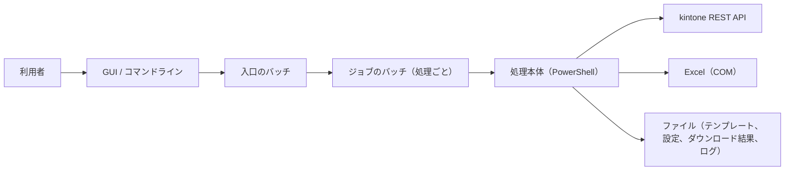

# アーキテクチャ設計

## 1. 概要

本ツールは、テンプレートをもとに kintone のスペースとアプリを作成し、設定を反映・確認するツールです。

処理は次の 3 層で構成されています。

| 通番 | 層 | 実装 | 役割 |
|---|---|---|---|
| 1 | 入口 | バッチ（処理ごと、GUI） | 引数の解釈、対象のグループの指定 |
| 2 | ジョブ | バッチ（処理ごと） | 設定の読み込み、処理の起動、終了判定 |
| 3 | 処理本体 | PowerShell スクリプト（処理ごと） | kintone API の呼び出し、Excel の読み書き |

操作手段は次の 2 つで、どちらも同じバッチを呼び出します。

- コマンドライン
- GUI

## 2. 実行環境と前提

| 通番 | 項目 | 内容 |
|---|---|---|
| 1 | 基本ソフトウェア | Windows の cmd と PowerShell 5.1 で動作します。 |
| 2 | 表計算ソフト | テンプレートと設定ファイルの読み書きに Excel を使います。Excel がインストールされている必要があります。 |
| 3 | 通信 | kintone REST API と HTTPS で通信します。 |
| 4 | 認証 | kintone のログイン名とパスワードで認証します（パスワードは、グループ別の設定に平文で保存されます）。 |

## 3. ディレクトリ構成

```
ルート/
├─ 入口のバッチ                         bats本体の呼び出し
├─ bats/                              各処理のバッチと処理本体、共通設定、GUI 本体
├─ clients/                           グループ別の設定
├─ template/                          設定テンプレート（基本、カスタム）
├─ download/                          ダウンロード結果
├─ config/                            設定ファイル
├─ checked/                           チェック結果
├─ run-list/                          複数実行の実行一覧
└─ logs/                              実行ログ
```

処理の全体の関係を次の図に示します。



## 4. 処理概要

| 通番 | 処理 | 入力 | 出力 |
|---|---|---|---|
| 1 | スペース作成 | 共通設定、グループ別の設定 | kintone のスペース |
| 2 | スペースダウンロード | グループ別の設定 | ダウンロード結果 |
| 3 | 設定ファイル作成 | ダウンロード結果、設定テンプレート | 設定ファイル |
| 4 | スペース更新 | 設定ファイル、グループ別の設定 | kintone のスペース |
| 5 | スペース確認 | 設定ファイル、グループ別の設定 | チェック結果 |
| 6 | テンプレート作成 | グループ別の設定 | テンプレートファイル |

## 5. 共通ライブラリ

| 通番 | 機能 | 内容 |
|---|---|---|
| 1 | kintone 連携 | kintone の REST 呼び出しと、スペースとアプリの取得・設定を行います。 |
| 2 | Excel 操作 | Excel の読み込みと書き込みを行います。 |
| 3 | ログ | 実行ログの出力を行います。 |
| 4 | GUI 部品 | GUI の共通部品を提供します。 |

## 6. 外部連携

| 通番 | 連携先 | 用途 | 通信内容 |
|---|---|---|---|
| 1 | kintone REST API | スペースとアプリの作成、取得、設定 | ログイン名とパスワードによる認証、HTTPS |
| 2 | Excel（COM） | テンプレートと設定ファイルの読み書き | ローカルの Excel を操作 |

## 7. エラー処理

- 処理が失敗すると、画面の状態に「失敗」と表示され、実行ログに記録されます。

## 8. 運用上の注意

- 実行前に、対象の Excel ファイルを閉じてください。
- 設定ファイルには、グループ別の設定のパスワードが平文で保存されます。共有フォルダに置く場合は、アクセス権を制限してください。
