# 処理フロー

## 1. 概要

画面のボタンごとに、押したときに行われる処理の流れを示します。

- 処理の一覧

| 通番 | 画面名 | ボタン名 | 内容 |
|---|---|---|---|
| 1 | 実行（複数実行） | 実行（複数実行） | 実行一覧ファイルの行ごとに、一括実行を行います。 |
| 2 | 実行（一括実行） | 実行（一括実行） | 選んだ処理を順に実行します。 |
| 3 | 実行（スペース作成） | 実行（スペースの作成） | スペーステンプレートから、新しいスペースを作成します。 |
| 4 | 実行（スペースダウンロード） | 実行（スペースのダウンロード） | 対象のスペースの現在の状態をダウンロードします。 |
| 5 | 実行（設定ファイル作成） | 実行（設定ファイルの作成） | テンプレートとダウンロード結果から、スペース設定ファイルを作成します。 |
| 6 | 実行（スペース更新） | 実行（スペースの更新） | スペース設定ファイルの内容を、kintone のスペースに反映します。 |
| 7 | 実行（スペース確認） | 実行（スペースの確認） | 反映結果を、kintone の現在の状態と比較して確認します。 |
| 8 | ログ | すべて削除 | ログのファイルをすべて削除します。 |
| 9 | 環境設定（共通） | 保存 | 入力した内容を保存します。 |
| 10 | 環境設定（共通） | 再読込 | 保存されている内容を読み込み直します。 |
| 11 | 環境設定（グループ別） | 新規作成 | 新しいグループを作成します。 |
| 12 | 環境設定（グループ別） | コピー | 既存のグループの設定をコピーして、新しいグループを作成します。 |
| 13 | 環境設定（グループ別） | 保存 | 入力した内容を保存します。 |
| 14 | 環境設定（グループ別） | 再読込 | 保存されている内容を読み込み直します。 |
| 15 | 環境設定（グループ別） | テスト接続（認証情報） | kintone に接続できるかを確認します。 |
| 16 | 環境設定（テンプレート） | 実行（テンプレート作成） | スペースの情報から、テンプレートファイルを作成します。 |

## 2. 各ボタンの処理フロー

### 2.1 実行（複数実行）[実行（複数実行）]

1. 実行一覧ファイルが選ばれていない場合は、「実行一覧ファイルを選択してください。」と表示して終了します。
2. 実行一覧ファイルが存在しない場合は、「実行一覧ファイルが存在しません。」と表示して終了します。
3. 実行一覧ファイルの各行を読み込みます。行がない場合は、「Excelに行がありません。」と表示して終了します。
4. スペース識別名、またはスペーステンプレートIDが空の行は、スキップします。
5. 設定テンプレート名（基本）と設定テンプレート名（カスタム）が両方とも空の行は、スキップします。
6. 行ごとに、一括実行と同じ処理を順に実行します。
7. 行ごとの結果を表示します。全体の状態には、「終了（成功-（件数）件、警告-（件数）件、失敗/スキップ-（件数）件）」を表示します。

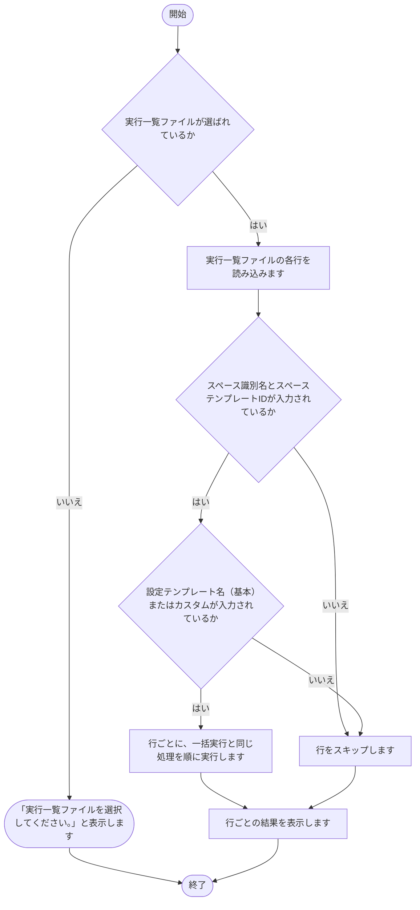

### 2.2 実行（一括実行）[実行（一括実行）]

1. 対象のグループを確認します。
2. 必須の入力（対象のグループ、スペース識別名、スペーステンプレートID）がない場合は、「（項目名） を設定してください。」と表示して終了します。
3. 設定テンプレート名（基本）と設定テンプレート名（カスタム）が両方とも入力されていない場合は、「設定テンプレート名（基本）または設定テンプレート名（カスタム）のどちらかを指定してください。」と表示して終了します。
4. 選んだ処理を順に実行します。チェックを外した処理は、実行せずにスキップします。
5. 処理ごとに、状態を「成功」「警告」「失敗」「スキップ」のいずれかで表示します。
6. 状態を表示し、実行ログを画面下部に出力します。

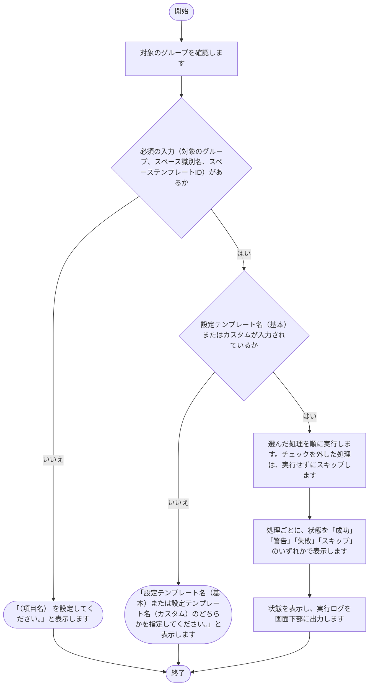

### 2.3 実行（スペース作成）[実行（スペースの作成）]

1. 対象のグループを確認します。
2. 必須の入力（対象のグループ、スペース識別名、スペーステンプレートID）がない場合は、「（項目名） を設定してください。」と表示して終了します。
3. スペーステンプレートから、新しいスペースを作成します。
4. スペースを作成できた場合は、作成したスペースのIDを、「スペースダウンロード」の「スペースID」に入力します。
5. 状態を表示し、実行ログを画面下部に出力します。

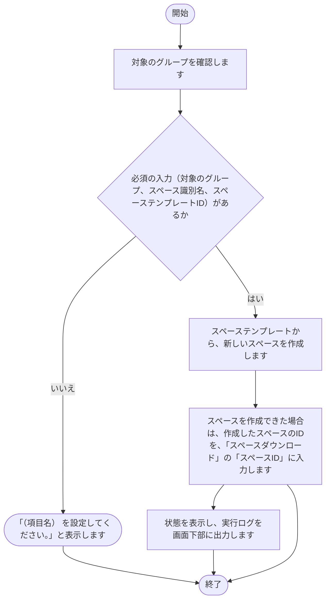

### 2.4 実行（スペースダウンロード）[実行（スペースのダウンロード）]

1. 対象のグループを確認します。
2. 必須の入力（スペース識別名）がない場合は、「スペース識別名 を設定してください。」と表示して終了します。
3. 対象のスペースの現在の状態をダウンロードします。
4. ダウンロード結果の Excel を出力します。
5. 状態を表示し、実行ログを画面下部に出力します。

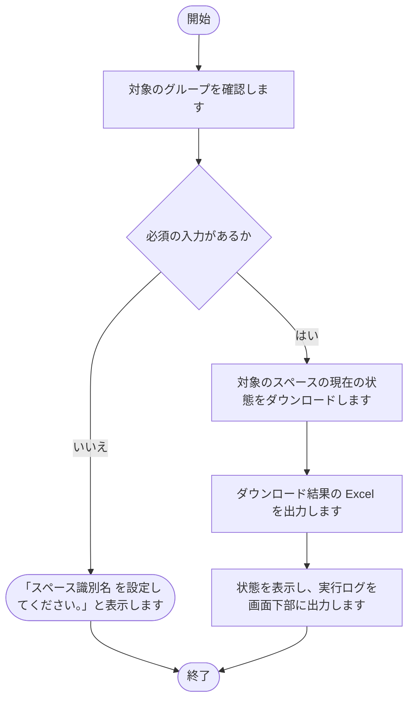

### 2.5 実行（設定ファイル作成）[実行（設定ファイルの作成）]

1. 対象のグループを確認します。
2. 必須の入力（スペース識別名）がない場合は、「スペース識別名 を設定してください。」と表示して終了します。
3. 設定テンプレート名（基本）またはカスタムが入力されていない場合は、「設定テンプレート名（基本）または設定テンプレート名（カスタム）のどちらかを指定してください。」と表示して終了します。
4. 設定テンプレートとダウンロード結果から、スペース設定ファイルを作成します。
5. 状態を表示し、実行ログを画面下部に出力します。

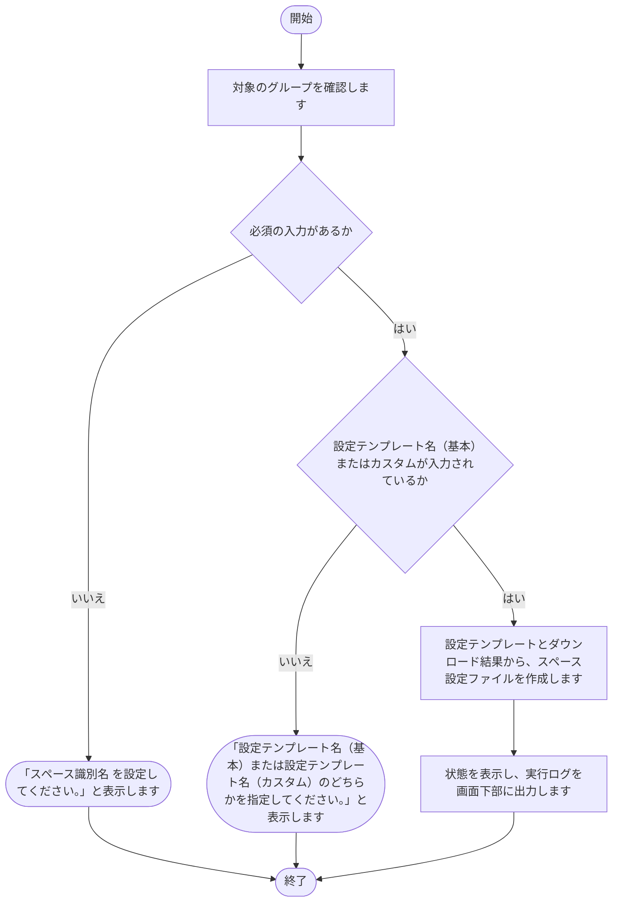

### 2.6 実行（スペース更新）[実行（スペースの更新）]

1. 対象のグループを確認します。
2. 必須の入力（スペース識別名）がない場合は、「スペース識別名 を設定してください。」と表示して終了します。
3. スペース設定ファイルの内容を、kintone のスペースに反映します。
4. 状態を表示し、実行ログを画面下部に出力します。

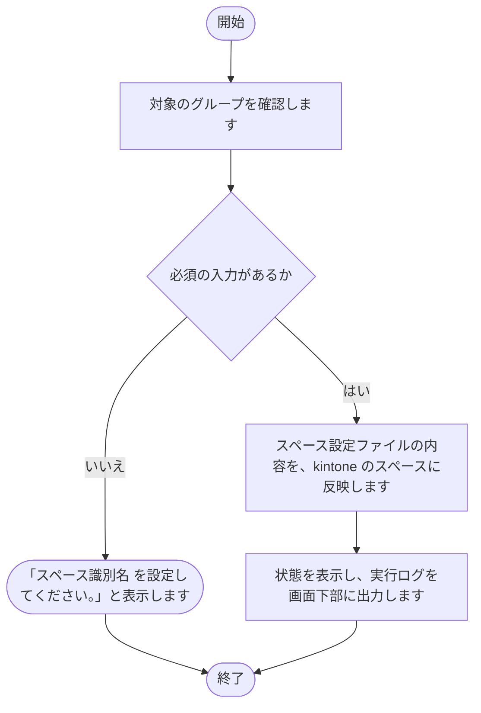

### 2.7 実行（スペース確認）[実行（スペースの確認）]

1. 対象のグループを確認します。
2. 必須の入力（スペース識別名）がない場合は、「スペース識別名 を設定してください。」と表示して終了します。
3. スペース設定ファイルと kintone の現在の状態を比較します。
4. チェック結果の Excel を出力します。
5. 状態を表示し、実行ログを画面下部に出力します。

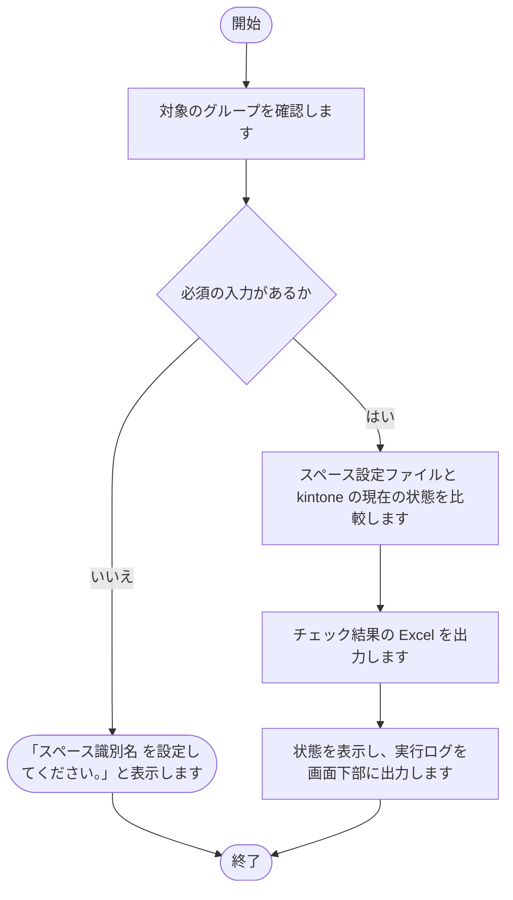

### 2.8 ログ[すべて削除]

1. ログのファイルがない場合は、「削除対象のログファイルがありません。」と表示して終了します。
2. 削除の確認を求めます。
3. 確認で「はい」を選んだ場合は、ログのファイルを削除します。
4. 確認で「いいえ」を選んだ場合は、何もせずに終了します。

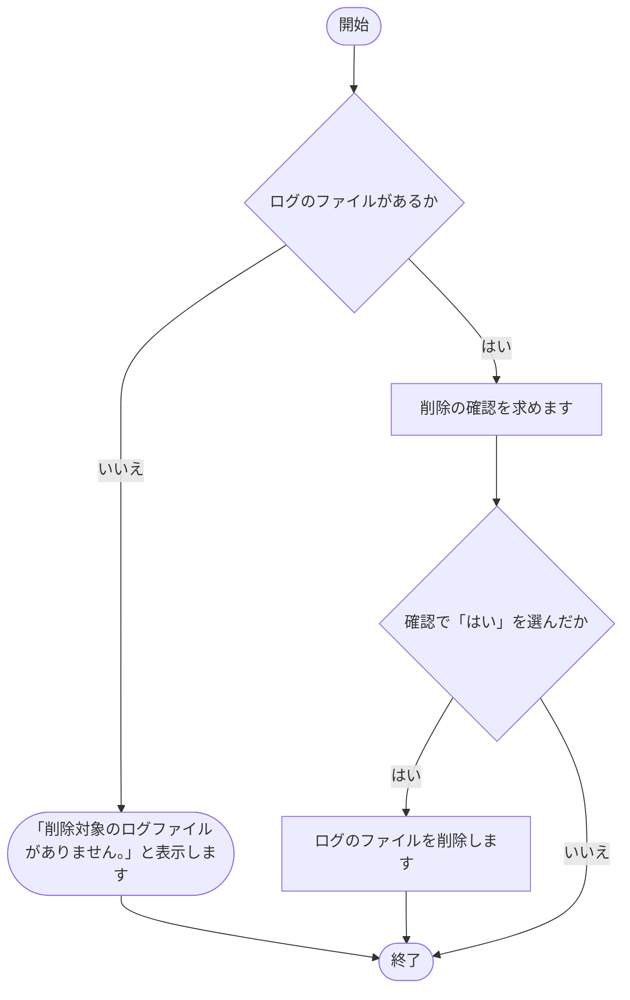

### 2.9 環境設定（共通）[保存]

1. 入力された内容を確認します。
2. 入力された内容を、共通設定ファイルに書き込みます。
3. 画面の表示を、保存後の内容に更新します。
4. 状態（保存）を表示します。

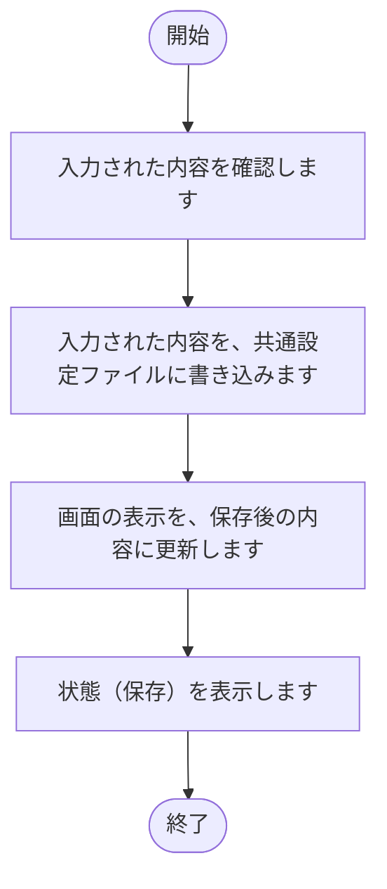

### 2.10 環境設定（共通）[再読込]

1. 共通設定ファイルの内容を読み込みます。
2. 読み込んだ内容で、画面の入力欄を表示し直します。
3. 状態（再読込）を表示します。

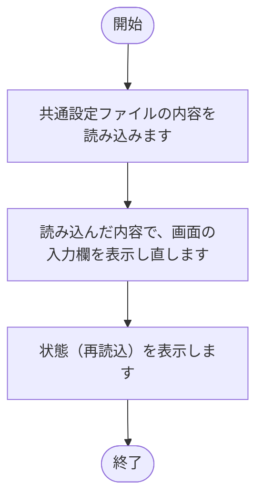

### 2.11 環境設定（グループ別）[新規作成]
1. グループ名を入力する画面を表示します。
2. 名前が空のとき、または「キャンセル」を押したときは、何も作らずに閉じます。
3. 入力された名前が既存のグループと重複している場合は、「（入力した名前）は既に存在します。」と表示して終了します。
4. 重複していなければ、新しいグループを一覧に追加して、選んだ状態にします。

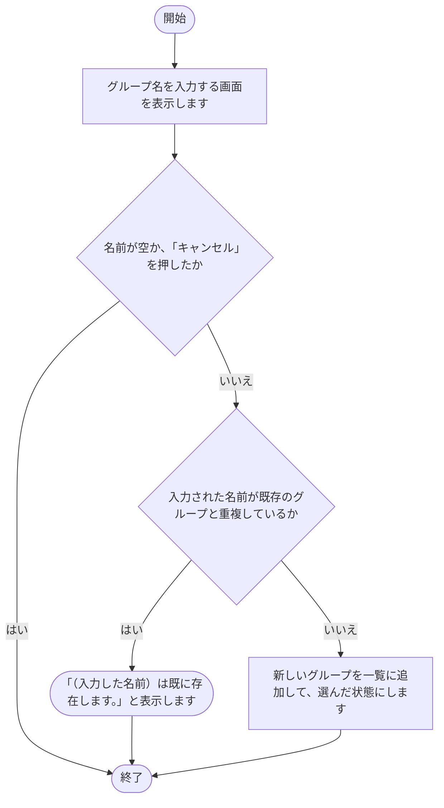

### 2.12 環境設定（グループ別）[コピー]
1. 選ばれているグループ設定ファイルが存在するかを確認します。存在しなければ、「コピー元のグループが存在しません。」と表示して終了します。
2. コピー先のグループ名を入力する画面を表示します。
3. 入力された名前が、既存のグループと重複していないかを確認します。
4. 重複している場合は、「（入力した名前）は既に存在します。」と表示して終了します。
5. 重複していなければ、グループ設定ファイルをコピーします。
6. コピー先のグループを一覧に追加して選びます。

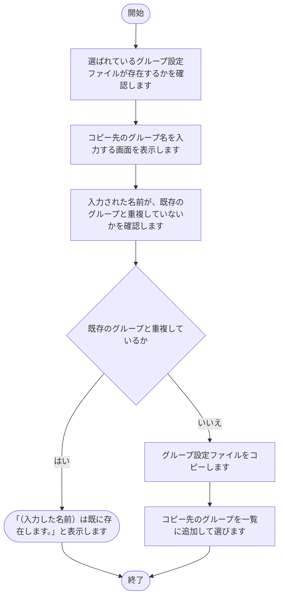

### 2.13 環境設定（グループ別）[保存]

1. 入力された内容を確認します。
2. 入力された内容を、対象のグループ設定ファイルに書き込みます。
3. 画面の表示を、保存後の内容に更新します。
4. 状態（保存）を表示します。

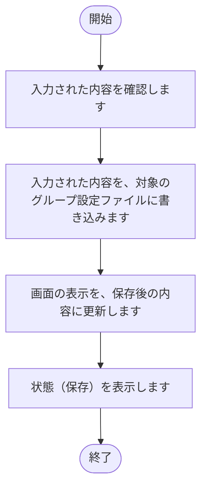

### 2.14 環境設定（グループ別）[再読込]

1. 対象のグループ設定ファイルの内容を読み込みます。
2. 読み込んだ内容で、画面の入力欄を表示し直します。
3. 状態（再読込）を表示します。

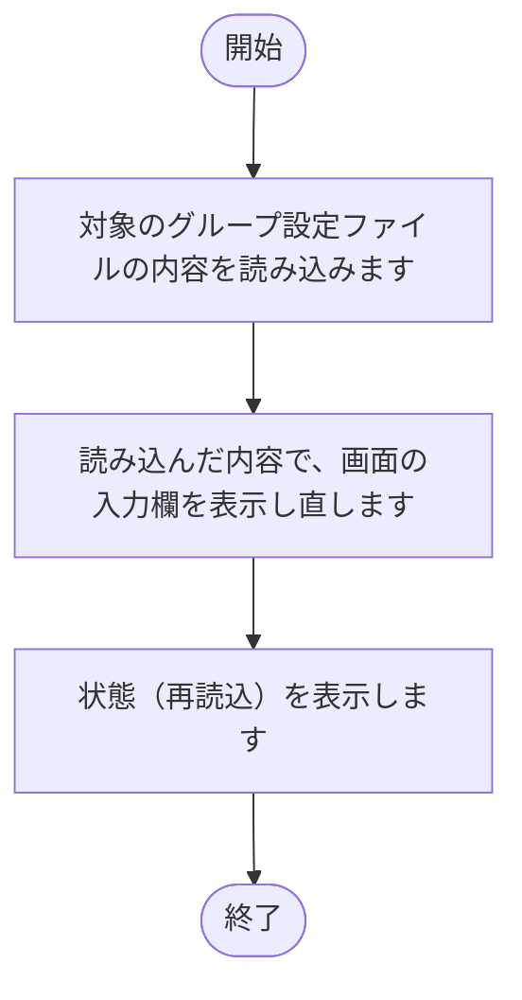

### 2.15 環境設定（グループ別）[テスト接続（認証情報）]

1. サブドメイン、ログイン名、パスワードのいずれかが空の場合は、「サブドメイン・ログイン名・パスワードをすべて入力してください。」と表示し、状態を失敗にして終了します。
2. kintone に接続し、接続できるかを確認します。
3. 状態（認証情報）を表示します。

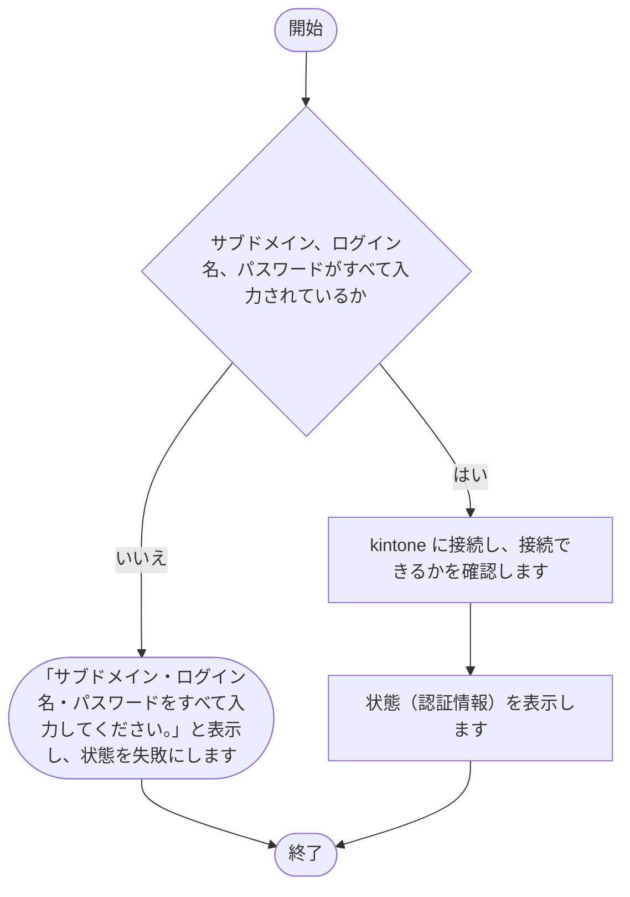

### 2.16 環境設定（テンプレート）[実行（テンプレート作成）]

1. 対象のグループ、スペースID、テンプレート名が入力されていない場合は、「対象のグループ、スペースID、テンプレート名を入力してください。」と表示して終了します。
2. スペースの名前を取得します。
3. テンプレートファイルを作成します。
4. 状態を表示し、実行ログを画面下部に出力します。

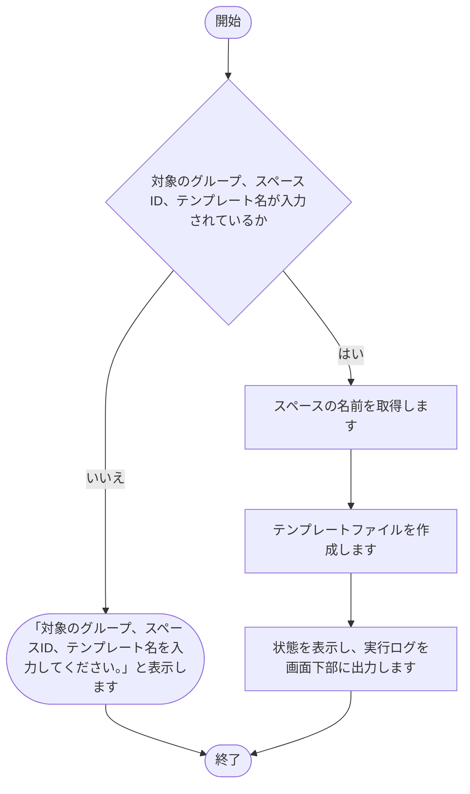

## 3. 注意事項

- 失敗した処理がある場合、後続の処理は実行されません（一括実行）。
- 出力先のファイルを開いたままにすると、書き込みに失敗する可能性があります。
- 新規作成したグループは、保存するまでグループ設定ファイルが作られません。
