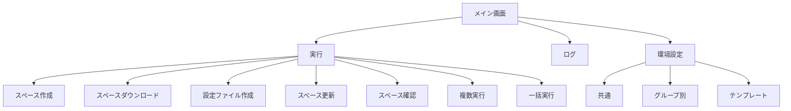

# kintone-resourse-generator 画面設計

## 1. 概要

kintone-resourse-generator の操作画面は、1 つのウィンドウに「実行」「ログ」「環境設定」のタブを置いた構成です。本書では、各タブの画面と、その中の項目や操作を示します。

### 1.1 画面の一覧

| 通番 | 画面 | 内容 |
|---|---|---|
| 1 | 実行（スペース作成） | 対象のグループとスペース識別名を指定して、スペーステンプレートから新しいスペースを作成します。 |
| 2 | 実行（スペースダウンロード） | 対象のスペースの現在の状態をダウンロードします。 |
| 3 | 実行（設定ファイル作成） | テンプレートとダウンロード結果から、設定ファイルを作成します。 |
| 4 | 実行（スペース更新） | 設定ファイルの内容を、kintone のスペースに反映します。 |
| 5 | 実行（スペース確認） | 反映結果を、kintone の現在の状態と比較して確認します。 |
| 6 | 実行（複数実行） | 実行一覧ファイルの行ごとに、一括実行を行います。 |
| 7 | 実行（一括実行） | 選んだ処理を、まとめて実行します。 |
| 8 | 環境設定（テンプレート） | スペースの情報から、テンプレートファイルを作成します。 |
| 9 | ログ | 実行ログを表示します。 |
| 10 | 環境設定（共通） | 共通のフォルダの場所を編集します。 |
| 11 | 環境設定（グループ別） | グループごとの kintone の接続情報を編集します。 |

### 1.2 画面遷移図

- 画面の切り替えは、タブを選ぶことで行います。

## 2. 各画面

### 2.1 実行（スペース作成）

#### スペースの作成

| 通番 | 項目 | 種類 | 内容 |
|---|---|---|---|
| 1 | 対象のグループ | コンボボックス | 対象のグループを選びます。 |
| 2 | スペース識別名 | テキスト | 設定ファイルの名前に使う識別名を入力します。 |
| 3 | スペーステンプレートID | テキスト | スペースの作成に使うテンプレートのIDを入力します。 |
| 4 | 実行 | ボタン | スペースを作成します。 |
| 5 | 状態 | ラベル | 処理の状態を表示します。 |
| 6 | 開く | リンク | 作成結果のフォルダを開きます。 |

### 2.2 実行（スペースダウンロード）

#### スペースのダウンロード

| 通番 | 項目 | 種類 | 内容 |
|---|---|---|---|
| 1 | 対象のグループ | コンボボックス | 対象のグループを選びます。 |
| 2 | スペース識別名 | テキスト | 設定ファイルの名前に使う識別名を入力します。 |
| 3 | スペースID | テキスト | ダウンロードするスペースのIDを入力します。 |
| 4 | 実行 | ボタン | スペースの現在の状態をダウンロードします。 |
| 5 | 状態 | ラベル | 処理の状態を表示します。 |
| 6 | 開く | リンク | ダウンロード結果のフォルダを開きます。 |

### 2.3 実行（設定ファイル作成）

#### 設定ファイルの作成

| 通番 | 項目 | 種類 | 内容 |
|---|---|---|---|
| 1 | 対象のグループ | コンボボックス | 対象のグループを選びます。 |
| 2 | スペース識別名 | テキスト | 設定ファイルの名前に使う識別名を入力します。 |
| 3 | 設定テンプレート名（基本） | コンボボックス | 設定テンプレート（基本）を選びます。 |
| 4 | 設定テンプレート名（カスタム） | コンボボックス | 設定テンプレート（カスタム）を選びます。 |
| 5 | 実行 | ボタン | 設定ファイルを作成します。 |
| 6 | 状態 | ラベル | 処理の状態を表示します。 |
| 7 | 開く | リンク | 設定ファイルのフォルダを開きます。 |

### 2.4 実行（スペース更新）

#### スペースの更新

| 通番 | 項目 | 種類 | 内容 |
|---|---|---|---|
| 1 | 対象のグループ | コンボボックス | 対象のグループを選びます。 |
| 2 | スペース識別名 | テキスト | 反映する設定ファイルの識別名を入力します。 |
| 3 | 実行 | ボタン | 設定ファイルの内容を、kintone のスペースに反映します。 |
| 4 | 状態 | ラベル | 処理の状態を表示します。 |
| 5 | 開く | リンク | 設定ファイルのフォルダを開きます。 |

### 2.5 実行（スペース確認）

#### スペースの確認

| 通番 | 項目 | 種類 | 内容 |
|---|---|---|---|
| 1 | 対象のグループ | コンボボックス | 対象のグループを選びます。 |
| 2 | スペース識別名 | テキスト | 確認する設定ファイルの識別名を入力します。 |
| 3 | 実行 | ボタン | 設定ファイルと kintone の現在の状態を比較します。 |
| 4 | 状態 | ラベル | 処理の状態を表示します。 |
| 5 | 開く | リンク | チェック結果のフォルダを開きます。 |

### 2.6 実行（複数実行）

#### 複数実行

| 通番 | 項目 | 種類 | 内容 |
|---|---|---|---|
| 1 | 対象のグループ | コンボボックス | 対象のグループを選びます。 |
| 2 | 実行一覧ファイル | テキスト | 実行一覧の Excel ファイルのパスを入力します（参照ボタン付き）。 |
| 3 | 実行 | ボタン | 実行一覧の行ごとに、一括実行を行います。 |
| 4 | 状態 | ラベル | 処理の状態を表示します。 |

### 2.7 実行（一括実行）

#### 一括実行

| 通番 | 項目 | 種類 | 内容 |
|---|---|---|---|
| 1 | 対象のグループ | コンボボックス | 対象のグループを選びます。 |
| 2 | スペース識別名 | テキスト | 設定ファイルの名前に使う識別名を入力します。 |
| 3 | スペーステンプレートID | テキスト | スペースの作成に使うテンプレートのIDを入力します。 |
| 4 | 設定テンプレート名（基本） | コンボボックス | 設定テンプレート（基本）を選びます。 |
| 5 | 設定テンプレート名（カスタム） | コンボボックス | 設定テンプレート（カスタム）を選びます。 |
| 6 | 表示／隠す | リンク | 処理の選択欄を表示したり隠したりします。 |
| 7 | 処理名 | チェックボックス | 処理ごとに 1 つ置きます。チェックを外した処理はスキップします。 |
| 8 | 実行 | ボタン | 選んだ処理を順に実行します。 |
| 9 | 状態 | ラベル | 処理の状態を表示します。 |

### 2.8 環境設定（テンプレート）

#### テンプレート作成

| 通番 | 項目 | 種類 | 内容 |
|---|---|---|---|
| 1 | 対象のグループ | コンボボックス | 対象のグループを選びます。 |
| 2 | スペースID | テキスト | テンプレートを作成するスペースのIDを入力します。 |
| 3 | テンプレート名 | テキスト | 作成するテンプレートの名前を入力します。 |
| 4 | 実行 | ボタン | テンプレートファイルを作成します。 |
| 5 | 状態 | ラベル | 処理の状態を表示します。 |
| 6 | 開く | リンク | テンプレートのフォルダを開きます。 |
| 7 | ログ | テキストエリア | 実行ログを表示します。 |

### 2.9 ログ

| 通番 | 項目 | 種類 | 内容 |
|---|---|---|---|
| 1 | 対象のグループ | コンボボックス | 表示するログのグループを選びます。 |
| 2 | スペース識別名 | コンボボックス | 表示するログのスペース識別名を選びます。 |
| 3 | （処理名） | ラジオボタン | 表示するログの処理を選びます。 |
| 4 | すべて削除 | ボタン | ログを削除します（削除の対象は確認の上）。 |
| 5 | ログ | テキストエリア | 選んだ条件の実行ログを表示します。 |

### 2.10 環境設定（共通）

| 通番 | 項目 | 種類 | 内容 |
|---|---|---|---|
| 1 | 保存 | ボタン | 入力した内容を保存します。 |
| 2 | 再読込 | ボタン | 保存されている内容を読み込み直します。 |
| 3 | ダウンロード先のフォルダ | テキスト | ダウンロード結果の保存先を入力します（参照ボタン付き）。 |
| 4 | 設定テンプレート（基本）ファイルのフォルダ | テキスト | 設定テンプレート（基本）の場所を入力します（参照ボタン付き）。 |
| 5 | 設定テンプレート（カスタム）ファイルのフォルダ | テキスト | 設定テンプレート（カスタム）の場所を入力します（参照ボタン付き）。 |
| 6 | 設定ファイルのフォルダ | テキスト | 設定ファイルの保存先を入力します（参照ボタン付き）。 |
| 7 | チェック結果の出力先フォルダ | テキスト | チェック結果の保存先を入力します（参照ボタン付き）。 |
| 8 | ログの出力先フォルダ | テキスト | 実行ログの保存先を入力します（参照ボタン付き）。 |

### 2.11 環境設定（グループ別）

| 通番 | 項目 | 種類 | 内容 |
|---|---|---|---|
| 1 | 対象のグループ | コンボボックス | 対象のグループを選びます。 |
| 2 | 新規作成 | ボタン | 新しいグループを作成します。 |
| 3 | 保存 | ボタン | 入力した内容を保存します。 |
| 4 | 再読込 | ボタン | 保存されている内容を読み込み直します。 |
| 5 | サブドメイン | テキスト | kintone の組織のサブドメインを入力します。 |
| 6 | ログイン名 | テキスト | kintone の接続に使うログイン名を入力します。 |
| 7 | パスワード | テキスト | kintone の接続に使うパスワードを入力します。 |
| 8 | テスト接続 | ボタン | kintone に接続できるかを確認します。 |
