# 画面設計

## 1. 概要

本ツールの操作画面は、1 つのウィンドウに「実行」「ログ」「環境設定」のタブを置いた構成です。本書では、各タブの画面と、その中の項目や操作を示します。

- 画面の一覧

| 通番 | 画面 | 内容 |
|---|---|---|
| 1 | 実行（複数実行） | 実行一覧ファイルの行ごとに、一括実行を行います。 |
| 2 | 実行（一括実行） | 選んだ処理を、まとめて実行します。 |
| 3 | 実行（スペース作成） | 対象のグループとスペース識別名を指定して、スペーステンプレートから新しいスペースを作成します。 |
| 4 | 実行（スペースダウンロード） | 対象のスペースの現在の状態をダウンロードします。 |
| 5 | 実行（設定ファイル作成） | テンプレートとダウンロード結果から、設定ファイルを作成します。 |
| 6 | 実行（スペース更新） | 設定ファイルの内容を、kintone のスペースに反映します。 |
| 7 | 実行（スペース確認） | 反映結果を、kintone の現在の状態と比較して確認します。 |
| 8 | ログ | 実行ログを表示します。 |
| 9 | 環境設定（共通） | 共通のフォルダの場所を編集します。 |
| 10 | 環境設定（グループ別） | グループごとの kintone の接続情報を編集します。 |
| 11 | 環境設定（テンプレート） | スペースの情報から、テンプレートファイルを作成します。 |

## 2. 画面遷移図

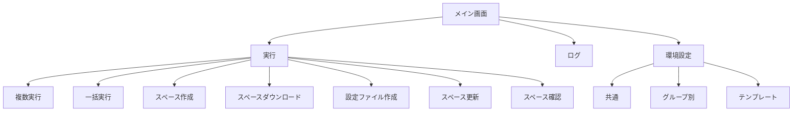

## 3. 各画面

### 3.1 実行（複数実行）

#### 複数実行

  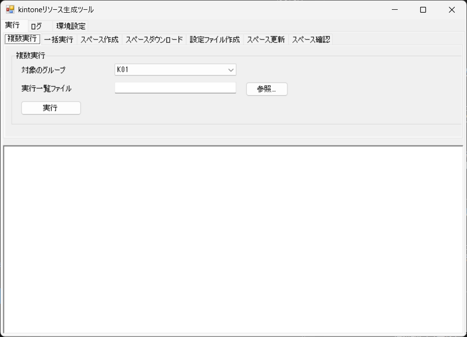

| 通番 | 項目 | 種類 | 内容 |
|---|---|---|---|
| 1 | 対象のグループ | コンボボックス | 対象のグループを選びます。 |
| 2 | 実行一覧ファイル | テキスト | 実行一覧の Excel ファイルのパスを入力します（参照ボタン付き）。 |
| 3 | 実行 | ボタン | 実行一覧の行ごとに、一括実行を行います。 |
| 4 | 状態 | ラベル | 処理の結果を表示します。 |
| 5 | ログ | テキストエリア | 実行の結果のログを表示します。 |

### 3.2 実行（一括実行）

#### 一括実行

  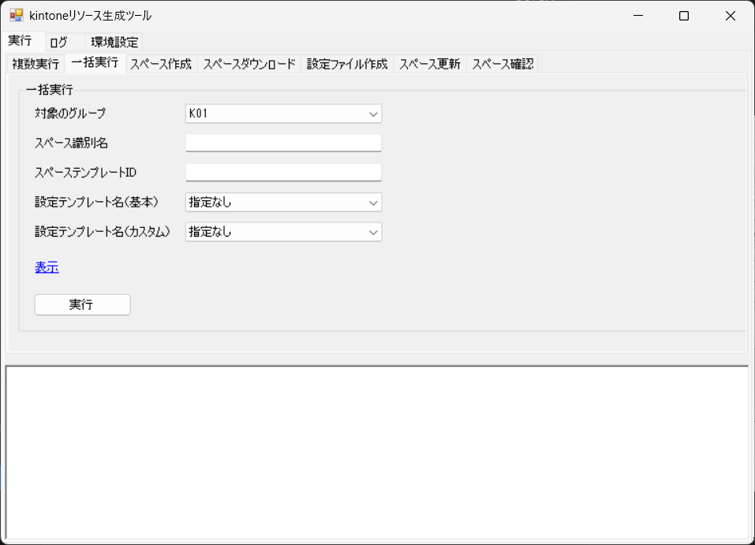

  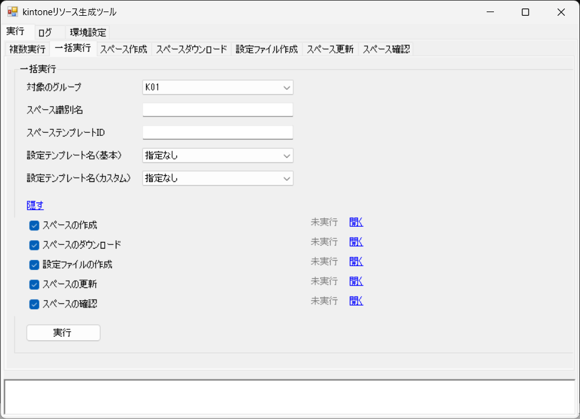

| 通番 | 項目 | 種類 | 内容 |
|---|---|---|---|
| 1 | 対象のグループ | コンボボックス | 対象のグループを選びます。 |
| 2 | スペース識別名 | テキスト | 設定ファイルの名前に使う識別名を入力します。 |
| 3 | スペーステンプレートID | テキスト | スペースの作成に使うテンプレートのIDを入力します。 |
| 4 | 設定テンプレート名（基本） | コンボボックス | 設定テンプレート（基本）を選びます。 |
| 5 | 設定テンプレート名（カスタム） | コンボボックス | 設定テンプレート（カスタム）を選びます。 |
| 6 | 表示／隠す | リンク | 処理の選択欄を表示したり隠したりします。表示しているときは「隠す」、隠しているときは「表示」と表示が切り替わります。 |
| 7 | スペースの作成 | チェックボックス | 処理を実行するかを選びます。チェックを外した処理はスキップします。 |
| 8 | 状態（スペースの作成） | ラベル | スペースの作成の結果を表示します。 |
| 9 | 開く（スペースの作成） | リンク | 作成したスペースの kintone の画面を開きます。 |
| 10 | スペースのダウンロード | チェックボックス | 処理を実行するかを選びます。チェックを外した処理はスキップします。 |
| 11 | 状態（スペースのダウンロード） | ラベル | スペースのダウンロードの結果を表示します。 |
| 12 | 開く（スペースのダウンロード） | リンク | ダウンロードした Excel（`<スペース識別名>_download.xlsx`）を開きます。 |
| 13 | 設定ファイルの作成 | チェックボックス | 処理を実行するかを選びます。チェックを外した処理はスキップします。 |
| 14 | 状態（設定ファイルの作成） | ラベル | 設定ファイルの作成の結果を表示します。 |
| 15 | 開く（設定ファイルの作成） | リンク | 作成した設定ファイル（`<スペース識別名>_config.xlsx`）を開きます。 |
| 16 | スペースの更新 | チェックボックス | 処理を実行するかを選びます。チェックを外した処理はスキップします。 |
| 17 | 状態（スペースの更新） | ラベル | スペースの更新の結果を表示します。 |
| 18 | 開く（スペースの更新） | リンク | kintone のスペースの画面を開きます。 |
| 19 | スペースの確認 | チェックボックス | 処理を実行するかを選びます。チェックを外した処理はスキップします。 |
| 20 | 状態（スペースの確認） | ラベル | スペースの確認の結果を表示します。 |
| 21 | 開く（スペースの確認） | リンク | チェック結果の Excel（`<スペース識別名>_check.xlsx`）を開きます。 |
| 22 | 実行 | ボタン | 選んだ処理を、スペースの作成から順に実行します。 |
| 23 | 状態 | ラベル | 一括実行の全体の結果を表示します。 |
| 24 | ログ | テキストエリア | 実行の結果のログを、画面下部に表示します。 |

- 「表示」は、処理の選択欄の表示状態に応じて「表示」と「隠す」の文言が切り替わるリンクです。
- 各処理の行の右側には、その処理の「状態」（ラベル）と「開く」（リンク）があります。

### 3.3 実行（スペース作成）

#### スペースの作成

  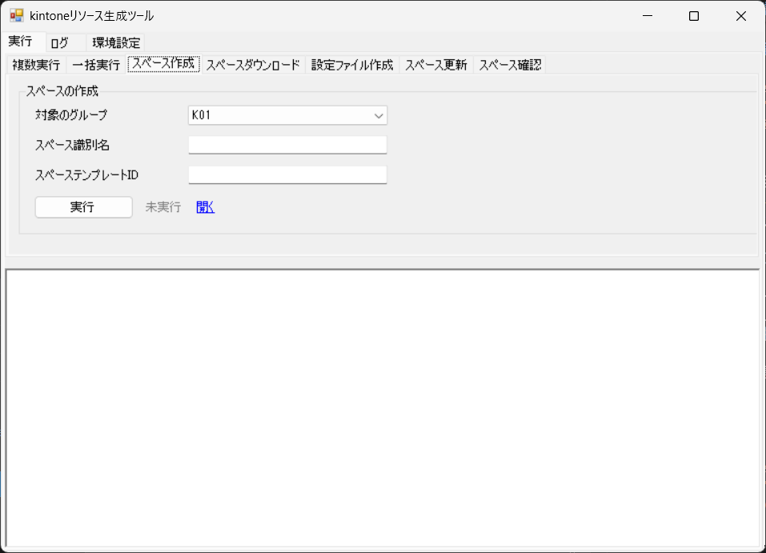

| 通番 | 項目 | 種類 | 内容 |
|---|---|---|---|
| 1 | 対象のグループ | コンボボックス | 対象のグループを選びます。 |
| 2 | スペース識別名 | テキスト | 設定ファイルの名前に使う識別名を入力します。 |
| 3 | スペーステンプレートID | テキスト | スペースの作成に使うテンプレートのIDを入力します。 |
| 4 | 実行 | ボタン | スペースを作成します。 |
| 5 | 状態 | ラベル | 処理の結果を表示します。 |
| 6 | 開く | リンク | 作成したスペースの kintone の画面を開きます。 |
| 7 | ログ | テキストエリア | 実行の結果のログを表示します。 |

### 3.4 実行（スペースダウンロード）

#### スペースのダウンロード

  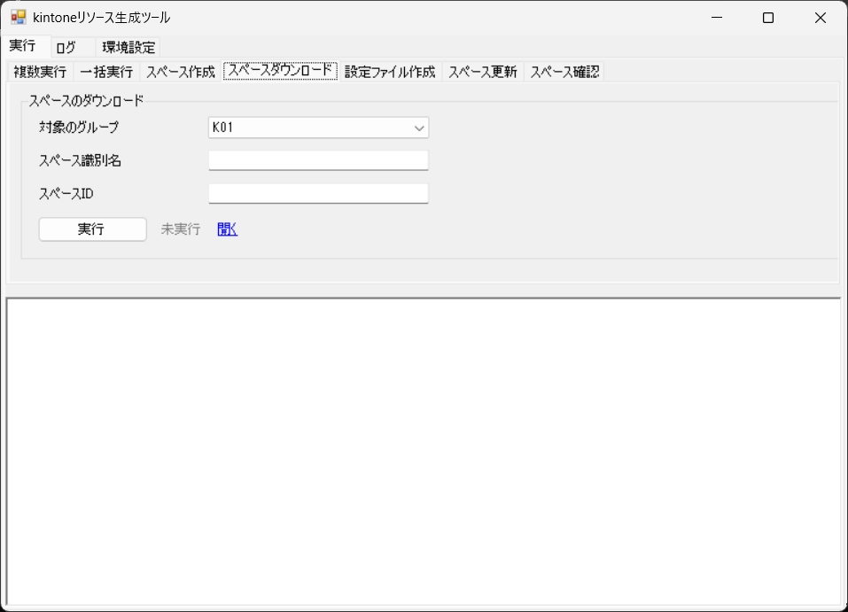

| 通番 | 項目 | 種類 | 内容 |
|---|---|---|---|
| 1 | 対象のグループ | コンボボックス | 対象のグループを選びます。 |
| 2 | スペース識別名 | テキスト | 設定ファイルの名前に使う識別名を入力します。 |
| 3 | スペースID | テキスト | ダウンロードするスペースのIDを入力します。 |
| 4 | 実行 | ボタン | スペースの現在の状態をダウンロードします。 |
| 5 | 状態 | ラベル | 処理の結果を表示します。 |
| 6 | 開く | リンク | ダウンロード結果のファイルを開きます。 |
| 7 | ログ | テキストエリア | 実行の結果のログを表示します。 |

### 3.5 実行（設定ファイル作成）

#### 設定ファイルの作成

  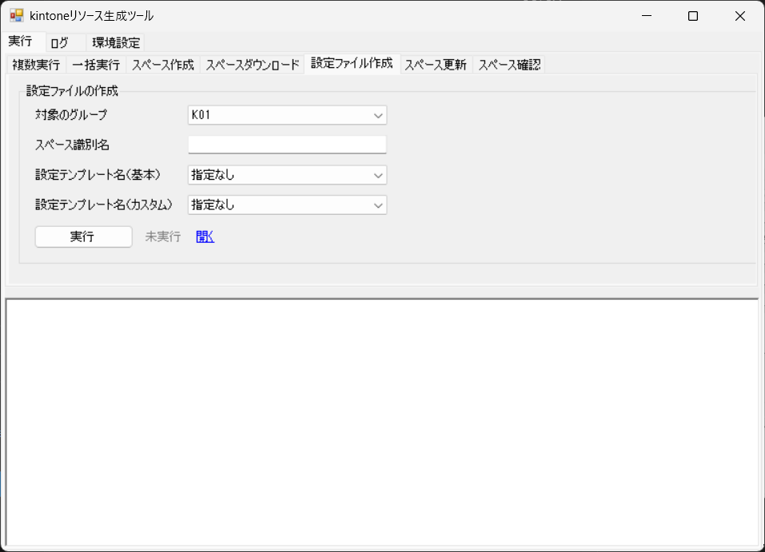

| 通番 | 項目 | 種類 | 内容 |
|---|---|---|---|
| 1 | 対象のグループ | コンボボックス | 対象のグループを選びます。 |
| 2 | スペース識別名 | テキスト | 設定ファイルの名前に使う識別名を入力します。 |
| 3 | 設定テンプレート名（基本） | コンボボックス | 設定テンプレート（基本）を選びます。 |
| 4 | 設定テンプレート名（カスタム） | コンボボックス | 設定テンプレート（カスタム）を選びます。 |
| 5 | 実行 | ボタン | 設定ファイルを作成します。 |
| 6 | 状態 | ラベル | 処理の結果を表示します。 |
| 7 | 開く | リンク | 作成した設定ファイルを開きます。 |
| 8 | ログ | テキストエリア | 実行の結果のログを表示します。 |

### 3.6 実行（スペース更新）

#### スペースの更新

  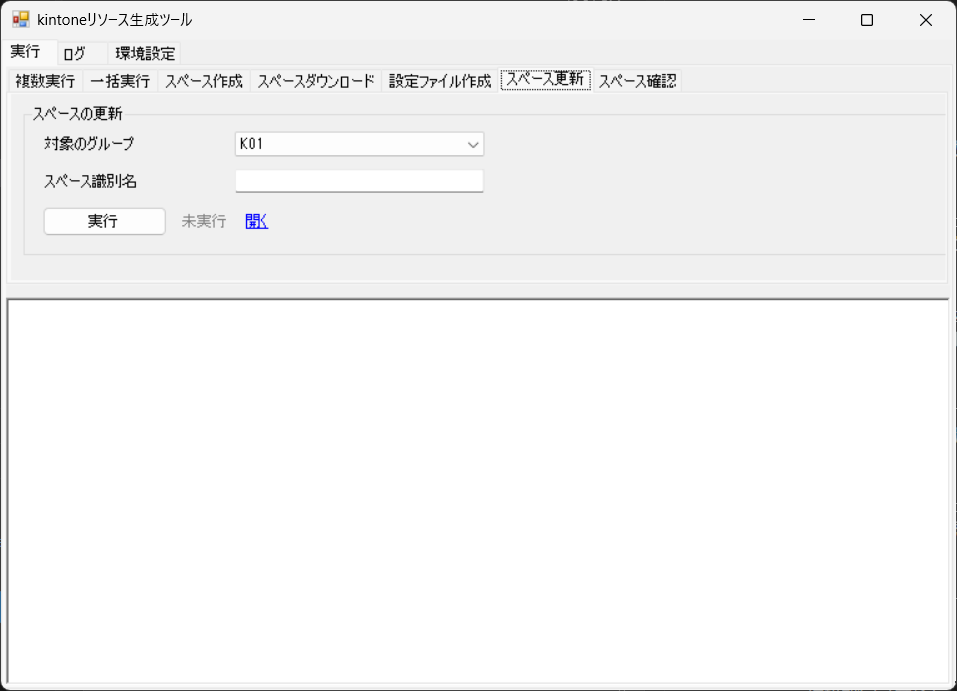

| 通番 | 項目 | 種類 | 内容 |
|---|---|---|---|
| 1 | 対象のグループ | コンボボックス | 対象のグループを選びます。 |
| 2 | スペース識別名 | テキスト | 反映する設定ファイルの名前に使う識別名を入力します。 |
| 3 | 実行 | ボタン | 設定ファイルの内容を、kintone のスペースに反映します。 |
| 4 | 状態 | ラベル | 処理の結果を表示します。 |
| 5 | 開く | リンク | kintone のスペースの画面を開きます。 |
| 6 | ログ | テキストエリア | 実行の結果のログを表示します。 |

### 3.7 実行（スペース確認）

#### スペースの確認

  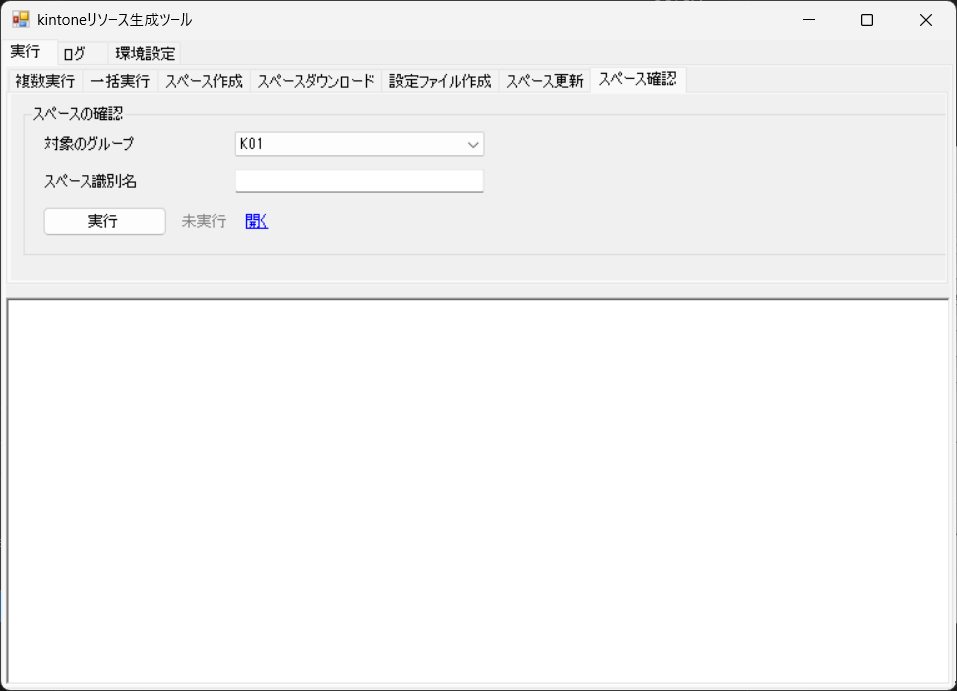

| 通番 | 項目 | 種類 | 内容 |
|---|---|---|---|
| 1 | 対象のグループ | コンボボックス | 対象のグループを選びます。 |
| 2 | スペース識別名 | テキスト | 確認する設定ファイルの名前に使う識別名を入力します。 |
| 3 | 実行 | ボタン | 設定ファイルと kintone の現在の状態を比較します。 |
| 4 | 状態 | ラベル | 処理の結果を表示します。 |
| 5 | 開く | リンク | チェック結果のファイルを開きます。 |
| 6 | ログ | テキストエリア | 実行の結果のログを表示します。 |

### 3.8 ログ

  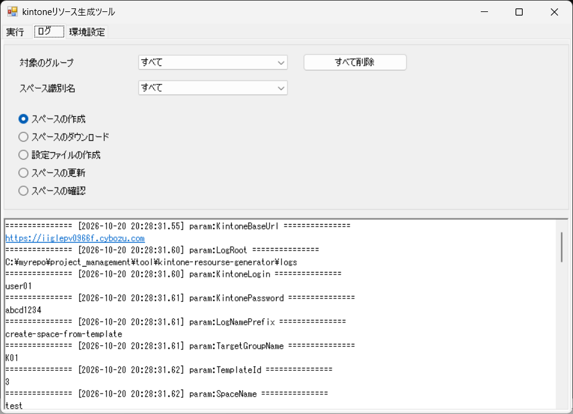

| 通番 | 項目 | 種類 | 内容 |
|---|---|---|---|
| 1 | すべて削除 | ボタン | 選んだ条件に関係なく、ログのファイルをすべて削除します。削除の前に確認を求めます。 |
| 2 | 対象のグループ | コンボボックス | 対象のグループを選びます。 |
| 3 | スペース識別名（ログの絞り込み） | コンボボックス | 表示するログのスペース識別名を選びます。 |
| 4 | スペースの作成 | ラジオボタン | 表示するログの処理を選びます。 |
| 5 | スペースのダウンロード | ラジオボタン | 表示するログの処理を選びます。 |
| 6 | 設定ファイルの作成 | ラジオボタン | 表示するログの処理を選びます。 |
| 7 | スペースの更新 | ラジオボタン | 表示するログの処理を選びます。 |
| 8 | スペースの確認 | ラジオボタン | 表示するログの処理を選びます。 |
| 9 | ログ | テキストエリア | 選んだ条件の実行ログを表示します。 |

### 3.9 環境設定（共通）

  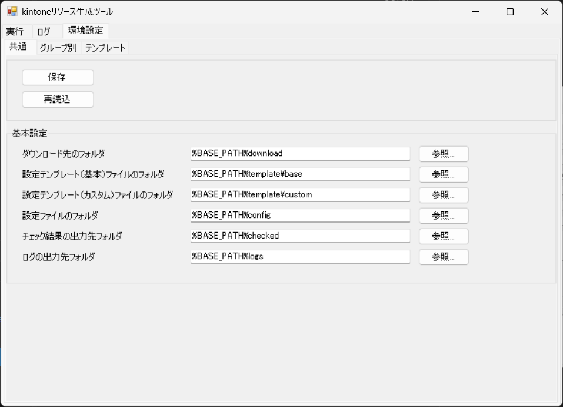

| 通番 | 項目 | 種類 | 内容 |
|---|---|---|---|
| 1 | 保存 | ボタン | 入力した内容を保存します。 |
| 2 | 再読込 | ボタン | 保存されている内容を読み込み直します。 |

#### 基本設定

  

| 通番 | 項目 | 種類 | 内容 |
|---|---|---|---|
| 1 | ダウンロード先のフォルダ | テキスト | スペースをダウンロードした Excel を出力するフォルダを入力します。 |
| 2 | 設定テンプレート（基本）ファイルのフォルダ | テキスト | 基本の設定テンプレートのファイルがあるフォルダを入力します。 |
| 3 | 設定テンプレート（カスタム）ファイルのフォルダ | テキスト | カスタムの設定テンプレートのファイルがあるフォルダを入力します。 |
| 4 | 設定ファイルのフォルダ | テキスト | 作成した設定ファイルを出力するフォルダを入力します。 |
| 5 | チェック結果の出力先フォルダ | テキスト | スペースの確認の結果（チェック結果の Excel）を出力するフォルダを入力します。 |
| 6 | ログの出力先フォルダ | テキスト | 実行ログを出力するフォルダを入力します。 |

### 3.10 環境設定（グループ別）

  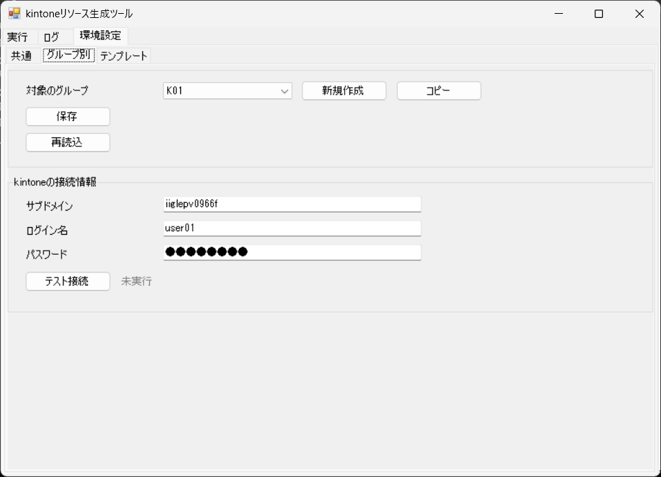

| 通番 | 項目 | 種類 | 内容 |
|---|---|---|---|
| 1 | 対象のグループ | コンボボックス | 対象のグループを選びます。 |
| 2 | 新規作成 | ボタン | 新しいグループを作成します。 |
| 3 | コピー | ボタン | 既存のグループの設定をコピーして、新しいグループを作成します。 |
| 4 | 保存 | ボタン | 入力した内容を保存します。 |
| 5 | 再読込 | ボタン | 保存されている内容を読み込み直します。 |

- 「新規作成」を押すと、グループ名を入力するダイアログを表示します。
- 「OK」を押すと、入力した名前のグループを一覧に追加して、選んだ状態にします。
- 入力した名前が既存のグループと重複しているときは、「（入力した名前）は既に存在します。」と表示し、追加しません。
- 名前が空のとき、または「キャンセル」を押したときは、何も作らずに閉じます。

#### 認証情報

  

| 通番 | 項目 | 種類 | 内容 |
|---|---|---|---|
| 1 | サブドメイン | テキスト | kintone のサブドメインを入力します。 |
| 2 | ログイン名 | テキスト | kintone にログインするための名前を入力します。 |
| 3 | パスワード | テキスト | kintone にログインするためのパスワードを入力します。 |
| 4 | テスト接続（認証情報） | ボタン | kintone に接続できるかを確認します。 |
| 5 | 状態（認証情報） | ラベル | テスト接続の結果を表示します。 |

### 3.11 環境設定（テンプレート）

#### テンプレート作成

  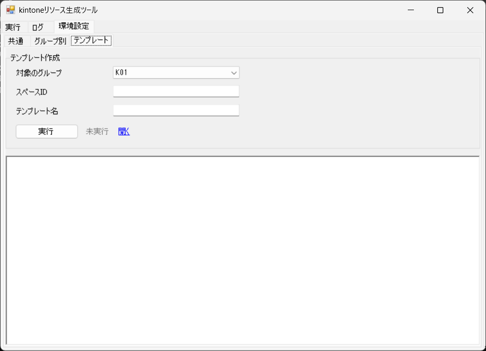

| 通番 | 項目 | 種類 | 内容 |
|---|---|---|---|
| 1 | 対象のグループ | コンボボックス | 対象のグループを選びます。 |
| 2 | スペースID | テキスト | テンプレートを作成するスペースのIDを入力します。 |
| 3 | テンプレート名 | テキスト | 作成するテンプレートの名前を入力します。 |
| 4 | 実行 | ボタン | テンプレートファイルを作成します。 |
| 5 | 状態 | ラベル | 処理の結果を表示します。 |
| 6 | 開く | リンク | テンプレートのファイルを開きます。 |
| 7 | ログ | テキストエリア | 実行ログを表示します。 |
