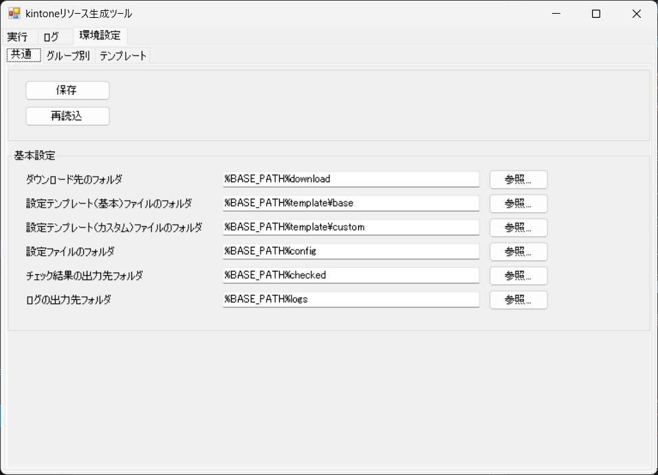
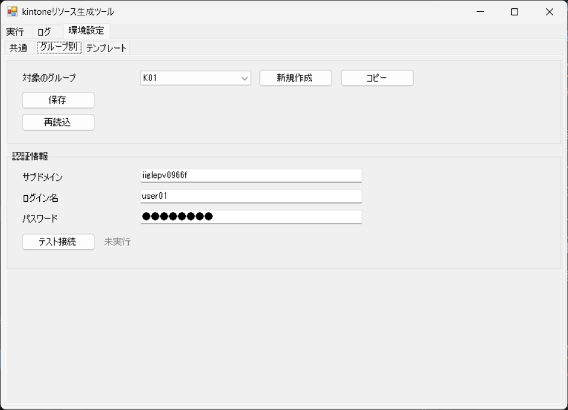
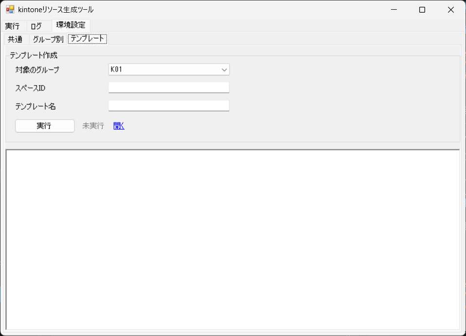
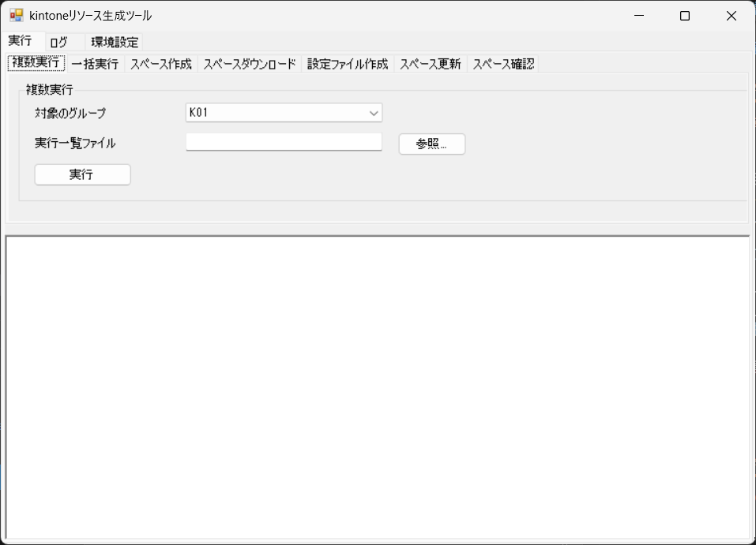
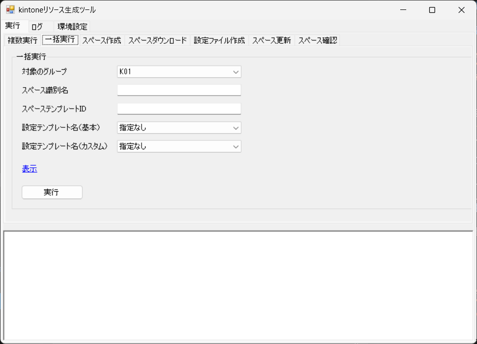
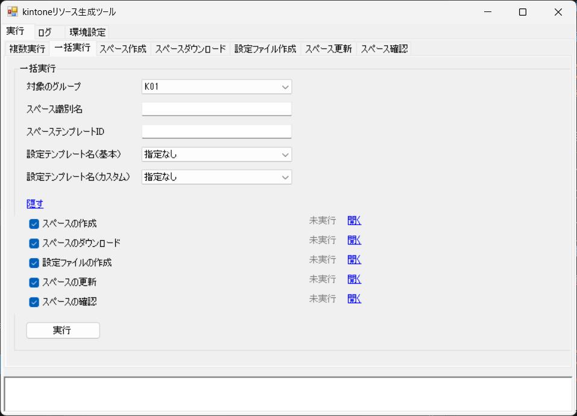
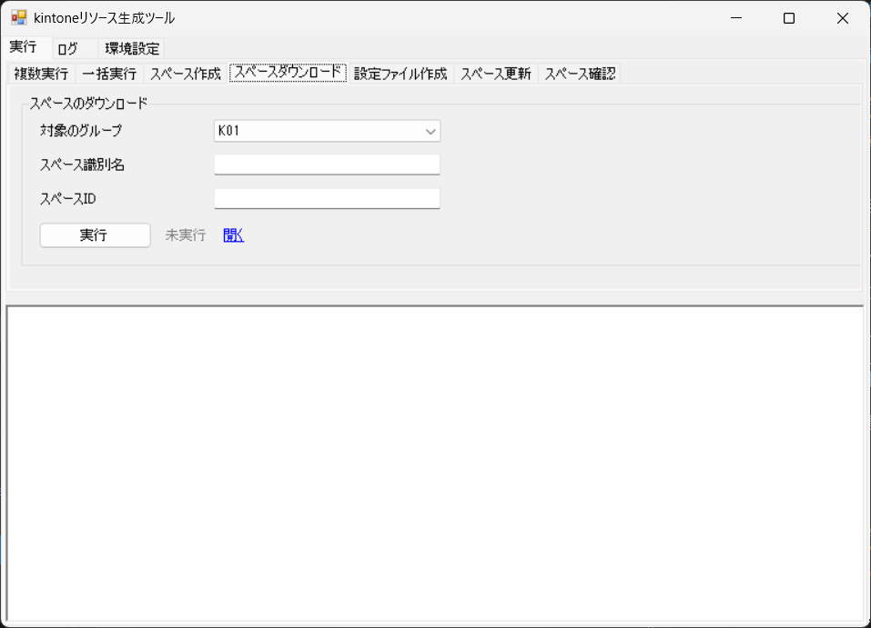
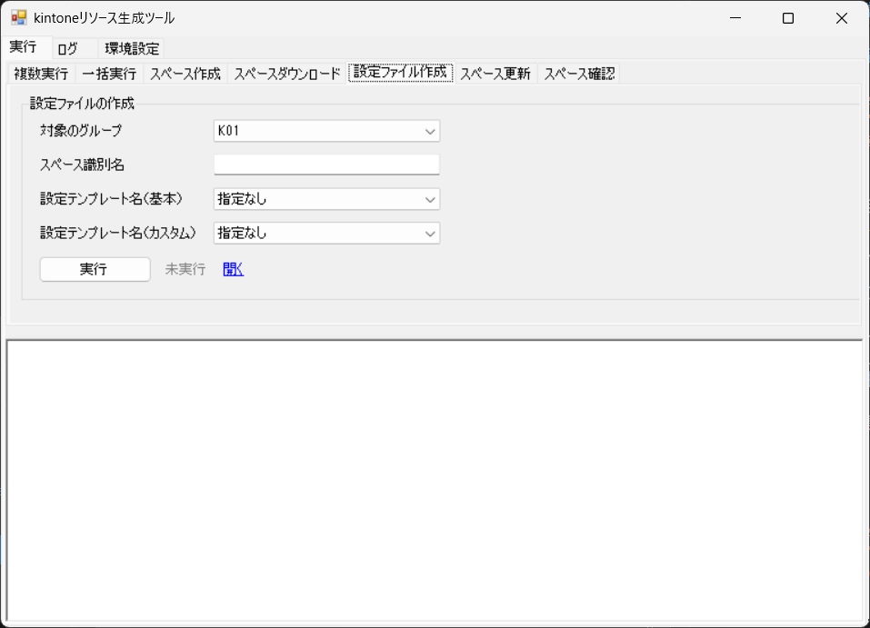
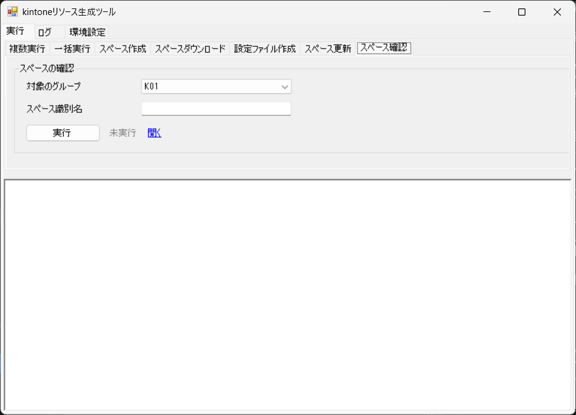
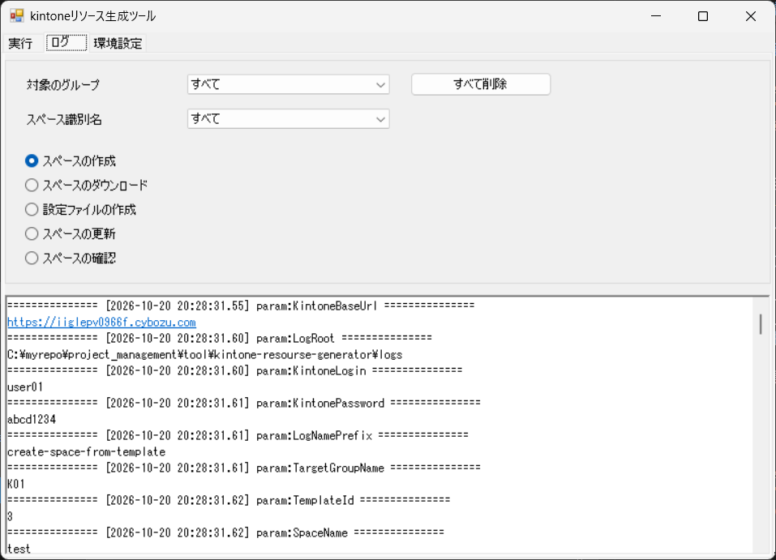

# 操作マニュアル

## 1. 目的と対象

　対象は、kintoneリソース生成ツール（kintone のスペースを作成、ダウンロード、反映するツール）です。 
　ツールの画面の操作と、スペースの作成と反映の確認方法を説明します。

## 2. 画面の構成

　ツールの画面は、次のタブで構成されています。

- 画面の一覧

| 通番 | メインタブ名 | サブタブ名 | 内容 |
|---|---|---|---|
| 1 | 実行 | 複数実行 | 実行一覧ファイルの行ごとに、一括実行を行います。 |
| 2 | 実行 | 一括実行 | 対象のグループとスペース識別名を指定して、選んだ処理をまとめて実行します。 |
| 3 | 実行 | スペース作成 | 対象のグループとスペース識別名を指定して、スペーステンプレートから新しいスペースを作成します。 |
| 4 | 実行 | スペースダウンロード | 対象のスペースの現在の状態をダウンロードします。 |
| 5 | 実行 | 設定ファイル作成 | テンプレートとダウンロード結果から、スペース設定ファイルを作成します。 |
| 6 | 実行 | スペース更新 | スペース設定ファイルの内容を、kintone のスペースに反映します。 |
| 7 | 実行 | スペース確認 | スペース設定ファイルと kintone の現在の状態を比較して確認します。 |
| 8 | ログ |  | 実行ログを表示し、ログを削除します。 |
| 9 | 環境設定 | 共通 | 共通の設定を編集します。 |
| 10 | 環境設定 | グループ別 | グループごとの設定を編集します。 |
| 11 | 環境設定 | テンプレート | スペースの情報から、テンプレートファイルを作成します。 |

## 3. 初期設定

　環境設定の「共通」「グループ別」「テンプレート」の各タブで、ツールの設定を行います。

### 3.1 共通

　環境設定の「共通」タブで、共通の設定を保存します。「基本設定」の項目も設定します。

  

#### 項目

| 通番 | 区分 | 項目 | 種類 | 内容 |
|---|---|---|---|---|
| 1 | 共通 | 保存 | ボタン | 設定を保存します。 |
| 2 | 共通 | 再読込 | ボタン | 保存した内容を読み直します。 |
| 3 | 共通 | 状態（保存） | 表示 | 保存の状態を表示します。 |
| 4 | 共通 | 状態（再読込） | 表示 | 再読込の状態を表示します。 |
| 5 | 基本設定 | ダウンロード先のフォルダ | 入力欄 | スペースをダウンロードした Excel を出力するフォルダを指定します。 |
| 6 | 基本設定 | 設定テンプレート（基本）ファイルのフォルダ | 入力欄 | 基本の設定テンプレートのファイルがあるフォルダを指定します。 |
| 7 | 基本設定 | 設定テンプレート（カスタム）ファイルのフォルダ | 入力欄 | カスタムの設定テンプレートのファイルがあるフォルダを指定します。 |
| 8 | 基本設定 | スペース設定ファイルのフォルダ | 入力欄 | 作成したスペース設定ファイルを出力するフォルダを指定します。 |
| 9 | 基本設定 | チェック結果の出力先フォルダ | 入力欄 | スペースの確認の結果を出力するフォルダを指定します。 |
| 10 | 基本設定 | ログの出力先フォルダ | 入力欄 | 実行ログを出力するフォルダを指定します。 |

#### 操作方法

1. 設定を変えたら、「保存」を押します。
   - 保存した内容を読み直すときは、「再読込」を押します。

### 3.2 グループ別

　環境設定の「グループ別」タブで、グループごとの接続情報を設定します。

  

#### 項目

| 通番 | 区分 | 項目 | 種類 | 内容 |
|---|---|---|---|---|
| 1 | 共通 | 対象のグループ | プルダウン | 設定するグループを選びます。 |
| 2 | 共通 | 新規作成 | ボタン | 新しいグループを作ります。 |
| 3 | 共通 | コピー | ボタン | 既存のグループの設定をコピーして、新しいグループを作ります。 |
| 4 | 共通 | 保存 | ボタン | 設定を保存します。 |
| 5 | 共通 | 再読込 | ボタン | 保存した内容を読み直します。 |
| 6 | 共通 | 状態（保存） | 表示 | 保存の状態を表示します。 |
| 7 | 共通 | 状態（再読込） | 表示 | 再読込の状態を表示します。 |
| 8 | 認証情報 | サブドメイン | 入力欄 | kintone のサブドメインを入力します。 |
| 9 | 認証情報 | ログイン名 | 入力欄 | kintone にログインするための名前を入力します。 |
| 10 | 認証情報 | パスワード | 入力欄 | kintone にログインするためのパスワードを入力します。 |
| 11 | 認証情報 | テスト接続（認証情報） | ボタン | kintone に接続できるかを確認します。 |
| 12 | 認証情報 | 状態（テスト接続（認証情報）） | 表示 | テスト接続の状態を表示します。 |

#### 操作方法

1. 「対象のグループ」で、設定するグループを選びます。
   - 「新規作成」「コピー」を押すと、グループを作れます。
2. 「認証情報」の「テスト接続（認証情報）」を押します。
   - kintone に接続できるかを確認します。
3. 設定を変えたら、「保存」を押します。
   - 新しいグループは、保存すると設定ファイルが作られます。

### 3.3 テンプレート

　環境設定の「テンプレート」タブで、スペースの情報から、テンプレートファイルを作成します。

  

#### 項目

| 通番 | 区分 | 項目 | 種類 | 内容 |
|---|---|---|---|---|
| 1 | 共通 | 対象のグループ | プルダウン | 対象のグループを選びます。 |
| 2 | テンプレート作成 | スペースID | 入力欄 | テンプレートを作成するスペースのIDを入力します。 |
| 3 | テンプレート作成 | テンプレート名 | 入力欄 | 作成するテンプレートの名前を入力します。 |
| 4 | テンプレート作成 | 実行（テンプレート作成） | ボタン | テンプレートファイルを作成します。 |
| 5 | テンプレート作成 | 状態（テンプレート作成） | 表示 | テンプレート作成の状態を表示します。 |
| 6 | テンプレート作成 | 開く（テンプレート作成） | リンク | テンプレートのファイルを開きます。 |

#### 操作方法

1. 「対象のグループ」で、グループを選びます。
2. 「スペースID」を入力します。
3. 「テンプレート名」を入力します。
4. 「実行」を押します。
   - 状態が「成功」と表示されたら、処理は完了しています。
5. 「開く」を押して、テンプレートのファイルを開きます。

## 4. 実行

　「実行」タブには、次のサブタブがあります。

### 4.1 複数実行

　「複数実行」で、実行一覧ファイルの行ごとに、一括実行を行います。

  

#### 項目

| 通番 | 区分 | 項目 | 種類 | 内容 |
|---|---|---|---|---|
| 1 | 複数実行 | 対象のグループ | プルダウン | 処理するグループを選びます。 |
| 2 | 複数実行 | 実行一覧ファイル | 入力欄 | 実行一覧の Excel ファイルのパスを指定します。 |
| 3 | 複数実行 | 実行（複数実行） | ボタン | 実行一覧の行ごとに、一括実行を行います。 |
| 4 | 複数実行 | 状態（複数実行） | 表示 | 処理の結果を表示します。 |

#### 操作方法

1. 「対象のグループ」で、グループを選びます。
2. 「実行一覧ファイル」に、実行一覧の Excel ファイルを指定します。
3. 「実行」を押します。
   - 状態が「終了」と表示されたら、処理は完了しています。行ごとの成功、警告、失敗の件数が表示されます。
4. 「ログ」タブで、行ごとの結果を確認します。

> 注意
> - 「実行」を押すと、実行一覧の行ごとに、スペースの作成と更新が kintone に反映されます。対象の kintone 環境を確認してから実行してください。

### 4.2 一括実行

　「一括実行」で、対象のグループとスペース識別名を指定して、選んだ処理をまとめて実行します。

  

  

#### 項目

| 通番 | 区分 | 項目 | 種類 | 内容 |
|---|---|---|---|---|
| 1 | 一括実行 | 対象のグループ | プルダウン | 処理するグループを選びます。 |
| 2 | 一括実行 | スペース識別名 | 入力欄 | スペース設定ファイルの名前に使う識別名を入力します。 |
| 3 | 一括実行 | スペーステンプレートID | 入力欄 | スペースの作成に使うテンプレートのIDを入力します。 |
| 4 | 一括実行 | 設定テンプレート名（基本） | プルダウン | 基本の設定テンプレートを選びます。 |
| 5 | 一括実行 | 設定テンプレート名（カスタム） | プルダウン | カスタムの設定テンプレートを選びます。 |
| 6 | 一括実行 | 表示／隠す | リンク | 処理の選択欄を表示したり隠したりします。 |
| 7 | 一括実行 | スペースの作成 | チェックボックス | 処理を実行します。チェックは外せません。 |
| 8 | 一括実行 | 状態（スペースの作成） | 表示 | スペースの作成の状態を表示します。 |
| 9 | 一括実行 | 開く（スペースの作成） | リンク | 作成したスペースの kintone の画面を開きます。 |
| 10 | 一括実行 | スペースのダウンロード | チェックボックス | 処理を実行します。チェックは外せません。 |
| 11 | 一括実行 | 状態（スペースのダウンロード） | 表示 | スペースのダウンロードの状態を表示します。 |
| 12 | 一括実行 | 開く（スペースのダウンロード） | リンク | ダウンロードした Excel を開きます。 |
| 13 | 一括実行 | 設定ファイルの作成 | チェックボックス | 処理を実行します。チェックは外せません。 |
| 14 | 一括実行 | 状態（設定ファイルの作成） | 表示 | 設定ファイルの作成の状態を表示します。 |
| 15 | 一括実行 | 開く（設定ファイルの作成） | リンク | 作成したスペース設定ファイルを開きます。 |
| 16 | 一括実行 | スペースの更新 | チェックボックス | 処理を実行します。チェックは外せません。 |
| 17 | 一括実行 | 状態（スペースの更新） | 表示 | スペースの更新の状態を表示します。 |
| 18 | 一括実行 | 開く（スペースの更新） | リンク | kintone のスペースの画面を開きます。 |
| 19 | 一括実行 | スペースの確認 | チェックボックス | 処理を実行するかを選びます。チェックを外した処理はスキップします。初期値は選ばれた状態です。 |
| 20 | 一括実行 | 状態（スペースの確認） | 表示 | スペースの確認の状態を表示します。 |
| 21 | 一括実行 | 開く（スペースの確認） | リンク | チェック結果の Excel を開きます。 |
| 22 | 一括実行 | 実行（一括実行） | ボタン | 選んだ処理を、スペースの作成から順に実行します。 |
| 23 | 一括実行 | 状態（一括実行） | 表示 | 一括実行の全体の状態を表示します。 |

#### 操作方法

1. 「対象のグループ」で、グループを選びます。
2. 「スペース識別名」を入力します。
3. 「スペーステンプレートID」を入力します。
4. 「設定テンプレート名（基本）」か「設定テンプレート名（カスタム）」のどちらかを選びます。
   - どちらも選ばないと、実行できません。
5. 「表示／隠す」を押して、処理の選択欄を表示します。
   - 選択欄を表示しているときは、リンクの文字が「隠す」になります。
6. 「スペースの確認」以外の処理は、チェックを外せません。実行しない「スペースの確認」のチェックは、外します。
7. 「実行」を押します。
   - 状態が「成功」と表示されたら、処理は完了しています。
8. 実行した処理の「開く」を押すと、結果を開けます。

> 注意
> - 「実行」を押すと、スペースの作成と更新が kintone に反映されます。対象の kintone 環境を確認してから実行してください。

### 4.3 スペース作成

　「スペース作成」で、対象のグループとスペース識別名を指定して、スペーステンプレートから新しいスペースを作成します。

  

#### 項目

| 通番 | 区分 | 項目 | 種類 | 内容 |
|---|---|---|---|---|
| 1 | スペースの作成 | 対象のグループ | プルダウン | 処理するグループを選びます。 |
| 2 | スペースの作成 | スペース識別名 | 入力欄 | スペース設定ファイルの名前に使う識別名を入力します。 |
| 3 | スペースの作成 | スペーステンプレートID | 入力欄 | スペースの作成に使うテンプレートのIDを入力します。 |
| 4 | スペースの作成 | 実行（スペースの作成） | ボタン | スペースを作成します。 |
| 5 | スペースの作成 | 状態（スペースの作成） | 表示 | スペースの作成の状態を表示します。 |
| 6 | スペースの作成 | 開く（スペースの作成） | リンク | 作成したスペースの kintone の画面を開きます。 |

#### 操作方法

1. 「対象のグループ」で、グループを選びます。
2. 「スペース識別名」を入力します。
3. 「スペーステンプレートID」を入力します。
4. 「実行」を押します。
   - 状態が「成功」と表示されたら、処理は完了しています。
5. 「開く」を押して、作成したスペースを開けます。

> 注意
> - 「実行」を押すと、kintone にスペースが作られます。作成先の kintone 環境を確認してから実行してください。

### 4.4 スペースダウンロード

　「スペースダウンロード」で、対象のスペースの現在の状態をダウンロードします。

  

#### 項目

| 通番 | 区分 | 項目 | 種類 | 内容 |
|---|---|---|---|---|
| 1 | スペースのダウンロード | 対象のグループ | プルダウン | 処理するグループを選びます。 |
| 2 | スペースのダウンロード | スペース識別名 | 入力欄 | スペース設定ファイルの名前に使う識別名を入力します。 |
| 3 | スペースのダウンロード | スペースID | 入力欄 | ダウンロードするスペースのIDを入力します。 |
| 4 | スペースのダウンロード | 実行（スペースのダウンロード） | ボタン | スペースの現在の状態をダウンロードします。 |
| 5 | スペースのダウンロード | 状態（スペースのダウンロード） | 表示 | スペースのダウンロードの状態を表示します。 |
| 6 | スペースのダウンロード | 開く（スペースのダウンロード） | リンク | ダウンロード結果のファイルを開きます。 |

#### 操作方法

1. 「対象のグループ」で、グループを選びます。
2. 「スペース識別名」を入力します。
3. 「スペースID」を入力します。
4. 「実行」を押します。
   - 状態が「成功」と表示されたら、処理は完了しています。
5. 「開く」を押して、ダウンロードした Excel を開けます。

### 4.5 設定ファイル作成

　「設定ファイル作成」で、テンプレートとダウンロード結果から、スペース設定ファイルを作成します。

  

#### 項目

| 通番 | 区分 | 項目 | 種類 | 内容 |
|---|---|---|---|---|
| 1 | 設定ファイルの作成 | 対象のグループ | プルダウン | 処理するグループを選びます。 |
| 2 | 設定ファイルの作成 | スペース識別名 | 入力欄 | スペース設定ファイルの名前に使う識別名を入力します。 |
| 3 | 設定ファイルの作成 | 設定テンプレート名（基本） | プルダウン | 基本の設定テンプレートを選びます。 |
| 4 | 設定ファイルの作成 | 設定テンプレート名（カスタム） | プルダウン | カスタムの設定テンプレートを選びます。 |
| 5 | 設定ファイルの作成 | 実行（設定ファイルの作成） | ボタン | スペース設定ファイルを作成します。 |
| 6 | 設定ファイルの作成 | 状態（設定ファイルの作成） | 表示 | 設定ファイルの作成の状態を表示します。 |
| 7 | 設定ファイルの作成 | 開く（設定ファイルの作成） | リンク | 作成したスペース設定ファイルを開きます。 |

#### 操作方法

1. 「対象のグループ」で、グループを選びます。
2. 「スペース識別名」を入力します。
3. 「設定テンプレート名（基本）」か「設定テンプレート名（カスタム）」のどちらかを選びます。
4. 「実行」を押します。
   - 状態が「成功」と表示されたら、処理は完了しています。
5. 「開く」を押して、スペース設定ファイルを開けます。

### 4.6 スペース更新

　「スペース更新」で、スペース設定ファイルの内容を、kintone のスペースに反映します。

  

#### 項目

| 通番 | 区分 | 項目 | 種類 | 内容 |
|---|---|---|---|---|
| 1 | スペースの更新 | 対象のグループ | プルダウン | 処理するグループを選びます。 |
| 2 | スペースの更新 | スペース識別名 | 入力欄 | 反映するスペース設定ファイルの名前に使う識別名を入力します。 |
| 3 | スペースの更新 | 実行（スペースの更新） | ボタン | スペース設定ファイルの内容を、kintone のスペースに反映します。 |
| 4 | スペースの更新 | 状態（スペースの更新） | 表示 | スペースの更新の状態を表示します。 |
| 5 | スペースの更新 | 開く（スペースの更新） | リンク | kintone のスペースの画面を開きます。 |

#### 操作方法

1. 「対象のグループ」で、グループを選びます。
2. 「スペース識別名」を入力します。
3. 「実行」を押します。
   - 状態が「成功」と表示されたら、処理は完了しています。
4. 「開く」を押して、更新したスペースを開けます。

> 注意
> - 「実行」を押すと、スペース設定ファイルの内容が kintone のスペースに反映されます。対象の kintone 環境を確認してから実行してください。

### 4.7 スペース確認

　「スペース確認」で、スペース設定ファイルと kintone の現在の状態を比較して確認します。

  

#### 項目

| 通番 | 区分 | 項目 | 種類 | 内容 |
|---|---|---|---|---|
| 1 | スペースの確認 | 対象のグループ | プルダウン | 処理するグループを選びます。 |
| 2 | スペースの確認 | スペース識別名 | 入力欄 | 確認するスペース設定ファイルの名前に使う識別名を入力します。 |
| 3 | スペースの確認 | 実行（スペースの確認） | ボタン | スペース設定ファイルと kintone の現在の状態を比較します。 |
| 4 | スペースの確認 | 状態（スペースの確認） | 表示 | スペースの確認の状態を表示します。 |
| 5 | スペースの確認 | 開く（スペースの確認） | リンク | チェック結果のファイルを開きます。 |

#### 操作方法

1. 「対象のグループ」で、グループを選びます。
2. 「スペース識別名」を入力します。
3. 「実行」を押します。
   - 状態が「成功」と表示されたら、処理は完了しています。
4. 「開く」を押して、チェック結果を開けます。

## 5. ログ

　「ログ」タブで、実行した処理の結果を確認できます。

  

#### 項目

| 通番 | 区分 | 項目 | 種類 | 内容 |
|---|---|---|---|---|
| 1 | 共通 | 対象のグループ | プルダウン | 結果を表示するグループを選びます。 |
| 2 | 共通 | すべて削除 | ボタン | ログの出力先にあるすべてのログファイルを削除します。削除の前に確認を求めます。 |
| 3 | 共通 | スペース識別名 | プルダウン | 結果を表示するスペース識別名を選びます。 |
| 4 | 共通 | スペースの作成 | ラジオボタン | スペースの作成の結果を表示します。 |
| 5 | 共通 | スペースのダウンロード | ラジオボタン | スペースのダウンロードの結果を表示します。 |
| 6 | 共通 | 設定ファイルの作成 | ラジオボタン | 設定ファイルの作成の結果を表示します。 |
| 7 | 共通 | スペースの更新 | ラジオボタン | スペースの更新の結果を表示します。 |
| 8 | 共通 | スペースの確認 | ラジオボタン | スペースの確認の結果を表示します。 |

#### 操作方法

1. 「対象のグループ」で、グループを選びます。
2. 「スペース識別名」で、結果を表示するスペース識別名を選びます。
3. 処理のラジオボタンから、表示する処理を選びます。
4. 表示された結果を見ます。
5. 不要になったログは、「すべて削除」を押して削除します。

## 6. 困ったとき

- **出力されたファイルが開けない**: 対象の Excel ファイルが、別のアプリで開かれていないかを確認します。開いている場合は、閉じてから実行します。
- **スペースの更新に失敗する**: 「環境設定」の「グループ別」タブの「テスト接続（認証情報）」で、接続情報を確認します。
- **状態が「失敗」になった**: 「ログ」タブで、その処理の結果を確認します。
- **状態が「警告」になった**: 「ログ」タブで、その処理の結果を確認します。
