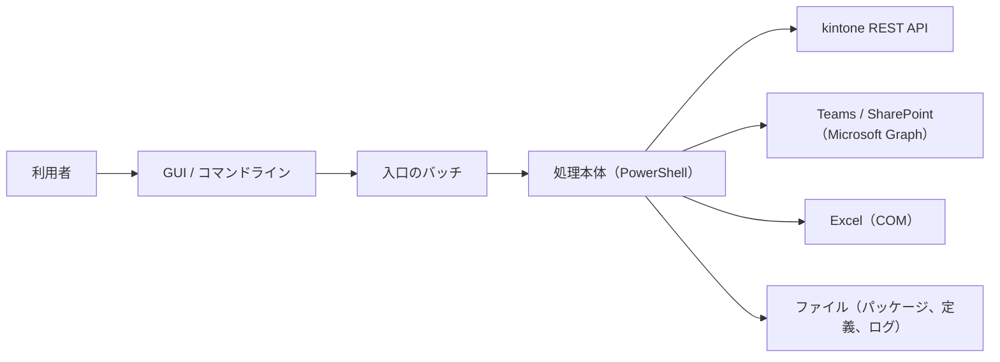

# アーキテクチャ設計

## 1. 概要

本ツールは、フォルダの内容からパッケージ（zip）を作成し、kintone のレコードにファイルとしてアップロードするツールです。

処理は次の 3 層で構成されています。

| 通番 | 層 | 実装 | 役割 |
|---|---|---|---|
| 1 | 操作 | GUI、コマンドライン | 操作を受け付け、入口のバッチを呼び出す |
| 2 | 入口 | バッチ（入口のバッチ） | 引数の解釈、グループの設定の読み込み、処理本体の起動 |
| 3 | 処理本体 | PowerShell スクリプト（処理ごと） | パッケージの作成、kintone へのアップロード、パッケージ定義の更新 |

操作手段は次の 2 つで、どちらも同じバッチを呼び出します。

- コマンドライン
- GUI

## 2. 実行環境と前提

| 通番 | 項目 | 内容 |
|---|---|---|
| 1 | 基本ソフトウェア | Windows の cmd と PowerShell 5.1 で動作します。 |
| 2 | 表計算ソフト | パッケージ定義の読み書きに Excel を使います。Excel がインストールされている必要があります。 |
| 3 | 通信 | kintone REST API と、Teams / SharePoint（Microsoft Graph）と HTTPS で通信します。 |
| 4 | 認証 | kintone のログイン名とパスワードで認証します（パスワードは、グループ別の設定に平文で保存されます）。Microsoft Graph の認証方法は（未確認）です。 |

## 3. ディレクトリ構成

```
ルート/
├─ 入口のバッチ                bats本体の呼び出し
├─ bats/                      各処理の本体、共通設定、補助のバッチ、GUI 本体
├─ clients/                   グループ別の設定と、パッケージ定義ファイル
├─ download/                  ダウンロードしたフォルダ
├─ generated/                 作成したパッケージ
└─ logs/                      実行ログ
```

処理の全体の関係を次の図に示します。



## 4. 処理概要

| 通番 | 処理 | 入力 | 出力 |
|---|---|---|---|
| 1 | パッケージの作成 | ダウンロード結果、パッケージ定義 | パッケージ |
| 2 | パッケージのアップロード | パッケージ | kintone のレコード |
| 3 | パッケージ定義ファイルの更新 | パッケージ定義 | パッケージ定義 |

## 5. 共通ライブラリ

| 通番 | 機能 | 内容 |
|---|---|---|
| 1 | kintone 連携 | kintone の REST API を呼び出し、ファイルの添付、レコードの作成と更新を行います。 |
| 2 | Excel 操作 | パッケージ定義ファイルの読み書きを行います。 |
| 3 | ログ | 実行ログの出力を行います。 |
| 4 | GUI 部品 | GUI の画面部品を作成します。 |
| 5 | Microsoft Graph 連携 | Teams / SharePoint と通信し、フォルダのダウンロードとアップロードを行います。 |

## 6. 外部連携

| 通番 | 連携先 | 用途 | 通信内容 |
|---|---|---|---|
| 1 | kintone REST API | ファイルの添付、レコードの作成と更新 | ログイン名とパスワードによる認証、HTTPS |
| 2 | Teams / SharePoint（Microsoft Graph） | フォルダのダウンロード、アップロード | Microsoft Graph への HTTPS 通信 |

## 7. エラー処理

- 処理が失敗すると、画面の状態に「失敗」と表示され、実行ログに記録されます。

## 8. 運用上の注意

- 実行前に、対象の Excel ファイルを閉じてください。
- グループ別の設定ファイルには、kintone のパスワードが平文で保存されます。共有フォルダに置く場合は、アクセス権を制限してください。
- Teams / SharePoint の処理（ダウンロード、フォルダのアップロード）は、GUI からは操作できません。
