# 処理フロー

## 1. 概要

画面のボタンごとに、押したときに行われる処理の流れを示します。

- 処理の一覧

| 通番 | 画面名 | ボタン名 | 内容 |
|---|---|---|---|
| 1 | 実行（一括実行） | 実行 | 選んだ処理を順に実行します。 |
| 2 | 実行（パッケージ作成） | 実行（パッケージの作成） | パッケージを作成します。 |
| 3 | 実行（パッケージ反映） | 実行（パッケージのアップロード） | 選んだ zip ファイルを kintone にアップロードします。 |
| 4 | ログ | すべて削除 | ログの出力先にあるすべてのログファイルを削除します。 |
| 5 | 環境設定（共通） | 保存 | 入力した内容を保存します。 |
| 6 | 環境設定（共通） | 再読込 | 保存されている内容を読み込み直します。 |
| 7 | 環境設定（グループ別） | 新規作成 | 新しいグループを一覧に追加します。 |
| 8 | 環境設定（グループ別） | コピー | 既存のグループの設定をコピーして、新しいグループを作成します。 |
| 9 | 環境設定（グループ別） | 保存 | 入力した内容を保存します。 |
| 10 | 環境設定（グループ別） | 再読込 | 保存されている内容を読み込み直します。 |
| 11 | 環境設定（グループ別） | テスト接続（認証情報） | kintone に接続できるかを確認します。 |
| 12 | 環境設定（グループ別） | テスト接続（ファイル管理） | 対象アプリのIDに接続できるかを確認します。 |
| 13 | 環境設定（パッケージ定義） | 実行（パッケージ定義ファイルの更新） | パッケージ定義ファイルを更新します。 |

## 2. 各ボタンの処理フロー

### 2.1 実行（パッケージ作成）[実行（パッケージの作成）]

1. 対象のグループの設定を読み込みます。
2. パッケージ定義ファイルを読み込みます。
3. 「テンプレート」シートを除くシートごとに、圧縮元のフォルダの内容から zip ファイルを作成します。
4. 状態を表示し、実行ログを画面下部に出力します。

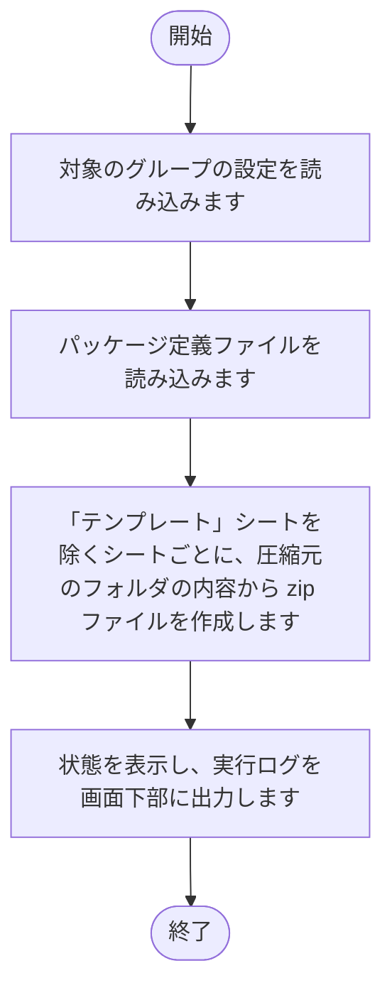

### 2.2 実行（パッケージ反映）[実行（パッケージのアップロード）]

1. タイトルが空でないか、同じ名前の zip ファイルがないか、zip ファイルが 1 つ以上あるかを確認します。
2. 入力に問題がある場合は、メッセージを出力して終了します。
3. ファイル1〜3 で選んだ zip ファイルと、フォルダ内の zip ファイルを対象にします。
4. zip ファイルを kintone に添付します。
5. 同じタイトルのレコードがあれば更新し、なければレコードを作成します。
6. 状態を表示し、実行ログを画面下部に出力します。

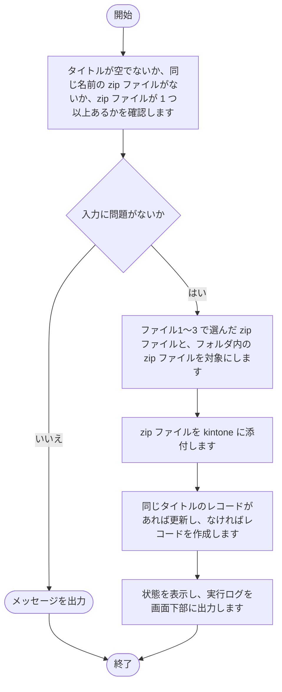

### 2.3 実行（一括実行）[実行]

1. パッケージのアップロードがチェックされている場合は、タイトルとフォルダが入力されているかを確認します。
2. 入力されていない場合は、メッセージを出力して終了します。
3. チェックされた処理を順に実行します。
4. チェックが外れている処理は、実行せずにスキップと表示します。
5. 処理ごとに、状態を表示します。
6. 状態を表示し、実行ログを画面下部に出力します。

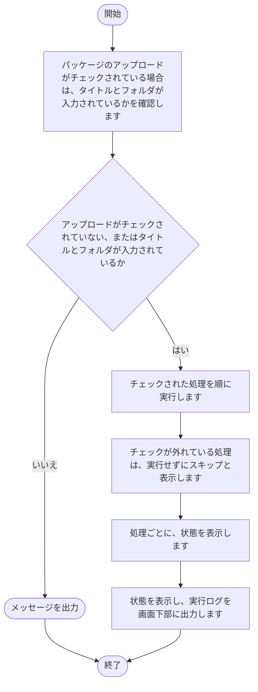

### 2.4 ログ[すべて削除]

1. ログの出力先にあるログファイルを確認します。
2. ログファイルが 1 つもない場合は、メッセージを出力して終了します。
3. 削除の確認を求めます。
4. 確認で「はい」を選んだ場合は、ログの出力先にあるすべてのログファイルを削除します。

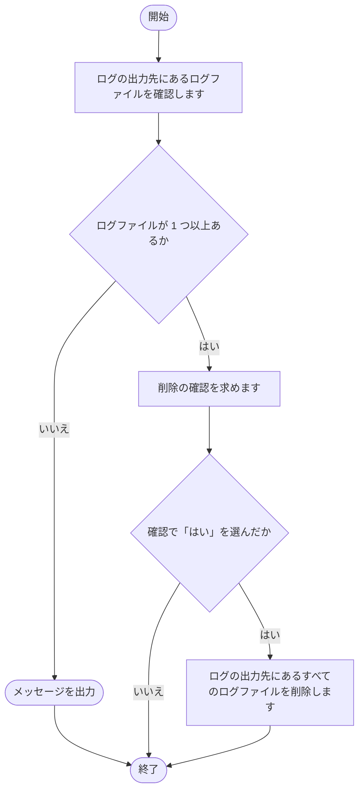

### 2.5 環境設定（共通）[保存]

1. 入力された内容を確認します。
2. 入力された内容を、共通の設定ファイルに書き込みます。
3. 画面の表示を、保存後の内容に更新します。
4. 結果を、ボタンの横に表示します。

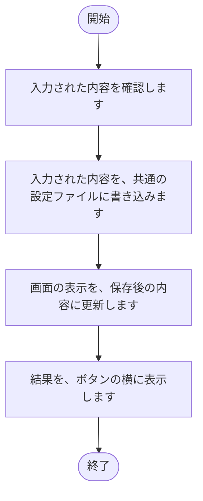

### 2.6 環境設定（共通）[再読込]

1. 共通の設定ファイルの内容を読み込みます。
2. 読み込んだ内容で、画面の入力欄を表示し直します。
3. 結果を、ボタンの横に表示します。

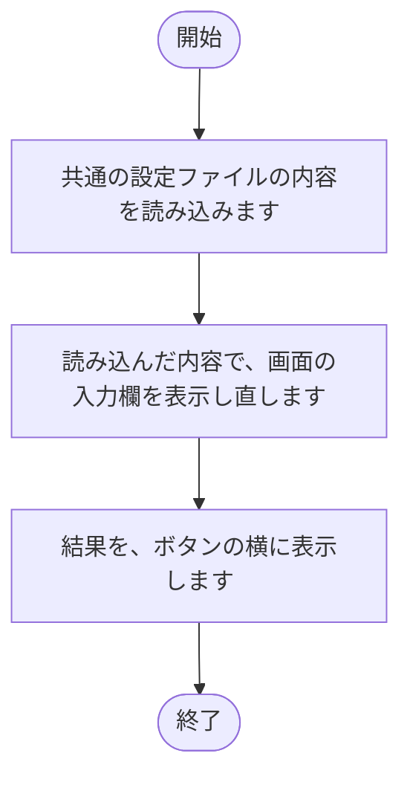

### 2.7 環境設定（グループ別）[新規作成]

1. グループ名を入力する画面を表示します。
2. 入力された名前が、既存のグループと重複していないかを確認します。
3. 重複していなければ、新しいグループを一覧に追加します。

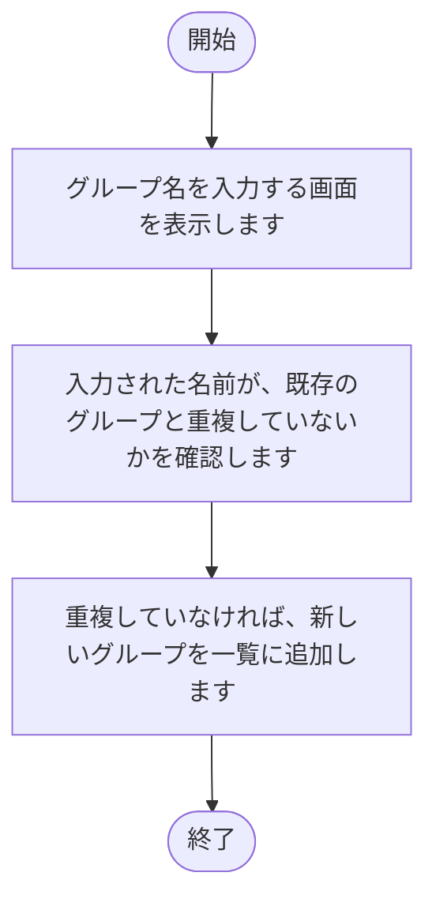

### 2.8 環境設定（グループ別）[コピー]
1. 選ばれているグループの設定ファイルが存在するかを確認します。存在しなければ、「コピー元のグループが存在しません」と表示して終了します。
2. コピー先のグループ名を入力する画面を表示します。
3. 入力された名前が、既存のグループと重複していないかを確認します。
4. 重複していなければ、設定ファイルと Excel ファイルをコピーします。パッケージ定義ファイルと出力先の、グループ名を含む部分を、コピー先の名前に書き換えます。
5. コピー先のグループを一覧に追加して選びます。

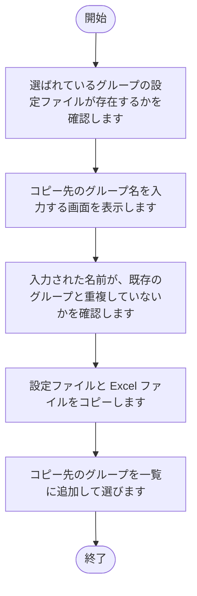

### 2.9 環境設定（グループ別）[保存]

1. 対象のグループの設定ファイルがない場合は、雛形からコピーします。
2. 入力された内容を、対象のグループの設定ファイルに書き込みます。
3. 対象のグループのパッケージ定義ファイルがない場合は、雛形からコピーします。
4. 画面の表示を、保存後の内容に更新します。
5. 結果を、ボタンの横に表示します。

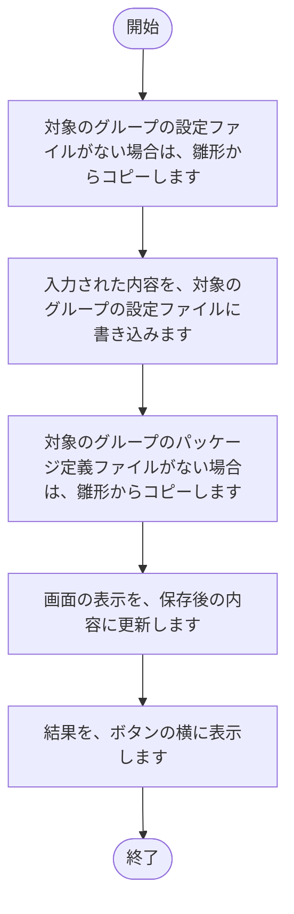

### 2.10 環境設定（グループ別）[再読込]

1. 対象のグループの設定ファイルの内容を読み込みます。
2. 読み込んだ内容で、画面の入力欄を表示し直します。
3. 結果を、ボタンの横に表示します。

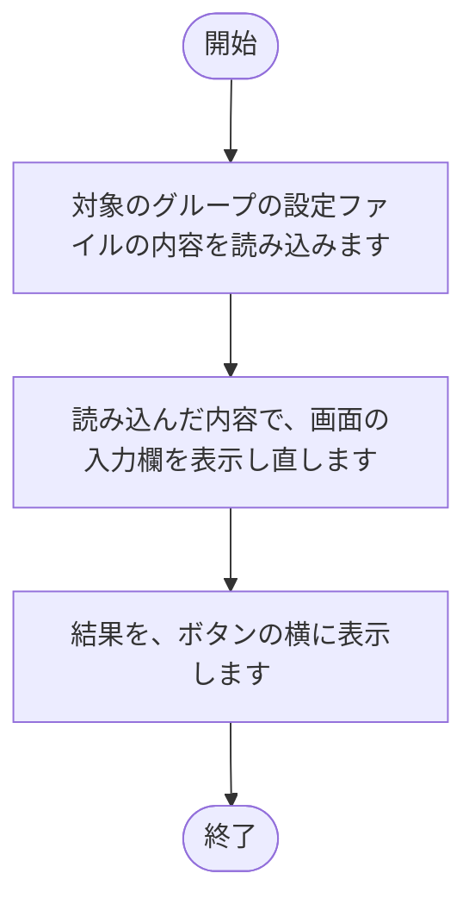

### 2.11 環境設定（グループ別）[テスト接続（認証情報）]

1. サブドメイン、ログイン名、パスワードが入力されているかを確認します。
2. 未入力の項目がある場合は、メッセージを出力して終了します。
3. kintone に接続し、接続できるかを確認します。
4. 結果を、ボタンの横に表示します。

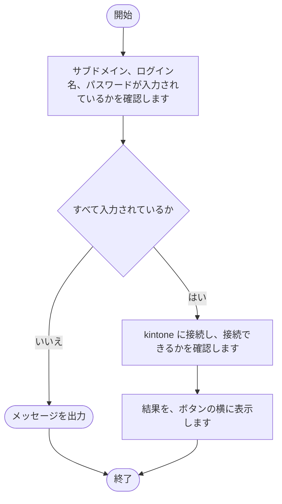

### 2.12 環境設定（グループ別）[テスト接続（ファイル管理）]

1. 対象アプリIDが入力されているかを確認します。
2. 未入力の場合は、メッセージを出力して終了します。
3. kintone のアプリに接続し、接続できるかを確認します。
4. 結果を、ボタンの横に表示します。

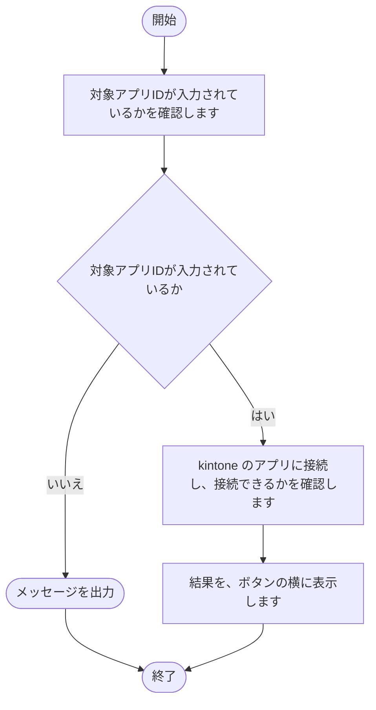

### 2.13 環境設定（パッケージ定義）[実行（パッケージ定義ファイルの更新）]

1. 対象のグループのパッケージ定義ファイルが、別のアプリで開かれていないかを確認します。
2. 「テンプレート」シートの 2 行目以降を消去します。
3. 圧縮元のフォルダの内容から、取得元の一覧を「テンプレート」シートに書き込みます。
4. 状態を表示し、実行ログを画面下部に出力します。

## 3. 注意事項

- 出力先のファイルを開いたままにすると、書き込みに失敗する可能性があります。
- 更新するファイルを別のアプリで開いたままにすると、パッケージ定義ファイルの更新に失敗する可能性があります。
- パッケージ定義ファイルの更新では、「テンプレート」シートの 2 行目以降が消去され、圧縮元のフォルダの内容から作り直されます。このシートに入力した内容は失われます。
- 一括実行では、ある処理が失敗しても、選んだ後続の処理は続けて実行されます。
