# package-generator 処理フロー

## 1. 概要

画面のボタンごとに、押したときに行われる処理の流れを示します。

### 1.1 処理の一覧

| 通番 | 画面名 | ボタン名 | 内容 |
|---|---|---|---|
| 1 | 実行（パッケージ作成） | 実行（パッケージの作成） | パッケージを作成します。 |
| 2 | 実行（パッケージ反映） | 実行（パッケージのアップロード） | 選んだ zip ファイルを kintone にアップロードします。 |
| 3 | 実行（一括実行） | 実行 | パッケージの作成とアップロードを順に実行します。 |
| 4 | ログ | すべて削除 | ログのファイルをすべて削除します。 |
| 5 | 環境設定（共通） | 保存 | 入力した内容を保存します。 |
| 6 | 環境設定（共通） | 再読込 | 保存されている内容を読み込み直します。 |
| 7 | 環境設定（グループ別） | 新規作成 | 新しいグループを作成します。 |
| 8 | 環境設定（グループ別） | 保存 | 入力した内容を保存します。 |
| 9 | 環境設定（グループ別） | 再読込 | 保存されている内容を読み込み直します。 |
| 10 | 環境設定（グループ別） | テスト接続（kintone接続） | kintone に接続できるかを確認します。 |
| 11 | 環境設定（グループ別） | テスト接続（ファイル管理） | 対象アプリのIDに接続できるかを確認します。 |
| 12 | 環境設定（パッケージ定義） | 実行（パッケージ定義ファイルの更新） | パッケージ定義ファイルを更新します。 |

## 2. 各ボタンの処理フロー

### 2.1 実行（パッケージ作成）[実行（パッケージの作成）]

1. 対象のグループを確認します。
2. パッケージ定義ファイルを読み込みます。
3. 圧縮元のフォルダの内容から、パッケージを作成します。
4. 状態を表示し、実行ログを画面下部に出力します。

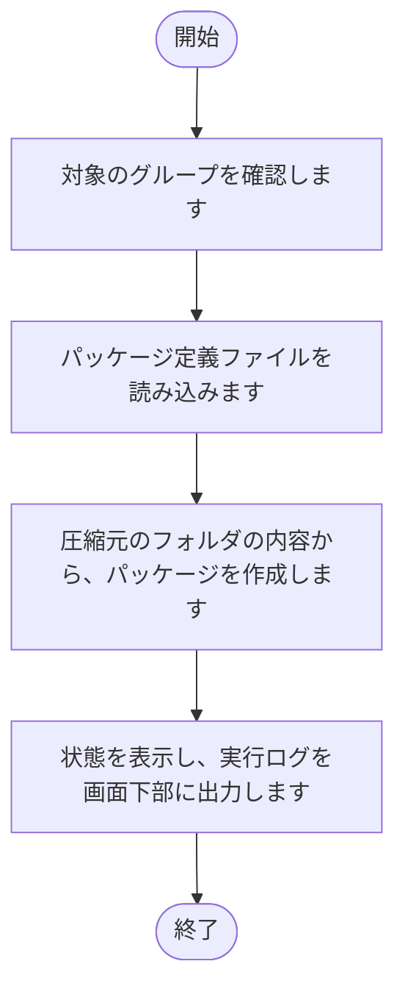

### 2.2 実行（パッケージ反映）[実行（パッケージのアップロード）]

1. 必須の入力（対象のグループ、タイトル、フォルダ）がない場合は、メッセージを出力して終了します。
2. フォルダ内の zip ファイルを取得します。
3. zip ファイルを kintone に添付します。
4. レコードを作成します。
5. 状態を表示し、実行ログを画面下部に出力します。

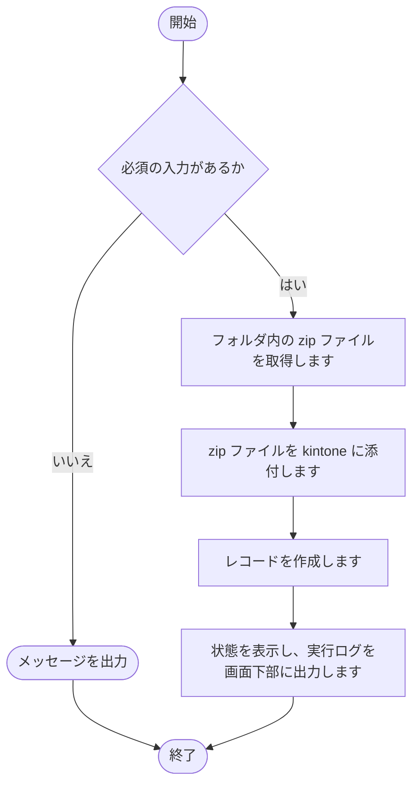

### 2.3 実行（一括実行）[実行]

1. 必須の入力（対象のグループ、タイトル、フォルダ）がない場合は、メッセージを出力して終了します。
2. 選んだ処理を順に実行します。
3. 処理ごとに、状態を表示します。
4. 状態を表示し、実行ログを画面下部に出力します。

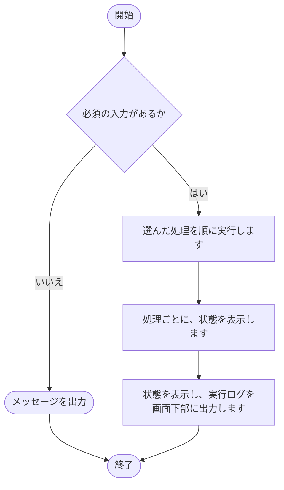

### 2.4 ログ[すべて削除]

1. ログのファイルを確認します。
2. 削除の確認を求めます。
3. 確認で「はい」を選んだ場合は、ログのファイルを削除します。

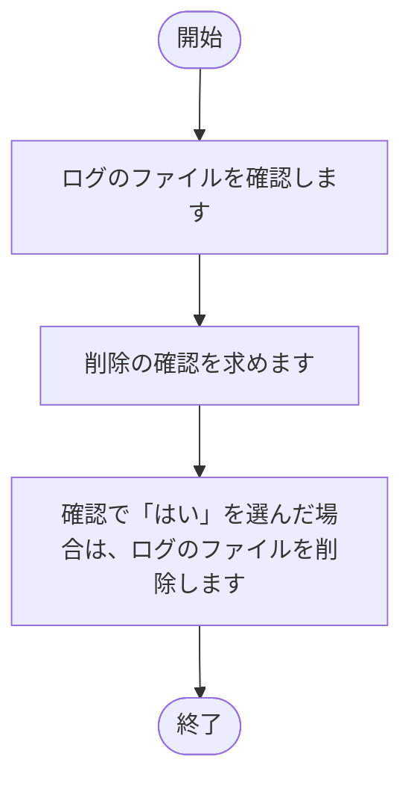

### 2.5 環境設定（共通）[保存]

1. 入力された内容を確認します。
2. 入力された内容を、共通の設定ファイルに書き込みます。
3. 画面の表示を、保存後の内容に更新します。
4. 結果を、ボタンの横に表示します。

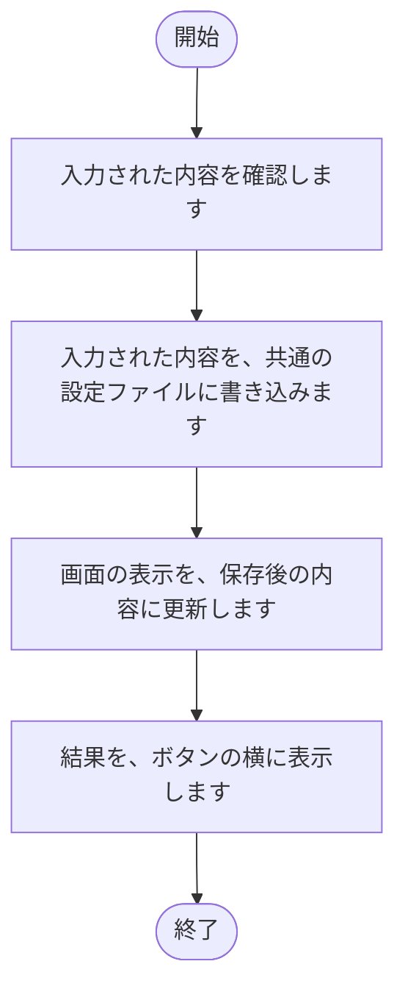

### 2.6 環境設定（共通）[再読込]

1. 共通の設定ファイルの内容を読み込みます。
2. 読み込んだ内容で、画面の入力欄を表示し直します。
3. 結果を、ボタンの横に表示します。

### 2.7 環境設定（グループ別）[新規作成]

1. グループ名を入力する画面を表示します。
2. 入力された名前が、既存のグループと重複していないかを確認します。
3. 重複していなければ、新しいグループを作成し、グループの一覧に追加します。

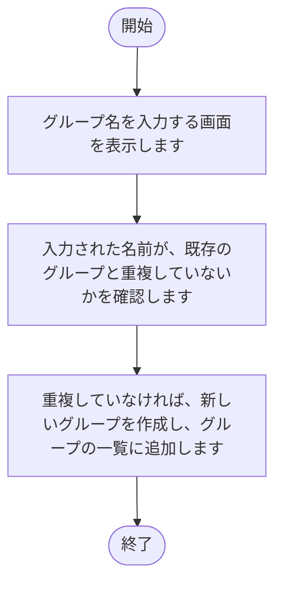

### 2.8 環境設定（グループ別）[保存]

1. 入力された内容を確認します。
2. 入力された内容を、対象のグループの設定ファイルに書き込みます。
3. 画面の表示を、保存後の内容に更新します。
4. 結果を、ボタンの横に表示します。

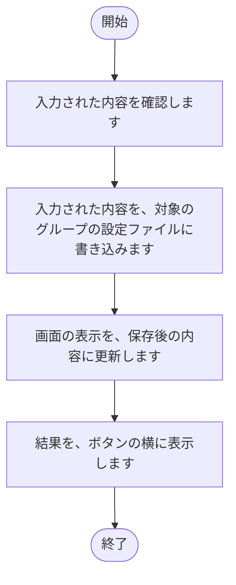

### 2.9 環境設定（グループ別）[再読込]

1. 対象のグループの設定ファイルの内容を読み込みます。
2. 読み込んだ内容で、画面の入力欄を表示し直します。
3. 結果を、ボタンの横に表示します。

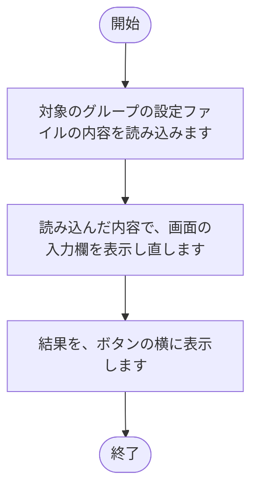

### 2.10 環境設定（グループ別）[テスト接続（kintone接続）]

1. サブドメイン、ログイン名、パスワードを確認します。
2. kintone に接続し、接続できるかを確認します。
3. 結果を、ボタンの横に表示します。

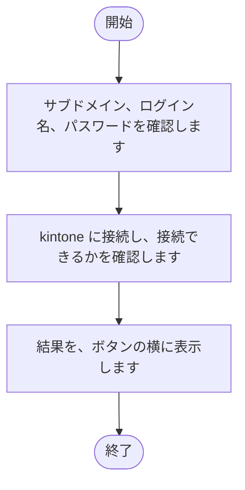

### 2.11 環境設定（グループ別）[テスト接続（ファイル管理）]

1. 対象アプリIDを確認します。
2. kintone のアプリに接続し、接続できるかを確認します。
3. 結果を、ボタンの横に表示します。

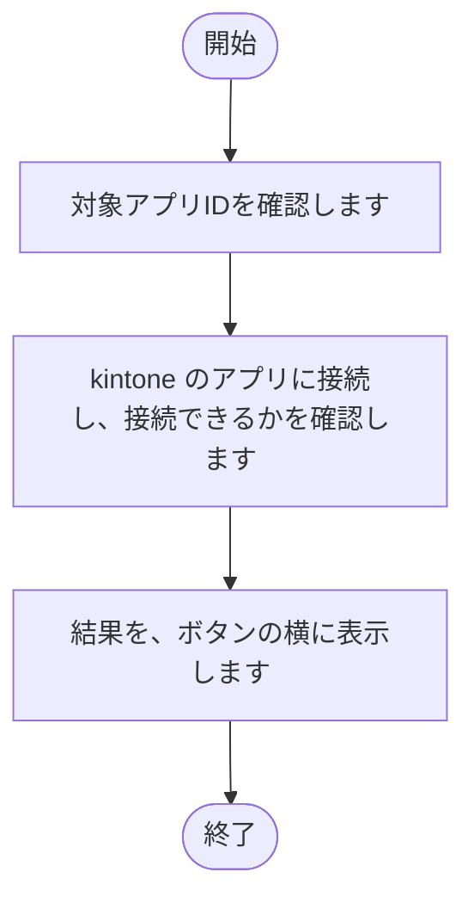

### 2.12 環境設定（パッケージ定義）[実行（パッケージ定義ファイルの更新）]

1. 対象のグループを確認します。
2. パッケージ定義ファイルを、テンプレートの内容で更新します。
3. 状態を表示し、実行ログを画面下部に出力します。

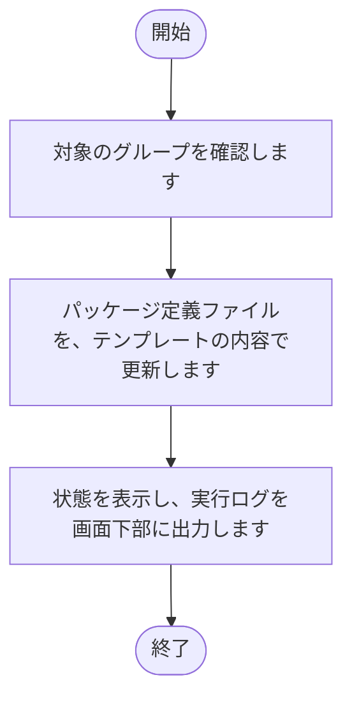

## 3. 注意事項

- 出力先のファイルを開いたままにすると、書き込みに失敗する可能性があります。
