# 処理フロー

## 1. 概要

画面のボタンごとに、押したときに行われる処理の流れを示します。

- 処理の一覧

| 通番 | 画面名 | ボタン名 | 内容 |
|---|---|---|---|
| 1 | 実行（一括実行） | 実行（一括実行） | 選んだ処理を順に実行します。 |
| 2 | 実行（パッケージ作成） | 実行（パッケージの作成） | パッケージを作成します。 |
| 3 | 実行（パッケージ反映） | 実行（パッケージのアップロード） | 選んだ zip ファイルを kintone にアップロードします。 |
| 4 | ログ | すべて削除 | ログの出力先にあるすべてのログファイルを削除します。削除の前に確認を求めます。 |
| 5 | 環境設定（共通） | 保存 | 入力した内容を保存します。 |
| 6 | 環境設定（共通） | 再読込 | 保存されている内容を読み込み直します。 |
| 7 | 環境設定（グループ別） | 新規作成 | 新しいグループを作成します。 |
| 8 | 環境設定（グループ別） | コピー | 既存のグループの設定をコピーして、新しいグループを作成します。 |
| 9 | 環境設定（グループ別） | 保存 | 入力した内容を保存します。 |
| 10 | 環境設定（グループ別） | 再読込 | 保存されている内容を読み込み直します。 |
| 11 | 環境設定（グループ別） | テスト接続（認証情報） | kintone に接続できるかを確認します。 |
| 12 | 環境設定（グループ別） | テスト接続（ファイル管理） | kintone のアプリに接続できるかを確認します。 |
| 13 | 環境設定（パッケージ定義） | 実行（パッケージ定義ファイルの更新） | パッケージ定義ファイルを更新します。 |

## 2. 各ボタンの処理フロー

### 2.1 実行（一括実行）[実行（一括実行）]

1. パッケージのアップロードがチェックされている場合は、タイトルが入力されているかを確認します。
2. 入力されていない場合は、「（項目名） を設定してください。」と表示して終了します。
3. チェックされた処理を順に実行します。
4. チェックを外した処理は、実行せずにスキップします。
5. 処理ごとに、状態を「成功」「警告」「失敗」「スキップ」のいずれかで表示します。
6. 状態を表示し、実行ログを画面下部に出力します。

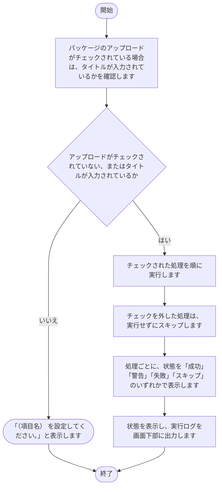

### 2.2 実行（パッケージ作成）[実行（パッケージの作成）]

1. 対象のグループ設定ファイルを読み込みます。
2. パッケージ定義ファイルを読み込みます。
3. 作業用のフォルダの中身を消して、作り直します。
4. 「テンプレート」シートを除き、対象のシートの指定がある場合はそのシートに絞り、除外のシートの指定に一致するシートを外します。
5. 残ったシートごとに、圧縮元のフォルダの内容から zip ファイルを作成します。圧縮元のフォルダがない取得元は飛ばして、警告を記録します。
6. 処理の終了時に、作業用のフォルダを削除します。
7. 1 つでも飛ばした場合は、状態を警告にします。それ以外は、状態を表示します。
8. 実行ログを画面下部に出力します。

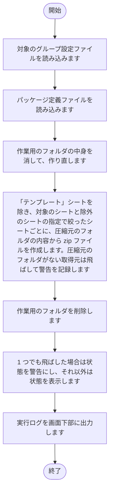

### 2.3 実行（パッケージ反映）[実行（パッケージのアップロード）]

1. タイトルが空でないか、同じ名前の zip ファイルがないか、zip ファイルが 1 つ以上あるかを確認します。
2. 入力に問題がある場合は、次のメッセージを出力して終了します。タイトルが空の場合は「タイトルを入力してください」、同じ名前の zip ファイルがある場合は「同じ名前のzipファイルがあります」、zip ファイルがない場合は「zipファイルを1つ以上指定してください」です。
3. ファイル1〜3 で zip ファイルを選んでいれば、それらを対象にします。選んでいなければ、対象のグループのパッケージの出力先（GenerateOutputPath）にある zip ファイルを対象にします。
4. zip ファイルを kintone に添付します。
5. 同じタイトルのレコードがあれば更新し、なければレコードを作成します。
6. 既存のレコードを更新した場合は、zip ファイルをバックアップの保存先（BackupPath）のクライアント名と日時のフォルダにコピーします。
7. 状態を表示し、実行ログを画面下部に出力します。

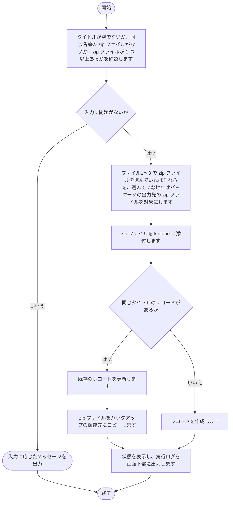

### 2.4 ログ[すべて削除]

1. ログの出力先にあるログファイルを確認します。
2. ログファイルが 1 つもない場合は、「削除対象のログファイルがありません。」と表示して終了します。
3. 削除の確認を求めます。
4. 確認で「はい」を選んだ場合は、ログの出力先にあるすべてのログファイルを削除します。

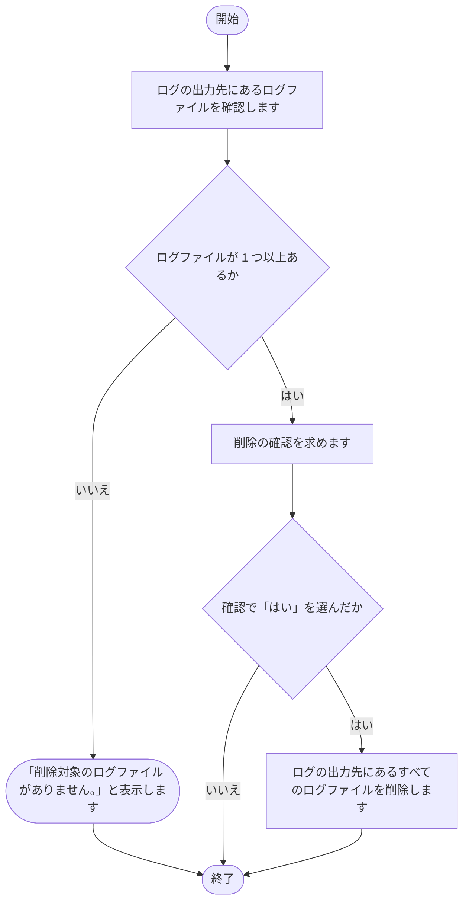

### 2.5 環境設定（共通）[保存]

1. 入力された内容を確認します。
2. 入力された内容を、共通設定ファイルに書き込みます。
3. 画面の表示を、保存後の内容に更新します。
4. 状態（保存）を表示します。

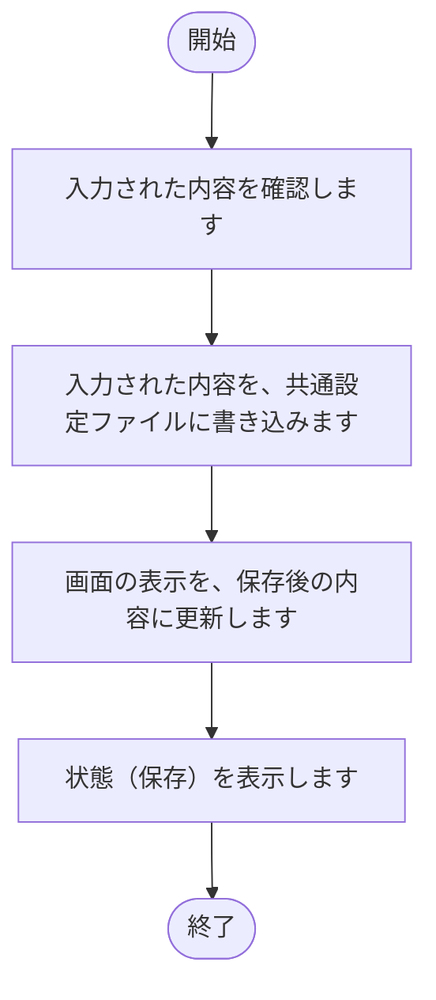

### 2.6 環境設定（共通）[再読込]

1. 共通設定ファイルの内容を読み込みます。
2. 読み込んだ内容で、画面の入力欄を表示し直します。
3. 状態（再読込）を表示します。

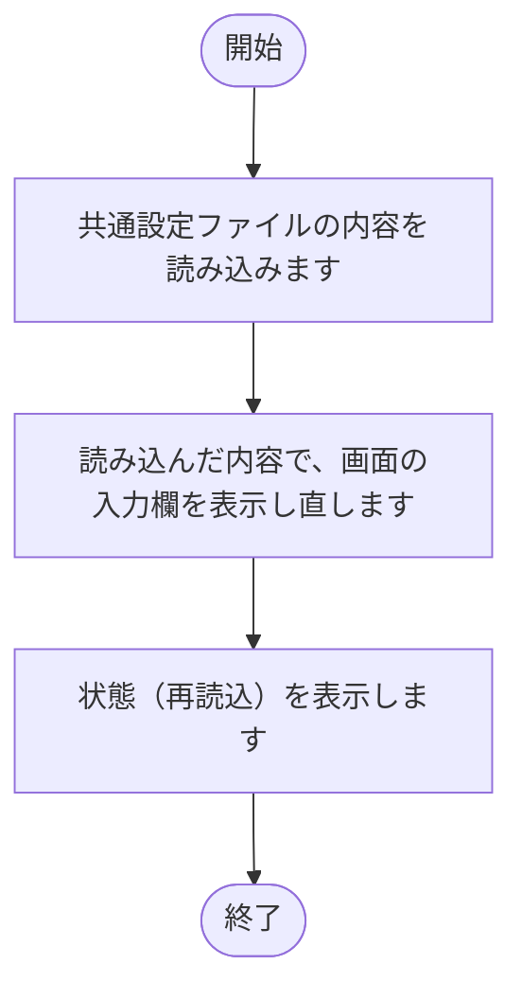

### 2.7 環境設定（グループ別）[新規作成]

1. グループ名を入力する画面を表示します。
2. 名前が空のとき、または「キャンセル」を押したときは、何も作らずに閉じます。
3. 入力された名前が既存のグループと重複している場合は、「（入力した名前）は既に存在します。」と表示して終了します。
4. 重複していなければ、新しいグループを一覧に追加して、選んだ状態にします。

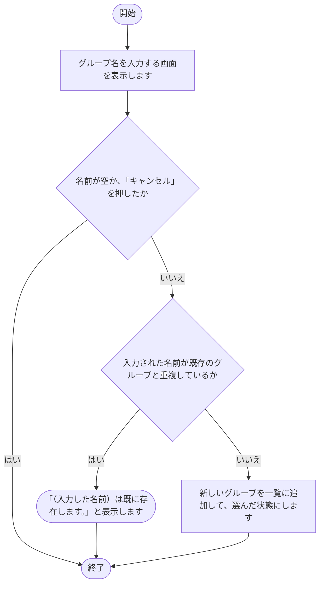

### 2.8 環境設定（グループ別）[コピー]

1. 選ばれているグループ設定ファイルが存在するかを確認します。存在しなければ、「コピー元のグループが存在しません。」と表示して終了します。
2. コピー先のグループ名を入力する画面を表示します。
3. 入力された名前が、既存のグループと重複していないかを確認します。
4. 重複している場合は、「（入力した名前）は既に存在します。」と表示して終了します。
5. 重複していなければ、グループ設定ファイルとパッケージ定義ファイルをコピーします。パッケージ定義ファイルと出力先の、グループ名を含む部分を、コピー先の名前に書き換えます。
6. コピー先のグループを一覧に追加して選びます。

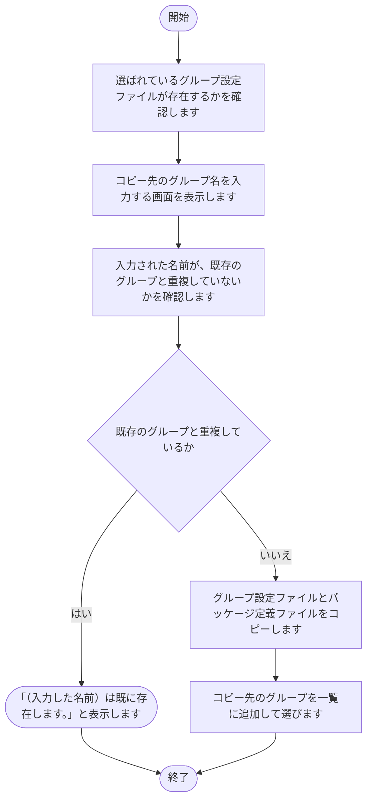

### 2.9 環境設定（グループ別）[保存]

1. 対象のグループ設定ファイルがない場合は、雛形からコピーします。
2. 入力された内容を、対象のグループ設定ファイルに書き込みます。
3. 対象のグループのパッケージ定義ファイルがない場合は、雛形からコピーします。
4. 画面の表示を、保存後の内容に更新します。
5. 状態（保存）を表示します。

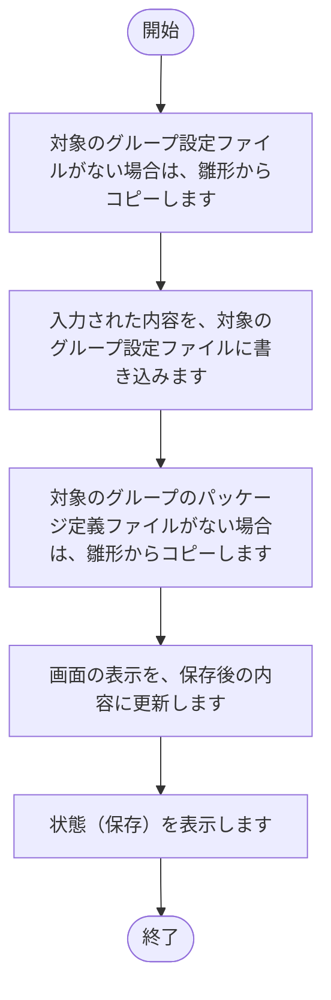

### 2.10 環境設定（グループ別）[再読込]

1. 対象のグループ設定ファイルの内容を読み込みます。
2. 読み込んだ内容で、画面の入力欄を表示し直します。
3. 状態（再読込）を表示します。

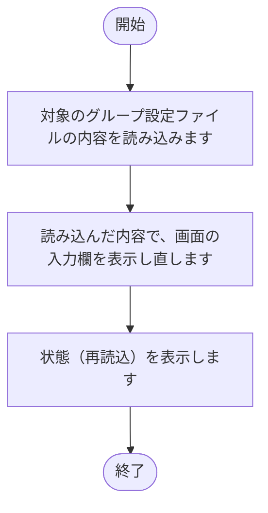

### 2.11 環境設定（グループ別）[テスト接続（認証情報）]

1. サブドメイン、ログイン名、パスワードが入力されているかを確認します。
2. 未入力の項目がある場合は、「サブドメイン・ログイン名・パスワードをすべて入力してください。」と表示し、状態を失敗にして終了します。
3. kintone に接続し、接続できるかを確認します。
4. 状態（テスト接続（認証情報））を表示します。

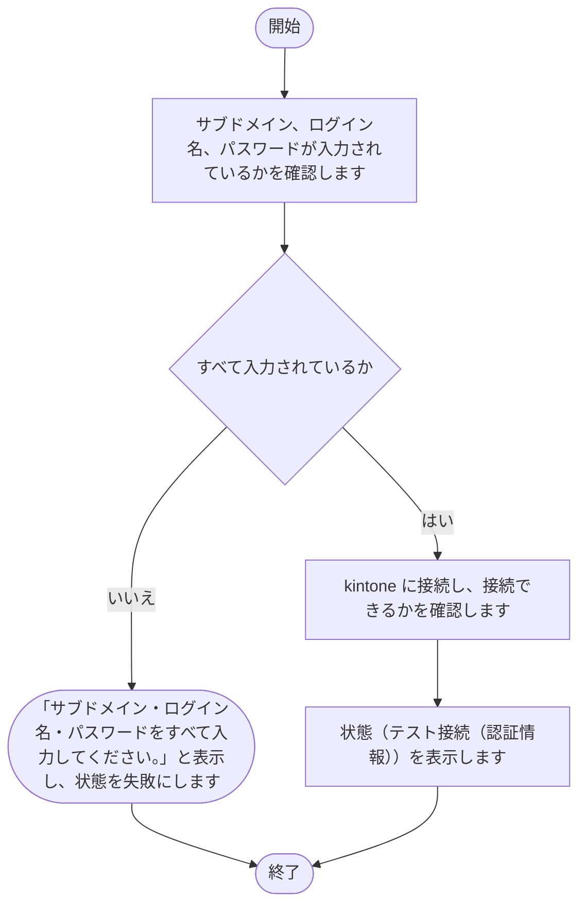

### 2.12 環境設定（グループ別）[テスト接続（ファイル管理）]

1. 対象アプリIDが入力されているかを確認します。
2. 未入力の場合は、「対象アプリIDを入力してください。」と表示し、状態を失敗にして終了します。
3. kintone のアプリに接続し、接続できるかを確認します。
4. 状態（テスト接続（ファイル管理））を表示します。

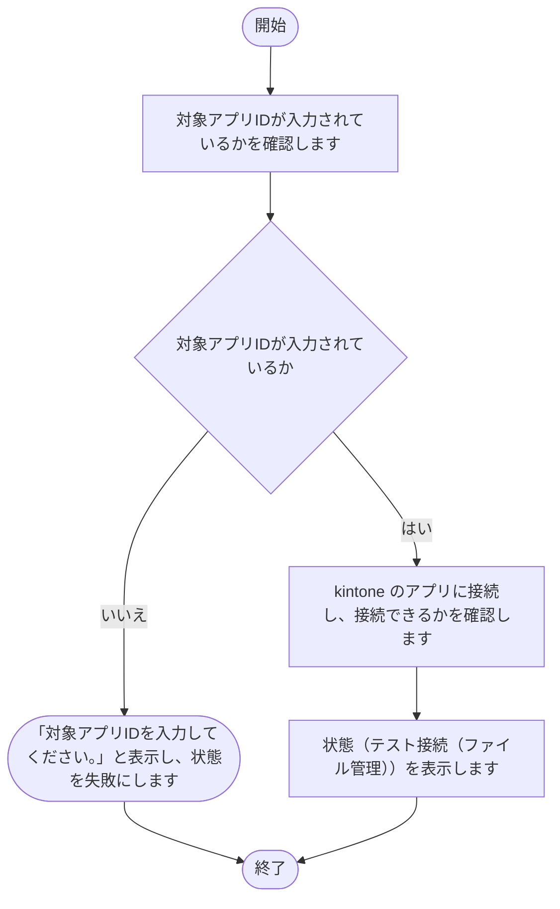

### 2.13 環境設定（パッケージ定義）[実行（パッケージ定義ファイルの更新）]

1. 対象のグループのパッケージ定義ファイルが、別のアプリで開かれていないかを確認します。
2. 「テンプレート」シートの 2 行目以降を消去します。
3. 圧縮元のフォルダの内容から、取得元の一覧を「テンプレート」シートに書き込みます。
4. 状態を表示し、実行ログを画面下部に出力します。

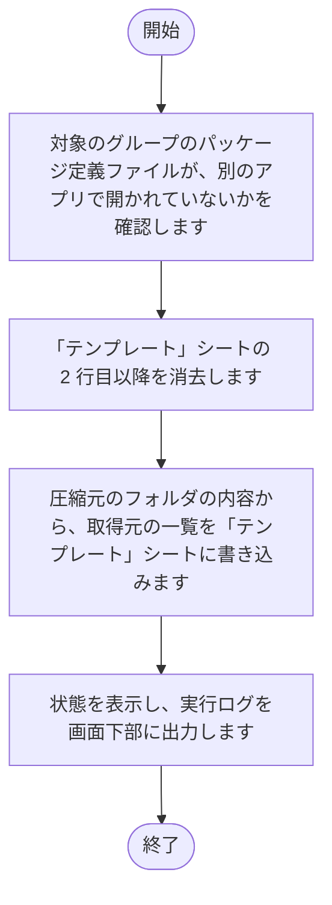

## 3. 注意事項

- 出力先のファイルを開いたままにすると、書き込みに失敗する可能性があります。
- 更新するファイルを別のアプリで開いたままにすると、パッケージ定義ファイルの更新に失敗する可能性があります。
- パッケージ定義ファイルの更新では、「テンプレート」シートの 2 行目以降が消去され、圧縮元のフォルダの内容から作り直されます。このシートに入力した内容は失われます。
- 一括実行では、ある処理が失敗しても、選んだ後続の処理は続けて実行されます。
