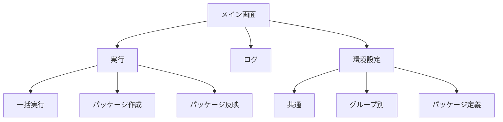

# package-generator 画面設計

## 1. 概要

package-generator の操作画面は、1 つのウィンドウに「実行」「ログ」「環境設定」のタブを置いた構成です。本書では、各タブの画面と、その中の項目や操作を示します。

### 1.1 画面の一覧

| 通番 | 画面 | 内容 |
|---|---|---|
| 1 | 実行（一括実行） | 対象のグループ、タイトル、フォルダを指定し、パッケージの作成とアップロードをまとめて実行します。 |
| 2 | 実行（パッケージ作成） | 対象のグループを指定して、パッケージを作成します。 |
| 3 | 実行（パッケージ反映） | 対象のグループ、タイトル、フォルダを指定して、パッケージを kintone にアップロードします。 |
| 4 | ログ | グループを選び、実行ログを表示します。 |
| 5 | 環境設定（共通） | ログの出力先を編集します。 |
| 6 | 環境設定（グループ別） | グループごとの kintone の接続情報、ダウンロード、パッケージ作成、アップロードの設定を編集します。 |
| 7 | 環境設定（パッケージ定義） | 対象のグループのパッケージ定義ファイルを更新します。 |

### 1.2 画面遷移図

- 画面の切り替えは、タブを選ぶことで行います。

## 2. 各画面

### 2.1 実行（一括実行）

| 通番 | 項目 | 種類 | 内容 |
|---|---|---|---|
| 1 | 対象のグループ | コンボボックス | 対象のグループを選びます。 |
| 2 | タイトル | テキスト | アップロードするレコードのタイトルを入力します。 |
| 3 | フォルダ | テキスト | アップロードする zip ファイルのあるフォルダを選びます（参照ボタン付き）。 |
| 4 | 実行 | ボタン | パッケージの作成とアップロードを順に実行します。 |
| 5 | 状態 | ラベル | 処理の状態を表示します。 |

### 2.2 実行（パッケージ作成）

#### パッケージの作成

| 通番 | 項目 | 種類 | 内容 |
|---|---|---|---|
| 1 | 対象のグループ | コンボボックス | 対象のグループを選びます。 |
| 2 | 実行 | ボタン | パッケージを作成します。 |
| 3 | 状態 | ラベル | 処理の状態を表示します。 |
| 4 | 開く | リンク | 作成したパッケージのフォルダを開きます。 |

### 2.3 実行（パッケージ反映）

#### パッケージのアップロード

| 通番 | 項目 | 種類 | 内容 |
|---|---|---|---|
| 1 | 対象のグループ | コンボボックス | 対象のグループを選びます。 |
| 2 | タイトル | テキスト | アップロードするレコードのタイトルを入力します。 |
| 3 | フォルダ | テキスト | アップロードする zip ファイルのあるフォルダを選びます（参照ボタン付き）。 |
| 4 | ファイル1 | テキスト | アップロードするzipファイルを選びます（参照ボタン付き）。 |
| 5 | ファイル2 | テキスト | アップロードするzipファイルを選びます（参照ボタン付き）。 |
| 6 | ファイル3 | テキスト | アップロードするzipファイルを選びます（参照ボタン付き）。 |
| 7 | 説明 | テキストエリア | レコードの説明を入力します。 |
| 8 | 実行 | ボタン | 選んだ zip ファイルを kintone にアップロードします。 |
| 9 | 状態 | ラベル | 処理の状態を表示します。 |
| 10 | 開く | リンク | アップロードの結果を開きます。 |

### 2.4 ログ

| 通番 | 項目 | 種類 | 内容 |
|---|---|---|---|
| 1 | 対象のグループ | コンボボックス | 表示するログのグループを選びます。 |
| 2 | （処理名） | ラジオボタン | 表示するログの処理を選びます。 |
| 3 | すべて削除 | ボタン | ログを削除します（削除の対象は確認の上）。 |
| 4 | ログ | テキストエリア | 選んだグループと処理の実行ログを表示します。 |

### 2.5 環境設定（共通）

| 通番 | 項目 | 種類 | 内容 |
|---|---|---|---|
| 1 | 保存 | ボタン | 入力した内容を保存します。 |
| 2 | 再読込 | ボタン | 保存されている内容を読み込み直します。 |
| 3 | ログの出力先 | テキスト | 実行ログの出力先を入力します（参照ボタン付き）。 |

### 2.6 環境設定（グループ別）

| 通番 | 項目 | 種類 | 内容 |
|---|---|---|---|
| 1 | 対象のグループ | コンボボックス | 対象のグループを選びます。 |
| 2 | 新規作成 | ボタン | 新しいグループを作成します。 |
| 3 | 保存 | ボタン | 入力した内容を保存します。 |
| 4 | 再読込 | ボタン | 保存されている内容を読み込み直します。 |
| 5 | サブドメイン | テキスト | kintone の組織のサブドメインを入力します。 |
| 6 | ログイン名 | テキスト | kintone の接続に使うログイン名を入力します。 |
| 7 | パスワード | テキスト | kintone の接続に使うパスワードを入力します。 |
| 8 | テスト接続（kintone接続） | ボタン | kintone に接続できるかを確認します。 |
| 9 | 対象アプリID | テキスト | ファイルを添付するアプリのIDを入力します。 |
| 10 | テスト接続（ファイル管理） | ボタン | 対象アプリのIDに接続できるかを確認します。 |
| 11 | ダウンロード元のサイトURL | テキスト | ダウンロード元のサイトの URL を入力します。 |
| 12 | ダウンロード元のフォルダ | テキスト | ダウンロード元のフォルダのパスを入力します。 |
| 13 | テナントID | テキスト | ダウンロード元のテナントのIDを入力します。 |
| 14 | ダウンロード先のフォルダ | テキスト | ダウンロードしたフォルダの保存先を入力します（参照ボタン付き）。 |
| 15 | 圧縮元のフォルダ | テキスト | パッケージの元になるフォルダを入力します（参照ボタン付き）。 |
| 16 | パッケージ定義ファイル | テキスト | パッケージ定義ファイルのパスを入力します（参照ボタン付き）。 |
| 17 | 作業用のフォルダ | テキスト | パッケージの作成に使う作業用のフォルダを入力します（参照ボタン付き）。 |
| 18 | パッケージの出力先 | テキスト | 作成したパッケージの保存先を入力します（参照ボタン付き）。 |
| 19 | 対象のシート | テキスト | パッケージに含めるシートを入力します。 |
| 20 | 除外のシート | テキスト | パッケージから除くシートを入力します。 |
| 21 | アップロード先のサイトURL | テキスト | アップロード先のサイトの URL を入力します。 |
| 22 | アップロード先のフォルダ | テキスト | アップロード先のフォルダのパスを入力します。 |
| 23 | テナントID | テキスト | アップロード先のテナントのIDを入力します。 |
| 24 | アップロード元のフォルダ | テキスト | アップロードするフォルダを入力します（参照ボタン付き）。 |
| 25 | 対象の項目形式 | テキスト | アップロードに含める項目の形式を入力します。 |
| 26 | 除外の項目形式 | テキスト | アップロードから除く項目の形式を入力します。 |

### 2.7 環境設定（パッケージ定義）

#### パッケージ定義ファイルの更新

| 通番 | 項目 | 種類 | 内容 |
|---|---|---|---|
| 1 | 対象のグループ | コンボボックス | 対象のグループを選びます。 |
| 2 | 実行 | ボタン | パッケージ定義ファイルを更新します。 |
| 3 | 状態 | ラベル | 処理の状態を表示します。 |
| 4 | 開く | リンク | 更新したパッケージ定義ファイルを開きます。 |
