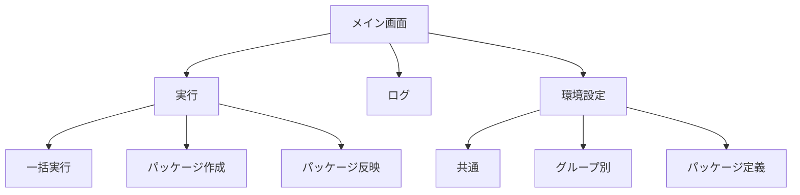
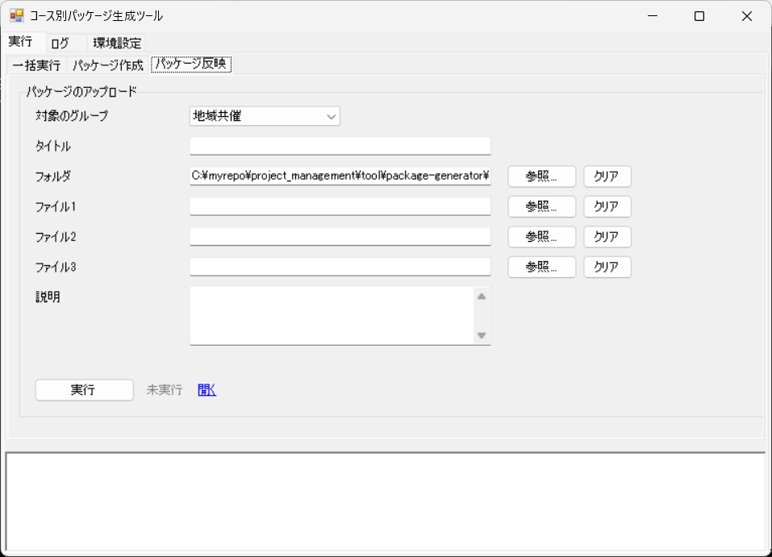
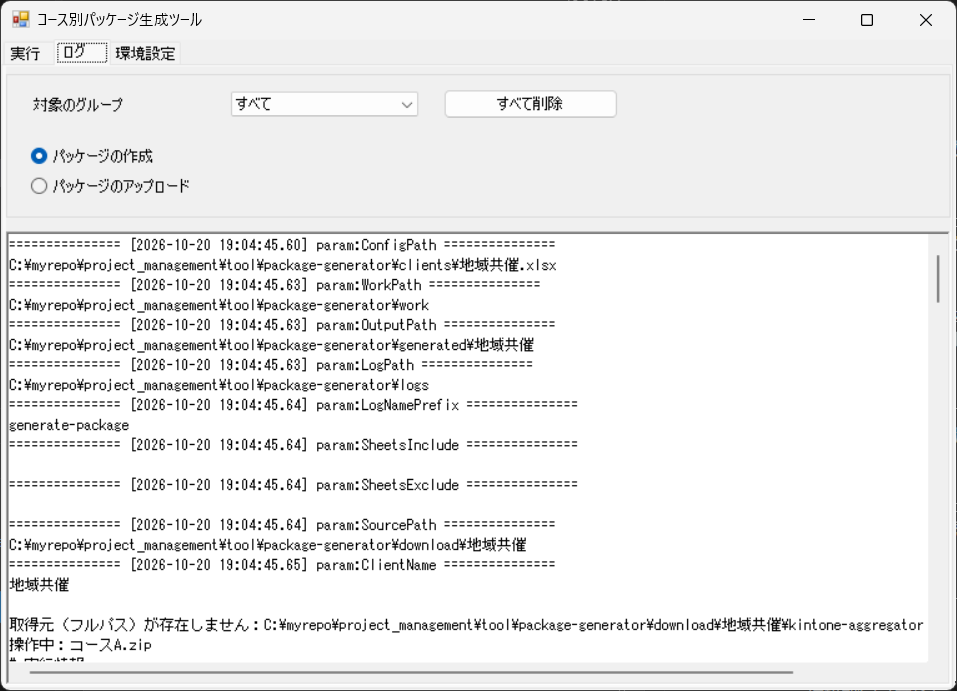
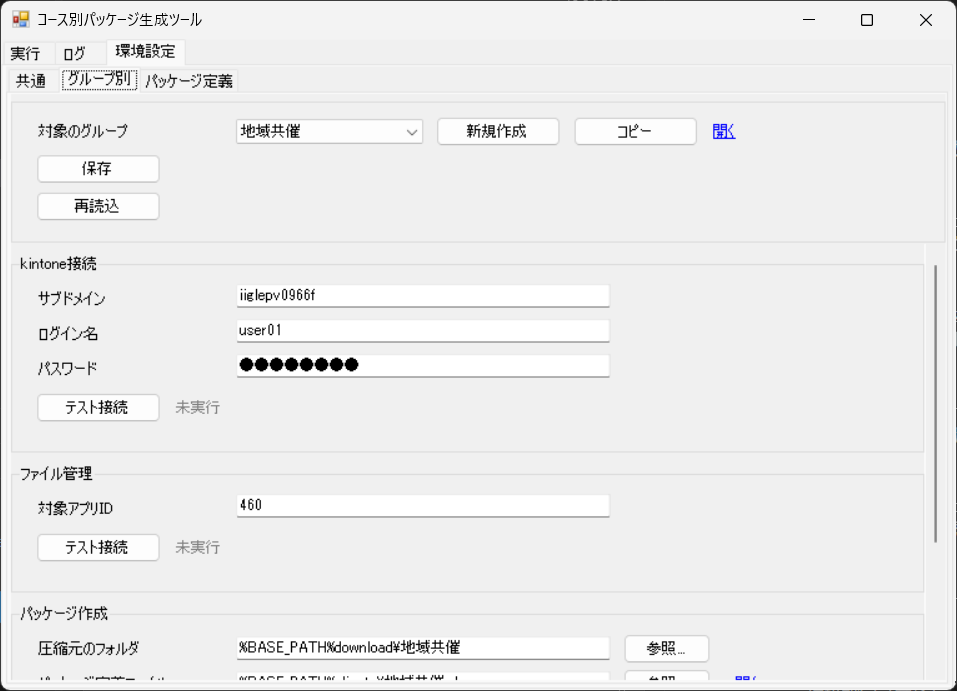
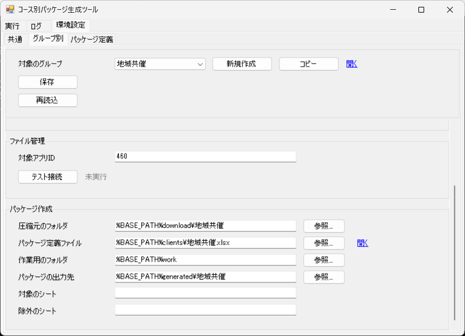
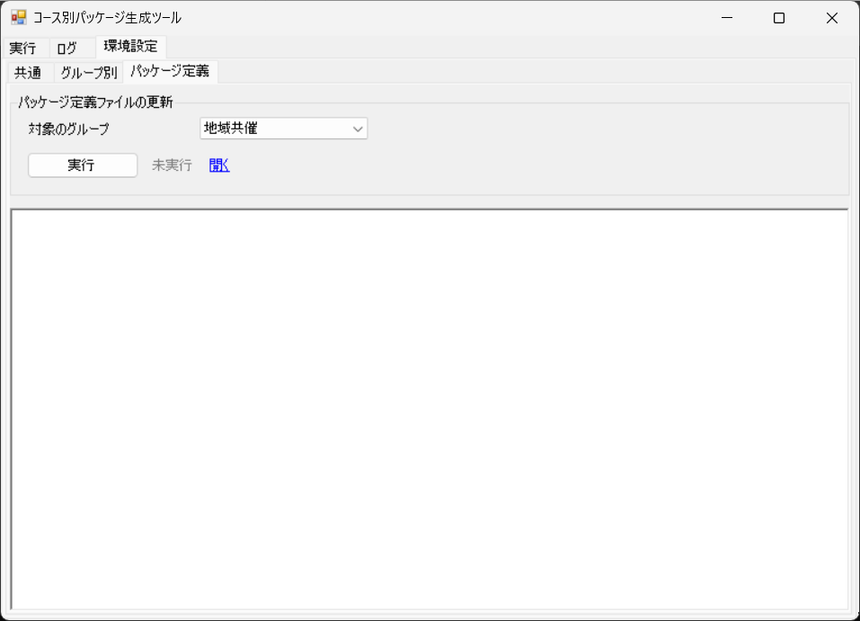

# 画面設計

## 1. 概要

本ツールの操作画面は、1 つのウィンドウに「実行」「ログ」「環境設定」のタブを置いた構成です。本書では、各タブの画面と、その中の項目や操作を示します。

- 画面の一覧

| 通番 | 画面 | 内容 |
|---|---|---|
| 1 | 実行（一括実行） | 対象のグループ、タイトル、フォルダを指定し、選んだ処理（パッケージの作成、パッケージのアップロード）をまとめて実行します。 |
| 2 | 実行（パッケージ作成） | 対象のグループを指定して、パッケージを作成します。 |
| 3 | 実行（パッケージ反映） | 対象のグループ、タイトル、フォルダを指定して、パッケージを kintone にアップロードします。 |
| 4 | ログ | グループと処理を選んで実行ログを表示し、ログを削除します。 |
| 5 | 環境設定（共通） | ログの出力先を編集します。 |
| 6 | 環境設定（グループ別） | グループの新規作成、グループごとの kintone の接続情報、ファイル管理の対象アプリ、パッケージ作成の設定を編集します。 |
| 7 | 環境設定（パッケージ定義） | 対象のグループのパッケージ定義ファイルを更新します。 |

## 2. 画面遷移図

## 3. 各画面

### 3.1 実行（一括実行）

  

| 通番 | 項目 | 種類 | 内容 |
|---|---|---|---|
| 1 | 対象のグループ | コンボボックス | 対象のグループを選びます。 |
| 2 | タイトル | テキスト | アップロードするレコードのタイトルを入力します。 |
| 3 | フォルダ | テキスト | アップロードする zip ファイルのあるフォルダを選びます（参照ボタン付き）。 |
| 4 | パッケージの作成 | チェックボックス | パッケージを作成するかを選びます。初期状態でチェックを付けます。 |
| 5 | 状態（パッケージの作成） | ラベル | パッケージの作成の状態を表示します。 |
| 6 | 開く（パッケージの作成） | リンク | 作成したパッケージの出力先のフォルダを開きます。 |
| 7 | パッケージのアップロード | チェックボックス | パッケージを kintone にアップロードするかを選びます。初期状態でチェックを外します。 |
| 8 | 状態（パッケージのアップロード） | ラベル | パッケージのアップロードの状態を表示します。 |
| 9 | 開く（パッケージのアップロード） | リンク | 対象の kintone アプリを開きます。 |
| 10 | 実行 | ボタン | 選んだ処理を順に実行します。 |
| 11 | 状態 | ラベル | 一括実行の全体の状態を表示します。 |
| 12 | ログ | テキストエリア | 実行の結果のログを表示します。 |

### 3.2 実行（パッケージ作成）

#### パッケージの作成

  

| 通番 | 項目 | 種類 | 内容 |
|---|---|---|---|
| 1 | 対象のグループ | コンボボックス | 対象のグループを選びます。 |
| 2 | 実行 | ボタン | パッケージを作成します。 |
| 3 | 状態 | ラベル | 処理の状態を表示します。 |
| 4 | 開く | リンク | 作成したパッケージのフォルダを開きます。 |
| 5 | ログ | テキストエリア | 実行の結果のログを表示します。 |

### 3.3 実行（パッケージ反映）

#### パッケージのアップロード

  

| 通番 | 項目 | 種類 | 内容 |
|---|---|---|---|
| 1 | 対象のグループ | コンボボックス | 対象のグループを選びます。 |
| 2 | タイトル | テキスト | アップロードするレコードのタイトルを入力します。 |
| 3 | フォルダ | テキスト | アップロードする zip ファイルのあるフォルダを選びます（参照ボタン付き）。 |
| 4 | クリア（フォルダ） | ボタン | フォルダの入力を消去します。 |
| 5 | ファイル1 | テキスト | アップロードする zip ファイルを選びます（参照ボタン付き）。 |
| 6 | クリア（ファイル1） | ボタン | ファイル1の入力を消去します。 |
| 7 | ファイル2 | テキスト | アップロードする zip ファイルを選びます（参照ボタン付き）。 |
| 8 | クリア（ファイル2） | ボタン | ファイル2の入力を消去します。 |
| 9 | ファイル3 | テキスト | アップロードする zip ファイルを選びます（参照ボタン付き）。 |
| 10 | クリア（ファイル3） | ボタン | ファイル3の入力を消去します。 |
| 11 | 説明 | テキストエリア | レコードの説明を入力します。 |
| 12 | 実行 | ボタン | 選んだ zip ファイルを kintone にアップロードします。 |
| 13 | 状態 | ラベル | 処理の状態を表示します。 |
| 14 | 開く | リンク | 対象の kintone アプリを開きます。 |
| 15 | ログ | テキストエリア | 実行の結果のログを表示します。 |

### 3.4 ログ

  

| 通番 | 項目 | 種類 | 内容 |
|---|---|---|---|
| 1 | すべて削除 | ボタン | ログの出力先にあるすべてのログファイルを削除します。削除の前に確認を求めます。 |
| 2 | 対象のグループ | コンボボックス | 対象のグループを選びます。 |
| 3 | 処理 | ラジオボタン | 表示するログの処理を選びます。 |
| 4 | ログ | テキストエリア | 選んだグループと処理の実行ログを表示します。 |

「処理」は、画面に表示されない項目名です。処理名のラジオボタンを指します。

### 3.5 環境設定（共通）

  

| 通番 | 項目 | 種類 | 内容 |
|---|---|---|---|
| 1 | 保存 | ボタン |
| 2 | 再読込 | ボタン |

#### 共通

  

| 通番 | 項目 | 種類 | 内容 |
|---|---|---|---|
| 1 | ログの出力先 | テキスト |

### 3.6 環境設定（グループ別）

  

  

| 通番 | 項目 | 種類 | 内容 |
|---|---|---|---|
| 1 | 対象のグループ | コンボボックス |
| 2 | 新規作成 | ボタン |
| 3 | 開く（対象のグループ） | リンク |
| 4 | 保存 | ボタン |
| 5 | 再読込 | ボタン |

#### kintone接続

  

  

| 通番 | 項目 | 種類 | 内容 |
|---|---|---|---|
| 1 | サブドメイン | テキスト |
| 2 | ログイン名 | テキスト |
| 3 | パスワード | テキスト |
| 4 | テスト接続（kintone接続） | ボタン |

#### ファイル管理

  

  

| 通番 | 項目 | 種類 | 内容 |
|---|---|---|---|
| 1 | 対象アプリID | テキスト |
| 2 | テスト接続（ファイル管理） | ボタン |

#### パッケージ作成

  

  

| 通番 | 項目 | 種類 | 内容 |
|---|---|---|---|
| 1 | 圧縮元のフォルダ | テキスト |
| 2 | パッケージ定義ファイル | テキスト |
| 3 | 開く（パッケージ定義ファイル） | リンク |
| 4 | 作業用のフォルダ | テキスト |
| 5 | パッケージの出力先 | テキスト |
| 6 | 対象のシート | テキスト |
| 7 | 除外のシート | テキスト |

### 3.7 環境設定（パッケージ定義）

#### パッケージ定義ファイルの更新

  

| 通番 | 項目 | 種類 | 内容 |
|---|---|---|---|
| 1 | 対象のグループ | コンボボックス | 対象のグループを選びます。 |
| 2 | 実行 | ボタン | パッケージ定義ファイルを更新します。 |
| 3 | 状態 | ラベル | 処理の状態を表示します。 |
| 4 | 開く | リンク | 更新したパッケージ定義ファイルを開きます。 |
| 5 | ログ | テキストエリア | 実行ログを表示します。 |
