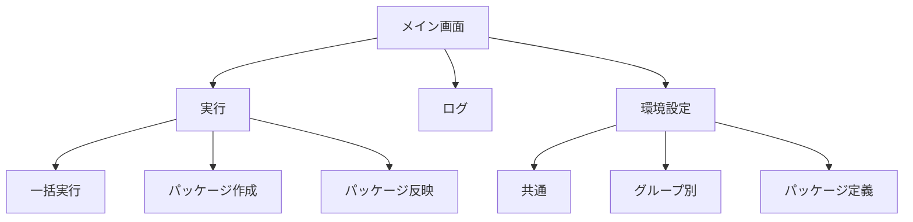
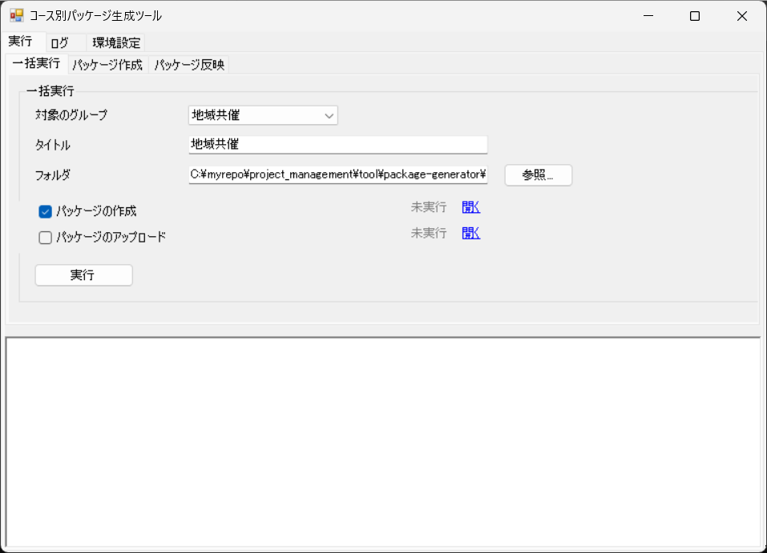
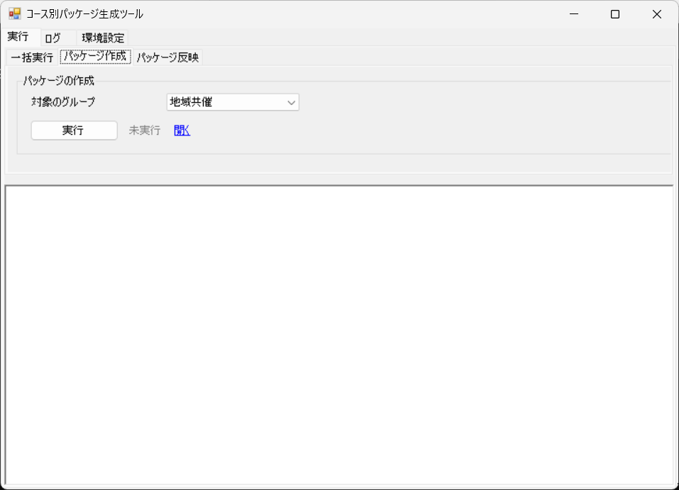
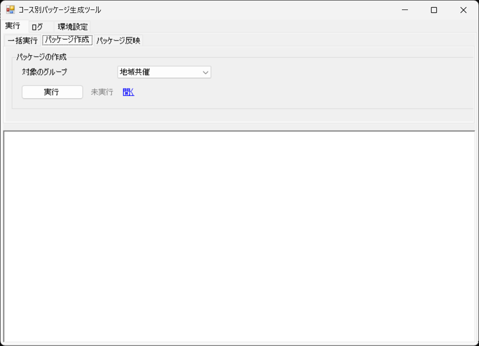
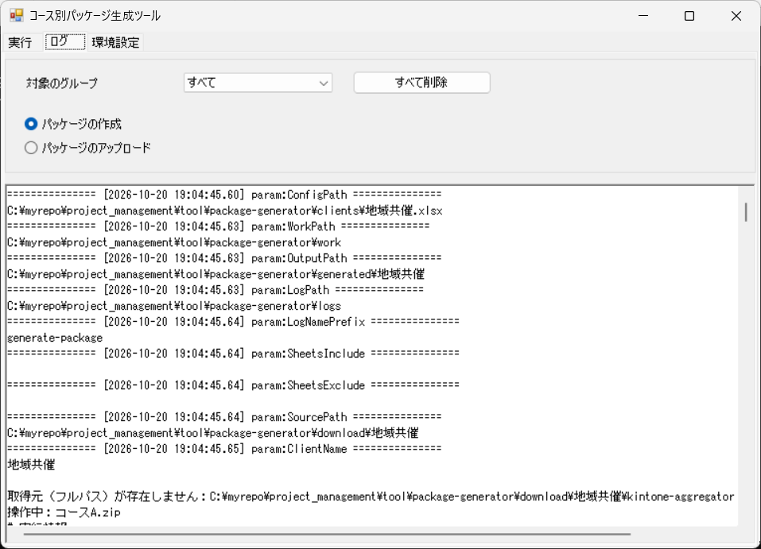
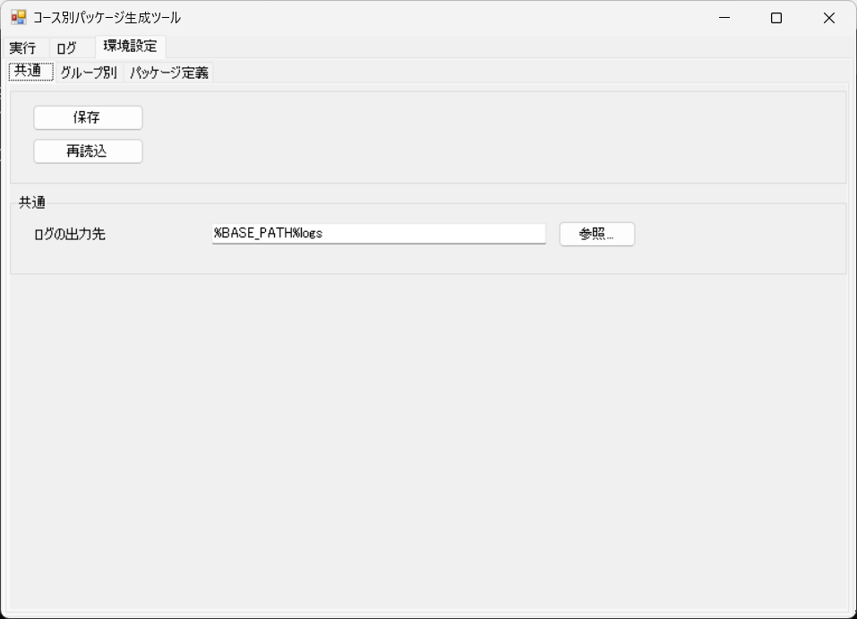
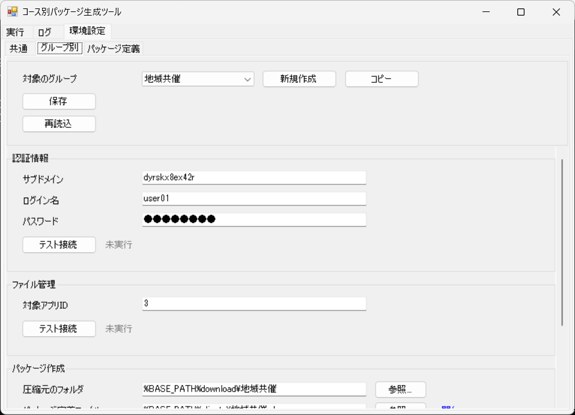
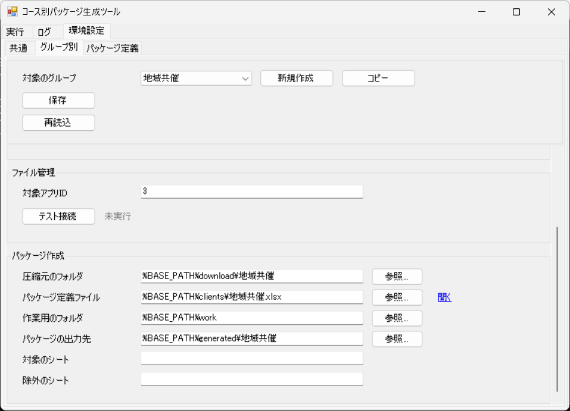
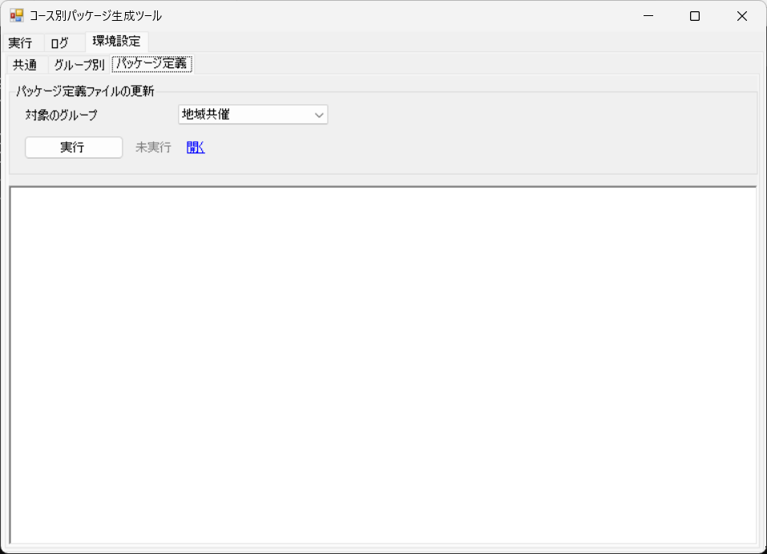

# 画面設計

## 1. 概要

本ツールの操作画面は、1 つのウィンドウに「実行」「ログ」「環境設定」のタブを置いた構成です。本書では、各タブの画面と、その中の項目や操作を示します。

- 画面の一覧

| 通番 | 画面 | 内容 |
|---|---|---|
| 1 | 実行（一括実行） | 対象のグループ、タイトルを指定し、選んだ処理（パッケージの作成、パッケージのアップロード）をまとめて実行します。 |
| 2 | 実行（パッケージ作成） | 対象のグループを指定して、パッケージを作成します。 |
| 3 | 実行（パッケージ反映） | 対象のグループ、タイトルを指定して、パッケージを kintone にアップロードします。ファイルを指定しない場合は、対象のグループのパッケージの出力先にある zip を使います。 |
| 4 | ログ | 実行ログを表示し、ログを削除します。 |
| 5 | 環境設定（共通） | 共通の設定を編集します。 |
| 6 | 環境設定（グループ別） | グループごとの設定を編集します。 |
| 7 | 環境設定（パッケージ定義） | 対象のグループのパッケージ定義ファイルを更新します。 |

## 2. 画面遷移図

## 3. 各画面

### 3.1 実行（一括実行）

#### 一括実行

  

| 通番 | 項目 | 種類 | 内容 |
|---|---|---|---|
| 1 | 対象のグループ | プルダウン | 対象のグループを選びます。 |
| 2 | タイトル | 入力欄 | アップロードするレコードのタイトルを入力します。 |
| 3 | パッケージの作成 | チェックボックス | 処理を実行するかを選びます。チェックを外した処理はスキップします。 |
| 4 | 状態（パッケージの作成） | 表示 | パッケージの作成の結果を表示します。 |
| 5 | 開く（パッケージの作成） | リンク | 作成したパッケージの出力先のフォルダを開きます。 |
| 6 | パッケージのアップロード | チェックボックス | 処理を実行するかを選びます。チェックを外した処理はスキップします。 |
| 7 | 状態（パッケージのアップロード） | 表示 | パッケージのアップロードの結果を表示します。 |
| 8 | 開く（パッケージのアップロード） | リンク | 対象の kintone アプリを開きます。 |
| 9 | 実行 | ボタン | 選んだ処理を順に実行します。 |
| 10 | 状態（実行） | 表示 | 一括実行の全体の結果を表示します。 |
| 11 | ログ | 表示 | 実行結果のログを表示します。 |

### 3.2 実行（パッケージ作成）

#### パッケージの作成

  

| 通番 | 項目 | 種類 | 内容 |
|---|---|---|---|
| 1 | 対象のグループ | プルダウン | 対象のグループを選びます。 |
| 2 | 実行（パッケージの作成） | ボタン | パッケージを作成します。 |
| 3 | 状態（パッケージの作成） | 表示 | パッケージの作成の結果を表示します。 |
| 4 | 開く（パッケージの作成） | リンク | 作成したパッケージのフォルダを開きます。 |
| 5 | ログ | 表示 | 実行結果のログを表示します。 |

### 3.3 実行（パッケージ反映）

#### パッケージのアップロード

  

| 通番 | 項目 | 種類 | 内容 |
|---|---|---|---|
| 1 | 対象のグループ | プルダウン | 対象のグループを選びます。 |
| 2 | タイトル | 入力欄 | アップロードするレコードのタイトルを入力します。 |
| 3 | ファイル1 | 入力欄 | アップロードする zip ファイルを選びます（参照ボタン付き）。指定しない場合は、対象のグループのパッケージの出力先にある zip を使います。 |
| 4 | クリア（ファイル1） | ボタン | ファイル1の入力を消去します。 |
| 5 | ファイル2 | 入力欄 | アップロードする zip ファイルを選びます（参照ボタン付き）。指定しない場合は、対象のグループのパッケージの出力先にある zip を使います。 |
| 6 | クリア（ファイル2） | ボタン | ファイル2の入力を消去します。 |
| 7 | ファイル3 | 入力欄 | アップロードする zip ファイルを選びます（参照ボタン付き）。指定しない場合は、対象のグループのパッケージの出力先にある zip を使います。 |
| 8 | クリア（ファイル3） | ボタン | ファイル3の入力を消去します。 |
| 9 | 説明 | 入力欄 | レコードの説明を入力します。 |
| 10 | 実行（パッケージのアップロード） | ボタン | 選んだ zip ファイルを kintone にアップロードします。 |
| 11 | 状態（パッケージのアップロード） | 表示 | パッケージのアップロードの結果を表示します。 |
| 12 | 開く（パッケージのアップロード） | リンク | 対象の kintone アプリを開きます。 |
| 13 | ログ | 表示 | 実行結果のログを表示します。 |

### 3.4 ログ

  

| 通番 | 項目 | 種類 | 内容 |
|---|---|---|---|
| 1 | すべて削除 | ボタン | ログの出力先にあるすべてのログファイルを削除します。削除の前に確認を求めます。 |
| 2 | 対象のグループ | プルダウン | 対象のグループを選びます。 |
| 3 | パッケージの作成 | ラジオボタン | 表示するログの処理を選びます。 |
| 4 | パッケージのアップロード | ラジオボタン | 表示するログの処理を選びます。 |
| 5 | ログ | 表示 | 選んだグループと処理の実行結果のログを表示します。 |

### 3.5 環境設定（共通）

#### ヘッダー

  

| 通番 | 項目 | 種類 | 内容 |
|---|---|---|---|
| 1 | 保存 | ボタン | 入力した内容を保存します。 |
| 2 | 状態（保存） | 表示 | 保存の結果を表示します。 |
| 3 | 再読込 | ボタン | 保存されている内容を読み込み直します。 |
| 4 | 状態（再読込） | 表示 | 再読込の結果を表示します。 |

#### 基本設定

  

| 通番 | 項目 | 種類 | 内容 |
|---|---|---|---|
| 1 | ログの出力先 | 入力欄 | 実行ログを出力するフォルダを入力します。 |

### 3.6 環境設定（グループ別）

#### ヘッダー

  

| 通番 | 項目 | 種類 | 内容 |
|---|---|---|---|
| 1 | 対象のグループ | プルダウン | 対象のグループを選びます。 |
| 2 | 新規作成 | ボタン | 新しいグループを作成します。 |
| 3 | コピー | ボタン | 既存のグループの設定をコピーして、新しいグループを作成します。 |
| 4 | 開く（パッケージ定義ファイル） | リンク | パッケージ定義ファイルを開きます。 |
| 5 | 保存 | ボタン | 入力した内容を保存します。 |
| 6 | 状態（保存） | 表示 | 保存の結果を表示します。 |
| 7 | 再読込 | ボタン | 保存されている内容を読み込み直します。 |
| 8 | 状態（再読込） | 表示 | 再読込の結果を表示します。 |

#### 認証情報

  

| 通番 | 項目 | 種類 | 内容 |
|---|---|---|---|
| 1 | サブドメイン | 入力欄 | kintone のサブドメインを入力します。 |
| 2 | ログイン名 | 入力欄 | kintone にログインするための名前を入力します。 |
| 3 | パスワード | 入力欄 | kintone にログインするためのパスワードを入力します。 |
| 4 | テスト接続（認証情報） | ボタン | kintone に接続できるかを確認します。 |
| 5 | 状態（テスト接続） | 表示 | テスト接続の結果を表示します。 |

#### ファイル管理

  

| 通番 | 項目 | 種類 | 内容 |
|---|---|---|---|
| 1 | 対象アプリID | 入力欄 | 接続する kintone アプリの ID を入力します。 |
| 2 | テスト接続（ファイル管理） | ボタン | kintone のアプリに接続できるかを確認します。 |
| 3 | 状態（テスト接続（ファイル管理）） | 表示 | テスト接続の結果を表示します。 |

#### パッケージ作成

  

| 通番 | 項目 | 種類 | 内容 |
|---|---|---|---|
| 1 | 圧縮元のフォルダ | 入力欄 | zip にまとめるファイルが入っているフォルダを入力します。 |
| 2 | パッケージ定義ファイル | 入力欄 | シートごとの内容を定義した Excel ファイルを指定します。 |
| 3 | 開く（パッケージ定義ファイル） | リンク | パッケージ定義ファイルを開きます。 |
| 4 | 作業用のフォルダ | 入力欄 | 作業用の一時フォルダを入力します。処理の開始時に中身を削除して作り直し、処理の終了時に削除します。 |
| 5 | パッケージの出力先 | 入力欄 | 作成した zip を出力するフォルダを入力します。 |
| 6 | 対象のシート | 入力欄 | zip にするシートの名前を、カンマで区切って入力します。 |
| 7 | 除外のシート | 入力欄 | zip から除外するシートの名前を、カンマで区切って入力します。 |

### 3.7 環境設定（パッケージ定義）

#### パッケージ定義ファイルの更新

  

| 通番 | 項目 | 種類 | 内容 |
|---|---|---|---|
| 1 | 対象のグループ | プルダウン | 対象のグループを選びます。 |
| 2 | 実行（パッケージ定義ファイルの更新） | ボタン | パッケージ定義ファイルを更新します。 |
| 3 | 状態（パッケージ定義ファイルの更新） | 表示 | パッケージ定義ファイルの更新の結果を表示します。 |
| 4 | 開く（パッケージ定義ファイルの更新） | リンク | 更新したパッケージ定義ファイルを開きます。 |
| 5 | ログ | 表示 | 実行結果のログを表示します。 |
