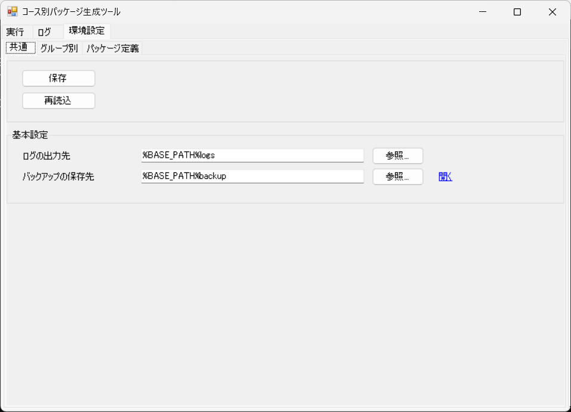
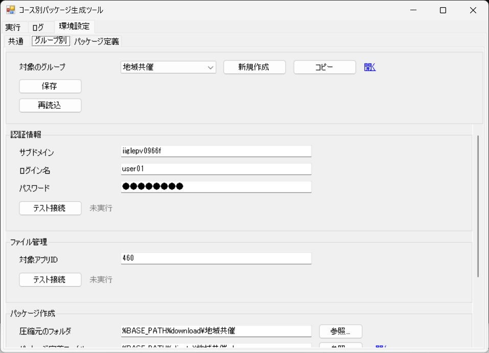
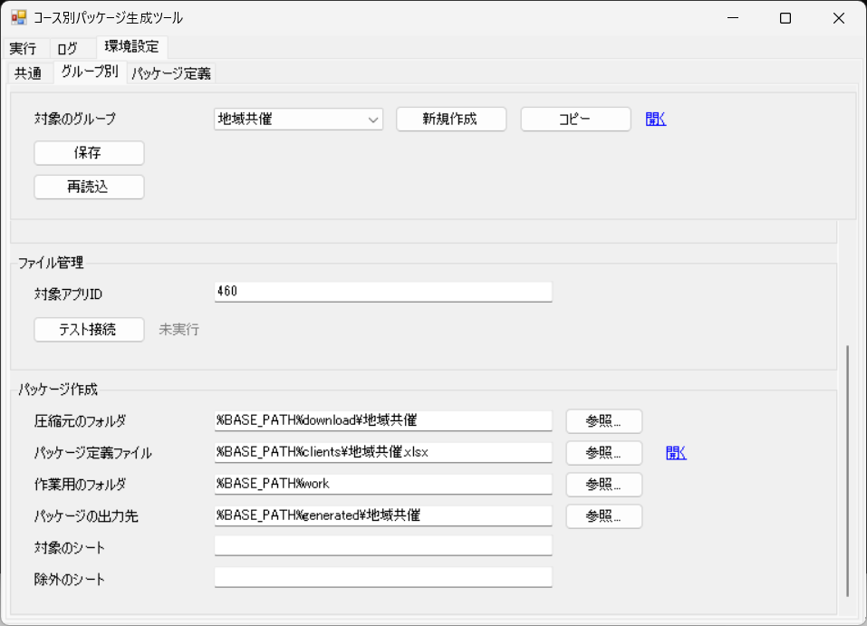
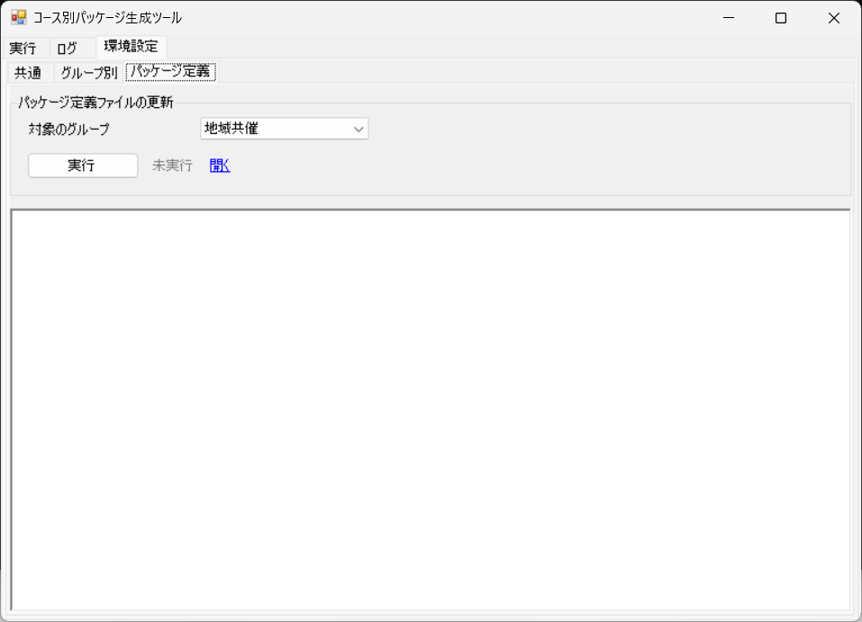
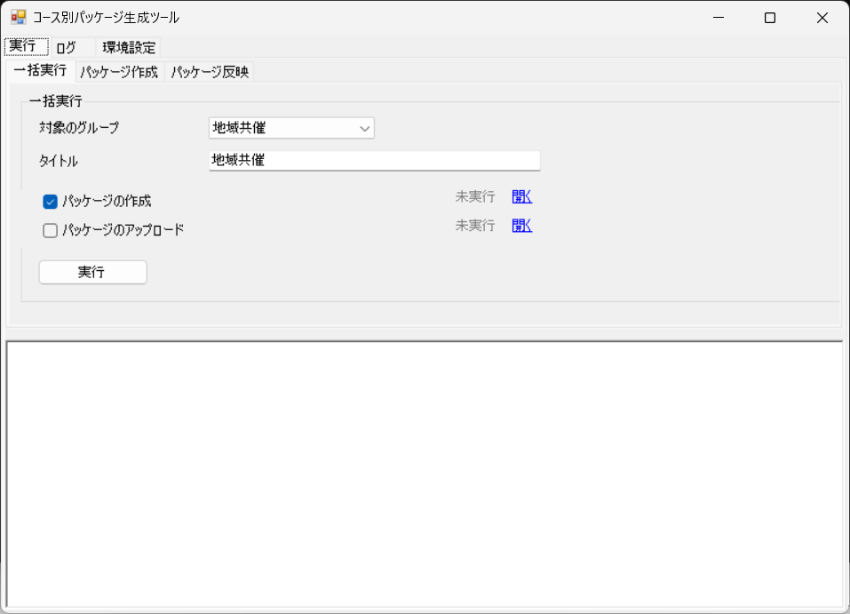
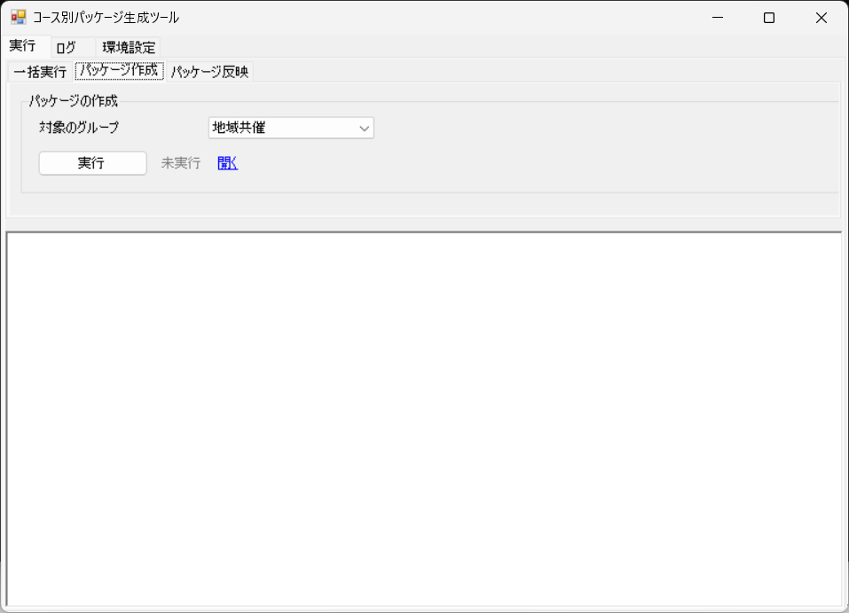
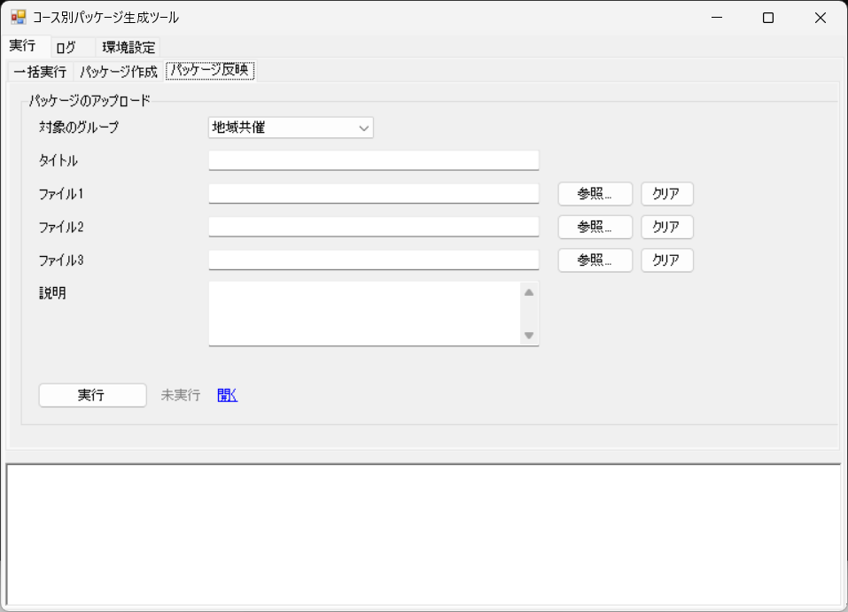
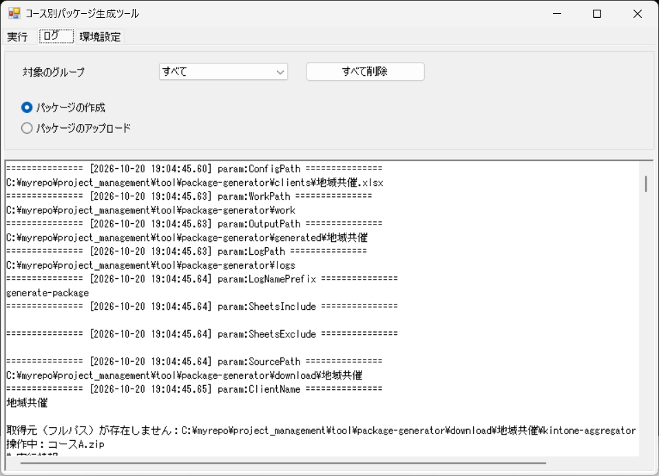

# 操作マニュアル

## 1. 目的と対象

　対象は、コース別パッケージ生成ツール（Excel のパッケージ定義に従って、ファイルを zip にまとめ、kintone にアップロードするツール）です。 
　ツールの画面の操作と、パッケージの作成とアップロードの確認方法を説明します。

## 2. 画面の構成

　ツールの画面は、次のタブで構成されています。

- 画面の一覧

| 通番 | メインタブ名 | サブタブ名 | 内容 |
|---|---|---|---|
| 1 | 実行 | 一括実行 | 対象のグループとタイトルを指定し、選んだ処理をまとめて実行します。 |
| 2 | 実行 | パッケージ作成 | 対象のグループを指定して、パッケージを作成します。 |
| 3 | 実行 | パッケージ反映 | 対象のグループとタイトルを指定して、パッケージを kintone にアップロードします。 |
| 4 | ログ |  | 実行ログを表示し、ログを削除します。 |
| 5 | 環境設定 | 共通 | 共通の設定を編集します。 |
| 6 | 環境設定 | グループ別 | グループごとの設定を編集します。 |
| 7 | 環境設定 | パッケージ定義 | 対象のグループのパッケージ定義ファイルを更新します。 |

## 3. 初期設定

　環境設定の「共通」「グループ別」「パッケージ定義」の各タブで、ツールの設定を行います。

### 3.1 共通

　環境設定の「共通」タブで、「基本設定」の項目を設定します。

  

#### 項目

| 通番 | 区分 | 項目 | 種類 | 内容 |
|---|---|---|---|---|
| 1 | 共通 | 保存 | ボタン | 設定を保存します。 |
| 2 | 共通 | 状態（保存） | 表示 | 保存の状態を表示します。 |
| 3 | 共通 | 再読込 | ボタン | 保存した内容を読み直します。 |
| 4 | 共通 | 状態（再読込） | 表示 | 再読込の状態を表示します。 |
| 5 | 基本設定 | ログの出力先 | 入力欄 | 実行ログを出力するフォルダを指定します。 |
| 6 | 基本設定 | バックアップの保存先 | 入力欄 | 既存のレコードを更新したときに、アップロードした zip を保存するフォルダを指定します。 |
| 7 | 基本設定 | 開く（バックアップの保存先） | リンク | バックアップの保存先のフォルダを開きます。 |

#### 操作方法

1. 設定を変えたら、「保存」を押します。
   - 保存した内容を読み直すときは、「再読込」を押します。

### 3.2 グループ別

　環境設定の「グループ別」タブで、グループごとの接続情報と、パッケージの作成に使う設定を設定します。

  

  

#### 項目

| 通番 | 区分 | 項目 | 種類 | 内容 |
|---|---|---|---|---|
| 1 | 共通 | 対象のグループ | プルダウン | 設定するグループを選びます。 |
| 2 | 共通 | 新規作成 | ボタン | 新しいグループを作ります。 |
| 3 | 共通 | コピー | ボタン | 既存のグループの設定をコピーして、新しいグループを作ります。 |
| 4 | 共通 | 保存 | ボタン | 設定を保存します。 |
| 5 | 共通 | 状態（保存） | 表示 | 保存の状態を表示します。 |
| 6 | 共通 | 再読込 | ボタン | 保存した内容を読み直します。 |
| 7 | 共通 | 状態（再読込） | 表示 | 再読込の状態を表示します。 |
| 8 | 認証情報 | サブドメイン | 入力欄 | kintone のサブドメインを入力します。 |
| 9 | 認証情報 | ログイン名 | 入力欄 | kintone にログインするための名前を入力します。 |
| 10 | 認証情報 | パスワード | 入力欄 | kintone にログインするためのパスワードを入力します。 |
| 11 | 認証情報 | テスト接続（認証情報） | ボタン | kintone に接続できるかを確認します。 |
| 12 | 認証情報 | 状態（テスト接続（認証情報）） | 表示 | テスト接続の状態を表示します。 |
| 13 | ファイル管理 | 対象アプリID | 入力欄 | 接続する kintone アプリの ID を入力します。 |
| 14 | ファイル管理 | テスト接続（ファイル管理） | ボタン | kintone のアプリに接続できるかを確認します。 |
| 15 | ファイル管理 | 状態（テスト接続（ファイル管理）） | 表示 | テスト接続の状態を表示します。 |
| 16 | パッケージ作成 | 圧縮元のフォルダ | 入力欄 | zip にまとめるファイルが入っているフォルダを入力します。 |
| 17 | パッケージ作成 | パッケージ定義ファイル | 入力欄 | シートごとの内容を定義した Excel ファイルを指定します。 |
| 18 | パッケージ作成 | 開く（パッケージ定義ファイル） | リンク | パッケージ定義ファイルを開きます。 |
| 19 | パッケージ作成 | 作業用のフォルダ | 入力欄 | 作業用の一時フォルダを入力します。処理の開始時に中身を削除して作り直し、処理の終了時に削除します。 |
| 20 | パッケージ作成 | パッケージの出力先 | 入力欄 | 作成した zip を出力するフォルダを入力します。 |
| 21 | パッケージ作成 | 対象のシート | 入力欄 | zip にするシートの名前を、カンマで区切って入力します。 |
| 22 | パッケージ作成 | 除外のシート | 入力欄 | zip から除外するシートの名前を、カンマで区切って入力します。 |

#### 操作方法

1. 「対象のグループ」で、設定するグループを選びます。
   - 「新規作成」「コピー」を押すと、グループを作れます。
2. 「認証情報」の「テスト接続（認証情報）」を押します。
   - kintone に接続できるかを確認します。
3. 「ファイル管理」の「テスト接続（ファイル管理）」を押します。
   - kintone のアプリに接続できるかを確認します。
4. 設定を変えたら、「保存」を押します。

### 3.3 パッケージ定義

　環境設定の「パッケージ定義」タブで、対象のグループのパッケージ定義ファイルを更新します。

  

#### 項目

| 通番 | 区分 | 項目 | 種類 | 内容 |
|---|---|---|---|---|
| 1 | 共通 | 対象のグループ | プルダウン | 更新するグループを選びます。 |
| 2 | 共通 | 実行（パッケージ定義ファイルの更新） | ボタン | パッケージ定義ファイルを更新します。 |
| 3 | 共通 | 状態（パッケージ定義ファイルの更新） | 表示 | パッケージ定義ファイルの更新の状態を表示します。 |
| 4 | 共通 | 開く（パッケージ定義ファイルの更新） | リンク | 更新したパッケージ定義ファイルを開きます。 |

#### 操作方法

1. 「対象のグループ」で、更新するグループを選びます。
2. 「実行」を押します。
   - 状態が「成功」と表示されたら、処理は完了しています。
3. 「開く」を押すと、更新したパッケージ定義ファイルを開けます。

## 4. 実行

　「実行」タブには、次のサブタブがあります。

### 4.1 一括実行

　「一括実行」で、対象のグループとタイトルを指定して、選んだ処理をまとめて実行します。

  

#### 項目

| 通番 | 区分 | 項目 | 種類 | 内容 |
|---|---|---|---|---|
| 1 | 一括実行 | 対象のグループ | プルダウン | 処理するグループを選びます。 |
| 2 | 一括実行 | タイトル | 入力欄 | アップロードするレコードのタイトルを入力します。 |
| 3 | 一括実行 | 説明 | 入力欄 | レコードの説明を入力します。 |
| 4 | 一括実行 | パッケージの作成 | チェックボックス | 処理を実行するかを選びます。チェックを外した処理はスキップします。初期値は選ばれた状態です。 |
| 5 | 一括実行 | 状態（パッケージの作成） | 表示 | パッケージの作成の状態を表示します。 |
| 6 | 一括実行 | 開く（パッケージの作成） | リンク | 作成したパッケージの出力先のフォルダを開きます。 |
| 7 | 一括実行 | パッケージのアップロード | チェックボックス | 処理を実行するかを選びます。チェックを外した処理はスキップします。初期値は選ばれた状態です。 |
| 8 | 一括実行 | 状態（パッケージのアップロード） | 表示 | パッケージのアップロードの状態を表示します。 |
| 9 | 一括実行 | 開く（パッケージのアップロード） | リンク | 対象の kintone アプリを開きます。 |
| 10 | 一括実行 | 実行（一括実行） | ボタン | 選んだ処理を順に実行します。 |
| 11 | 一括実行 | 状態（一括実行） | 表示 | 一括実行の全体の状態を表示します。 |

#### 操作方法

1. 「対象のグループ」で、グループを選びます。
2. 「タイトル」を入力します。
3. 「説明」を入力します。
4. 実行する処理にチェックを入れ、実行しない処理のチェックを外します。
   - チェックを外した処理は、スキップされます。
5. 「実行」を押します。
   - 状態が「成功」と表示されたら、処理は完了しています。
6. 「開く」を押して、結果が開けることを確認します。

> 注意
> - 「パッケージのアップロード」は kintone に投稿されます。アップロード先のアプリを確認してから実行してください。

### 4.2 パッケージ作成

　「パッケージ作成」で、対象のグループを指定して、パッケージを作成します。

  

#### 項目

| 通番 | 区分 | 項目 | 種類 | 内容 |
|---|---|---|---|---|
| 1 | パッケージの作成 | 対象のグループ | プルダウン | 処理するグループを選びます。 |
| 2 | パッケージの作成 | 実行（パッケージの作成） | ボタン | パッケージを作成します。 |
| 3 | パッケージの作成 | 状態（パッケージの作成） | 表示 | パッケージの作成の状態を表示します。 |
| 4 | パッケージの作成 | 開く（パッケージの作成） | リンク | 作成したパッケージのフォルダを開きます。 |

#### 操作方法

1. 「対象のグループ」で、グループを選びます。
2. 「実行」を押します。
   - 状態が「成功」と表示されたら、処理は完了しています。
3. 「開く」を押して、パッケージが作られていることを確認します。

### 4.3 パッケージ反映

　「パッケージ反映」で、対象のグループとタイトルを指定して、パッケージを kintone にアップロードします。

  

#### 項目

| 通番 | 区分 | 項目 | 種類 | 内容 |
|---|---|---|---|---|
| 1 | パッケージのアップロード | 対象のグループ | プルダウン | 処理するグループを選びます。 |
| 2 | パッケージのアップロード | タイトル | 入力欄 | アップロードするレコードのタイトルを入力します。 |
| 3 | パッケージのアップロード | ファイル1 | 入力欄 | アップロードする zip ファイルを指定します。指定しない場合は、対象のグループのパッケージの出力先にある zip を使います。 |
| 4 | パッケージのアップロード | クリア（ファイル1） | ボタン | ファイル1の入力を消去します。 |
| 5 | パッケージのアップロード | ファイル2 | 入力欄 | アップロードする zip ファイルを指定します。指定しない場合は、対象のグループのパッケージの出力先にある zip を使います。 |
| 6 | パッケージのアップロード | クリア（ファイル2） | ボタン | ファイル2の入力を消去します。 |
| 7 | パッケージのアップロード | ファイル3 | 入力欄 | アップロードする zip ファイルを指定します。指定しない場合は、対象のグループのパッケージの出力先にある zip を使います。 |
| 8 | パッケージのアップロード | クリア（ファイル3） | ボタン | ファイル3の入力を消去します。 |
| 9 | パッケージのアップロード | 説明 | 入力欄 | レコードの説明を入力します。 |
| 10 | パッケージのアップロード | 実行（パッケージのアップロード） | ボタン | 選んだ zip ファイルを kintone にアップロードします。 |
| 11 | パッケージのアップロード | 状態（パッケージのアップロード） | 表示 | パッケージのアップロードの状態を表示します。 |
| 12 | パッケージのアップロード | 開く（パッケージのアップロード） | リンク | 対象の kintone アプリを開きます。 |

#### 操作方法

1. 「対象のグループ」で、グループを選びます。
2. 「タイトル」を入力します。
3. 必要に応じて、「ファイル1」「ファイル2」「ファイル3」に zip ファイルを指定します。
   - 指定しない場合は、対象のグループのパッケージの出力先にある zip を使います。
4. 必要に応じて、「説明」を入力します。
5. 「実行」を押します。
   - 状態が「成功」と表示されたら、処理は完了しています。
6. 「開く」を押して、アップロード先の kintone アプリを開きます。

> 注意
> - 「実行」を押すと、zip ファイルが kintone にアップロードされます。アップロード先のアプリを確認してから実行してください。
> - 既存のレコードを更新したときは、zip ファイルがバックアップの保存先にコピーされます。

## 5. ログ

　「ログ」タブで、実行した処理の結果を確認できます。

  

#### 項目

| 通番 | 区分 | 項目 | 種類 | 内容 |
|---|---|---|---|---|
| 1 | 共通 | 対象のグループ | プルダウン | 結果を表示するグループを選びます。 |
| 2 | 共通 | すべて削除 | ボタン | ログの出力先にあるすべてのログファイルを削除します。削除の前に確認を求めます。 |
| 3 | 共通 | パッケージの作成 | ラジオボタン | パッケージの作成の結果を表示します。 |
| 4 | 共通 | パッケージのアップロード | ラジオボタン | パッケージのアップロードの結果を表示します。 |

#### 操作方法

1. 「対象のグループ」で、グループを選びます。
2. 処理のラジオボタンから、表示する処理を選びます。
3. 表示された結果を見ます。
4. 不要になったログは、「すべて削除」を押して削除します。

## 6. 困ったとき

- **出力されたファイルが開けない**: 対象の zip ファイルや Excel ファイルが、別のアプリで開かれていないかを確認します。開いている場合は、閉じてから実行します。
- **アップロードに失敗する**: 「環境設定」の「グループ別」タブの「テスト接続（認証情報）」と「テスト接続（ファイル管理）」で、接続情報と対象アプリIDを確認します。
- **状態が「失敗」になった**: 「ログ」タブで、その処理の結果を確認します。
- **状態が「警告」になった**: 「ログ」タブで、その処理の結果を確認します。
