# 処理フロー

## 1. 概要

本ツールの画面にあるボタンを押したときに行われる処理の流れと、SMS を受信したときに自動で行われる処理を示します。画面ごとのボタンを一覧にし、ボタンごとに処理の手順とフローチャートを示します。SMS を受信したときの自動処理は、ボタンを押す操作ではないため、3. で示します。アプリの設定には保存ボタンがなく、項目を変えるたびに自動で保存されます。

- 処理の一覧
  | 通番 | 画面名 | ボタン名 | 内容 |
  |---|---|---|---|
  | 1 | トップ | SMSの検索 | SMSの検索画面を開きます。 |
  | 2 | トップ | ログの確認 | ログの画面を開きます。 |
  | 3 | トップ | 送信先の設定 | 送信先の設定画面を開きます。 |
  | 4 | トップ | アプリの設定 | アプリの設定画面を開きます。 |
  | 5 | トップ | 設定のインポート・エクスポート | 設定のインポート・エクスポートの画面を開きます。 |
  | 6 | 送信先の設定 | 設定を追加 | 一覧の末尾に、空の送信先を追加します。 |
  | 7 | 送信先の設定 | コピー | 送信先の内容を複製し、元の送信先の直後に追加します。 |
  | 8 | 送信先の設定 | 削除 | 送信先を一覧から外します。 |
  | 9 | 送信先の設定 | +（送信先の振り分け） | 振り分けキーワードの入力欄を1行追加します。 |
  | 10 | 送信先の設定 | ×（送信先の振り分け） | 振り分けキーワードの行を一覧から外します。 |
  | 11 | 送信先の設定 | テスト送信 | テスト用の本文を入力し、kintone へテスト登録します。 |
  | 12 | 送信先の設定 | 設定を保存 | すべての送信先を検証して保存し、トップ画面へ戻ります。 |
  | 13 | アプリの設定 | 初期化 | 確認のあと、アプリの設定を既定値に戻します。 |
  | 14 | アプリの設定 | 許可する（SMSの読み取り） | SMSの読み取りの許可を求めます。 |
  | 15 | アプリの設定 | 許可する（SMSの受信） | SMSの受信の許可を求めます。 |
  | 16 | アプリの設定 | 許可する（SMSの送信） | SMSの送信の許可を求めます。 |
  | 17 | アプリの設定 | +（固定変換） | 固定変換の入力行を1行追加します。 |
  | 18 | アプリの設定 | ×（固定変換） | 固定変換の行を削除します。 |
  | 19 | アプリの設定 | 引継ぎ内容の設定 | 引継ぎ内容の設定画面を開きます。 |
  | 20 | 引継ぎ内容の設定 | すべて削除 | 確認のあと、一覧のすべての引継ぎ内容を画面から外します。 |
  | 21 | 引継ぎ内容の設定 | 削除 | その引継ぎ内容を一覧から外します。 |
  | 22 | 引継ぎ内容の設定 | 設定を保存 | 変更を保存し、前の画面へ戻ります。 |
  | 23 | 設定のインポート・エクスポート | ファイルを選択 | 読み込む JSON ファイルを選び、内容をプレビューに表示します。 |
  | 24 | 設定のインポート・エクスポート | インポート | 確認のあと、読み込んだ内容を設定に統合します。 |
  | 25 | 設定のインポート・エクスポート | エクスポート | 設定を JSON ファイルに書き出します。 |
  | 26 | ログ | 更新 | ログの一覧を読み直し、表示し直します。 |
  | 27 | ログ | 削除 | 確認のあと、すべてのログを削除します。 |
  | 28 | SMSの検索 | 検索 | 検索条件に合う SMS を一覧に表示します。 |
  | 29 | SMSの検索 | 全選択 | 選べる SMS をすべて選びます。 |
  | 30 | SMSの検索 | 選択解除 | 選んだ SMS の選択をすべて解除します。 |
  | 31 | SMSの検索 | 選択したSMSを送信 | 選んだ SMS を、手動で kintone へ登録します。 |
  | 32 | SMSの検索 | ▼ 表示 / ▲ 隠す | 検索条件の表示と非表示を切り替えます。 |
  | 33 |  | SMS受信の自動処理 | SMS を受信したときの処理です。 |
  | 34 |  | SMS送信の自動処理 | SMS受信の自動処理から依頼された登録を、kintone に行う処理です。 |

## 2. 各処理の流れ

### 2.1 トップ[SMSの検索]

1. SMSの検索画面を開きます。

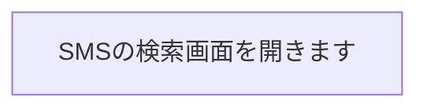

<div class="pagebreak"></div>

### 2.2 トップ[ログの確認]

1. ログの画面を開きます。

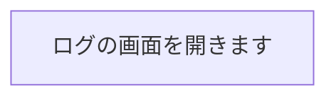

<div class="pagebreak"></div>

### 2.3 トップ[送信先の設定]

1. 送信先の設定画面を開きます。

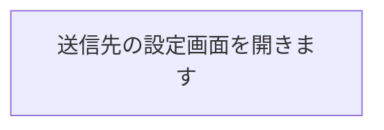

<div class="pagebreak"></div>

### 2.4 トップ[アプリの設定]

1. アプリの設定画面を開きます。

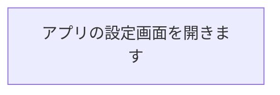

<div class="pagebreak"></div>

### 2.5 トップ[設定のインポート・エクスポート]

1. 設定のインポート・エクスポートの画面を開きます。

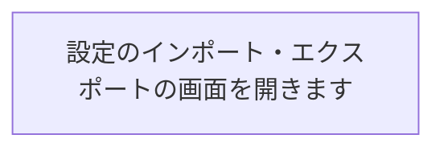

<div class="pagebreak"></div>

### 2.6 送信先の設定[設定を追加]

1. 一覧の末尾に、空の送信先を追加します。
2. 追加した送信先の位置までスクロールします。

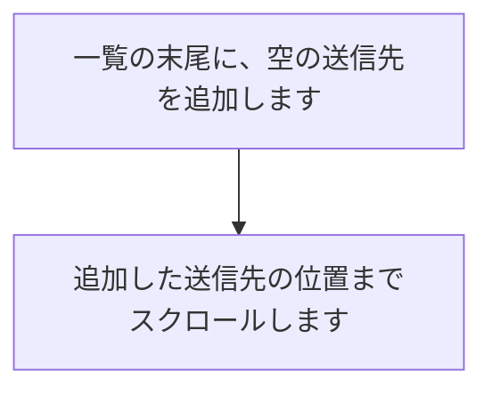

<div class="pagebreak"></div>

### 2.7 送信先の設定[コピー]

1. 押した送信先の、画面上の入力内容を複製します。
2. 送信先名が空でなければ、名前の末尾に「のコピー」を付けます。
3. 複製を、元の送信先の直後に追加します。
4. 追加した送信先の位置までスクロールします。

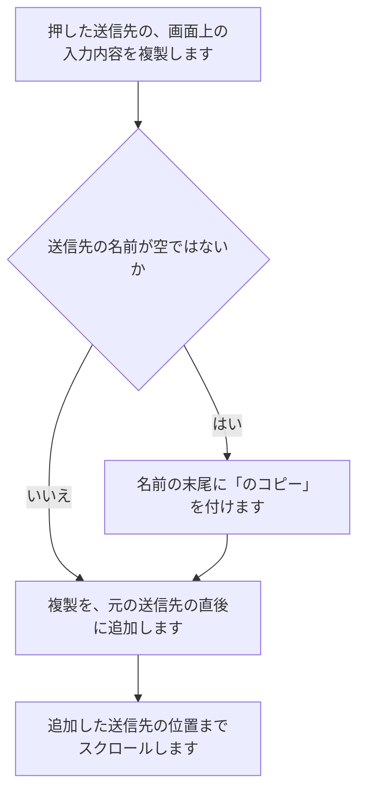

<div class="pagebreak"></div>

### 2.8 送信先の設定[削除]

1. 押した送信先を、一覧から外します。
2. 送信先の番号を振り直します。

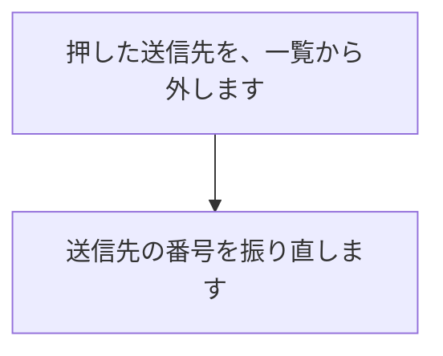

<div class="pagebreak"></div>

### 2.9 送信先の設定[+（送信先の振り分け）]

1. その送信先の振り分けキーワードの入力欄を、1行追加します。

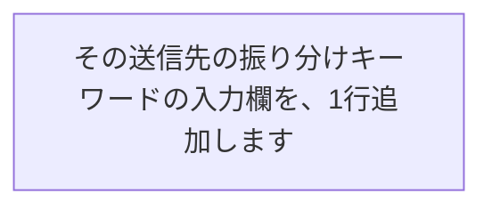

<div class="pagebreak"></div>

### 2.10 送信先の設定[×（送信先の振り分け）]

1. その行の振り分けキーワードを、一覧から外します。

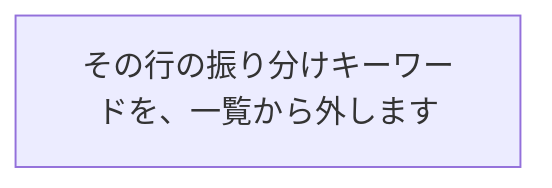

<div class="pagebreak"></div>

### 2.11 送信先の設定[テスト送信]

1. テスト送信する送信先の入力内容を確認します。
2. 必須の項目が不足しているときは、入力エラーのダイアログを表示します。
3. その場合は、処理を終了します。
4. 必須の項目が揃っているときは、テスト本文を入力するダイアログを表示します。
5. 「キャンセル」を押したときは、処理を終了します。
6. 「送信」を押したときは、テスト本文から会社名と氏名を抽出します。
7. 会社名の抽出が有効で、この送信先がデフォルトの送信先ではないときは、抽出した会社名が振り分けに一致するかを確認します。
8. 振り分けに一致しないときは、送信先エラーのダイアログを表示します。
9. その場合は、処理を終了します。
10. テストの SMS を、固定の送信元と登録種別「外部ツール」で kintone に登録します。
11. 登録の結果と抽出の結果を、テスト結果のダイアログに表示します。

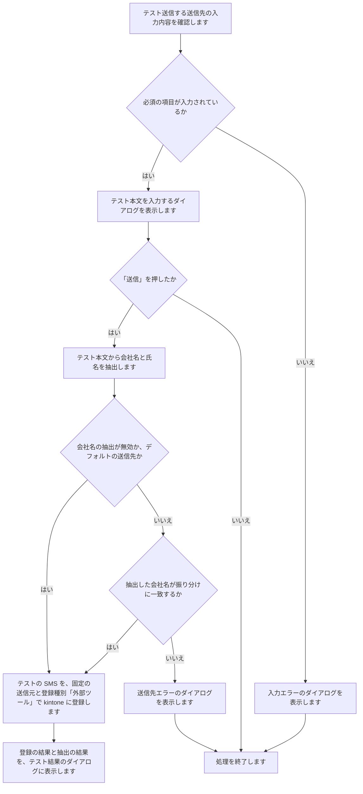

<div class="pagebreak"></div>

### 2.12 送信先の設定[設定を保存]

1. 一覧の送信先を、先頭から順に確認します。
2. 必須の項目が不足している送信先があるときは、入力エラーのダイアログを表示します。
3. その場合は、どの送信先も保存せずに、処理を終了します。
4. 送信先の名前が重複しているときは、入力エラーのダイアログに重複した名前を表示します。
5. その場合は、どの送信先も保存せずに、処理を終了します。
6. すべて揃っているときは、送信先の設定を保存します。
7. 「設定を保存しました」を表示します。
8. トップ画面へ戻ります。

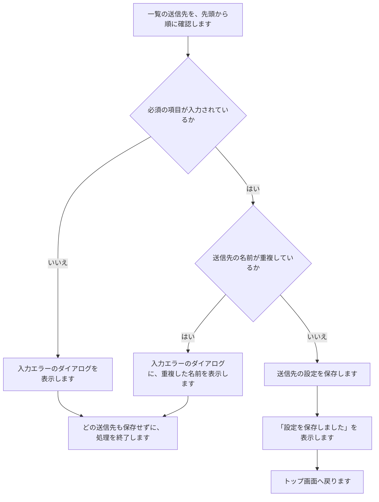

<div class="pagebreak"></div>

### 2.13 アプリの設定[初期化]

1. 「設定を初期化しますか？」の確認ダイアログを表示します。
2. 「キャンセル」を押したときは、何もせずに閉じます。
3. 「初期化」を押したときは、アプリの設定だけを既定値に戻します。
4. 表示テーマをライトに戻し、アプリの設定画面を開き直します。

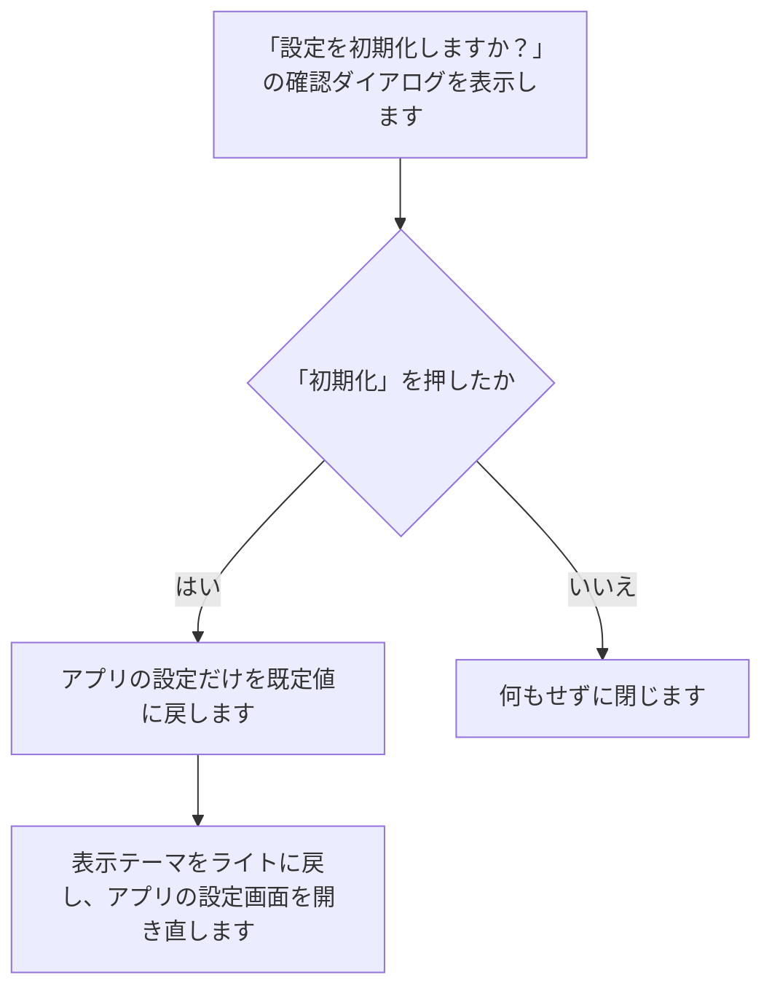

<div class="pagebreak"></div>

### 2.14 アプリの設定[許可する（SMSの読み取り）]

1. SMSの読み取りの許可を求める画面を表示します。
2. 許可されたときは、表示を「許可済み」に変え、このボタンを隠します。
3. 許可されなかったときは、「SMSの読み取りの許可がない場合、SMSの検索はできません」と表示します。

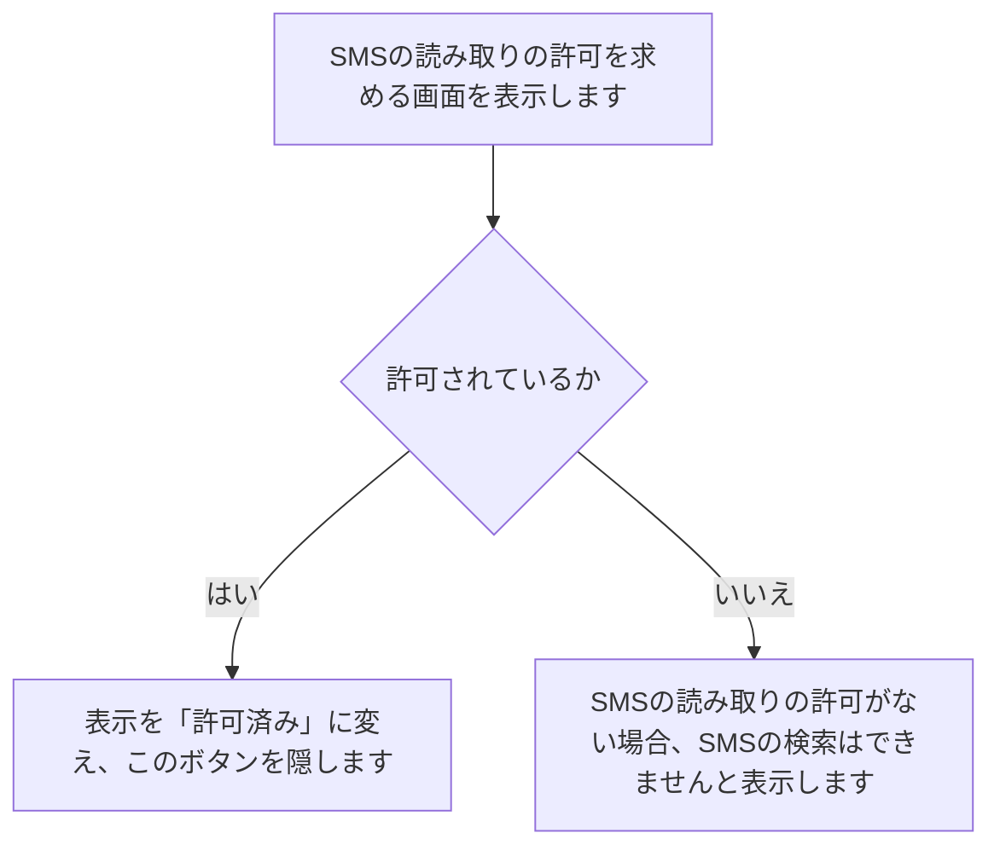

<div class="pagebreak"></div>

### 2.15 アプリの設定[許可する（SMSの受信）]

1. SMSの受信の許可を求める画面を表示します。
2. 許可されたときは、表示を「許可済み」に変え、このボタンを隠します。
3. 許可されなかったときは、「SMSの受信の許可がない場合、SMSの自動送信・自動返信ができません」と表示します。

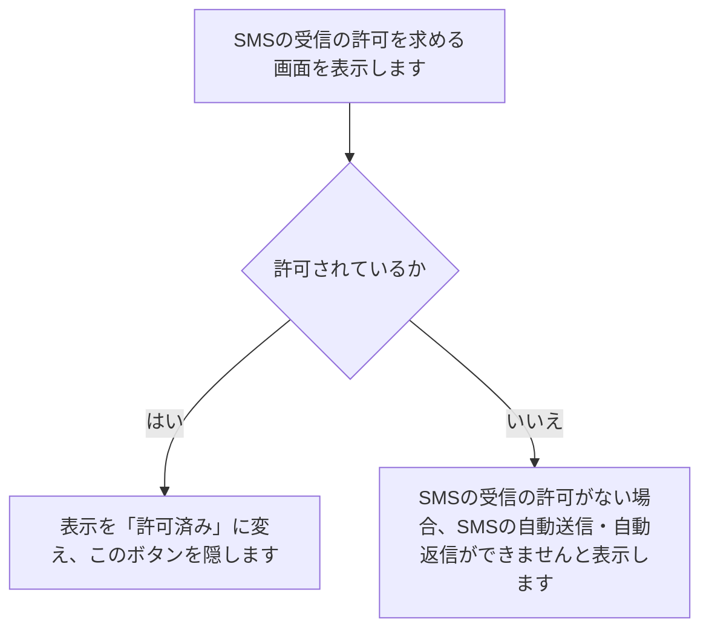

<div class="pagebreak"></div>

### 2.16 アプリの設定[許可する（SMSの送信）]

1. SMSの送信の許可を求める画面を表示します。
2. 許可されたときは、表示を「許可済み」に変え、このボタンを隠します。
3. 許可されなかったときは、「SMSの送信の許可がない場合、自動返信はできません」と表示します。

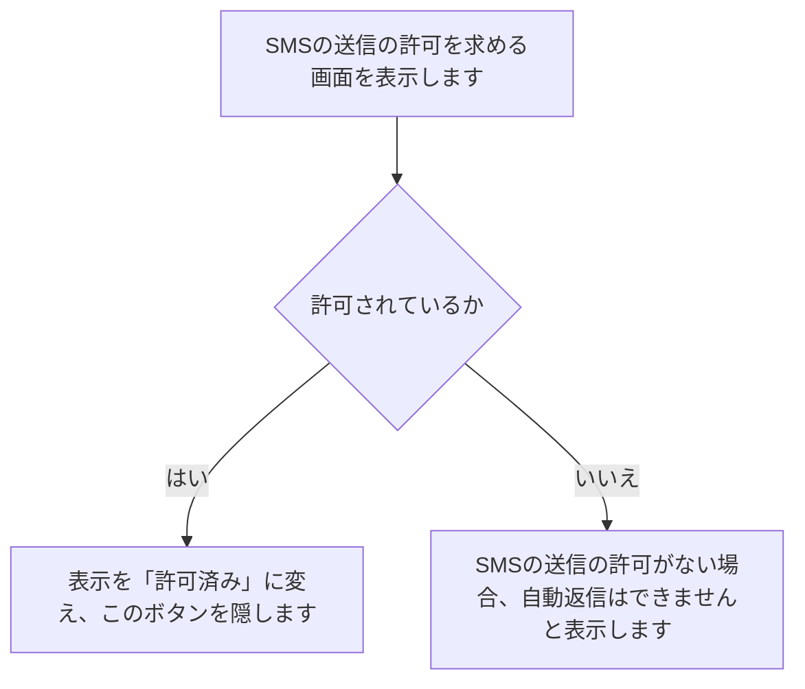

<div class="pagebreak"></div>

### 2.17 アプリの設定[+（固定変換）]

1. 会社名の抽出が有効なときは、変換前と変換後の入力欄を、固定変換の一覧に1行追加します。
2. 入力するたびに、入力した内容を自動で保存します。
3. 会社名の抽出が無効なときは、このボタンを押せない状態のままにします。
4. その場合は、処理を終了します。

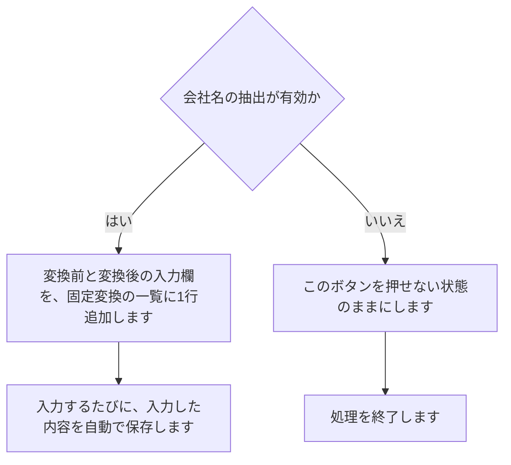

<div class="pagebreak"></div>

### 2.18 アプリの設定[×（固定変換）]

1. その行を、固定変換の一覧から外します。
2. 固定変換の内容を、すぐに保存します。

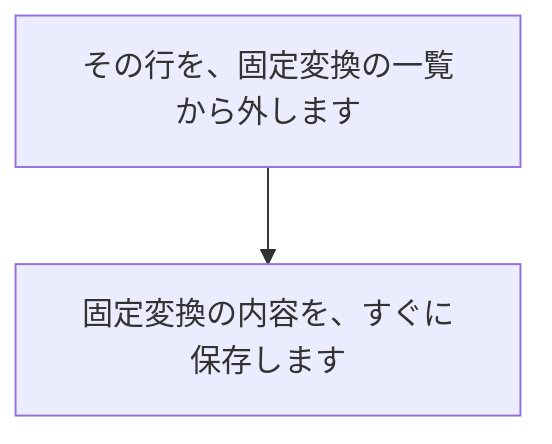

<div class="pagebreak"></div>

### 2.19 アプリの設定[引継ぎ内容の設定]

1. 引継ぎが有効なときは、引継ぎ内容の設定画面を開きます。
2. 引継ぎが無効なときは、このボタンを押せない状態のままにします。
3. その場合は、処理を終了します。

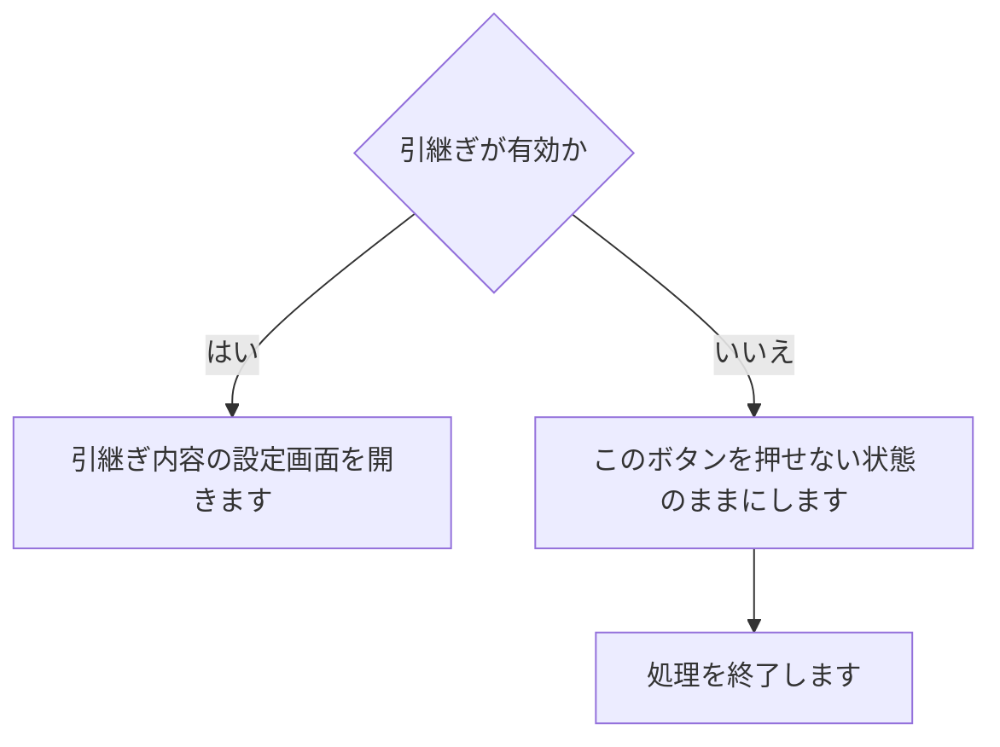

<div class="pagebreak"></div>

### 2.20 引継ぎ内容の設定[すべて削除]

1. 「すべて削除」の確認ダイアログを表示します。
2. 「キャンセル」を押したときは、何もせずに閉じます。
3. 「削除」を押したときは、一覧のすべての引継ぎ内容を画面から外します。

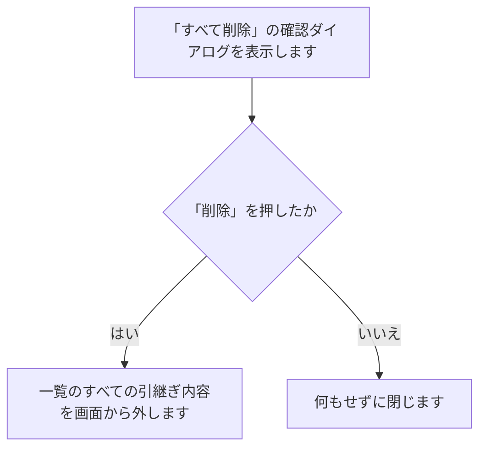

<div class="pagebreak"></div>

### 2.21 引継ぎ内容の設定[削除]

1. その引継ぎ内容を、一覧から外します。

```mermaid
flowchart TD
  A["その引継ぎ内容を、一覧から外します"]
```

<div class="pagebreak"></div>

### 2.22 引継ぎ内容の設定[設定を保存]

1. 一覧の各項目について、会社名（会社名の抽出が有効なとき）と氏名が空でないかを確認します。
2. 空の項目があるときは、入力エラーのダイアログを表示します。
3. その場合は、保存せずに処理を終了します。
4. 画面を開いてから保存データが変わっているときは、保存に失敗したことを示すダイアログを表示します。
5. その場合は、保存せずに処理を終了します。
6. 一覧から外した項目を取り除き、変更を保存します。
7. 「設定を保存しました」を表示し、前の画面へ戻ります。

```mermaid
flowchart TD
  A{"空の項目があるか"} -- はい --> B["入力エラーのダイアログを表示します"] --> C["保存せずに処理を終了します"]
  A -- いいえ --> D{"開いてから保存データが変わっているか"}
  D -- はい --> E["保存に失敗したことを示すダイアログを表示します"] --> C
  D -- いいえ --> F["一覧から外した項目を取り除き、変更を保存します"]
  F --> G["「設定を保存しました」を表示します"]
  G --> H["前の画面へ戻ります"]
```

<div class="pagebreak"></div>

### 2.23 設定のインポート・エクスポート[ファイルを選択]

1. ファイルを選ぶ画面を表示します。
2. ファイルを選ばなかったときは、何もせずに閉じます。
3. ファイルを選んだときは、そのファイルを読み込みます。
4. 読み込めなかったときは、「ファイルを読み込めませんでした」のエラーダイアログを表示します。
5. JSON として読めなかったときは、ファイルの形式が正しくないことを示すエラーダイアログを表示します。
6. 送信先の名前の重複、引継ぎ内容の必須の項目の不足、送信元の重複があるときは、その内容を示すエラーダイアログを表示します。
7. 含まれている項目が1つもないときは、反映する内容がないことを示すエラーダイアログを表示します。
8. エラーのときは、プレビューを「ファイルが選択されていません」に戻し、「インポート」を押せない状態にします。
9. 検証が通ったときは、ファイル名と項目ごとの件数をプレビューに表示し、「インポート」を押せるようにします。

```mermaid
flowchart TD
  A["ファイルを選ぶ画面を表示します"] --> B{"ファイルを選んだか"}
  B -- はい --> C["選んだファイルを読み込みます"] --> D{"読み込めたか"}
  B -- いいえ --> Z["何もせずに閉じます"]
  D -- はい --> F{"JSON として読めたか"}
  D -- いいえ --> E["「ファイルを読み込めませんでした」のエラーダイアログを表示します"] --> J["プレビューを「ファイルが選択されていません」に戻し、「インポート」を押せない状態にします"]
  F -- はい --> H{"重複や必須の項目の不足があるか"}
  F -- いいえ --> G["ファイルの形式が正しくないことを示すエラーダイアログを表示します"] --> J
  H -- はい --> I["その内容を示すエラーダイアログを表示します"] --> J
  H -- いいえ --> M{"含まれている項目が1つ以上あるか"}
  M -- はい --> K["ファイル名と項目ごとの件数をプレビューに表示します"] --> L["「インポート」を押せるようにします"]
  M -- いいえ --> N["反映する内容がないことを示すエラーダイアログを表示します"] --> J
```

<div class="pagebreak"></div>

### 2.24 設定のインポート・エクスポート[インポート]

1. 「設定をインポートしますか？」の確認ダイアログを表示します。
2. 「キャンセル」を押したときは、何もせずに閉じます。
3. 「インポート」を押したときは、ファイルに含まれるアプリの設定を、現在の設定に統合します。
4. ファイルに含まれる送信先は、同じ名前の送信先があれば内容を更新し、なければ追加します。
5. ファイルに含まれる引継ぎ内容は、同じ送信元があれば内容を更新し、なければ追加します。
6. 「設定をインポートしました」を表示し、表示テーマを反映して、前の画面へ戻ります。

```mermaid
flowchart TD
  A["「設定をインポートしますか？」の確認ダイアログを表示します"] --> B{"「インポート」を押したか"}
  B -- はい --> D["ファイルに含まれるアプリの設定を、現在の設定に統合します"]
  B -- いいえ --> C["何もせずに閉じます"]
  D --> E["ファイルに含まれる送信先は、同じ名前の送信先があれば内容を更新し、なければ追加します"]
  E --> F["ファイルに含まれる引継ぎ内容は、同じ送信元があれば内容を更新し、なければ追加します"]
  F --> G["「設定をインポートしました」を表示し、表示テーマを反映して、前の画面へ戻ります"]
```

<div class="pagebreak"></div>

### 2.25 設定のインポート・エクスポート[エクスポート]

1. ファイル名「s2k_settings_年月日_時分秒.json」を提案して、保存先を選ぶ画面を表示します。
2. 保存先を選ばずに閉じたときは、何もしません。
3. 保存先を選んだときは、アプリの設定、送信先の設定、引継ぎ内容を、JSON ファイルに書き出します。
4. 書き出しに成功したときは、「設定をエクスポートしました」を表示します。
5. 書き出しに失敗したときは、「ファイルを書き出せませんでした」のエラーダイアログを表示します。

```mermaid
flowchart TD
  A["ファイル名「s2k_settings_年月日_時分秒.json」を提案して、保存先を選ぶ画面を表示します"] --> B{"保存先を選んだか"}
  B -- はい --> D["アプリの設定、送信先の設定、引継ぎ内容を JSON ファイルに書き出します"]
  B -- いいえ --> C["何もせずに閉じます"]
  D --> E{"書き出せたか"}
  E -- はい --> F["「設定をエクスポートしました」を表示します"]
  E -- いいえ --> G["「ファイルを書き出せませんでした」のエラーダイアログを表示します"]
```

<div class="pagebreak"></div>

### 2.26 ログ[更新]

1. 保存されているログを読み直します。
2. ログがあるときは、ログの一覧を表示し直します。
3. ログがないときは、「ログがありません」と表示します。

```mermaid
flowchart TD
  A["保存されているログを読み直します"] --> B{"ログがあるか"}
  B -- はい --> C["ログの一覧を表示し直します"]
  B -- いいえ --> D["「ログがありません」と表示します"]
```

<div class="pagebreak"></div>

### 2.27 ログ[削除]

1. 「ログを削除しますか？」の確認ダイアログを表示します。
2. 「キャンセル」を押したときは、何もせずに閉じます。
3. 「削除」を押したときは、すべてのログを削除します。
4. 削除の後、ログの一覧を表示し直します。

```mermaid
flowchart TD
  A["「ログを削除しますか？」の確認ダイアログを表示します"] --> B{"「削除」を押したか"}
  B -- はい --> D["すべてのログを削除します"]
  B -- いいえ --> C["何もせずに閉じます"]
  D --> E["ログの一覧を表示し直します"]
```

<div class="pagebreak"></div>

### 2.28 SMSの検索[検索]

1. SMSの読み取りが許可されていないときは、検索の欄を隠し、許可を求める案内を表示して終了します。
2. 日付の範囲と本文に含む文字列の条件で、受信箱の SMS を新しい順に読み取ります。
3. 読み取りに失敗したときは、エラーを表示し、読み取れた SMS を0件として扱います。
4. 送信状況の条件が選ばれているときは、ログと突き合わせて、送信状況が一致する SMS だけに絞り込みます。
5. 送信先の条件が「すべて」以外のときは、振り分けの結果で絞り込みます。
6. 抽出状況の条件が選ばれているときは、抽出状況が一致する SMS だけに絞り込みます。
7. 検索を押したときは、「N件見つかりました」と表示します。
8. 該当するSMSがないときは、「該当するSMSがありません」と表示します。
9. 一覧を作り直して、チェックを外します。

```mermaid
flowchart TD
  A{"SMSの読み取りが許可されているか"}
  A -- はい --> C["日付の範囲と本文の条件で、受信箱の SMS を新しい順に読み取ります"]
  A -- いいえ --> B["検索の欄を隠し、許可を求める案内を表示します"] --> Z["処理を終了します"]
  C --> D{"読み取れたか"}
  D -- はい --> F{"送信状況の条件が選ばれているか"}
  D -- いいえ --> E["エラーを表示し、読み取れた SMS を0件として扱います"] --> F
  F -- はい --> G["ログと突き合わせて、送信状況が一致する SMS だけに絞り込みます"] --> H{"送信先の条件が「すべて」以外か"}
  F -- いいえ --> H
  H -- はい --> I["振り分けの結果で絞り込みます"] --> J{"抽出状況の条件が選ばれているか"}
  H -- いいえ --> J
  J -- はい --> K["抽出状況が一致する SMS だけに絞り込みます"] --> L["「N件見つかりました」と表示します"]
  J -- いいえ --> L
  L --> M{"該当する SMS があるか"}
  M -- はい --> N["一覧を作り直して、チェックを外します"]
  M -- いいえ --> O["「該当するSMSがありません」と表示します"] --> N
```

<div class="pagebreak"></div>

### 2.29 SMSの検索[全選択]

1. 一覧のうち、選べる SMS のチェックをすべて入れます。

```mermaid
flowchart TD
  A["一覧のうち、選べる SMS のチェックをすべて入れます"]
```

<div class="pagebreak"></div>

### 2.30 SMSの検索[選択解除]

1. 一覧のすべてのチェックを外します。

```mermaid
flowchart TD
  A["一覧のすべてのチェックを外します"]
```

<div class="pagebreak"></div>

### 2.31 SMSの検索[選択したSMSを送信]

1. 選んだ SMS がないときは、「送信するSMSを選択してください」と表示します。
2. その場合は、処理を終了します。
3. 選んだ SMS を、受信日時の古い順に並べます。
4. 選んだ SMS を、1件ずつ順番に手動で kintone へ登録するよう、送信のキューに追加します。
5. 選んだ SMS の件数を、「N件を送信キューに追加しました」と表示します。
6. 「N件を送信キューに追加しました」の表示の後、チェックを外して一覧を検索し直します。
7. 登録が終わったときは、送信のログを確認します。
8. 送信のログがあるときは、成功と失敗の件数を「SMSの送信が完了しました（成功N件 / 失敗M件）」と表示します。
9. 送信のログがないときは、「SMSの送信が完了しました」と表示します。
10. 「SMSの送信が完了しました」の表示の後、一覧を検索し直します。

```mermaid
flowchart TD
  A{"選んだ SMS があるか"}
  A -- はい --> C["選んだ SMS を、受信日時の古い順に並べます"] --> D["選んだ SMS を、1件ずつ順番に手動で kintone へ登録するよう、送信のキューに追加します"] --> E["「N件を送信キューに追加しました」と表示します"] --> F["「N件を送信キューに追加しました」の表示の後、チェックを外して一覧を検索し直します"] --> G{"送信のログがあるか"}
  A -- いいえ --> B["「送信するSMSを選択してください」と表示します"] --> Z["処理を終了します"]
  G -- はい --> H["成功と失敗の件数を「SMSの送信が完了しました（成功N件 / 失敗M件）」と表示します"] --> J["「SMSの送信が完了しました」の表示の後、一覧を検索し直します"]
  G -- いいえ --> I["「SMSの送信が完了しました」と表示します"] --> J
```

<div class="pagebreak"></div>

### 2.32 SMSの検索[▼ 表示 / ▲ 隠す]

1. 検索条件の欄が表示されているときは、その欄を隠します。
2. 検索条件の欄が隠れているときは、その欄を表示します。
3. ボタンの文字を、「▲ 隠す」または「▼ 表示」に切り替えます。

```mermaid
flowchart TD
  A{"検索条件の欄が表示されているか"}
  A -- はい --> B["検索条件の欄を隠します"]
  A -- いいえ --> C["検索条件の欄を表示します"]
  B --> D["ボタンの文字を切り替えます"]
  C --> D
```

### 2.33 SMS受信の自動処理

SMS を受信したときに、次の処理を行います。ボタンを押す操作ではありません。SMS受信の自動処理とSMS送信の自動処理は並行して行われます。

1. SMS を受信すると、送信元、本文、受信日時を読み取ります。
2. 分割されて届いた本文は、連結します。
3. SMS送信の自動処理（2.34）を、SMS受信の自動処理と並行して始めます。
4. 引継ぎがオンで、同じ送信元の引継ぎ内容があるときは、その会社名と氏名を使います。
5. 引継ぎ内容がないときは、本文から会社名と氏名を抽出します。
6. AIによる抽出が有効なときは、端末上のAIで会社名と氏名を抽出します。
7. AIによる抽出が無効か、AIで抽出できなかったときは、ルールに基づいて会社名と氏名を抽出します。
8. 会社名の抽出が有効なときは、会社名の変換（自動変換と固定変換）を適用します。
9. 会社名の抽出が有効なときは、振り分けに一致する送信先を決めます。
10. 一致する送信先がないときは、デフォルトの送信先を使います。
11. 会社名の抽出が無効なときは、すべての送信先を対象にします。
12. 本文から抽出でき、引継ぎではないときは、引継ぎ内容を更新します。
13. 受信完了のログを残します。
14. 返信モードが自動で、抽出が異常のときは、同じ送信元への前回の返信から間隔が過ぎているかを確認します。
15. 間隔が過ぎているときは、SMSの送信の許可があるかを確認します。
16. SMSの送信の許可があるときは、返信メッセージの送信を実行します。
17. 返信メッセージの送信を実行したときは、返信完了のログを残します。
18. 返信しないときは、返信メッセージを送信しません。

```mermaid
flowchart TD
  A["SMS を受信すると、送信元、本文、受信日時を読み取ります"] --> A2["分割されて届いた本文は、連結します"] --> A3["SMS送信の自動処理（2.34）を、SMS受信の自動処理と並行して始めます"] --> B{"引継ぎがオンで、同じ送信元の引継ぎ内容があるか"}
  B -- はい --> C["引継ぎの会社名と氏名を使います"] --> H{"会社名の抽出が有効か"}
  B -- いいえ --> D{"AIによる抽出が有効か"}
  D -- はい --> E["端末上のAIで会社名と氏名を抽出します"] --> F{"AIで抽出できたか"}
  D -- いいえ --> G["ルールに基づいて会社名と氏名を抽出します"]
  F -- はい --> H
  F -- いいえ --> G
  G --> H
  H -- はい --> I["会社名の変換（自動変換と固定変換）を適用します"] --> J{"振り分けに一致する送信先があるか"}
  H -- いいえ --> M["すべての送信先を対象にします"]
  J -- はい --> K["振り分けに一致する送信先を決めます"]
  J -- いいえ --> L["デフォルトの送信先を使います"]
  K --> N{"本文から抽出でき、引継ぎではないか"}
  L --> N
  M --> N
  N -- はい --> O["引継ぎ内容を更新します"] --> P["受信完了のログを残します"]
  N -- いいえ --> P
  P --> Q{"返信モードが自動で、抽出が異常か"}
  Q -- はい --> R{"同じ送信元への前回の返信から、間隔が過ぎているか"}
  Q -- いいえ --> X["返信メッセージを送信しません"]
  R -- はい --> S{"SMSの送信の許可があるか"}
  R -- いいえ --> X
  S -- はい --> T["返信メッセージの送信を実行します"] --> U["返信完了のログを残します"]
  S -- いいえ --> X
```

<div class="pagebreak"></div>

<div class="pagebreak"></div>

### 2.34 SMS送信の自動処理

SMS送信の自動処理は、SMS受信の自動処理の途中（2.33 の手順 3）から並行して始まります。

1. 必須の項目が揃った送信先がないときは、「SMSの送信先が存在しません」の失敗のログを残します。
2. その場合は、処理を終了します。
3. 送信モードが手動のときは、登録せずに終了します。
4. 抽出が異常で、抽出状況が異常の SMS の送信が無効なときは、その送信先への登録を行わず、次の送信先に進みます。
5. 送信の開始のログを残します。
6. kintone で、同じ送信元の既存のレコードを、登録種別と統合条件で検索します。
7. 既存のレコードがあるときは、同じ時刻で同じ本文が履歴にあるかを確認します。
8. 同じ時刻で同じ本文が履歴にあるときは、更新をスキップします。
9. 同じ時刻で同じ本文が履歴にないときは、履歴に本文を受信日時の順に加えて、既存のレコードを更新します。
10. 既存のレコードを更新するときは、今回の受信日時が既存より新しいときに限り、本文を更新します。
11. 既存のレコードがないときは、新しいレコードを登録します。
12. 登録の結果を、送信完了のログに残します。
13. 通信エラーまたは一時的なエラー（HTTP 5xx・429）のときは、最初の実行を含めて最大 5 回まで、一定の間隔をあけて再試行します。
14. 再試行の対象でないとき、または上限に達したときは、再試行せずに終了します。

```mermaid
flowchart TD
  V{"必須の項目が揃った送信先があるか"}
  V -- はい --> X2{"送信モードが自動か"}
  V -- いいえ --> W1["「SMSの送信先が存在しません」の失敗のログを残します"] --> W2["処理を終了します"]
  X2 -- はい --> Z1{"抽出が異常で、抽出状況が異常の送信が無効か"}
  X2 -- いいえ --> Y["登録せずに終了します"]
  Z1 -- はい --> Z2["その送信先への登録を行わず、次の送信先に進みます"] --> Z1
  Z1 -- いいえ --> Z3["送信の開始のログを残します"] --> Z4["kintone で、同じ送信元の既存のレコードを、登録種別と統合条件で検索します"] --> Z5{"既存のレコードがあるか"}
  Z5 -- はい --> Z6{"同じ時刻で、同じ本文が履歴にあるか"}
  Z6 -- はい --> Z7["更新をスキップします"] --> Z10["登録の結果を、送信完了のログに残します"]
  Z6 -- いいえ --> Z8["履歴に本文を受信日時の順に加えて、既存のレコードを更新します"] --> Z8A{"今回の受信日時が既存より新しいか"}
  Z8A -- はい --> Z8B["本文を更新します"] --> Z10
  Z8A -- いいえ --> Z8C["本文は更新しません"] --> Z10
  Z5 -- いいえ --> Z9["新しいレコードを登録します"] --> Z10
  Z10 --> Z11{"通信エラーまたは一時的なエラーか"}
  Z11 -- はい --> Z13{"再試行の上限に達したか"}
  Z11 -- いいえ --> Z14["再試行せずに終了します"]
  Z13 -- はい --> Z14
  Z13 -- いいえ --> Z12["一定の間隔をあけて再試行します"] --> V
```

## 3. 注意事項

- 送信（登録）に失敗したときは、送信完了のログに失敗として残ります。通信エラーと一時的なエラー（HTTP 5xx・429）は、一定の間隔をあけて自動で再試行し、最初の実行を含めて最大 5 回まで行います。上限に達したSMSは、SMSの検索画面から手動で登録してください。
- 必須の項目が揃っていない送信先には登録されません。有効な送信先が1つもないときは、その旨が失敗としてログに残ります。
- 同じ送信元のSMSは、統合条件の範囲内であれば、既存のレコードの履歴に追記されます。
- 手動で登録するSMSは、抽出が異常でも、送信モードの設定に関係なく登録されます。
- SMSの検索で、抽出が異常のSMSは、「SMS選択の対象」の設定がオフのときは選べません。
- 返信は、送信を実行した時点で完了とみなします。相手に届いたかどうかは確認しません。
- SMSの読み取り、受信、送信のいずれかが許可されていないと、対応する機能は動きません。
- 送信先の追加、コピー、削除、振り分けキーワードの変更は、「設定を保存」を押すまで保存されません。
- 引継ぎ内容の削除（「すべて削除」と「削除」）は、「設定を保存」を押すまで保存されません。
- テスト送信は、実際に kintone へ登録します。テスト送信のログはログの画面に残りません。
- 設定のエクスポートで書き出したファイルには、送信先のログイン情報のパスワードが平文で含まれます。ファイルの取り扱いに注意してください。
- 設定のインポートでは、同じ名前の送信先と、同じ送信元の引継ぎ内容が、ファイルの内容で上書きされます。設定のインポートでは、ファイルに含まれない項目は、現在の値が残ります。
- 引継ぎ内容の設定の画面を開いてから、SMSの受信などで保存データが変わると、保存できません。画面を開き直してから編集してください。
- 「設定を初期化」は、アプリの設定だけを既定値に戻します。送信先、ログ、引継ぎ内容は消えません。
- ログの削除は取り消せません。
