# 処理フロー

対象: `doc\02_設計\処理フロー.md`

共通の書き方は「共通ルール」、設計全体の書き方は「設計ルール」を参照してください。

## 1. 概要

画面のボタンを押したときに行われる処理の流れを示します。SMS を受信したときの自動処理は、ボタンを押す処理ではないため、最後の節（3.1）で示します。

- 処理の一覧
  | 通番 | 画面名 | ボタン名 | 内容 |
  |---|---|---|---|
  | 1 | トップ | SMSの検索 | SMS の検索画面を開きます。 |
  | 2 | トップ | ログの確認 | ログの画面を開きます。 |
  | 3 | トップ | 送信先の設定 | 送信先の設定画面を開きます。 |
  | 4 | トップ | アプリの設定 | アプリの設定画面を開きます。 |
  | 5 | トップ | 設定のインポート・エクスポート | 設定のインポート・エクスポートの画面を開きます。 |
  | 6 | 送信先の設定 | 設定を追加 | 空の送信先を追加します。 |
  | 7 | 送信先の設定 | コピー | 送信先を複製します。 |
  | 8 | 送信先の設定 | 削除 | 送信先を削除します。 |
  | 9 | 送信先の設定 | テスト送信 | テスト用の SMS を登録します。 |
  | 10 | 送信先の設定 | 設定を保存 | すべての送信先を保存します。 |
  | 11 | アプリの設定 | 設定を初期化 | アプリの設定を既定値に戻します。 |
  | 12 | アプリの設定 | 許可する | 権限を求めます。 |
  | 13 | アプリの設定 | 引継ぎ内容の設定 | 引継ぎ内容の設定画面を開きます。 |
  | 14 | 設定のインポート・エクスポート | ファイルを選択 | 読み込む JSON ファイルを選びます。 |
  | 15 | 設定のインポート・エクスポート | インポート | 読み込んだ内容を設定に統合します。 |
  | 16 | 設定のインポート・エクスポート | エクスポート | 設定を JSON ファイルに書き出します。 |
  | 17 | 引継ぎ内容の設定 | すべて削除 | 引継ぎ内容をすべて削除します。 |
  | 18 | 引継ぎ内容の設定 | 削除 | 引継ぎ内容の項目を削除します。 |
  | 19 | 引継ぎ内容の設定 | 設定を保存 | 引継ぎ内容の変更を保存します。 |
  | 20 | ログ | 更新 | ログの一覧を更新します。 |
  | 21 | ログ | 削除 | すべてのログを削除します。 |
  | 22 | SMSの検索 | 検索 | 条件に合う SMS を一覧に表示します。 |
  | 23 | SMSの検索 | 全選択 | 選べる SMS をすべて選びます。 |
  | 24 | SMSの検索 | 選択解除 | 選んだ SMS の選択を解除します。 |
  | 25 | SMSの検索 | 選択したSMSを送信 | 選んだ SMS を手動で登録します。 |

## 2. 各ボタンの処理フロー

### 2.1 SMSの検索[検索]

1. 検索条件を読み取ります。
2. 権限がなければ、読み取りの許可を求める案内を表示して終了します。
3. 条件に合う SMS を一覧に表示します。
4. 送信状況と抽出状況を表示します。

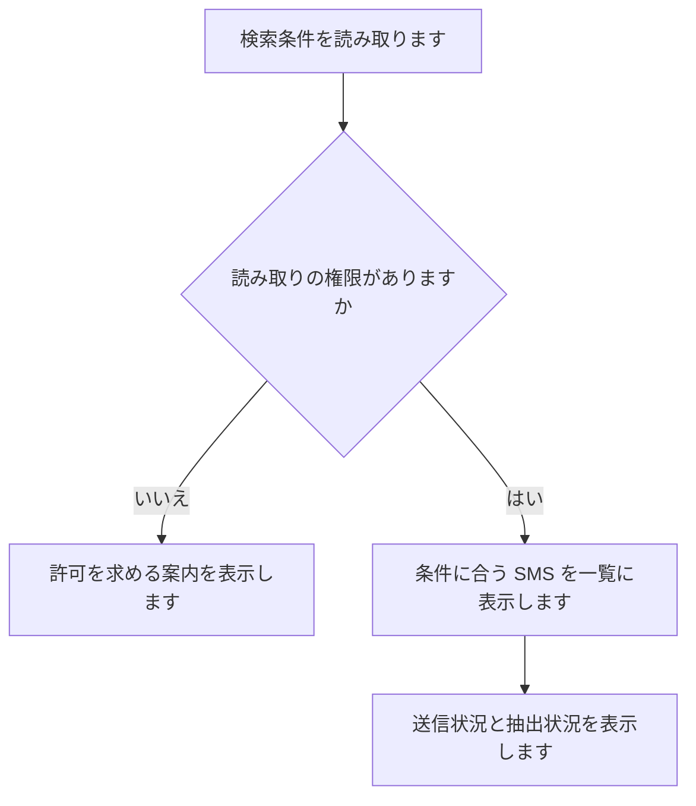

### 2.2 SMSの検索[全選択]

1. 選べる SMS をすべて選びます。

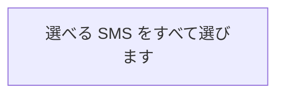

### 2.3 SMSの検索[選択解除]

1. 選んだ SMS の選択をすべて解除します。

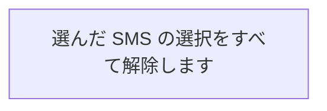

### 2.4 SMSの検索[選択したSMSを送信]

1. 選んだ SMS がないときは、メッセージを表示して終了します。
2. 選んだ SMS を、受信日時の古い順に並べます。
3. 1 件ずつ順に登録します。
4. 登録が終わると、成功と失敗の件数を表示します。
5. 一覧を検索し直し、選択を解除します。

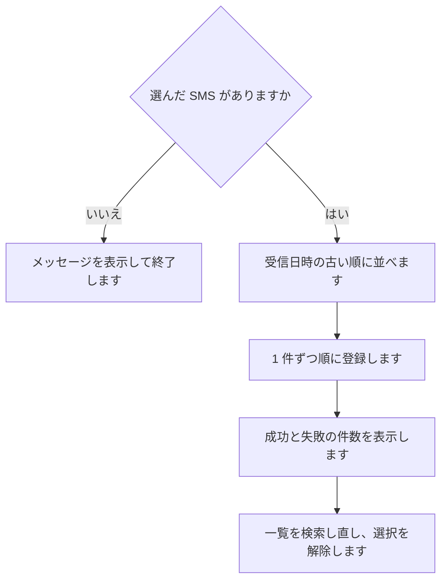

### 2.5 送信先の設定[設定を追加]

1. 空の送信先を、末尾に追加します。
2. 追加した送信先の位置へ移動します。

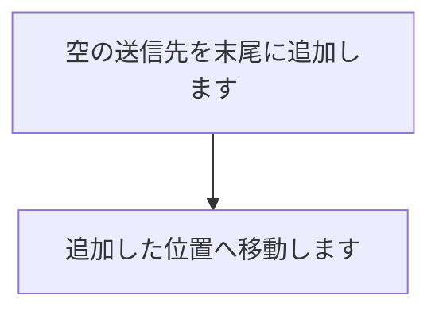

### 2.6 送信先の設定[コピー]

1. 送信先の内容を複製します。
2. 名前に「のコピー」を付けます。
3. 複製を、元の送信先の直後に追加します。

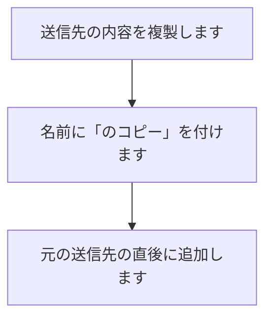

### 2.7 送信先の設定[削除]

1. 送信先を、確認なしで削除します。

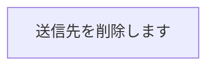

### 2.8 送信先の設定[テスト送信]

1. 送信先の接続情報と登録先の情報を確認します。
2. 必須の項目が不足していれば、不足の内容を表示して終了します。
3. 本文を編集するダイアログを表示します。
4. 「送信」を押すと、本文から会社名と氏名を取り出します。
5. 振り分けの結果が、この送信先と一致しなければ、登録せずにエラーを表示して終了します。
6. 一致していれば、テストの SMS を kintone に登録します。
7. 抽出の結果と、登録の結果を表示します。

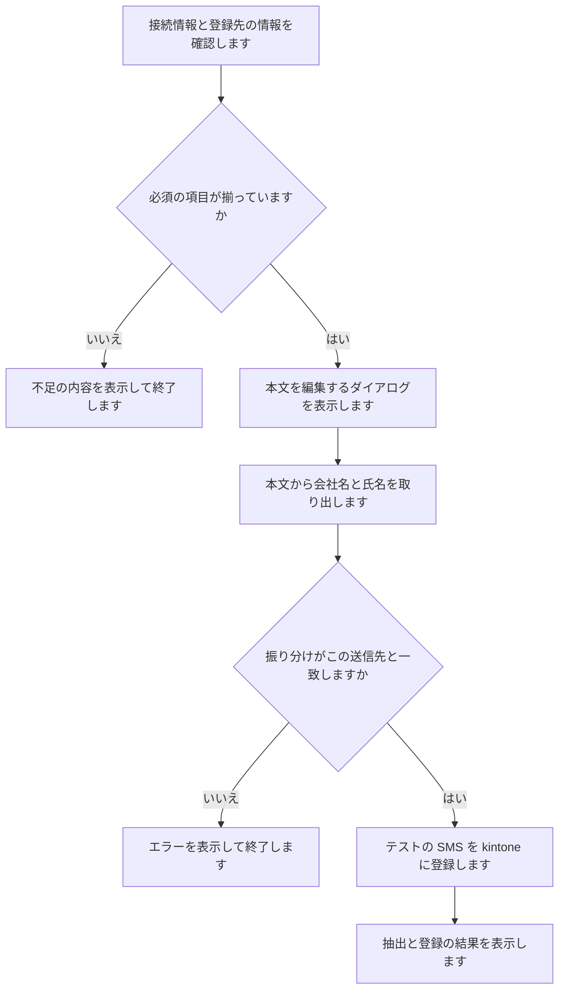

### 2.9 送信先の設定[設定を保存]

1. すべての送信先の入力を確認します。
2. 必須の項目が不足していれば、不足のある送信先の名前を示して、保存せずに終了します。
3. 送信先の名前が重複していれば、保存せずに終了します。
4. すべて揃っていれば、送信先の設定を保存します。
5. トップ画面へ戻ります。

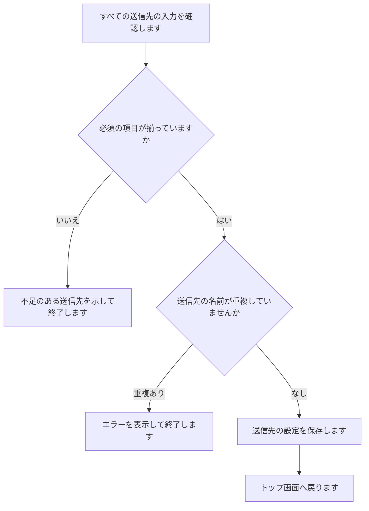

### 2.10 アプリの設定[設定を初期化]

1. 確認を表示します。
2. 「はい」を選んだときは、アプリの設定を既定値に戻します。
3. 送信先、ログ、引継ぎ内容は変更しません。

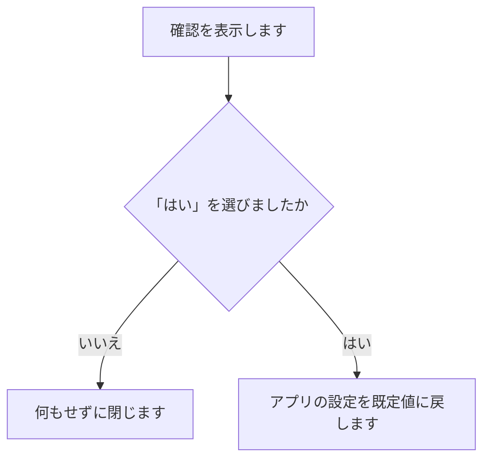

### 2.11 アプリの設定[許可する]

1. 権限を求める画面を表示します。
2. 許可されたら、表示を「許可済み」に変えます。

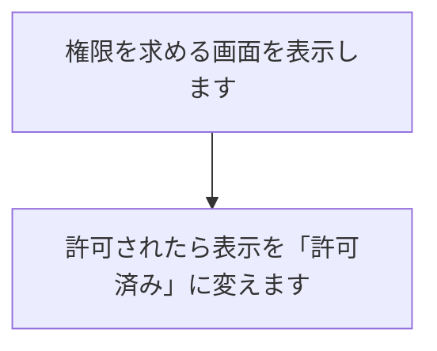

### 2.12 設定のインポート・エクスポート[ファイルを選択]

1. ファイルを選ぶ画面を表示します。
2. 選んだファイルを読み込み、項目ごとの件数を表示します。
3. 読み込みに失敗したときは、エラーを表示します。

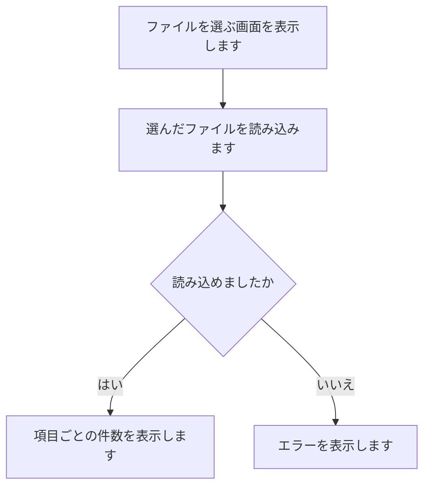

### 2.13 設定のインポート・エクスポート[インポート]

1. 確認を表示します。
2. 「はい」を選んだときは、ファイルの内容を設定に統合します。
3. 送信先は、名前が同じものを更新し、ないものを追加します。
4. 引継ぎ内容は、送信元が同じものを更新し、ないものを追加します。
5. 読み込んでいない項目は、現在の値を保持します。
6. トップ画面へ戻ります。

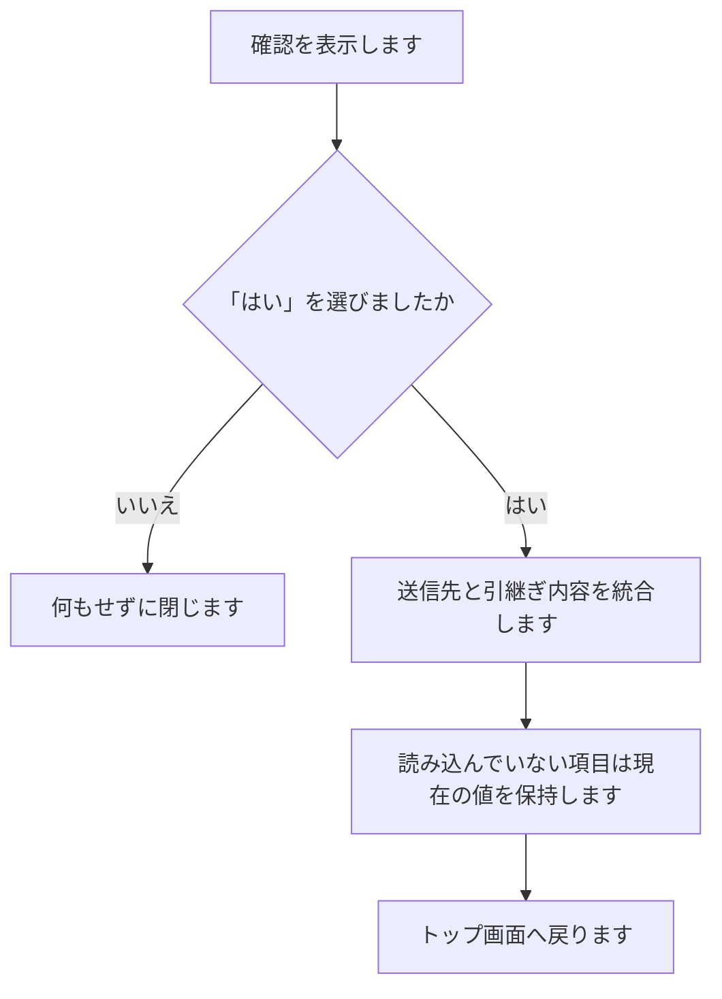

### 2.14 設定のインポート・エクスポート[エクスポート]

1. 保存先を選ぶ画面を表示します。
2. 設定を JSON ファイルに書き出します。
3. 書き出しに失敗したときは、エラーを表示します。

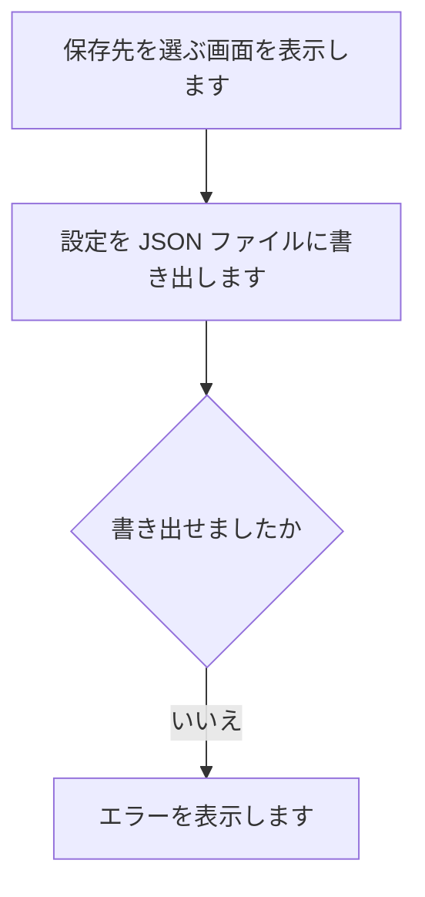

### 2.15 ログ[更新]

1. ログの一覧を、保存されている内容から読み直します。
2. 一覧を表示し直します。

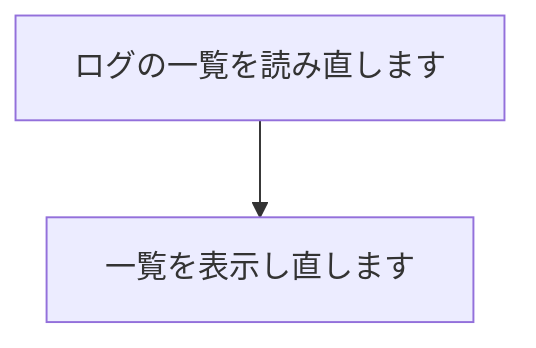

### 2.16 ログ[削除]

1. 確認を表示します。
2. 「はい」を選んだときは、すべてのログを削除します。

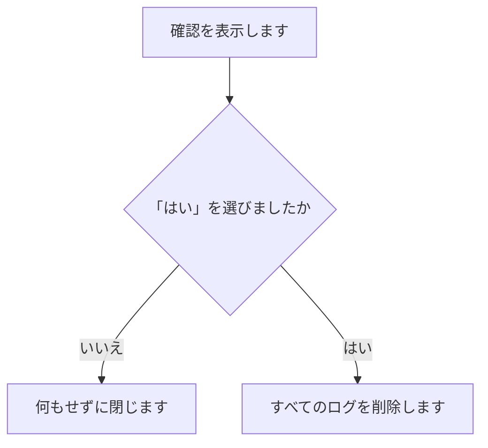

### 2.17 引継ぎ内容の設定[すべて削除]

1. 確認を表示します。
2. 「はい」を選んだときは、一覧のすべての項目を削除の対象にします。
3. 削除は「設定を保存」で確定します。

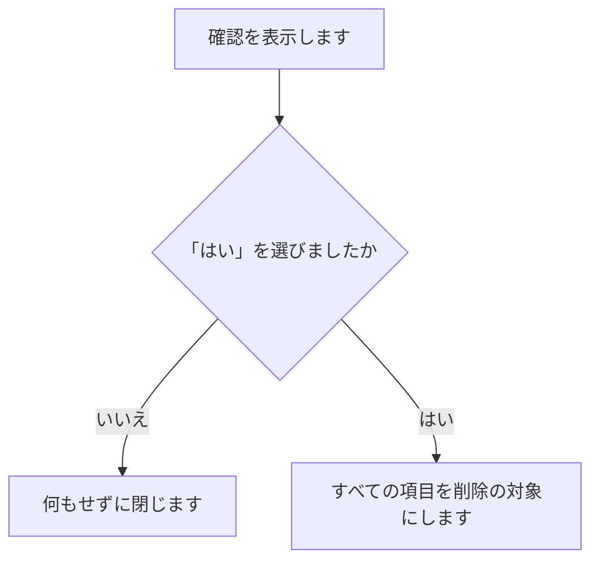

### 2.18 引継ぎ内容の設定[削除]

1. その項目を削除の対象にします。
2. 削除は「設定を保存」で確定します。

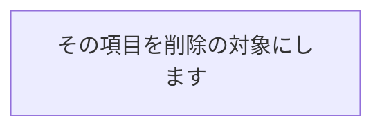

### 2.19 引継ぎ内容の設定[設定を保存]

1. 会社名（会社名の抽出がオンのとき）と氏名が空の項目があれば、エラーを表示して終了します。
2. 編集を始めてから内容が変わっていれば、保存せずにエラーを表示して終了します。
3. 削除の対象を取り除き、変更を保存します。

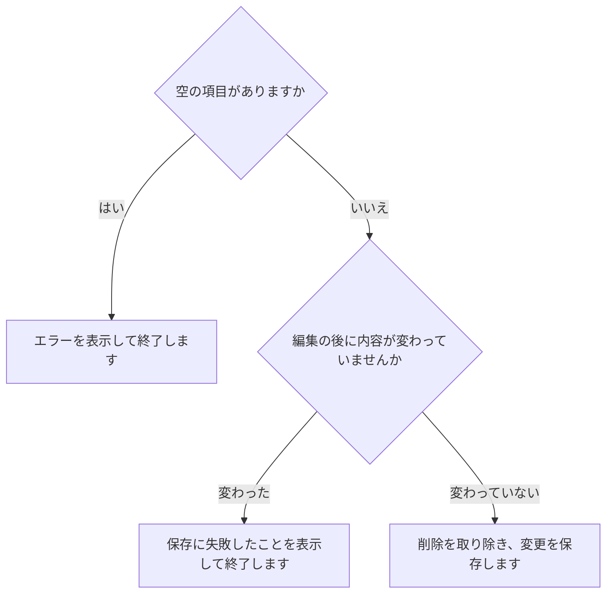

### 2.20 アプリの設定[自動保存]

アプリの設定には保存ボタンがありません。項目を変えるたびに、次の処理を行います。

1. 変えた項目の値を保存します。
2. 表示テーマを変えたときは、画面にすぐ反映します。

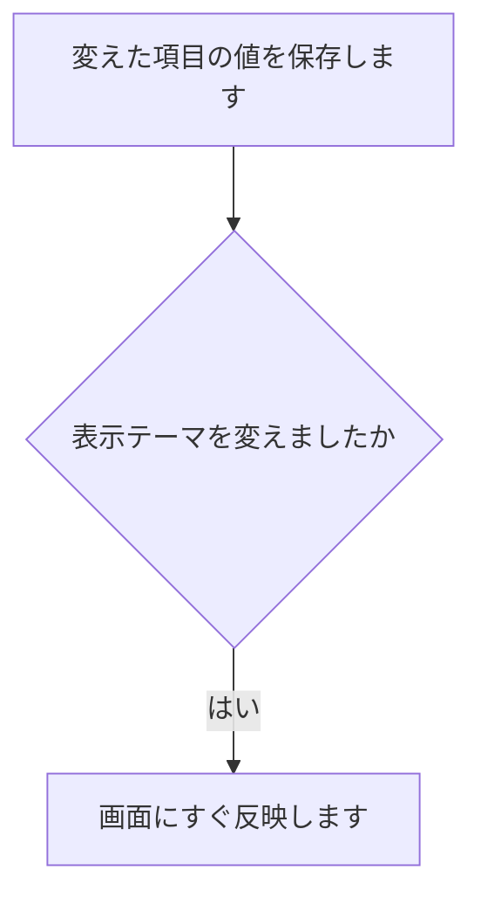

## 3. 注意事項

- 送信先の登録に失敗したときは、ログに失敗として残ります。自動の再送は、上限に達すると行いません。失敗した SMS は、SMS の検索画面から手動で登録してください。
- 権限を許可しないと、SMS の検索や自動の登録と返信の一部が動きません。
- テスト送信は、実際に kintone へ登録します。
- 設定のインポートは、同じ名前の送信先の内容を上書きします。

### 3.1 SMS受信時の自動処理

SMS を受信したときに、次の処理を行います。ボタンを押す操作ではありません。

1. 受信した SMS の本文と送信元を読み取ります。
2. 送信先を決めます。引継ぎが有効で、同じ送信元の引継ぎ内容があれば、その会社名と氏名を使います。
3. 引継ぎがなければ、本文から会社名と氏名を取り出します。
4. 取り出した会社名を変換し、振り分けの条件に合う送信先を決めます。
5. 受信のログを残します。
6. 送信モードが自動のときは、決まった送信先へ登録します。
7. 抽出に失敗し、返信モードが自動のときは、送信元へ自動返信します。

```mermaid
flowchart TD
  A[SMS を受信します] --> B{引継ぎの内容がありますか}
  B -- ある --> C[引継ぎの会社名と氏名を使います]
  B -- ない --> D[本文から会社名と氏名を取り出します]
  C --> E[送信先を決めます]
  D --> E
  E --> F[受信のログを残します]
  F --> G{送信モードは自動ですか}
  G -- はい --> H[送信先へ登録します]
  G -- いいえ --> I[登録せずに終わります]
  F --> J{抽出に失敗し、返信モードは自動ですか}
  J -- はい --> K[自動返信します]
```
