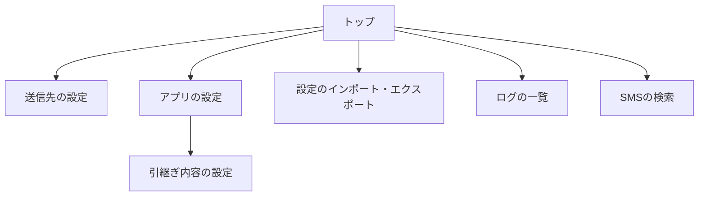

# 画面設計

対象: `doc\02_設計\画面設計.md`

共通の書き方は「共通ルール」、設計全体の書き方は「設計ルール」を参照してください。

## 1. 概要

本ツールの操作画面の構成と、各画面の項目と操作を示します。トップ画面から、各機能の画面を開きます。

- 画面の一覧
  | 通番 | 画面 | 内容 |
  |---|---|---|
  | 1 | トップ | 送信モードと返信モードを表示し、各画面を開きます。 |
  | 2 | 送信先の設定 | 送信先を追加、コピー、削除し、kintone への接続と振り分けを設定します。 |
  | 3 | アプリの設定 | 端末の許可、レイアウト、SMSの検索、SMSの送信、SMSの返信、SMSの情報抽出、SMSの引継ぎ、ログの設定をします。 |
  | 4 | 引継ぎ内容の設定 | 引き継ぐ会社名と氏名を一覧で確認し、編集します。 |
  | 5 | 設定のインポート・エクスポート | 設定を JSON ファイルに書き出し、読み込みます。 |
  | 6 | ログの一覧 | 受信、登録、返信の記録を確認します。 |
  | 7 | SMSの検索 | 受信した SMS を絞り込み、登録する SMS を選びます。 |

## 2. 画面遷移図

## 3. 各画面

### 3.1 トップ

トップ画面は、現在の送信モードと返信モードを表示し、各画面を開くボタンを並べます。

  

| 項目 | 種類 | 内容 |
|---|---|---|
| SMSの送信モード | 表示 | 送信モードを「自動」または「手動」で表示します。既定は「自動」です。 |
| SMSの返信モード | 表示 | 返信モードを「自動」または「手動」で表示します。既定は「手動」です。 |
| SMSの検索 | ボタン | SMSの検索画面を開きます。 |
| ログの確認 | ボタン | ログの一覧画面を開きます。 |
| 送信先の設定 | ボタン | 送信先の設定画面を開きます。 |
| アプリの設定 | ボタン | アプリの設定画面を開きます。 |
| 設定のインポート・エクスポート | ボタン | 設定のインポート・エクスポートの画面を開きます。 |

- 送信モードと返信モードの表示は、画面に戻るたびに最新の設定に合わせて更新します。

### 3.2 送信先の設定

送信先ごとに、kintone への接続先、振り分けの条件、登録するフィールドを設定します。送信先は、「設定 1」「設定 2」… の順にカードとして並びます。「設定 N」の見出しから「テスト送信」までの項目は、送信先ごとに並びます。

  

| 項目 | 種類 | 内容 |
|---|---|---|
| 設定を追加 | ボタン | 空の送信先を末尾に追加し、その位置へ移動します。 |

- 「設定を追加」を押すと、次の初期値の送信先を追加します。接続先は「univ-kyousai-{X}」、統合条件は「同一日付」、統合範囲は5時間です。フィールドコードは、送信元が「sender」、履歴が「history」、受信日時が「receive_datetime」、登録種別が「registration_type」、会社名が「company_name」、氏名が「user_name」、本文が「body」です。

#### 設定 N

| 項目 | 種類 | 内容 |
|---|---|---|
| コピー | ボタン | 送信先を複製し、直後に追加します。送信先名が空でないときは、名前の末尾に「のコピー」を付けます。 |
| 削除 | ボタン | 確認なしで送信先を削除し、番号を振り直します。 |

#### 基本の設定

| 項目 | 種類 | 内容 |
|---|---|---|
| 送信先 | 入力欄 | 送信先の名前です。必須です。 |
| 会社名（基本の設定） | 入力欄 | 会社名の抽出がオフのときだけ表示します。その送信先に登録する固定の会社名です。 |
| 送信先の振り分け | 表 | 含む文字列の入力欄を行ごとに持ちます。「+」で行を追加し、「×」で行を削除します。会社名の抽出がオンのときだけ表示します。キーワードがない送信先は、デフォルトの送信先になります。 |

#### kintoneの設定

| 項目 | 種類 | 内容 |
|---|---|---|
| 接続先 | 入力欄 | kintone のサブドメインです。必須です。 |
| 認証情報 | 表示 | 次の 2 つの項目の見出しです。 |
| ログイン名 | 入力欄 | kintone のログイン名です。必須です。 |
| パスワード | 入力欄 | kintone のパスワードです。必須です。伏せて表示します。 |
| 連絡用のアプリ | 入力欄 | 登録先のアプリの ID です。必須です。 |

#### フィールドコード

| 項目 | 種類 | 内容 |
|---|---|---|
| 登録種別 | 入力欄 | 登録種別を書き込むフィールドのコードです。必須です。 |
| 受信日時 | 入力欄 | 受信日時を書き込むフィールドのコードです。必須です。 |
| 送信元 | 入力欄 | 送信元を書き込むフィールドのコードです。必須です。 |
| 会社名（フィールドコード） | 入力欄 | 会社名を書き込むフィールドのコードです。任意です。 |
| 氏名 | 入力欄 | 氏名を書き込むフィールドのコードです。任意です。 |
| 本文 | 入力欄 | 本文を書き込むフィールドのコードです。任意です。 |
| 履歴 | 入力欄 | 本文の履歴を書き込むフィールドのコードです。必須です。 |

#### 統合条件

| 項目 | 種類 | 内容 |
|---|---|---|
| 同一日付 | ラジオボタン | 日付が同じ既存のデータを更新します。既定です。 |
| 時間 | ラジオボタン | 統合範囲の時間以内に、同じ送信元から再度受信した既存のデータを更新します。 |
| 統合範囲 | 入力欄 | 「時間」を選んだときだけ入力できます。既定は5時間です。 |

| 項目 | 種類 | 内容 |
|---|---|---|
| テスト送信 | ボタン | 本文を入力するダイアログを表示します。 |

- 「テスト送信」を押すと、入力内容で送信先を検証し、テスト本文を入力するダイアログを表示します。必須項目が空のときは「入力エラー」のダイアログを表示します。
- テスト本文のダイアログで「送信」を押すと、テストの SMS を kintone へ実際に登録し、「テスト結果」のダイアログに登録の結果と、抽出した会社名、氏名、本文を表示します。
- 会社名の抽出がオンで、送信先がキーワードによる振り分けに一致しない（デフォルトの送信先を除く）ときは、「テスト結果」のダイアログに「送信先エラー」を表示し、登録しません。
- テスト本文のダイアログで「キャンセル」を押すと、何もせずに閉じます。

| 項目 | 種類 | 内容 |
|---|---|---|
| 設定を保存 | ボタン | すべての送信先を保存し、トップ画面へ戻ります。 |

- 「設定を保存」を押すと、すべての送信先を検証します。1件でも必須項目が空のとき、または送信先名が重複しているときは、「入力エラー」のダイアログを表示し、どの送信先も保存しません。
- 保存できたときは「設定を保存しました」を表示し、トップ画面へ戻ります。

### 3.3 アプリの設定

アプリの設定は、項目を変えるたびに自動で保存されます。保存ボタンはありません。画面を開くたびに、保存済みの設定の値を表示します。

  

| 項目 | 種類 | 内容 |
|---|---|---|
| 初期化 | ボタン | 確認のあとで、アプリの設定を既定値に戻します。送信先、ログ、引継ぎ内容は消えません。 |

- 「初期化」を押すと、「設定を初期化しますか？」のダイアログを表示し、「この操作は取り消せません」と表示します。「初期化」を押すと、アプリの設定を既定値に戻し、画面を開き直します。「キャンセル」を押すと、何もせずに閉じます。

#### 端末の許可

| 項目 | 種類 | 内容 |
|---|---|---|
| SMSの読み取り | 表示 | 許可されているときは「許可済み」を表示します。 |
| 許可する（SMSの読み取り） | ボタン | 許可されていないときだけ表示します。押すと、端末に許可を求めます。ボタンの下に「SMSの検索に使用します」を表示します。 |
| SMSの受信 | 表示 | 許可されているときは「許可済み」を表示します。 |
| 許可する（SMSの受信） | ボタン | 許可されていないときだけ表示します。押すと、端末に許可を求めます。ボタンの下に「SMSの自動送信・自動返信に使用します」を表示します。 |
| SMSの送信 | 表示 | 許可されているときは「許可済み」を表示します。 |
| 許可する（SMSの送信） | ボタン | 許可されていないときだけ表示します。押すと、端末に許可を求めます。ボタンの下に「SMSの自動返信に使用します」を表示します。 |

- 許可を求めて拒否されたときは、その権限がないと何ができないかを、トーストで表示します。

#### レイアウト

| 項目 | 種類 | 内容 |
|---|---|---|
| 表示テーマ | 表示 | 表示テーマを選びます。 |
| ライト | ラジオボタン | 既定です。選ぶと、すぐに反映します。 |
| ダーク | ラジオボタン | 選ぶと、すぐに反映します。 |

#### SMSの検索

| 項目 | 種類 | 内容 |
|---|---|---|
| 検索条件の初期値 | 表示 | 次の項目は、SMSの検索画面を開いたときの初期値です。 |
| 受信日の範囲 | 入力欄 | 検索画面を開いたときの受信日の範囲（日）です。既定は1日（今日だけ）です。 |
| 送信先 | プルダウン | 検索画面の初期の送信先です。既定は「すべて」です。送信先が1件のときは表示しません。 |
| 送信状況 | 表示 | 次の 3 つの項目の初期の選択です。 |
| 未送信 | チェックボックス | 検索画面の「⬜ 未」の初期の状態です。既定はオフです。 |
| 済（自動） | チェックボックス | 検索画面の「✅ 済（自動）」の初期の状態です。既定はオフです。 |
| 済（手動） | チェックボックス | 検索画面の「☑️ 済（手動）」の初期の状態です。既定はオフです。 |
| 抽出状況 | 表示 | 次の 2 つの項目の初期の選択です。 |
| 正常 | チェックボックス | 検索画面の「🆗 正常」の初期の状態です。既定はオフです。 |
| 異常 | チェックボックス | 検索画面の「🆖 異常」の初期の状態です。既定はオフです。 |
| 検索条件の表示 | 表示 | 検索画面で検索条件を表示するかを選びます。 |
| 表示 | ラジオボタン | 既定です。検索画面を開いたときに、検索条件を表示します。 |
| 隠す | ラジオボタン | 検索画面を開いたときに、検索条件を隠します。 |
| SMS選択の対象 | 表示 | 検索結果の SMS を選べるかを設定します。 |
| 抽出状況が異常（SMS選択の対象） | チェックボックス | 抽出状況が異常な SMS を検索結果で選択できるようにします。既定はオフです。 |

#### SMSの送信

| 項目 | 種類 | 内容 |
|---|---|---|
| 送信モード | 表示 | 受信した SMS を kintone へ送信するかを選びます。 |
| 手動（送信モード） | ラジオボタン | SMS を受信しても、自動では送信しません。 |
| 自動（送信モード） | ラジオボタン | 既定です。SMS を受信した場合、kintone へ自動送信します。 |
| 自動送信の対象 | 表示 | 自動送信の対象を設定します。 |
| 抽出状況が異常（自動送信の対象） | チェックボックス | 「自動」のときだけ操作できます。抽出状況が異常な SMS も自動送信の対象に含めます。既定はオフです。 |

#### SMSの返信

| 項目 | 種類 | 内容 |
|---|---|---|
| 返信モード | 表示 | 自動返信するかを選びます。 |
| 手動（返信モード） | ラジオボタン | 既定です。自動返信しません。 |
| 自動（返信モード） | ラジオボタン | 「抽出状況が異常」な SMS を受信した場合、返信用のメッセージを自動返信します。 |
| 自動返信の間隔 | 入力欄 | 「自動」のときだけ入力できます。同じ送信元には、ここで指定した秒数が経つまで自動返信を再送信しません。既定は10秒です。 |
| 返信メッセージ（自動入力） | 表示 | SMS の検索画面で長押しして開く返信画面に、自動で入る文言です。 |
| 正しく抽出できた場合 | 入力欄 | 抽出状況が正常な SMS への返信に使う文言です。 |
| 正しく抽出できなかった場合 | 入力欄 | 抽出状況が異常な SMS への返信に使う文言です。会社名が不要な場合は、「（記入例）」から会社名を削除します。 |

#### SMSの情報抽出

| 項目 | 種類 | 内容 |
|---|---|---|
| 会社名の抽出 | 表示 | 本文から会社名と氏名を取り出すかを設定します。 |
| 有効にする（会社名の抽出） | チェックボックス | 既定はオンです。オンのとき、本文の1行目を「会社名」として扱います。オフのとき、1行目を「氏名」として扱います。 |
| 会社名の変換 | 表示 | 抽出した会社名に適用する変換を設定します。 |
| 自動変換 | 表示 | 変換の自動適用を設定します。 |
| 有効にする（自動変換） | チェックボックス | 既定はオンです。英数字を半角大文字に、それ以外の文字を全角に変換します。「会社名の抽出」がオンのときだけ操作できます。 |
| 固定変換 | 表 | 変換前と変換後の入力欄の組を行ごとに持ちます。「+」で行を追加し、各行の「×」で行を削除します。「会社名の抽出」がオンのときだけ操作できます。 |
| AIによる抽出 | 表示 | 端末上の AI で抽出するかを設定します。 |
| 有効にする（AIによる抽出） | チェックボックス | 既定はオフです。端末上の AI で会社名と氏名を抽出します。AI の呼び出しに失敗した場合は、ルールベースの抽出を実行します。 |

- 「有効にする（会社名の抽出）」をオンにするとき、引継ぎ内容に会社名がない件があれば、「注意」のダイアログで件数を表示します。「OK」を押すと、オンにします。「キャンセル」を押すと、オフのままにします。

#### SMSの引継ぎ

| 項目 | 種類 | 内容 |
|---|---|---|
| 引継ぎ | 表示 | 過去の SMS から抽出結果を引き継ぐかを設定します。 |
| 有効にする（引継ぎ） | チェックボックス | 既定はオンです。過去の正常な SMS から抽出結果を引き継ぎます。 |
| 引継ぎ内容の設定 | ボタン | 引継ぎがオンのときだけ押せます。引継ぎ内容の設定画面を開きます。 |
| 引継ぎの範囲 | 表示 | 引き継ぐ範囲を選びます。 |
| 制限なし | ラジオボタン | 既定です。引き継ぐ範囲に日付の制限を設けません。引継ぎがオンのときだけ選べます。 |
| 同一日のみ | ラジオボタン | 引き継ぐ範囲を同じ日だけにします。日付が変わると引継ぎがリセットされます。引継ぎがオンのときだけ選べます。 |
| 引継ぎ内容の表示 | 表示 | 引継ぎ内容の表示を設定します。 |
| 氏名を表示する | チェックボックス | 既定はオンです。電話番号の代わりに、引き継いだ氏名を表示します。引継ぎがオンのときだけ操作できます。 |

#### ログ

| 項目 | 種類 | 内容 |
|---|---|---|
| 自動更新 | 表示 | ログの一覧を自動で読み込み直すかを設定します。 |
| 有効にする（自動更新） | チェックボックス | 既定はオンです。ログの一覧を指定した間隔で自動的に読み込み直します。 |
| 更新間隔 | 入力欄 | 「自動更新」がオンのときだけ入力できます。単位は秒です。既定は5秒です。 |
| 統合範囲 | 入力欄 | 送信ログと端末の SMS を同じ SMS とみなす、時刻のずれの許容範囲です。単位は秒です。既定は15秒です。 |
| 本文の最大表示文字数 | 入力欄 | ログの一覧に表示する本文の最大文字数です。既定は100文字です。 |

- 数値の入力欄は、1 以上の整数を入力したときだけ保存します。
- 「送信先」は、送信先が1件のときは表示しません。

### 3.4 引継ぎ内容の設定

引継ぎ内容を送信元ごとの一覧で確認し、会社名と氏名を編集します。

  

| 項目 | 種類 | 内容 |
|---|---|---|
| キーワード | 入力欄 | 会社名、氏名、送信元で絞り込みます。入力すると、一覧をすぐに絞り込みます。保存はしません。 |
| 表示順序 | 表示 | 一覧の並び順を選びます。 |
| 古い順 | ラジオボタン | 既定です。受信日時の古い順に並べます。 |
| 新しい順 | ラジオボタン | 受信日時の新しい順に並べます。 |
| 引継ぎ内容がありません | 表示 | 引継ぎ内容が1件もないときに、一覧の代わりに表示します。 |
| 一致する引継ぎ内容がありません | 表示 | 絞り込みに一致する項目がないときに、一覧の代わりに表示します。 |

一覧の各項目（送信元ごと）は、次の行を持ちます。

| 項目 | 種類 | 内容 |
|---|---|---|
| 送信元 | 表示 | 引継ぎ内容の送信元を表示します。 |
| 削除 | ボタン | その項目を一覧から削除します。確認はありません。「設定を保存」で確定します。 |
| 会社名 | 入力欄 | 会社名です。会社名の抽出がオンのときだけ表示します。 |
| 氏名 | 入力欄 | 氏名です。 |
| 送信先 | 表示 | 会社名から判定した登録先の送信先の名前です。該当がなければ「なし」と表示します。 |

| 項目 | 種類 | 内容 |
|---|---|---|
| 設定を保存 | ボタン | 変更を保存し、アプリの設定へ戻ります。 |

- 「設定を保存」を押すと、会社名の抽出がオンのときは会社名と氏名、オフのときは氏名が空の項目があれば、「入力エラー」のダイアログを表示し、保存しません。
- 画面を開いてから SMS の受信などで内容が更新されていたときは、保存せず、「保存に失敗しました」のダイアログを表示します。
- 保存できたときは「設定を保存しました」を表示し、アプリの設定へ戻ります。

### 3.5 設定のインポート・エクスポート

設定を JSON ファイルに書き出し、読み込みます。

  

#### インポート

JSONファイルからアプリ設定・送信先の設定・引継ぎ内容を反映します。

| 項目 | 種類 | 内容 |
|---|---|---|
| ファイルを選択 | ボタン | 読み込む JSON ファイルを選びます。選ぶと、内容を読み込んで下の欄に表示します。 |
| ファイル名 | 表示 | 選んだファイルの名前を表示します。ファイルを選ぶまでは「ファイルが選択されていません」と表示します。 |
| アプリの設定 | 表示 | ファイルにアプリの設定があるときは「統合」、ないときは「変更なし」と表示します。 |
| 送信先の設定 | 表示 | ファイルに送信先があるときは「統合（件数）」、ないときは「変更なし」と表示します。 |
| 引継ぎ内容 | 表示 | ファイルに引継ぎ内容があるときは「統合（件数）」、ないときは「変更なし」と表示します。 |
| インポート | ボタン | ファイルを読み込むまで押せません。 |

#### エクスポート

現在のアプリ設定・送信先の設定・引継ぎ内容をJSONファイルに書き出します。

| 項目 | 種類 | 内容 |
|---|---|---|
| エクスポート | ボタン | 保存先を選んで、設定を JSON ファイルに書き出します。ファイル名は「s2k_settings_yyyyMMdd_HHmmss.json」です。 |

- 「ファイルを選択」を押すと、ファイルを選ぶ画面を開きます。読み込めないとき、または形式が正しくないときは、「インポートエラー」のダイアログを表示し、ファイル名の欄を「ファイルが選択されていません」に戻します。
- 「インポート」を押すと、「設定をインポートしますか？」のダイアログを表示し、読み込んだ内容を示します。「インポート」を押すと、ファイルの内容を現在の設定に統合し、「設定をインポートしました」を表示して、トップ画面へ戻ります。「キャンセル」を押すと、何もせずに閉じます。
- 統合は、ファイルに含まれる項目を反映し、ファイルに含まれない項目は既存の値を残します。ファイルに含まれないセクションは変更しません。
- 送信先名が重複しているとき、引継ぎ内容の送信元が空・重複しているとき、氏名が空のとき、または会社名の抽出がオンで会社名が空のときは、「インポートエラー」のダイアログを表示し、読み込みません。
- 「エクスポート」を押すと、保存先を選ぶ画面を開きます。書き出せたときは「設定をエクスポートしました」を表示し、書き出せないときは「エクスポートエラー」のダイアログを表示します。

### 3.6 ログの一覧

受信、登録、返信の記録を新しい順に表示します。

  

| 項目 | 種類 | 内容 |
|---|---|---|
| 更新 | ボタン | ログの一覧を読み込み直します。 |
| 削除 | ボタン | すべてのログを削除します。確認のあとで削除します。 |
| 凡例 | 表示 | 抽出対象、抽出状況、送信状況、返信状況、送信先のアイコンの意味を示します。 |
| ログがありません | 表示 | 記録が1件もないときに、一覧の代わりに表示します。 |
| ログの一覧 | 表 | 記録を新しい順に表示します。各項目に、種別（「[受信完了]」など）、記録日時、成否（「[成功]」または「[失敗]」）とメッセージ、抽出対象・抽出状況・送信状況・返信状況・送信先のアイコン、送信先名、送信元（引継ぎの場合は氏名）、受信日時、本文の抜粋を表示します。 |

- 「削除」を押すと、「ログを削除しますか？」のダイアログを表示します。「削除」を押すと、すべてのログを削除します。「キャンセル」を押すと、何もせずに閉じます。
- 一覧を下に引っ張ると、ログを読み込み直します。
- 「自動更新」がオンのときは、更新間隔ごとに自動で読み込み直します。
- ログの項目を長押しすると、自動返信の項目では「返信内容」のダイアログを、それ以外の抽出を伴う項目では「抽出結果」のダイアログを表示します。「抽出結果」には、会社名、氏名、本文を表示します。抽出に失敗しているときは「会社名・氏名の抽出に失敗しています」を表示します。

### 3.7 SMSの検索

端末が受信した SMS を、条件で絞り込みます。

  

| 項目 | 種類 | 内容 |
|---|---|---|
| アプリ設定画面の「端末の許可」の「SMSの読み取り」を許可してください | 表示 | 「SMSの読み取り」の許可がないときに、検索の画面の代わりに表示します。 |
| ▲ 隠す | ボタン | 検索条件を隠します。検索条件が隠れているときは「▼ 表示」と表示し、押すと検索条件を表示します。 |

#### 検索条件

| 項目 | 種類 | 内容 |
|---|---|---|
| 受信日の範囲 | 表示 | 受信日の範囲を、開始日と終了日で選びます。 |
| 開始日 | 入力欄 | 日付を選びます。初期値は、今日から「受信日の範囲」の日数分さかのぼった日です。 |
| 終了日 | 入力欄 | 日付を選びます。初期値は今日です。 |
| 送信先 | プルダウン | すべて、送信先の名前、未設定のいずれかで絞り込みます。初期値は、アプリの設定で選んだ送信先です。送信先が1件のときは表示しません。 |
| 抽出状況 | 表示 | 抽出状況で絞り込みます。 |
| 🆗 正常 | チェックボックス | オンのとき、抽出状況が正常な SMS だけに絞り込みます。 |
| 🆖 異常 | チェックボックス | オンのとき、抽出状況が異常な SMS だけに絞り込みます。 |
| 送信状況 | 表示 | 送信状況で絞り込みます。 |
| ⬜ 未 | チェックボックス | オンのとき、未送信の SMS だけに絞り込みます。 |
| ✅ 済（自動） | チェックボックス | オンのとき、自動で送信済みの SMS だけに絞り込みます。 |
| ☑️ 済（手動） | チェックボックス | オンのとき、手動で送信済みの SMS だけに絞り込みます。 |

| 項目 | 種類 | 内容 |
|---|---|---|
| 検索 | ボタン | 条件に合う SMS を一覧に表示し、件数を「○件見つかりました」と表示します。 |
| 全選択 | ボタン | 選べる SMS をすべて選びます。 |
| 選択解除 | ボタン | 選んだ SMS の選択をすべて解除します。 |
| 凡例 | 表示 | 抽出対象、抽出状況、送信状況、返信状況、送信先のアイコンの意味を示します。 |
| 該当するSMSがありません | 表示 | 条件に合う SMS がないときに、一覧の代わりに表示します。 |
| 結果一覧 | 表 | 条件に合う SMS を新しい順に表示します。各項目の左のチェックボックスで選びます。各項目に、抽出対象、抽出状況、送信状況、返信状況、送信先、送信元（引継ぎの場合は氏名）、受信日時、本文を表示します。 |

| 項目 | 種類 | 内容 |
|---|---|---|
| 選択したSMSを送信 | ボタン | 選んだ SMS を、受信日時の古い順に、手動で kintone へ送信します。 |

- 検索条件の「正常」と「異常」は、どちらもオフのときは抽出状況で絞り込みません。「未」「済（自動）」「済（手動）」も、どれもオフのときは送信状況で絞り込みません。
- 「検索」は、画面を開いたとき、画面に戻ったとき、一覧を下に引っ張ったときにも、同じ条件で検索し直します。
- 「全選択」は、選べない項目（送信先が未設定の SMS、または抽出状況が異常で「抽出状況が異常（SMS選択の対象）」がオフの SMS）を除きます。
- 一覧の項目を押すと、選べる項目のチェックを切り替えます。項目を長押しすると、標準の SMS アプリで返信を開き、本文に返信の文面が入ります。抽出に失敗した SMS は「正しく抽出できなかった場合」、それ以外は「正しく抽出できた場合」の文言です。
- 「選択したSMSを送信」を押すと、選んでいないときは「送信するSMSを選択してください」を表示します。選んだときは「○件を送信キューに追加しました」を表示し、チェックを外して一覧を更新します。全件の送信が終わると「SMSの送信が完了しました（成功○件 / 失敗○件）」を表示します。
