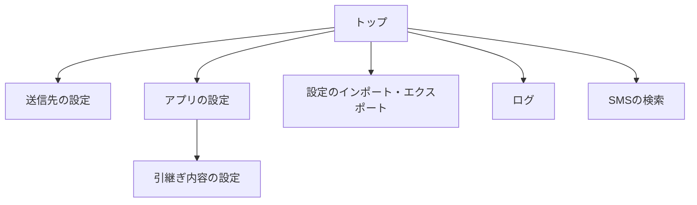

# 画面設計

対象: `doc\02_設計\画面設計.md`

共通の書き方は「共通ルール」、設計全体の書き方は「設計ルール」を参照してください。

## 1. 概要

本ツールの操作画面の構成と、各画面の項目と操作を示します。トップ画面から、各機能の画面を開きます。

- 画面の一覧
  | 通番 | 画面 | 内容 |
  |---|---|---|
  | 1 | トップ | 送信モードと返信モードを表示し、各画面を開きます。 |
  | 2 | 送信先の設定 | 送信先を追加、コピー、削除し、kintone への接続と振り分けを設定します。 |
  | 3 | アプリの設定 | 表示、権限、登録、返信、検索、抽出、引継ぎ、ログの設定をします。 |
  | 4 | 引継ぎ内容の設定 | 引き継ぐ会社名と氏名を一覧で確認し、編集します。 |
  | 5 | 設定のインポート・エクスポート | 設定を JSON ファイルに書き出し、読み込みます。 |
  | 6 | ログ | 受信、登録、返信の記録を確認し、削除します。 |
  | 7 | SMSの検索 | 受信した SMS を絞り込み、登録する SMS を選びます。 |

## 2. 画面遷移図

## 3. 各画面

### 3.1 トップ

トップ画面は、現在の送信モードと返信モードを表示し、各画面へ移動するボタンを並べます。

#### 項目

| 項目 | 種類 | 内容 |
|---|---|---|
| SMSの送信モード | 表示 | 送信モードが自動か手動かを表示します。 |
| SMSの返信モード | 表示 | 返信モードが自動か手動かを表示します。 |
| SMSの検索 | ボタン | SMS の検索画面を開きます。 |
| ログの確認 | ボタン | ログの画面を開きます。 |
| 送信先の設定 | ボタン | 送信先の設定画面を開きます。 |
| アプリの設定 | ボタン | アプリの設定画面を開きます。 |
| 設定のインポート・エクスポート | ボタン | 設定のインポート・エクスポートの画面を開きます。 |

### 3.2 送信先の設定

送信先ごとに、登録先と振り分けの条件を設定します。送信先は、カードの一覧として並びます。

#### 操作

- 「設定を追加」を押すと、空の送信先を末尾に追加し、その位置へ移動します。
- 各カードの「コピー」を押すと、送信先を複製します。
- 各カードの「削除」を押すと、確認なしで送信先を削除します。
- 「設定を保存」を押すと、すべての送信先を検証して保存します。保存後、トップ画面へ戻ります。

#### 基本の設定

| 項目 | 種類 | 内容 |
|---|---|---|
| 送信先 | 入力欄 | 送信先の名前です。必須です。 |
| 会社名 | 入力欄 | 会社名の抽出がオフのときだけ表示します。その送信先に登録する固定の会社名です。 |
| 振り分け | 表 | 振り分けキーワードを追加、削除します。キーワードがない送信先はデフォルトの送信先になります。 |

#### kintoneの設定

| 項目 | 種類 | 内容 |
|---|---|---|
| 接続先 | 入力欄 | kintone のサブドメインです。必須です。 |
| 認証情報（ログイン名） | 入力欄 | kintone のログイン名です。必須です。 |
| 認証情報（パスワード） | 入力欄 | kintone のパスワードです。必須です。伏せて表示します。 |
| 連絡用のアプリ | 入力欄 | 登録先のアプリの番号です。必須です。 |

#### フィールドの設定

| 項目 | 種類 | 内容 |
|---|---|---|
| 登録種別 | 入力欄 | 登録種別を書き込むフィールドです。必須です。 |
| 受信日時 | 入力欄 | 受信日時を書き込むフィールドです。必須です。 |
| 送信元 | 入力欄 | 送信元を書き込むフィールドです。必須です。 |
| 会社名 | 入力欄 | 会社名を書き込むフィールドです。任意です。 |
| 氏名 | 入力欄 | 氏名を書き込むフィールドです。任意です。 |
| 本文 | 入力欄 | 本文を書き込むフィールドです。任意です。 |
| 履歴 | 入力欄 | 本文の履歴を書き込むフィールドです。必須です。 |

#### 統合条件

| 項目 | 種類 | 内容 |
|---|---|---|
| 同一日付 | ラジオボタン | 同じ日の既存のレコードに追記します。 |
| 時間 | ラジオボタン | 前後の時間の範囲にある既存のレコードに追記します。 |
| 統合範囲（時間） | 入力欄 | 統合条件が時間のときだけ入力できます。前後の時間です。 |

#### テスト送信

| 項目 | 種類 | 内容 |
|---|---|---|
| テスト送信 | ボタン | 本文を編集するダイアログを表示します。「送信」を押すと、テストの SMS を登録します。 |

- 「テスト送信」は、実際に kintone へ登録します。

### 3.3 アプリの設定

アプリの設定は、項目を変えるたびに自動で保存されます。保存ボタンはありません。

#### 操作

- 「設定を初期化」を押すと、確認のあとでアプリの設定を既定値に戻します。送信先、ログ、引継ぎ内容は消えません。

#### 端末の許可

| 項目 | 種類 | 内容 |
|---|---|---|
| SMSの読み取り | 表示 | 許可されているかを表示します。 |
| SMSの受信 | 表示 | 許可されているかを表示します。 |
| SMSの送信 | 表示 | 許可されているかを表示します。 |
| 許可する | ボタン | 許可されていない権限を求めます。 |

#### 表示

| 項目 | 種類 | 内容 |
|---|---|---|
| 表示テーマ | プルダウン | ライトかダークかを選びます。すぐに反映されます。 |

#### 登録と返信

| 項目 | 種類 | 内容 |
|---|---|---|
| SMSの送信モード | ラジオボタン | 自動か手動かを選びます。 |
| 抽出失敗SMSの自動送信 | チェックボックス | 抽出に失敗した SMS を、自動で登録の対象にします。 |
| SMSの返信モード | ラジオボタン | 自動か手動かを選びます。 |
| 自動返信の間隔 | 入力欄 | 同じ送信元へ自動返信する間隔（秒）です。 |
| 返信メッセージ（正常） | 入力欄 | 抽出に成功した SMS の送信元へ送る文面です。 |
| 返信メッセージ（異常） | 入力欄 | 抽出に失敗した SMS の送信元へ送る文面です。 |

#### SMSの検索

| 項目 | 種類 | 内容 |
|---|---|---|
| 受信日の範囲 | 入力欄 | 検索画面を開いたときの範囲（日）です。 |
| 送信先 | プルダウン | 検索画面の既定の送信先です。送信先が 1 件のときは表示しません。 |
| 送信状況 | チェックボックス | 未送信、済（自動）、済（手動）を既定で選ぶかを設定します。 |
| 抽出状況 | チェックボックス | 正常、異常を既定で選ぶかを設定します。 |
| 検索条件の表示 | ラジオボタン | 検索条件を表示するか、隠すかを選びます。 |
| SMS選択の対象（抽出異常） | チェックボックス | オンにすると、抽出に失敗した SMS も選択できます。 |

#### SMSの情報抽出

| 項目 | 種類 | 内容 |
|---|---|---|
| 会社名の抽出 | チェックボックス | 本文から会社名を取り出すかを設定します。 |
| 会社名の自動変換 | チェックボックス | 抽出した会社名を自動で変換するかを設定します。 |
| 会社名の固定変換 | 表 | 変換前と変換後の対応を追加、削除します。 |
| AIによる抽出 | チェックボックス | 端末内の AI で抽出するかを設定します。 |

#### SMSの引継ぎ

| 項目 | 種類 | 内容 |
|---|---|---|
| 引継ぎ | チェックボックス | 同じ送信元の以前の情報を引き継ぐかを設定します。 |
| 引継ぎ内容の設定 | ボタン | 引継ぎ内容の設定画面を開きます。引継ぎがオンのときに押せます。 |
| 引継ぎの範囲 | ラジオボタン | 制限なしか、同一日のみかを選びます。 |
| 引継ぎ内容の氏名表示 | チェックボックス | 引継ぎ内容の一覧に氏名を表示するかを設定します。 |

#### ログ

| 項目 | 種類 | 内容 |
|---|---|---|
| ログの自動更新 | チェックボックス | ログの一覧を一定の間隔で更新するかを設定します。 |
| 更新間隔 | 入力欄 | ログの自動更新の間隔（秒）です。 |
| 統合範囲（秒） | 入力欄 | 送信ログと端末の SMS を同じとみなす時間の差です。 |
| 本文の表示文字数 | 入力欄 | ログに表示する本文の文字数です。 |

### 3.4 引継ぎ内容の設定

引継ぎ内容を一覧で確認し、編集します。

#### 操作

- 検索欄に入力すると、会社名、氏名、送信元で絞り込みます。
- 「すべて削除」を押すと、確認のあとで一覧のすべての項目を削除します。削除は「設定を保存」で確定します。
- 「設定を保存」を押すと、変更を保存します。

#### 項目

| 項目 | 種類 | 内容 |
|---|---|---|
| キーワード | 入力欄 | 会社名、氏名、送信元で絞り込みます。 |
| 表示順序 | ラジオボタン | 古い順か、新しい順かを選びます。 |
| すべて削除 | ボタン | 一覧のすべての項目を削除します。 |
| 送信元 | 表示 | 引継ぎ内容の送信元を表示します。 |
| 削除 | ボタン | その項目を削除します。 |
| 会社名 | 入力欄 | 会社名です。会社名の抽出がオンのときだけ表示します。 |
| 氏名 | 入力欄 | 氏名です。 |
| 送信先 | 表示 | 会社名から判定した登録先の送信先の名前です。該当がなければ「なし」と表示します。 |
| 設定を保存 | ボタン | 変更を保存します。 |

- 保存するとき、編集を始めてから内容が変わっていれば、保存しません。エラーを表示します。

### 3.5 設定のインポート・エクスポート

設定を JSON ファイルに書き出し、読み込みます。

#### 項目

| 項目 | 種類 | 内容 |
|---|---|---|
| ファイルを選択 | ボタン | 読み込む JSON ファイルを選びます。 |
| 読み込んだ内容 | 表示 | 選んだファイル名と、各項目の件数を表示します。 |
| インポート | ボタン | 読み込んだ内容を設定に統合します。ファイルの読み込みが済むまで押せません。 |
| エクスポート | ボタン | 設定を JSON ファイルに書き出します。保存先を選べます。 |

- 「インポート」を押すと、確認のあとで設定に統合し、トップ画面へ戻ります。

### 3.6 ログ

受信、登録、返信の記録を新しい順に表示します。

#### 項目

| 項目 | 種類 | 内容 |
|---|---|---|
| 更新 | ボタン | ログの一覧を更新します。 |
| 削除 | ボタン | すべてのログを削除します。確認のあとで削除します。 |
| 凡例 | 表示 | 抽出対象、抽出状況、送信状況、返信、送信先のアイコンの意味を示します。 |
| ログの一覧 | 表 | 種別、記録日時、成否、メッセージ、送信先名、受信日時、送信元、本文の抜粋を表示します。 |

- ログの項目を長押しすると、返信の内容、または抽出の結果を表示します。

### 3.7 SMSの検索

端末が受信した SMS を、条件で絞り込みます。

#### 検索条件

| 項目 | 種類 | 内容 |
|---|---|---|
| 受信日の範囲 | 入力欄 | 開始日と終了日を選びます。初期値は、今日を含む直近の日数です。 |
| 本文に含む文字列 | 入力欄 | 本文に含まれる文字列で絞り込みます。 |
| 送信先 | プルダウン | すべて、送信先の名前、未設定のいずれかで絞り込みます。送信先が 1 件のときは表示しません。 |
| 抽出状況 | チェックボックス | 正常、異常で絞り込みます。 |
| 送信状況 | チェックボックス | 未送信、済（自動）、済（手動）で絞り込みます。 |
| 検索条件の表示 | ボタン | 検索条件を表示したり隠したりします。 |

#### 一覧と操作

| 項目 | 種類 | 内容 |
|---|---|---|
| 検索 | ボタン | 条件に合う SMS を一覧に表示します。 |
| 全選択 | ボタン | 選べる SMS をすべて選びます。 |
| 選択解除 | ボタン | 選んだ SMS の選択を解除します。 |
| 選択したSMSを送信 | ボタン | 選んだ SMS を、手動で登録します。 |
| 結果一覧 | 表 | SMS の一覧です。チェックボックスで選びます。 |

- SMS の項目を長押しすると、標準の SMS アプリで返信を開きます。本文に返信の文面が入ります。
- 送信先が有効に 1 つもないとき、または抽出に失敗していて「SMS選択の対象」がオフのときは、その SMS は選べません。
