# 操作マニュアル

## 1. 目的と対象

- 対象: 端末が受信した SMS を kintone に登録する本ツール（Android アプリ）。
- 使う人: 本ツールを導入し、SMS の登録と返信を運用する担当者。

## 2. 画面の構成

- 画面の一覧

| 通番 | 画面名 | 概要 |
|---|---|---|
| 1 | トップ | 送信モードと返信モードを表示し、各画面を開きます。 |
| 2 | SMSの検索 | 端末が受信した SMS を条件で絞り込み、登録する SMS や返信する SMS を選びます。 |
| 3 | ログの一覧 | 受信、登録、返信の記録を新しい順に確認し、不要になったログを削除します。 |
| 4 | 送信先の設定 | 送信先を追加、コピー、削除し、kintone への接続と振り分けを設定します。 |
| 5 | アプリの設定 | 端末の許可、レイアウト、SMSの検索、SMSの送信、SMSの返信、SMSの情報抽出、SMSの引継ぎ、ログの設定をします。 |
| 6 | 引継ぎ内容の設定 | 同じ送信元の以前の会社名と氏名を一覧で確認し、編集します。 |
| 7 | 設定のインポート・エクスポート | 設定を JSON ファイルに書き出し、読み込みます。 |

## 3. 共通

### 3.1 トップ

　送信モードと返信モードを表示し、各画面を開きます。

  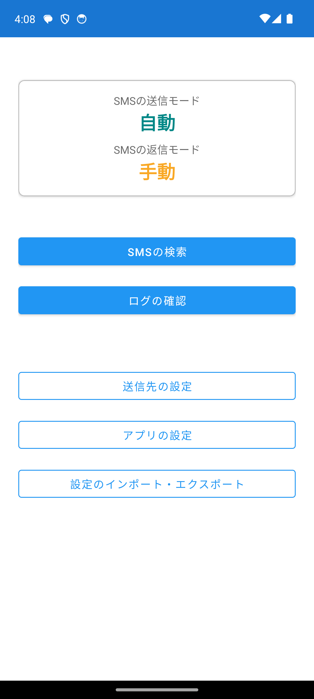

#### 項目

| 通番 | 区分 | 項目 | 種類 | 内容 |
|---|---|---|---|---|
| 1 | 共通 | SMSの送信モード | 表示 | 送信モードを「自動」または「手動」で表示します。 |
| 2 | 共通 | SMSの返信モード | 表示 | 返信モードを「自動」または「手動」で表示します。 |
| 3 | 共通 | SMSの検索 | ボタン | 「SMSの検索」の画面を開きます。 |
| 4 | 共通 | ログの確認 | ボタン | ログの一覧の画面を開きます。 |
| 5 | 共通 | 送信先の設定 | ボタン | 送信先の設定の画面を開きます。 |
| 6 | 共通 | アプリの設定 | ボタン | アプリの設定の画面を開きます。 |
| 7 | 共通 | 設定のインポート・エクスポート | ボタン | 設定のインポート・エクスポートの画面を開きます。 |

#### 操作方法

1. トップ画面で、「SMSの送信モード」と「SMSの返信モード」を確かめます。

   

     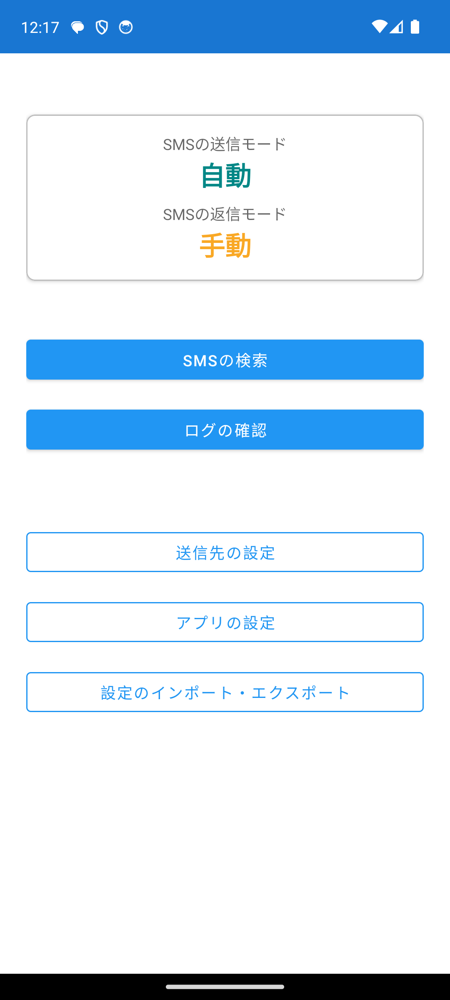
   

2. 操作したい画面のボタンを押します。

   

     
   

> 注意
> - 送信モードと返信モードの表示は、画面に戻るたびに最新の設定に合わせて更新します。

## 4. 初期設定

### 4.1 アプリの設定

　アプリの動作と既定値を設定します。 
　項目を変えるたびに自動で保存されます。保存ボタンはありません。

  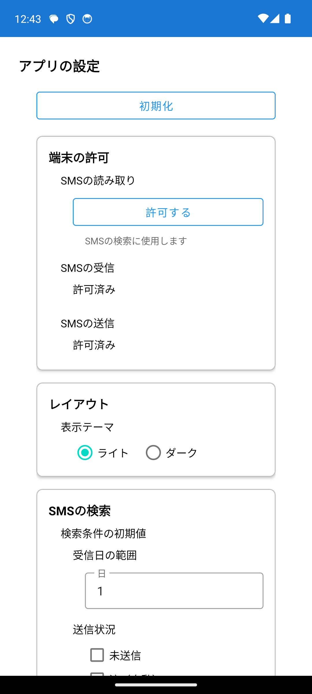

#### 項目

| 通番 | 区分 | 項目 | 種類 | 内容 |
|---|---|---|---|---|
| 1 | 共通 | 初期化 | ボタン | 確認のあと、アプリの設定を既定値に戻します。送信先、ログ、引継ぎ内容は消えません。 |
| 2 | 端末の許可 | SMSの読み取り | 表示 | 許可されているときは「許可済み」を表示します。 |
| 3 | 端末の許可 | 許可する（SMSの読み取り） | ボタン | 許可されていないときだけ表示します。押すと、端末に許可を求めます。 |
| 4 | 端末の許可 | SMSの受信 | 表示 | 許可されているときは「許可済み」を表示します。 |
| 5 | 端末の許可 | 許可する（SMSの受信） | ボタン | 許可されていないときだけ表示します。押すと、端末に許可を求めます。 |
| 6 | 端末の許可 | SMSの送信 | 表示 | 許可されているときは「許可済み」を表示します。 |
| 7 | 端末の許可 | 許可する（SMSの送信） | ボタン | 許可されていないときだけ表示します。押すと、端末に許可を求めます。 |
| 8 | レイアウト | 表示テーマ | 表示 | 表示テーマを選びます。 |
| 9 | レイアウト | ライト | ラジオボタン | 選ぶと、すぐに反映します。初期値は「ライト」です。 |
| 10 | レイアウト | ダーク | ラジオボタン | 選ぶと、すぐに反映します。 |
| 11 | SMSの検索 | 受信日の範囲 | 入力欄 | 「SMSの検索」を開いたときの受信日の範囲を、日数で入力します。初期値は 1 日（今日だけ）です。 |
| 12 | SMSの検索 | 送信先 | プルダウン | 「SMSの検索」を開いたときの送信先を選びます。初期値は「すべて」です。送信先が 1 件のときは表示しません。 |
| 13 | SMSの検索 | 未送信 | チェックボックス | 「SMSの検索」の「⬜ 未」の初期の状態を設定します。初期値はオフです。 |
| 14 | SMSの検索 | 済（自動） | チェックボックス | 「SMSの検索」の「✅ 済（自動）」の初期の状態を設定します。初期値はオフです。 |
| 15 | SMSの検索 | 済（手動） | チェックボックス | 「SMSの検索」の「☑️ 済（手動）」の初期の状態を設定します。初期値はオフです。 |
| 16 | SMSの検索 | 正常 | チェックボックス | 「SMSの検索」の「🆗 正常」の初期の状態を設定します。初期値はオフです。 |
| 17 | SMSの検索 | 異常 | チェックボックス | 「SMSの検索」の「🆖 異常」の初期の状態を設定します。初期値はオフです。 |
| 18 | SMSの検索 | 表示 | ラジオボタン | 「SMSの検索」を開いたときに、検索条件を表示します。初期値です。 |
| 19 | SMSの検索 | 隠す | ラジオボタン | 「SMSの検索」を開いたときに、検索条件を隠します。 |
| 20 | SMSの検索 | 抽出状況が異常（SMS選択の対象） | チェックボックス | 抽出状況が異常な SMS を、検索結果で選べるようにします。初期値はオフです。 |
| 21 | SMSの送信 | 手動（送信モード） | ラジオボタン | SMS を受信しても、自動では kintone へ送信しません。 |
| 22 | SMSの送信 | 自動（送信モード） | ラジオボタン | SMS を受信すると、kintone へ自動で送信します。初期値は「自動」です。 |
| 23 | SMSの送信 | 抽出状況が異常（自動送信の対象） | チェックボックス | 「自動」のときだけ操作できます。抽出状況が異常な SMS も自動送信の対象に含めます。初期値はオフです。 |
| 24 | SMSの返信 | 手動（返信モード） | ラジオボタン | 自動では返信しません。初期値は「手動」です。 |
| 25 | SMSの返信 | 自動（返信モード） | ラジオボタン | 抽出状況が異常な SMS を受信すると、返信メッセージを自動で返信します。 |
| 26 | SMSの返信 | 自動返信の間隔 | 入力欄 | 「自動」のときだけ入力できます。同じ送信元へは、ここで指定した秒数が経つまで再送信しません。初期値は 10 秒です。 |
| 27 | SMSの返信 | 正しく抽出できた場合 | 入力欄 | 抽出状況が正常な SMS への返信に使う文言を入力します。 |
| 28 | SMSの返信 | 正しく抽出できなかった場合 | 入力欄 | 抽出状況が異常な SMS への返信に使う文言を入力します。 |
| 29 | SMSの情報抽出 | 有効にする（会社名の抽出） | チェックボックス | 本文から会社名と氏名を取り出します。オンのとき、本文の 1 行目を会社名として扱います。初期値はオンです。 |
| 30 | SMSの情報抽出 | 有効にする（自動変換） | チェックボックス | 英数字を半角大文字、それ以外の文字を全角にそろえて変換します。「会社名の抽出」がオンのときだけ操作できます。初期値はオンです。 |
| 31 | SMSの情報抽出 | 固定変換 | 表 | 変換前と変換後の文字の組を、行ごとに入力します。「+」で行を追加し、「×」で行を削除します。「会社名の抽出」がオンのときだけ操作できます。 |
| 32 | SMSの情報抽出 | 有効にする（AIによる抽出） | チェックボックス | 端末上の AI で会社名と氏名を抽出します。AI の呼び出しに失敗したときは、ルールに基づいて抽出します。初期値はオフです。 |
| 33 | SMSの引継ぎ | 有効にする（引継ぎ） | チェックボックス | 過去の正常な SMS から抽出した会社名と氏名を、次の SMS に引き継ぎます。初期値はオンです。 |
| 34 | SMSの引継ぎ | 引継ぎ内容の設定 | ボタン | 引継ぎがオンのときだけ押せます。「引継ぎ内容の設定」の画面を開きます。 |
| 35 | SMSの引継ぎ | 制限なし | ラジオボタン | 引き継ぐ範囲に日付の制限を設けません。初期値です。引継ぎがオンのときだけ選べます。 |
| 36 | SMSの引継ぎ | 同一日のみ | ラジオボタン | 引き継ぐ範囲を同じ日だけにします。日付が変わると引継ぎがリセットされます。引継ぎがオンのときだけ選べます。 |
| 37 | SMSの引継ぎ | 氏名を表示する | チェックボックス | 電話番号の代わりに、引き継いだ氏名を表示します。初期値はオンです。引継ぎがオンのときだけ操作できます。 |
| 38 | ログ | 有効にする（自動更新） | チェックボックス | ログの一覧を、更新間隔ごとに自動で読み込み直します。初期値はオンです。 |
| 39 | ログ | 更新間隔 | 入力欄 | 「自動更新」がオンのときだけ入力できます。単位は秒です。初期値は 5 秒です。 |
| 40 | ログ | 統合範囲 | 入力欄 | 送信のログと端末の SMS を同じ SMS とみなす、時刻のずれの許容範囲を秒で入力します。初期値は 15 秒です。 |
| 41 | ログ | 本文の最大表示文字数 | 入力欄 | ログの一覧に表示する本文の最大文字数を入力します。初期値は 100 文字です。 |

#### 操作方法

1. トップ画面の「アプリの設定」を押します。

   

     
   

2. 「端末の許可」の「許可する（SMSの読み取り）」を押し、端末の許可を与えます。

   

     
     
   

3. 「端末の許可」の「許可する（SMSの受信）」を押し、端末の許可を与えます。

   

     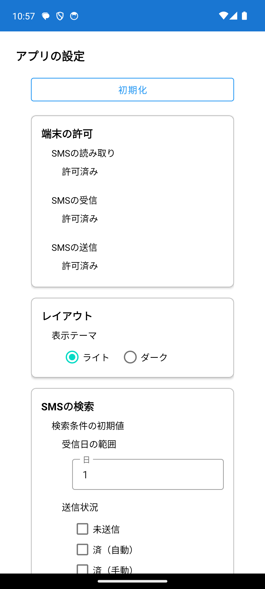
     
   

4. 「端末の許可」の「許可する（SMSの送信）」を押し、端末の許可を与えます。

   

     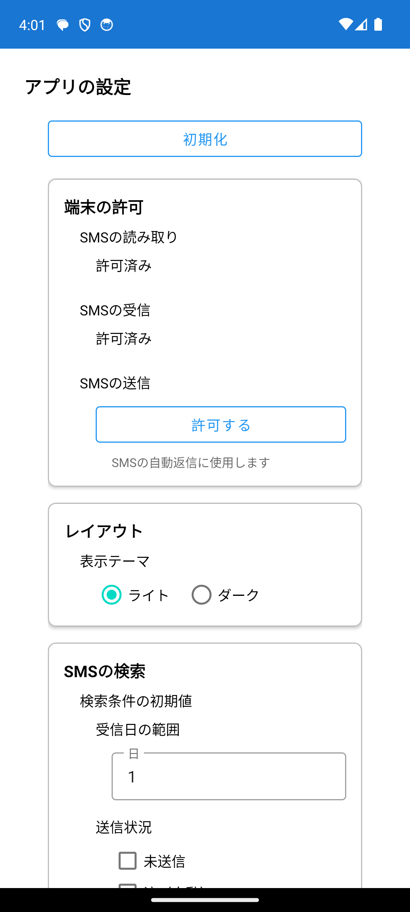
     
   

5. 「SMSの送信モード」の項目を、運用に合わせて設定します。

   

     
   

6. 「SMSの返信モード」の項目を、運用に合わせて設定します。

   

     
   

7. 「SMSの情報抽出」の項目を、運用に合わせて設定します。

   

     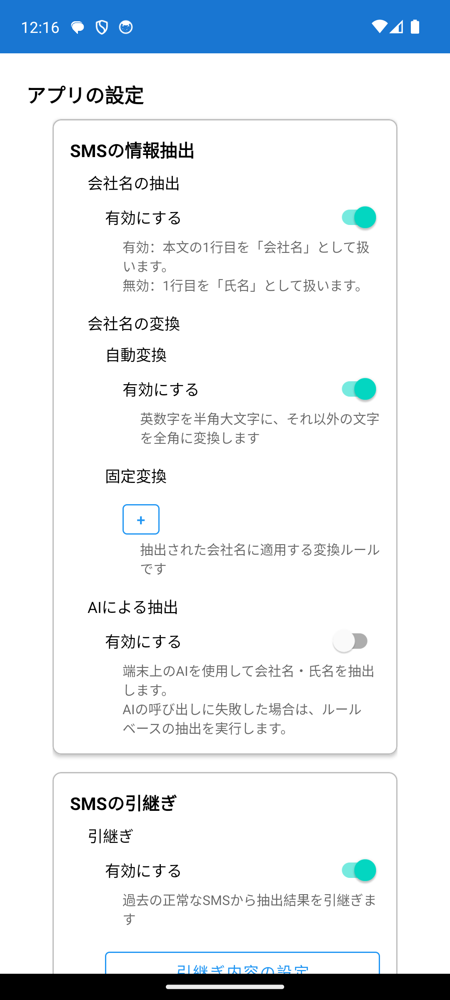
   

8. 「SMSの引継ぎ」の項目を、運用に合わせて設定します。

   

     
   

9. 「ログ」の項目を、運用に合わせて設定します。

   

     
   

> 注意
> - 項目を変えると、すぐに保存されます。
> - 「SMSの読み取り」「SMSの受信」「SMSの送信」のいずれかが許可されていないと、その権限を使う機能は動きません。
> - 数値の入力欄は、1 以上の整数を入力したときだけ保存します。

### 4.2 送信先の設定

　kintone への接続先と、SMS の振り分けを設定します。 
　送信先は 1 件以上必要です。

  

#### 項目

| 通番 | 区分 | 項目 | 種類 | 内容 |
|---|---|---|---|---|
| 1 | 共通 | 設定を追加 | ボタン | 空の送信先を一覧の末尾に追加します。 |
| 2 | 設定 N | コピー | ボタン | 送信先を複製し、直後に追加します。送信先の名前が空でないときは、名前の末尾に「のコピー」を付けます。 |
| 3 | 設定 N | 削除 | ボタン | 送信先を一覧から削除します。確認はありません。番号は振り直します。 |
| 4 | 基本の設定 | 送信先 | 入力欄 | 送信先の名前を入力します。入力は必須です。 |
| 5 | 基本の設定 | 会社名（基本の設定） | 入力欄 | 会社名の抽出がオフのときに表示します。その送信先に登録する固定の会社名を入力します。 |
| 6 | 基本の設定 | 送信先の振り分け | 表 | 会社名に含まれる文字列（振り分けキーワード）を、行ごとに入力します。「+」で行を追加し、「×」で行を削除します。会社名の抽出がオンのときに表示します。キーワードがない送信先は、デフォルトの送信先になります。 |
| 7 | kintoneの設定 | 接続先 | 入力欄 | kintone のサブドメインを入力します。入力は必須です。 |
| 8 | kintoneの設定 | 認証情報 | 表示 | ログイン名とパスワードの見出しを表示します。 |
| 9 | kintoneの設定 | ログイン名 | 入力欄 | kintone のログイン名を入力します。入力は必須です。 |
| 10 | kintoneの設定 | パスワード | 入力欄 | kintone のパスワードを入力します。入力は必須です。伏せて表示します。 |
| 11 | kintoneの設定 | 連絡用のアプリ | 入力欄 | 登録先のアプリの ID を入力します。入力は必須です。 |
| 12 | フィールドコード | 登録種別 | 入力欄 | 登録種別を書き込むフィールドのコードを入力します。入力は必須です。 |
| 13 | フィールドコード | 受信日時 | 入力欄 | 受信日時を書き込むフィールドのコードを入力します。入力は必須です。 |
| 14 | フィールドコード | 送信元 | 入力欄 | 送信元を書き込むフィールドのコードを入力します。入力は必須です。 |
| 15 | フィールドコード | 会社名（フィールドコード） | 入力欄 | 会社名を書き込むフィールドのコードを入力します。任意です。 |
| 16 | フィールドコード | 氏名 | 入力欄 | 氏名を書き込むフィールドのコードを入力します。任意です。 |
| 17 | フィールドコード | 本文 | 入力欄 | 本文を書き込むフィールドのコードを入力します。任意です。 |
| 18 | フィールドコード | 履歴 | 入力欄 | 本文の履歴を書き込むフィールドのコードを入力します。入力は必須です。 |
| 19 | 統合条件 | 同一日付 | ラジオボタン | 日付が同じ既存のレコードを更新します。初期値は「同一日付」です。 |
| 20 | 統合条件 | 時間 | ラジオボタン | 統合範囲の時間以内に、同じ送信元から再度受信した既存のレコードを更新します。 |
| 21 | 統合条件 | 統合範囲 | 入力欄 | 「時間」を選んだときだけ入力します。初期値は 5 時間です。 |
| 22 | 設定 N | テスト送信 | ボタン | テスト本文を入力するダイアログを表示します。「送信」を押すと、テストの SMS を kintone へ登録し、結果を「テスト結果」のダイアログに表示します。 |
| 23 | 共通 | 設定を保存 | ボタン | すべての送信先を保存し、トップ画面へ戻ります。 |

#### 操作方法

1. トップ画面の「送信先の設定」を押します。

   

     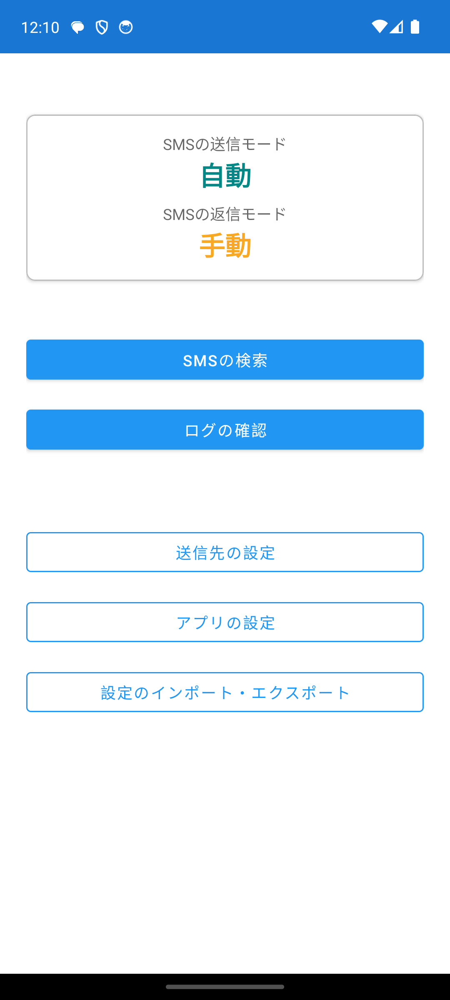
   

2. 「設定を追加」を押し、送信先を追加します。

   

     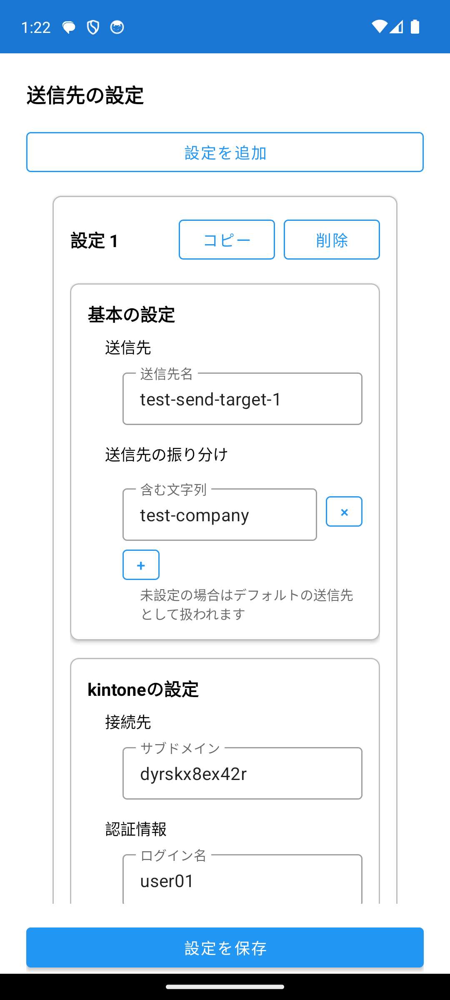
   

3. 「基本の設定」の項目を、運用に合わせて設定します。

   

     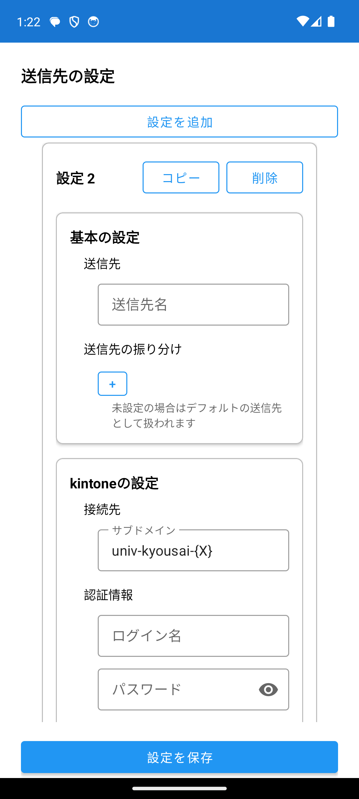
   

   - 送信先の名前は、ほかの送信先と重ならないようにします。

4. 「kintoneの設定」の項目を、運用に合わせて設定します。

   

     
     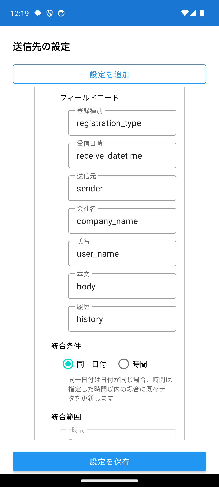
     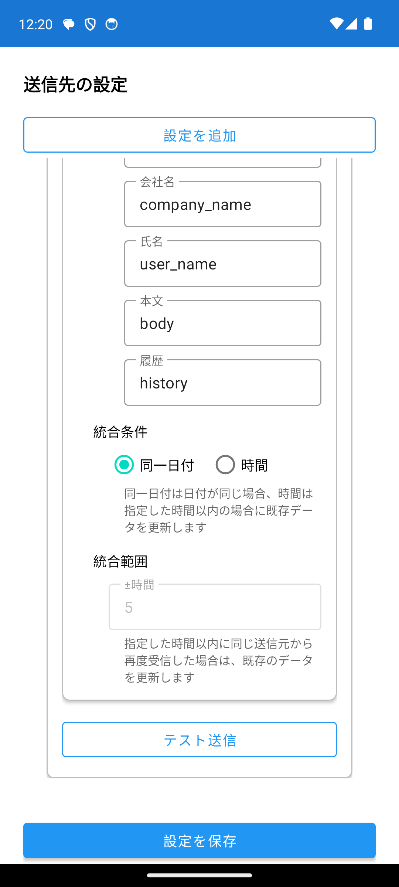
   

5. 必要に応じて、「コピー」を押し、送信先を複製します。

   

     
   

6. 必要に応じて、「削除」を押して、一覧から外します。

   

     
   

7. 必要に応じて、「テスト送信」を押します。

   

     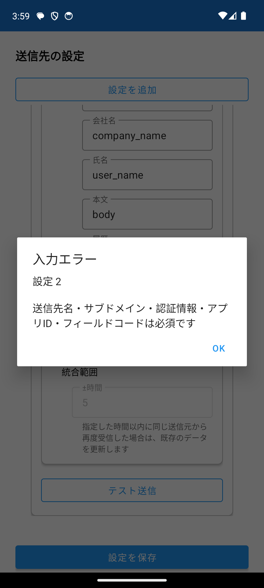
     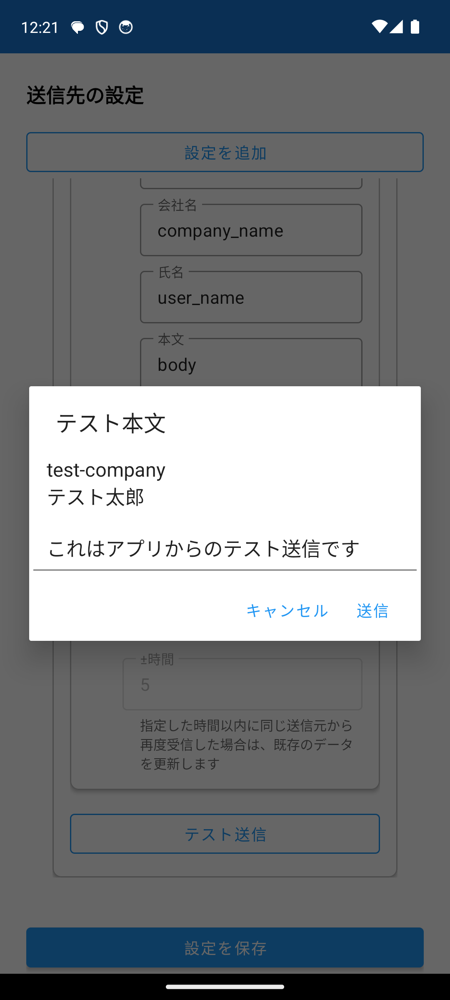
     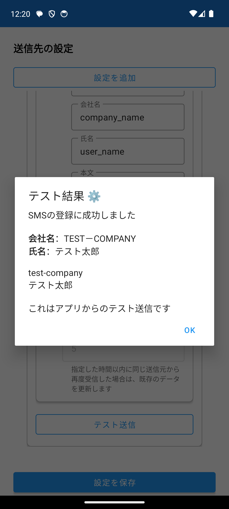     
   

   - テスト本文を入力するダイアログで、テスト本文を入力し、「送信」を押します。

8. 「設定を保存」を押します。

   

     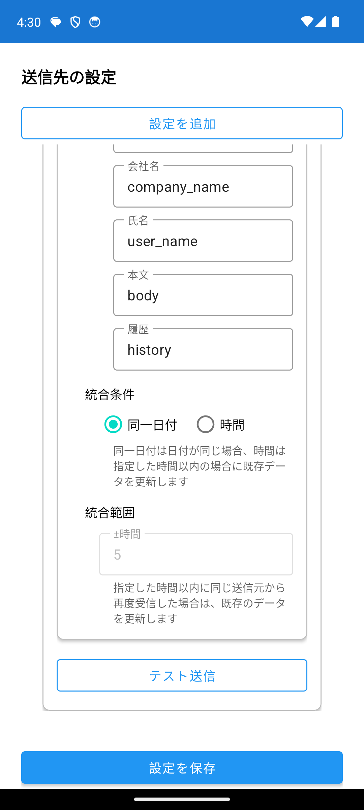
   

> 注意
> - 送信先は、「設定を保存」を押すまで保存されません。
> - 「テスト送信」は、テストの SMS を実際に kintone へ登録します。

### 4.3 引継ぎ内容の設定

　同じ送信元の以前の会社名と氏名を、送信元ごとの一覧で確認し、編集します。

  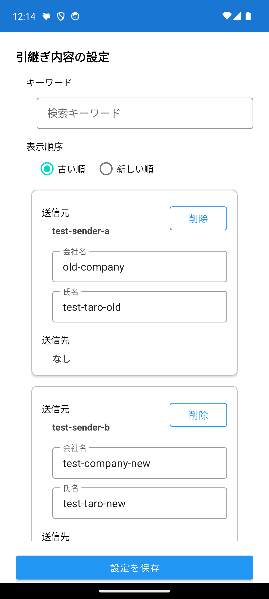

#### 項目

| 通番 | 区分 | 項目 | 種類 | 内容 |
|---|---|---|---|---|
| 1 | 共通 | キーワード | 入力欄 | 会社名、氏名、送信元で絞り込みます。入力すると、一覧をすぐに絞り込みます。保存はしません。 |
| 2 | 共通 | 古い順 | ラジオボタン | 受信日時の古い順に並べます。初期値です。 |
| 3 | 共通 | 新しい順 | ラジオボタン | 受信日時の新しい順に並べます。 |
| 4 | 共通 | 引継ぎ内容がありません | 表示 | 引継ぎ内容が 1 件もないときに、一覧の代わりに表示します。 |
| 5 | 共通 | 一致する引継ぎ内容がありません | 表示 | 絞り込みに一致する項目がないときに、一覧の代わりに表示します。 |
| 6 | 一覧の項目（送信元ごと） | 送信元 | 表示 | 引継ぎ内容の送信元を表示します。 |
| 7 | 一覧の項目（送信元ごと） | 削除 | ボタン | その項目を一覧から削除します。確認はありません。「設定を保存」を押すまで確定しません。 |
| 8 | 一覧の項目（送信元ごと） | 会社名 | 入力欄 | 会社名を入力します。会社名の抽出がオンのときだけ表示します。 |
| 9 | 一覧の項目（送信元ごと） | 氏名 | 入力欄 | 氏名を入力します。 |
| 10 | 一覧の項目（送信元ごと） | 送信先 | 表示 | 会社名から判定した登録先の送信先の名前を表示します。該当がないときは「なし」と表示します。 |
| 11 | 共通 | 設定を保存 | ボタン | 変更を保存し、アプリの設定へ戻ります。 |

#### 操作方法

1. 「アプリの設定」の「引継ぎ内容の設定」を押します。

   

     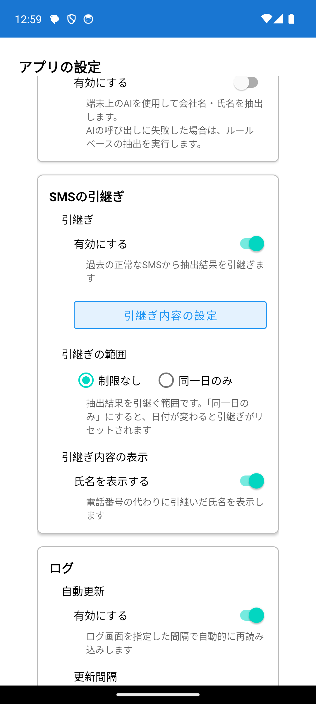
   

2. 必要に応じて、「会社名」「氏名」を編集します。

   

     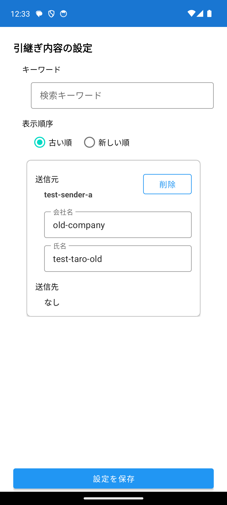
   

3. 検索をする場合、「キーワード」を入力し、一覧を絞り込みます。

   

     
   

4. 必要に応じて、「削除」を押します。

   

     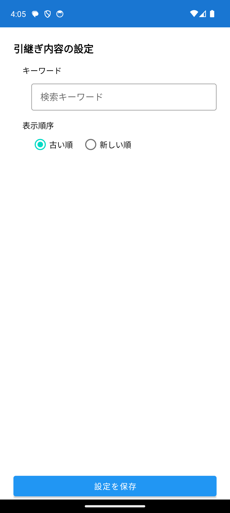
   

5. 「設定を保存」を押します。

   

     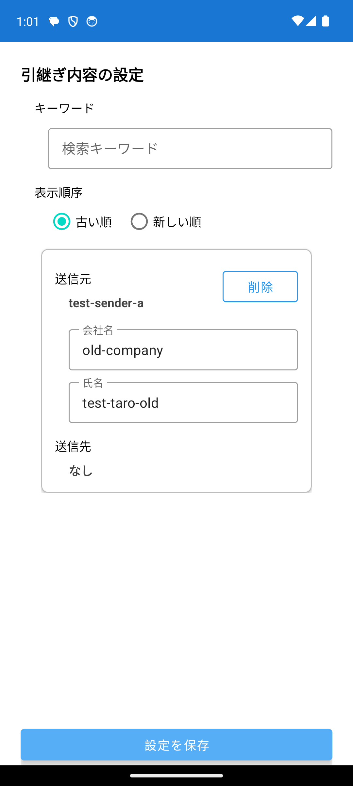
   

> 注意
> - 会社名の抽出がオンのときは会社名と氏名が、オフのときは氏名が空の項目があると、「設定を保存」を押しても保存されず、入力エラーを表示します。
> - 画面を開いてから SMS の受信などで内容が更新されていると、保存できず、「保存に失敗しました」を表示します。

### 4.4 設定のインポート・エクスポート

　設定を JSON ファイルに書き出したり、JSON ファイルから読み込んだりします。 
　端末を変えるときや、設定を別の端末へ移すときに使います。

  

#### 項目

| 通番 | 区分 | 項目 | 種類 | 内容 |
|---|---|---|---|---|
| 1 | インポート | ファイルを選択 | ボタン | 読み込む JSON ファイルを選びます。選ぶと、ファイルの内容を読み込んで表示します。 |
| 2 | インポート | ファイル名 | 表示 | 選んだファイルの名前を表示します。ファイルを選ぶまでは「ファイルが選択されていません」と表示します。 |
| 3 | インポート | アプリの設定 | 表示 | ファイルにアプリの設定があるときは「統合」、ないときは「変更なし」と表示します。 |
| 4 | インポート | 送信先の設定 | 表示 | ファイルに送信先があるときは「統合（件数）」、ないときは「変更なし」と表示します。 |
| 5 | インポート | 引継ぎ内容 | 表示 | ファイルに引継ぎ内容があるときは「統合（件数）」、ないときは「変更なし」と表示します。 |
| 6 | インポート | インポート | ボタン | ファイルを読み込むまで押せません。確認のあと、ファイルの内容を現在の設定に統合します。 |
| 7 | エクスポート | エクスポート | ボタン | 保存先を選んで、アプリの設定、送信先、引継ぎ内容を JSON ファイルに書き出します。ファイル名の初期値は「s2k_settings_日時.json」です。 |

#### 操作方法

1. トップ画面の「設定のインポート・エクスポート」を押します。

   

     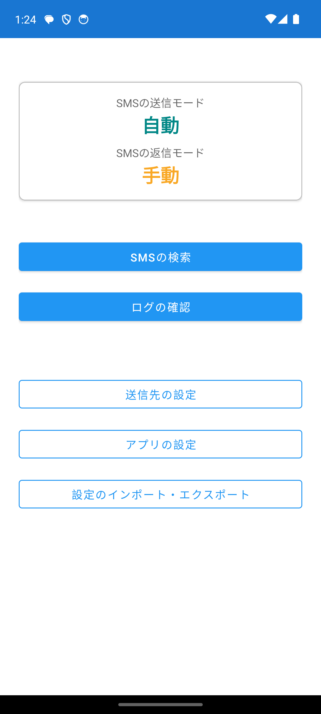
   

2. 設定を書き出す場合は、「エクスポート」を押します。

   

     
     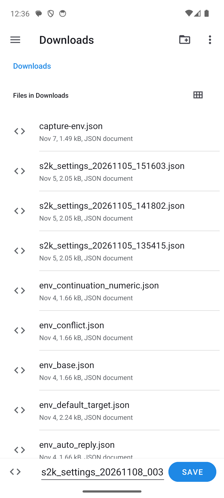
   

3. 設定を読み込む場合は、「ファイルを選択」を押します。

   

     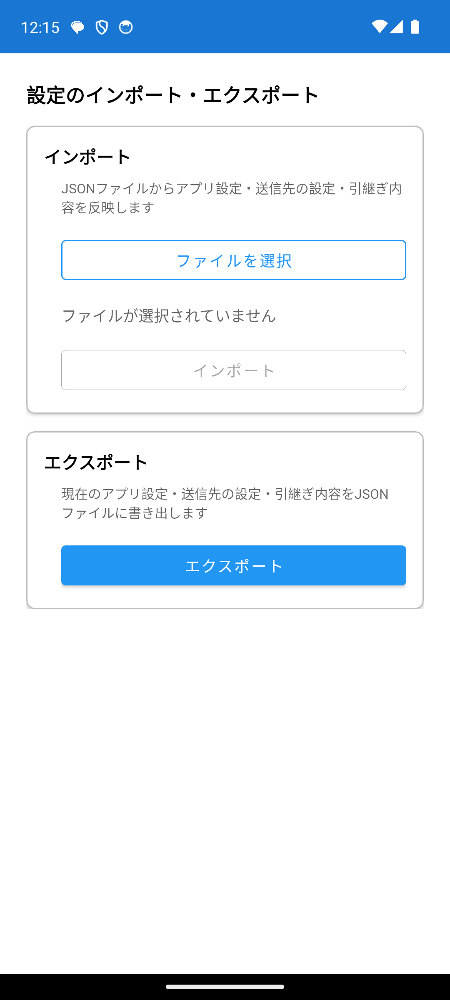
     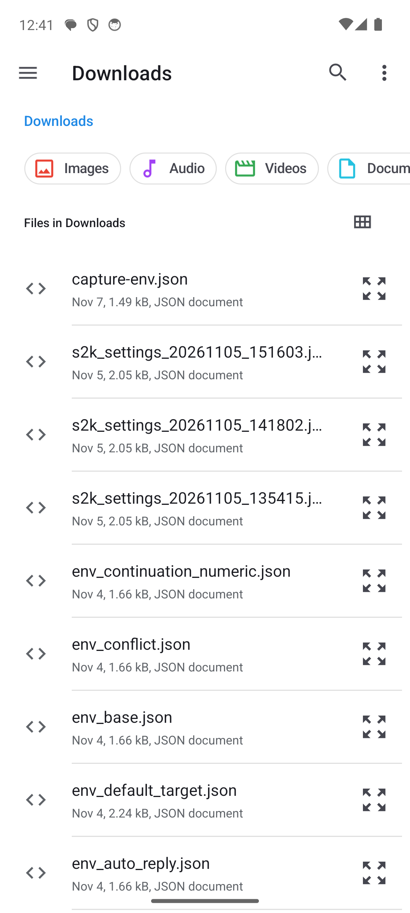
   

4. 表示された内容を確かめます。

   

     
   

5. 「インポート」を押します。

   

     
   

6. 「設定をインポートしますか？」のダイアログで、「インポート」を押します。

   

     
   

> 注意
> - 読み込みでは、ファイルに含まれる項目だけを反映します。
> - ファイルに含まれない項目は、現在の値のまま残ります。
> - 同じ名前の送信先と、同じ送信元の引継ぎ内容は、ファイルの内容で上書きされます。
> - エクスポートしたファイルには、送信先のパスワードが平文で含まれます。
> - ファイルの扱いに注意してください。
> - 読み込めないファイルや、形式が正しくないファイルは、「インポートエラー」のダイアログを表示し、読み込みません。

## 5. SMSの操作

### 5.1 SMSの検索

　端末が受信した SMS を条件で絞り込み、kintone へ手動で登録します。 
　抽出に失敗した SMS は、長押しして返信を開くこともできます。

  

#### 項目

| 通番 | 区分 | 項目 | 種類 | 内容 |
|---|---|---|---|---|
| 1 | 検索条件 | 受信日の範囲 | 表示 | 受信日の範囲を、開始日と終了日で選びます。 |
| 2 | 検索条件 | 開始日 | 入力欄 | 日付を選びます。初期値は、今日から「受信日の範囲」の日数分さかのぼった日です。 |
| 3 | 検索条件 | 終了日 | 入力欄 | 日付を選びます。初期値は今日です。 |
| 4 | 検索条件 | 送信先 | プルダウン | すべて、送信先の名前、未設定のいずれかで絞り込みます。初期値は、アプリの設定で選んだ送信先です。送信先が 1 件のときは表示しません。 |
| 5 | 検索条件 | 抽出状況 | 表示 | 抽出状況で絞り込みます。 |
| 6 | 検索条件 | 🆗 正常 | チェックボックス | オンのとき、抽出状況が正常な SMS だけに絞り込みます。 |
| 7 | 検索条件 | 🆖 異常 | チェックボックス | オンのとき、抽出状況が異常な SMS だけに絞り込みます。 |
| 8 | 検索条件 | 送信状況 | 表示 | 送信状況で絞り込みます。 |
| 9 | 検索条件 | ⬜ 未 | チェックボックス | オンのとき、未送信の SMS だけに絞り込みます。 |
| 10 | 検索条件 | ✅ 済（自動） | チェックボックス | オンのとき、自動で送信済みの SMS だけに絞り込みます。 |
| 11 | 検索条件 | ☑️ 済（手動） | チェックボックス | オンのとき、手動で送信済みの SMS だけに絞り込みます。 |
| 12 | 共通 | ▲ 隠す | ボタン | 検索条件を隠します。隠れているときは「▼ 表示」と表示し、押すと検索条件を表示します。 |
| 13 | 共通 | 検索 | ボタン | 条件に合う SMS を一覧に表示し、件数を「○件見つかりました」と表示します。 |
| 14 | 共通 | 全選択 | ボタン | 選べる SMS をすべて選びます。 |
| 15 | 共通 | 選択解除 | ボタン | 選んだ SMS の選択をすべて解除します。 |
| 16 | 共通 | 凡例 | 表示 | 抽出対象、抽出状況、送信状況、返信状況、送信先のアイコンの意味を示します。 |
| 17 | 共通 | 結果一覧 | 表 | 条件に合う SMS を新しい順に表示します。各項目の左のチェックボックスで選びます。各項目に、抽出対象、抽出状況、送信状況、返信状況、送信先、送信元（引継ぎの場合は氏名）、受信日時、本文を表示します。 |
| 18 | 共通 | 該当するSMSがありません | 表示 | 条件に合う SMS がないときに、一覧の代わりに表示します。 |
| 19 | 共通 | 選択したSMSを送信 | ボタン | 選んだ SMS を、受信日時の古い順に、手動で kintone へ登録します。 |

#### 操作方法

1. トップ画面の「SMSの検索」を押します。

   

     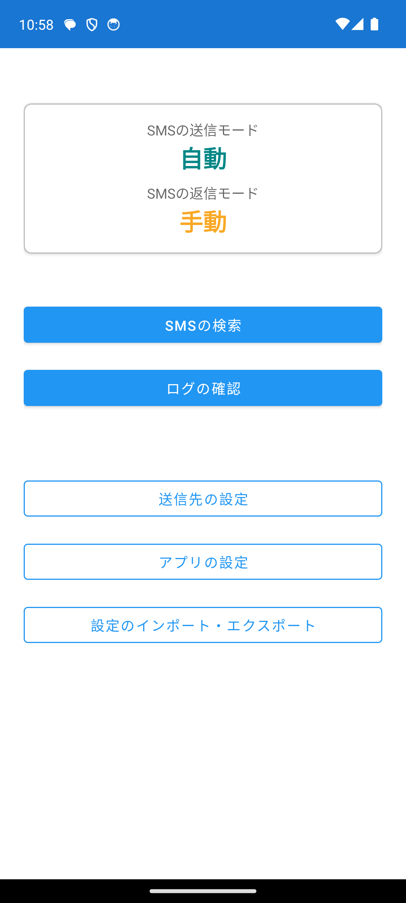
   

2. 必要に応じて、「検索条件」を設定します。

   

     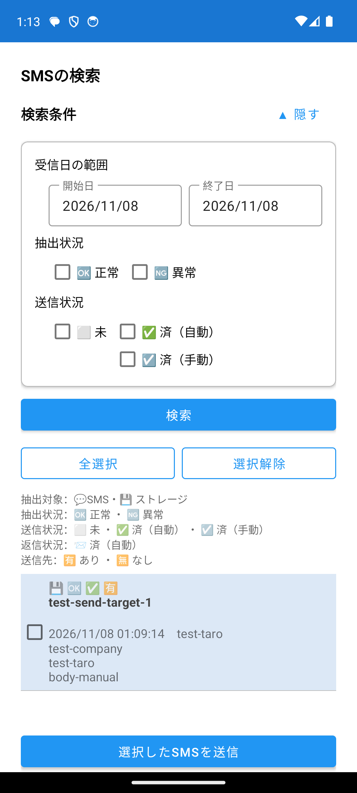
   

3. 「検索」を押し、条件に合う SMS を表示します。

   

     
   

4. 登録する SMS の項目を押して、選びます。

   

     
   

5. 「選択したSMSを送信」を押します。

   

     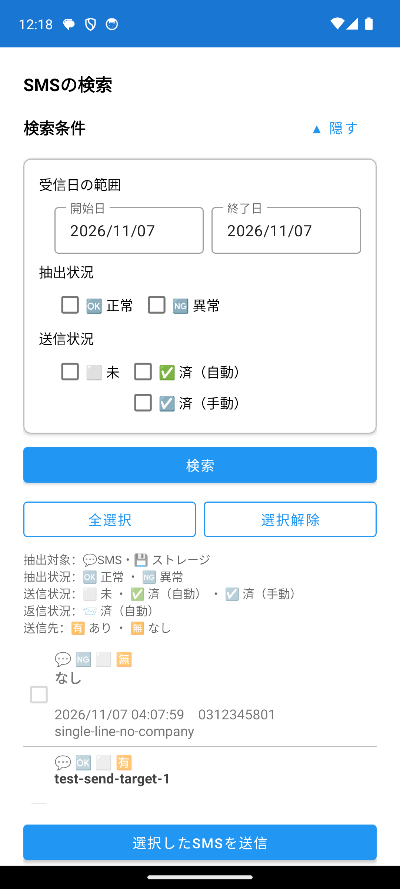
     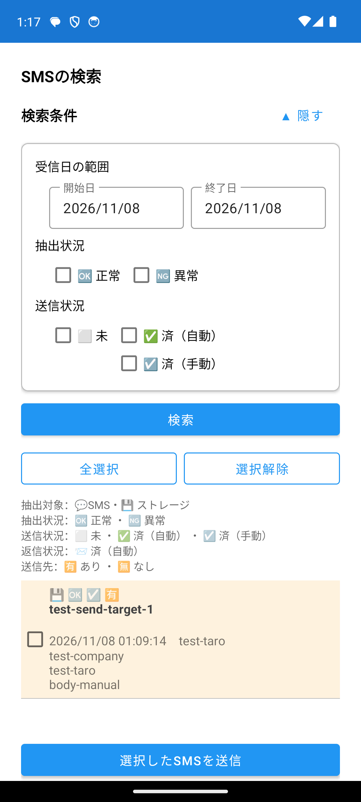
   

6. 手動で返信するときは、返信する SMS の項目を長押しします。

   

     
   

   - SMS アプリで返信が開き、返信の文面が入ります。

> 注意
> - 抽出状況が異常の SMS は、「抽出状況が異常（SMS選択の対象）」がオフのときは選べません。

## 6. ログ

### 6.1 ログの一覧

　受信、登録、返信の記録を、新しい順に表示します。

  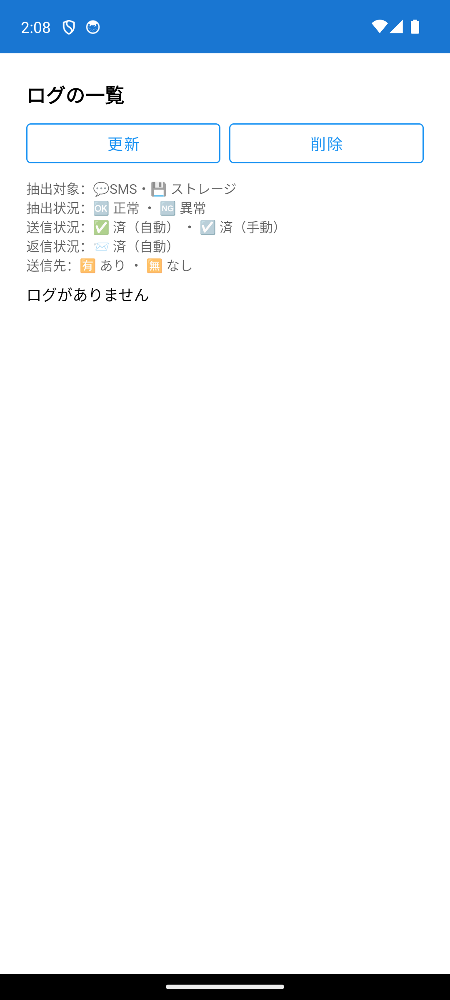

#### 項目

| 通番 | 区分 | 項目 | 種類 | 内容 |
|---|---|---|---|---|
| 1 | 共通 | 更新 | ボタン | ログの一覧を読み込み直します。 |
| 2 | 共通 | 削除 | ボタン | すべてのログを削除します。確認のあと削除します。 |
| 3 | 共通 | 凡例 | 表示 | 抽出対象、抽出状況、送信状況、返信状況、送信先のアイコンの意味を示します。 |
| 4 | 共通 | ログの一覧 | 表 | 記録を新しい順に表示します。各項目に、種別（「[受信完了]」など）、記録日時、成否（「[成功]」または「[失敗]」）とメッセージ、各アイコン、送信先名、送信元（引継ぎの場合は氏名）、受信日時、本文の抜粋を表示します。 |
| 5 | 共通 | ログがありません | 表示 | 記録が 1 件もないときに、一覧の代わりに表示します。 |

#### 操作方法

1. トップ画面の「ログの確認」を押します。

   

     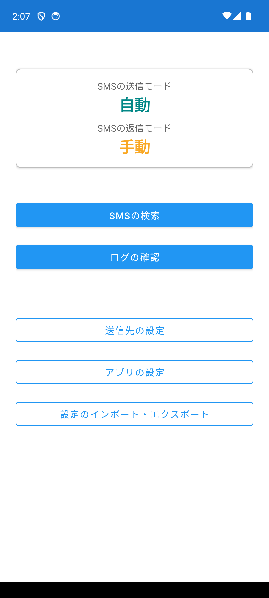
   

2. 一覧を確認します。

   

     
   

3. 「更新」を押すと、一覧を再表示します。

   

     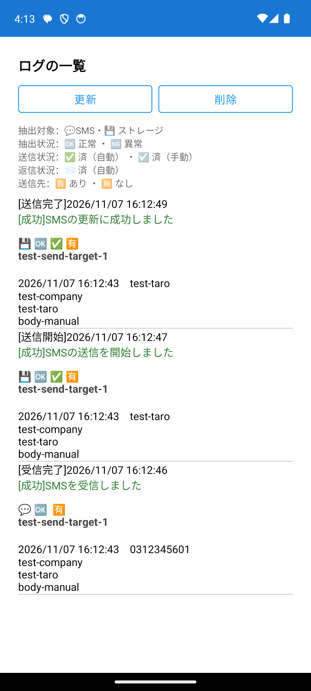
   

4. ログを消す場合は、「削除」を押します。

   

     
   

5. 「ログを削除しますか？」のダイアログで、「削除」を押します。

   

     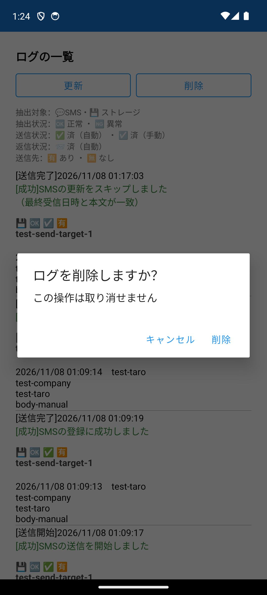
   

6. 項目を長押しすると、「抽出結果」を確認できます。

   

     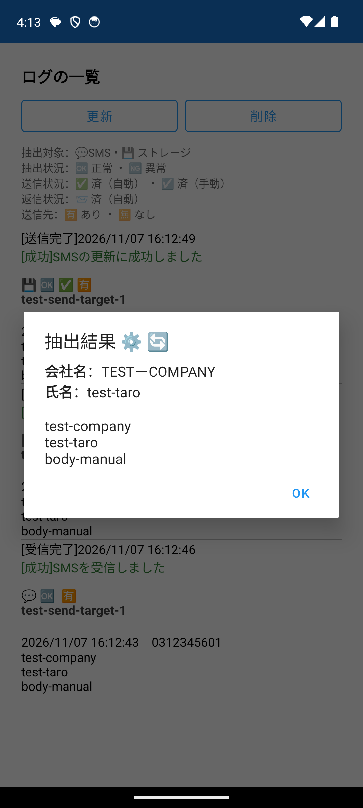
   

> 注意
> - ログの削除は取り消せません。
> - 「自動更新」がオンのときは、更新間隔ごとに一覧を自動で読み直します。
> - 抽出に失敗しているときは、「抽出結果」のダイアログに「会社名・氏名の抽出に失敗しています」を表示します。

## 7. 困ったとき

- **SMS が kintone に登録されない**
  1. 「アプリの設定」画面の「端末の許可」で、「SMSの読み取り」と「SMSの受信」が「許可済み」と表示されていることを確認する。
  2. 「アプリの設定」画面の「SMSの送信モード」が「手動」であることを確認する。
  3. 「SMSの検索」画面で「検索」を押す。
  4. 登録する SMS を選ぶ。
  5. 「選択したSMSを送信」を押す。
  6. kintone の「連絡用のアプリ」で、登録された SMS のレコードがあることを確認する。

- **ログに「SMSの送信先が存在しません」と表示される**
  1. 「送信先の設定」画面で、送信先が 1 件以上あることを確認する。
  2. 送信先の「送信先」「接続先」「ログイン名」「パスワード」「連絡用のアプリ」「登録種別」「受信日時」「送信元」「履歴」がすべて入っていることを確認する。

- **kintone への登録が失敗する**
  1. 「送信先の設定」画面の「kintoneの設定」で、「接続先」「ログイン名」「パスワード」「連絡用のアプリ」が正しいことを確認する。
  2. 正しくない項目があれば、正しい値に直す。
  3. kintone のサーバーが一時的に使えないとき（エラーコードが 5xx または 429）は、自動で再試行されるので、しばらく待つ。
  4. 端末が kintone に接続できないとき（通信エラー）は、自動で再試行されないので、端末の通信状態を確認する。

- **「SMSの読み取り」の案内が表示される**
  1. 「アプリの設定」画面の「端末の許可」で、「許可する（SMSの読み取り）」を押す。

- **引継ぎ内容が保存できない**
  1. 「引継ぎ内容の設定」画面を閉じる。
  2. 「アプリの設定」画面の「引継ぎ内容の設定」を押す。
  3. 内容を編集する。
  4. 「設定を保存」を押す。

- **設定のインポートでエラーになる**
  1. 「設定のインポート・エクスポート」画面で、読み込むファイルが、本ツールで書き出した JSON ファイルか確認する。
  2. 読み込むファイルの中に、同じ名前の送信先がないか確認する。
  3. 同じ名前の送信先があれば、そのファイルを直す。

- **自動で返信されない**
  1. 「アプリの設定」画面の「SMSの返信モード」を「自動」にする。
  2. 「アプリの設定」画面の「端末の許可」で、「SMSの送信」が「許可済み」であることを確認する。
  3. 「許可済み」でなければ、「許可する（SMSの送信）」を押す。
  4. 「アプリの設定」画面の「自動返信の間隔」の秒数が経つまで待つ。（同じ送信元には、この秒数が経つまで再送信されない。）
