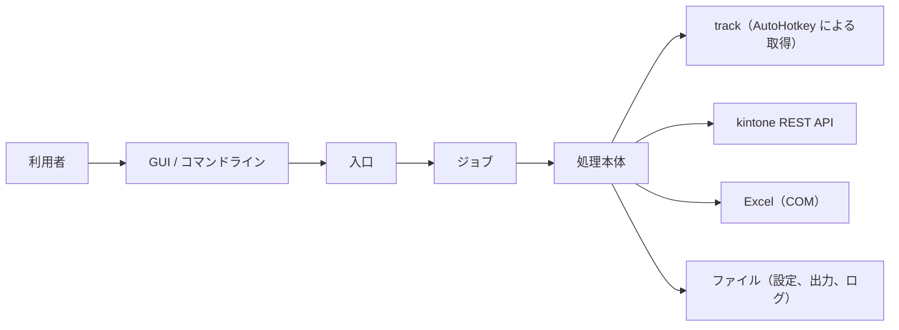

# アーキテクチャ設計

## 1. 概要

本ツールは、track から取得したテストとアンケートの結果を、グループごとに集計し、結果を kintone のスレッドに投稿するツールです。

処理は次の層で構成されています。

| 通番 | 層 | 内容 |
|---|---|---|
| 1 | 入口 | 引数の解釈、グループの列挙 |
| 2 | ジョブ | グループごとの設定読み込み、処理の起動、終了判定 |
| 3 | 処理本体 | track からの取得、集計、Excel の出力、kintone への投稿 |

- 全体構成



## 2. 実行環境と前提

| 通番 | 項目 | 内容 |
|---|---|---|
| 1 | 基本ソフトウェア | Windows の cmd と PowerShell 5.1 で動作します。 |
| 2 | 表計算ソフト | 集計結果の作成に Excel を使います。Excel がインストールされている必要があります。 |
| 3 | ブラウザと自動操作 | track からの取得に、Chrome と AutoHotkey（バージョン 2）を使います。track にログインできる必要があります。 |
| 4 | 通信 | kintone REST API と HTTPS で通信します。 |
| 5 | 認証 | kintone のログイン名とパスワードで認証します（パスワードは、グループ別の設定に平文で保存されます）。 |

## 3. ディレクトリ構成

```
ルート/
├─ 入口のバッチ                bats本体の呼び出し
├─ bats/                      各処理のバッチと処理本体、共通設定、GUI 本体
│  └─ library/                共通の処理（kintone 接続、Excel、GUI 部品など）
├─ clients/                   グループ別の設定と雛形
├─ template/                  出力テンプレート
├─ output/                    処理結果
├─ logs/                      実行ログ
└─ AutoHotkey/                track からのダウンロード用の実行環境
```

## 4. 処理概要

| 通番 | 処理 | 入力 | 出力 |
|---|---|---|---|
| 1 | 実施結果取得 | 共通設定、グループ別の設定、テスト、アンケート | 実施結果 |
| 2 | 実施状況確認 | 実施結果 | 統合結果 |
| 3 | 実施結果集計（テスト） | 実施結果 | テスト集計結果 |
| 4 | 実施結果集計（アンケート） | 実施結果 | アンケート集計結果 |
| 5 | 投稿 | テスト集計結果、アンケート集計結果 | kintone のスレッドへのコメント |
| 6 | 経年比較 | 共通設定、グループ別の設定、過去年度のグループデータ、実施結果 | 経年比較結果 |

- 実施結果取得は、テストとアンケートを別々に実行できます。

## 5. 共通ライブラリ

| 通番 | 機能 | 内容 |
|---|---|---|
| 1 | kintone 連携 | kintone の REST API を呼び出し、接続の確認とスレッドへのコメント投稿を行います。 |
| 2 | Excel 操作 | Excel の読み込み、書き込み、色付け、シート操作を行います。 |
| 3 | ファイル入出力 | 配列のファイルへの書き出しと読み込みを行います。 |
| 4 | テスト・アンケート共通 | テストとアンケートの結果データと集計データを作成します。 |
| 5 | ログ | 処理本体用のログを出力します。 |
| 6 | 共通処理 | 型と改行の変換、排他制御を行います。 |
| 7 | GUI 部品 | 画面の部品（ボタン、入力欄、表など）の作成と更新を行います。 |

## 6. 外部連携

| 通番 | 連携先 | 用途 | 通信内容 |
|---|---|---|---|
| 1 | track | 実施結果のファイルの取得 | ブラウザの操作（AutoHotkey）による取得 |
| 2 | kintone REST API | スレッドへのコメント投稿 | ログイン名とパスワードによる認証、HTTPS |
| 3 | Excel（COM） | 集計結果の作成 | ローカルの Excel を操作 |

## 7. エラー処理

- 処理が失敗すると、画面の状態に「失敗」と表示され、実行ログに記録されます。
- track の画面が変わると、ブラウザ操作による実施結果の取得に影響します。取得できないときは、track の画面の変更を確認してください。

## 8. 運用上の注意

- 実行前に、対象の Excel ファイルを閉じてください。
- 処理中はクリップボードを使うため、コピー操作を行わないでください。
- グループ別の設定ファイルにはパスワードが平文で保存されます。共有フォルダに置く場合は、アクセス権を制限してください。
