# track-aggregator 処理フロー

## 1. 概要

画面のボタンごとに、押したときに行われる処理の流れを示します。

### 1.1 処理の一覧

| 通番 | 画面名 | ボタン名 | 内容 |
|---|---|---|---|
| 1 | 実行（一括実行） | 実行 | 選んだ処理を順に実行します。 |
| 2 | 実行（実施データ取得） | 実行（テスト・アンケート） | track から実施結果を取得します。 |
| 3 | 実行（実施データ取得） | 実行（取得状況確認） | 取得の状況を確認します。 |
| 4 | 実行（実施状況確認） | 実行（テスト・アンケート） | 取得した結果を統合します。 |
| 5 | 実行（実施結果確認） | 実行（テスト） | テストの集計結果を作成します。 |
| 6 | 実行（実施結果確認） | 実行（アンケート） | アンケートの集計結果を作成します。 |
| 7 | 実行（実施結果確認） | 実行（投稿） | 集計結果を、投稿先のスレッドに投稿します。 |
| 8 | 実行（経年比較） | 実行（アンケート・テスト） | 経年比較の結果を作成します。 |
| 9 | ログ | すべて削除 | 実行ログのファイルをすべて削除します。 |
| 10 | 環境設定（共通） | 保存 | 入力した内容を保存します。 |
| 11 | 環境設定（共通） | 再読込 | 保存されている内容を読み込み直します。 |
| 12 | 環境設定（グループ別） | 新規作成 | 新しいグループを作成します。 |
| 13 | 環境設定（グループ別） | 保存 | 入力した内容を保存します。 |
| 14 | 環境設定（グループ別） | 再読込 | 保存されている内容を読み込み直します。 |
| 15 | 環境設定（グループ別） | テスト接続（認証情報） | 認証情報で kintone に接続できるかを確認します。 |
| 16 | 環境設定（グループ別） | テスト接続（ユーザー） | ユーザーマスターのアプリIDに接続できるかを確認します。 |
| 17 | 環境設定（グループ別） | テスト投稿 | テスト用のコメントを投稿して、投稿先を確認します。 |
| 18 | 環境設定（マスター） | 保存 | 入力した内容を保存します。 |
| 19 | 環境設定（マスター） | 再読込 | 保存されている内容を読み込み直します。 |
| 20 | 環境設定（マスター） | 同期実行（ユーザー） | ユーザーマスターを受講生一覧に同期します。 |
| 21 | 環境設定（マスター） | 削除（テスト） | 選んだ行を削除します。 |
| 22 | 環境設定（マスター） | 追加（テスト） | 表に行を追加します。 |
| 23 | 環境設定（マスター） | 削除（アンケート） | 選んだ行を削除します。 |
| 24 | 環境設定（マスター） | 追加（アンケート） | 表に行を追加します。 |

## 2. 各ボタンの処理フロー

### 2.1 実行（一括実行）[実行]

1. 対象のグループを確認します。
2. 選んだ処理を、実施データ取得、実施状況確認、実施結果確認、経年比較の順に実行します。
3. 処理ごとに、状態を表示します。
4. 状態を表示し、実行ログを画面下部に出力します。

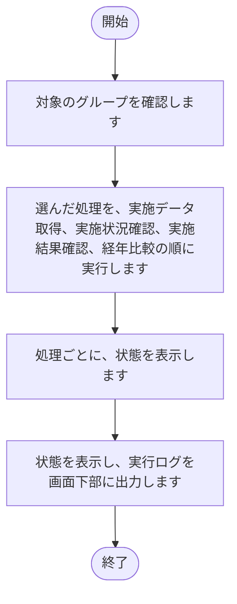

### 2.2 実行（実施データ取得）[実行（テスト・アンケート）]

1. 対象のグループを確認します。
2. track から実施結果のファイルを取得します。
3. 状態を表示し、実行ログを画面下部に出力します。

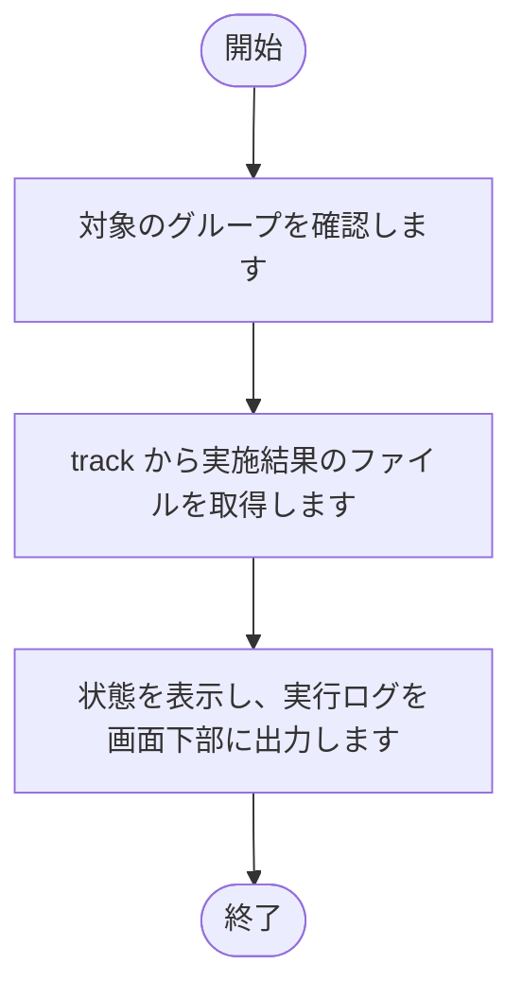

### 2.3 実行（実施データ取得）[実行（取得状況確認）]

1. 対象のグループを確認します。
2. 取得の状況を確認します。
3. 状態を表示し、実行ログを画面下部に出力します。

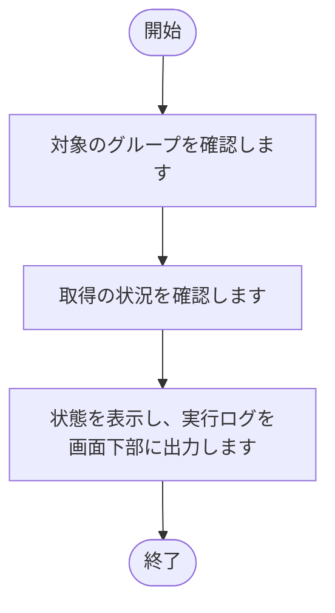

### 2.4 実行（実施状況確認）[実行（テスト・アンケート）]

1. 対象のグループを確認します。
2. 取得した結果を読み込みます。
3. 統合結果の Excel を出力します。
4. 状態を表示し、実行ログを画面下部に出力します。

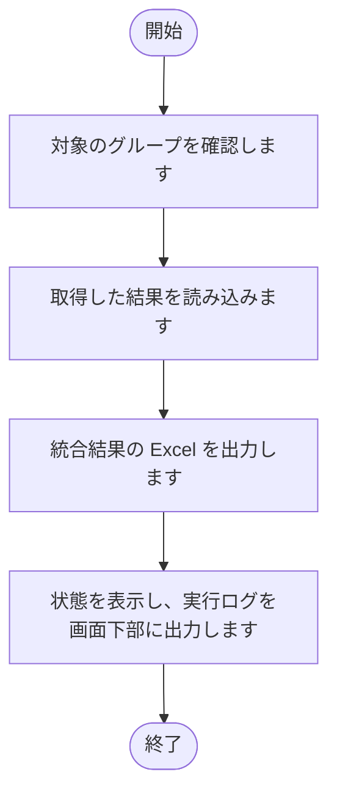

### 2.5 実行（実施結果確認）[実行（テスト）]

1. 対象のグループを確認します。
2. テスト結果を読み込みます。
3. テストの集計結果の Excel を出力します。
4. 状態を表示し、実行ログを画面下部に出力します。

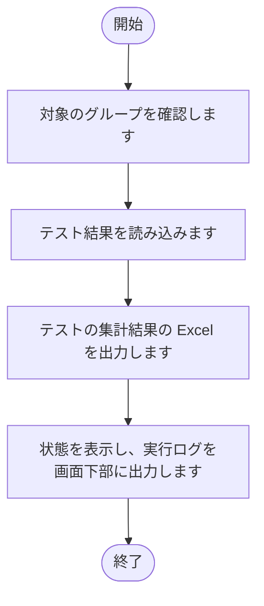

### 2.6 実行（実施結果確認）[実行（アンケート）]

1. 対象のグループを確認します。
2. アンケート結果を読み込みます。
3. アンケートの集計結果の Excel を出力します。
4. 状態を表示し、実行ログを画面下部に出力します。

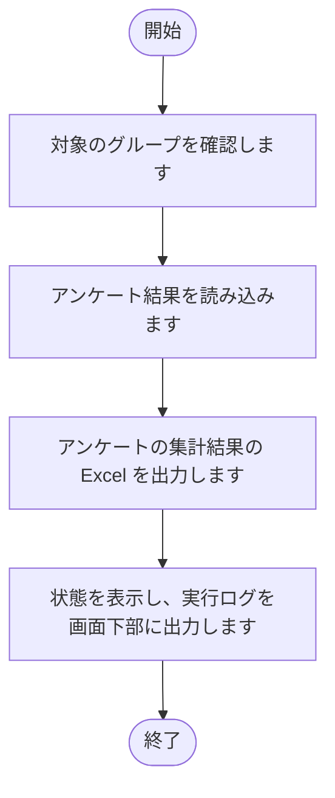

### 2.7 実行（実施結果確認）[実行（投稿）]

1. 対象のグループを確認します。
2. 集計結果の Excel を読み込みます。
3. 集計結果を添付ファイルとして用意します。
4. 投稿先のスレッドにコメントを投稿します。
5. 状態を表示し、実行ログを画面下部に出力します。

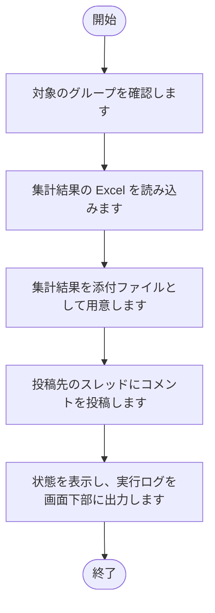

### 2.8 実行（経年比較）[実行（アンケート・テスト）]

1. 対象のグループを確認します。
2. 対象の会社名と比較年を確認します。
3. 過去の集計結果を読み込みます。
4. 経年比較の Excel を出力します。
5. 状態を表示し、実行ログを画面下部に出力します。

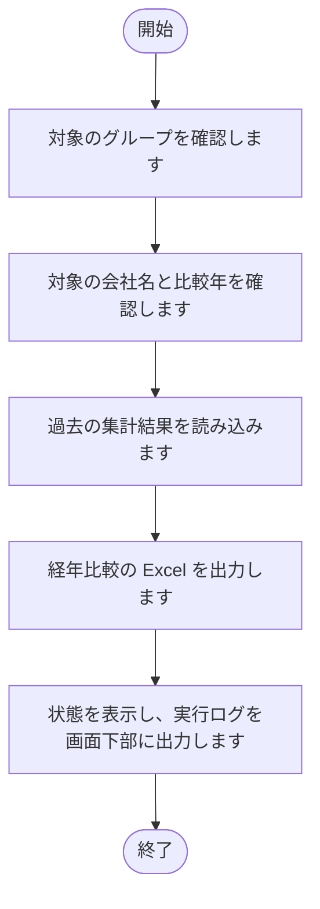

### 2.9 ログ[すべて削除]

1. ログのファイルを確認します。
2. 削除の確認を求めます。
3. 確認で「はい」を選んだ場合は、ログのファイルを削除します。

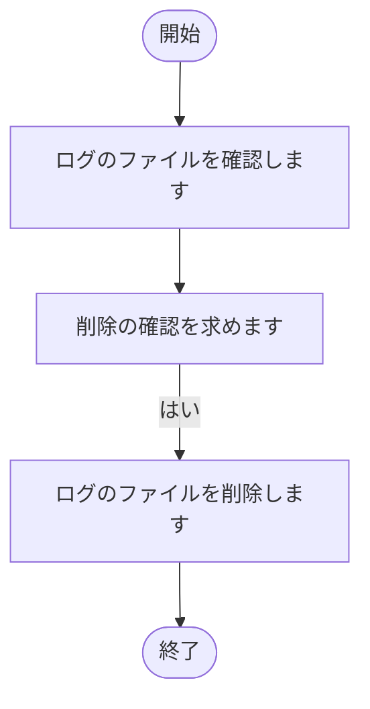

### 2.10 環境設定（共通）[保存]

1. 入力された内容を確認します。
2. 入力された内容を、共通の設定ファイルに書き込みます。
3. 画面の表示を、保存後の内容に更新します。
4. 結果を、ボタンの横に表示します。

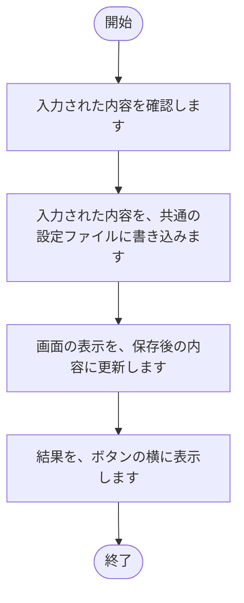

### 2.11 環境設定（共通）[再読込]

1. 共通の設定ファイルの内容を読み込みます。
2. 読み込んだ内容で、画面の入力欄を表示し直します。
3. 結果を、ボタンの横に表示します。

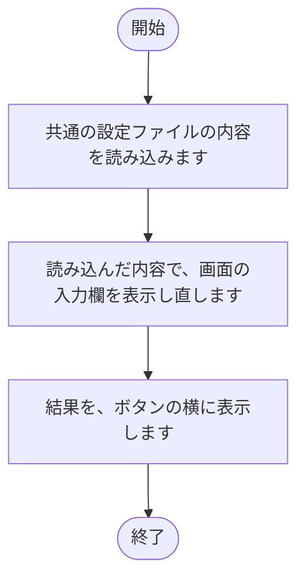

### 2.12 環境設定（グループ別）[新規作成]

1. グループ名を入力する画面を表示します。
2. 入力された名前が、既存のグループと重複していないかを確認します。
3. 重複していなければ、新しいグループを作成し、グループの一覧に追加します。

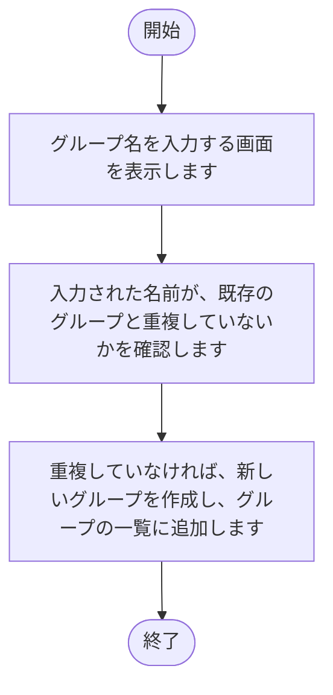

### 2.13 環境設定（グループ別）[保存]

1. 入力された内容を確認します。
2. 入力された内容を、対象のグループの設定ファイルに書き込みます。
3. 画面の表示を、保存後の内容に更新します。
4. 結果を、ボタンの横に表示します。

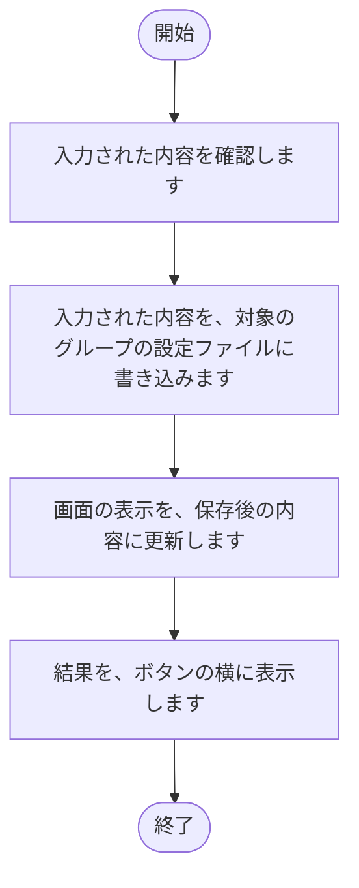

### 2.14 環境設定（グループ別）[再読込]

1. 対象のグループの設定ファイルの内容を読み込みます。
2. 読み込んだ内容で、画面の入力欄を表示し直します。
3. 結果を、ボタンの横に表示します。

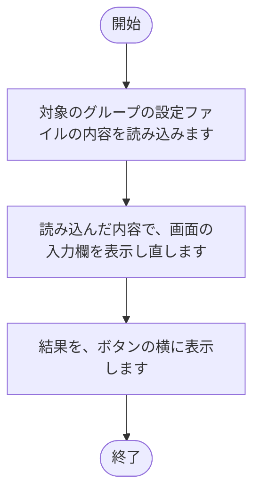

### 2.15 環境設定（グループ別）[テスト接続（認証情報）]

1. サブドメイン、ログイン名、パスワードを確認します。
2. kintone に接続し、接続できるかを確認します。
3. 結果を、ボタンの横に表示します。

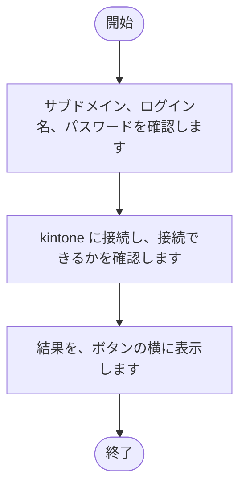

### 2.16 環境設定（グループ別）[テスト接続（ユーザー）]

1. 対象アプリIDを確認します。
2. kintone のアプリに接続し、接続できるかを確認します。
3. 結果を、ボタンの横に表示します。

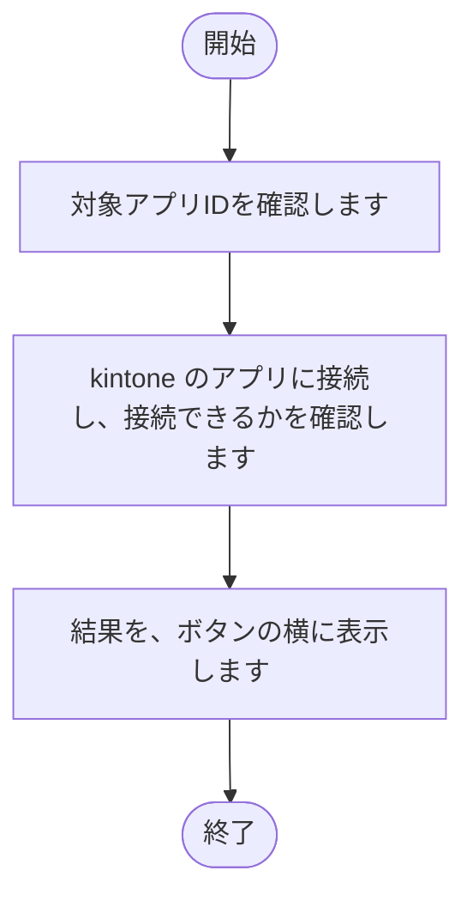

### 2.17 環境設定（グループ別）[テスト投稿]

1. 投稿先スペースIDと投稿先スレッドIDを確認します。
2. テスト用のコメントを、投稿先のスレッドに投稿します。
3. 結果を、ボタンの横に表示します。

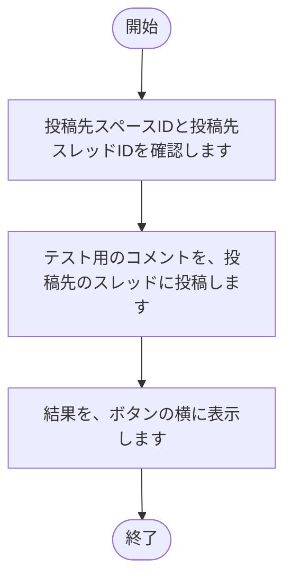

### 2.18 環境設定（マスター）[保存]

1. 入力された内容を確認します。
2. 入力された内容を、対象のグループのデータに書き込みます。
3. 画面の表示を、保存後の内容に更新します。
4. 結果を、ボタンの横に表示します。

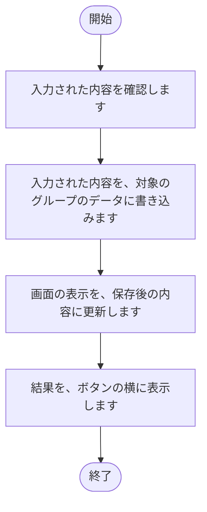

### 2.19 環境設定（マスター）[再読込]

1. 対象のグループのデータを読み込みます。
2. 読み込んだ内容で、画面の表を表示し直します。
3. 結果を、ボタンの横に表示します。

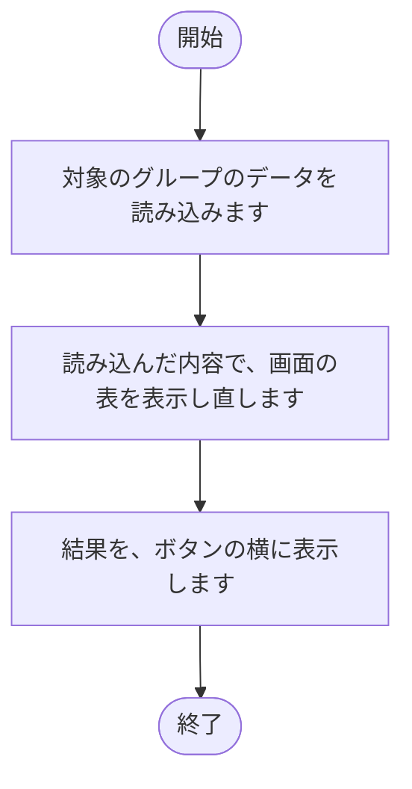

### 2.20 環境設定（マスター）[同期実行（ユーザー）]

1. 対象のグループを確認します。
2. アプリIDが入力されていない場合は、メッセージを出力して終了します。
3. ユーザーマスターの内容を、受講生一覧のシートに書き込みます。
4. 結果を、ボタンの横に表示します。

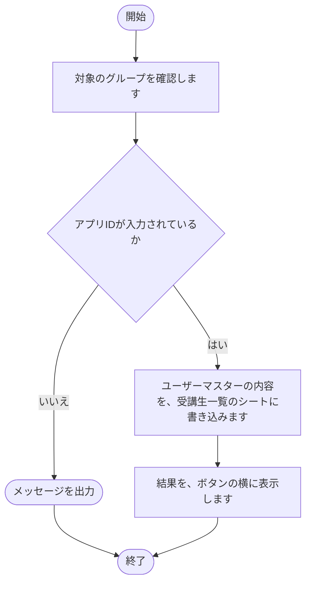

### 2.21 環境設定（マスター）[削除（テスト）]

1. 削除の対象の行を確認します。
2. 選んだ行を削除します。

```mermaid
flowchart TD
    S(["開始"])
    E(["終了"])
    N1["削除の対象の行を確認します"]
    S --> N1
    N2["選んだ行を削除します"]
    N1 --> N2
    N2 --> E
```

### 2.22 環境設定（マスター）[追加（テスト）]

1. 表の末尾に、空の行を追加します。
2. 画面の表示を、追加後の内容に更新します。

```mermaid
flowchart TD
    S(["開始"])
    E(["終了"])
    N1["表の末尾に、空の行を追加します"]
    S --> N1
    N2["画面の表示を、追加後の内容に更新します"]
    N1 --> N2
    N2 --> E
```

### 2.23 環境設定（マスター）[削除（アンケート）]

1. 削除の対象の行を確認します。
2. 選んだ行を削除します。

```mermaid
flowchart TD
    S(["開始"])
    E(["終了"])
    N1["削除の対象の行を確認します"]
    S --> N1
    N2["選んだ行を削除します"]
    N1 --> N2
    N2 --> E
```

### 2.24 環境設定（マスター）[追加（アンケート）]

1. 表の末尾に、空の行を追加します。
2. 画面の表示を、追加後の内容に更新します。

```mermaid
flowchart TD
    S(["開始"])
    E(["終了"])
    N1["表の末尾に、空の行を追加します"]
    S --> N1
    N2["画面の表示を、追加後の内容に更新します"]
    N1 --> N2
    N2 --> E
```

## 3. 注意事項

- 失敗した処理があっても、後続の処理は実行されます（一括実行）。
- 出力先のファイルを開いたままにすると、書き込みに失敗する可能性があります。
