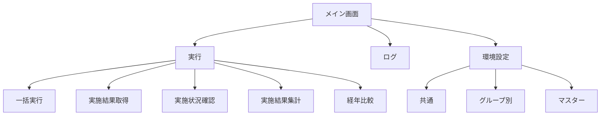
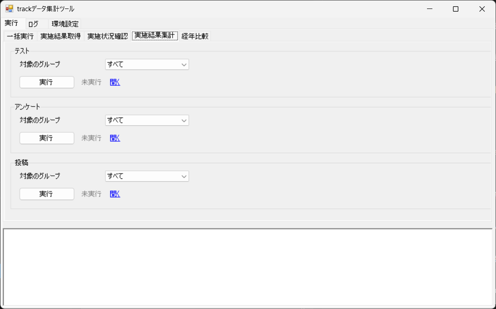
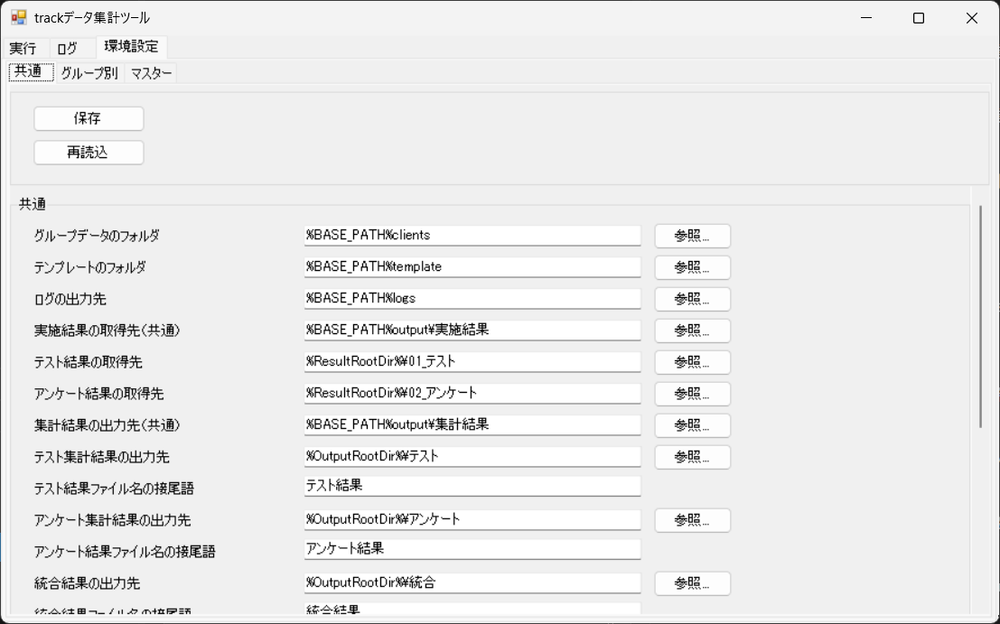
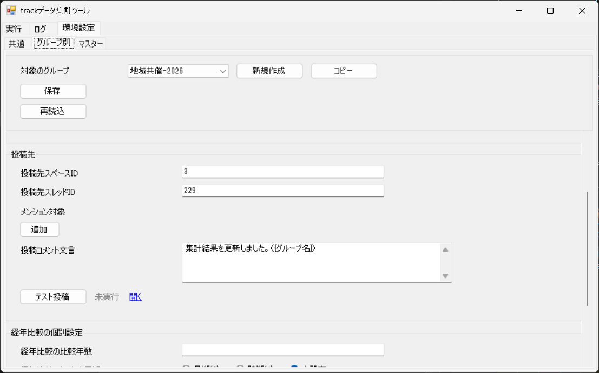
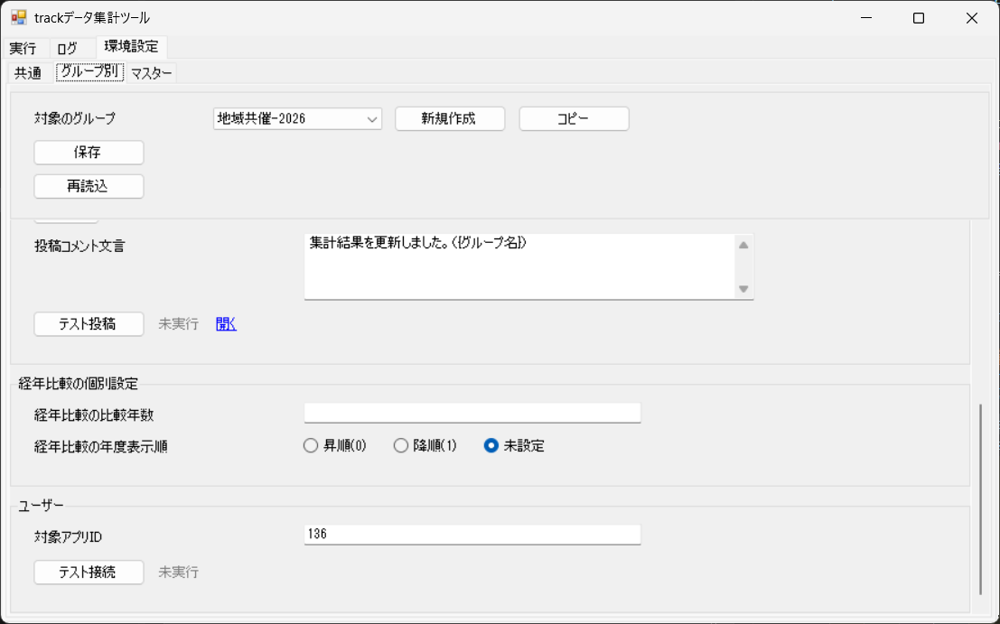
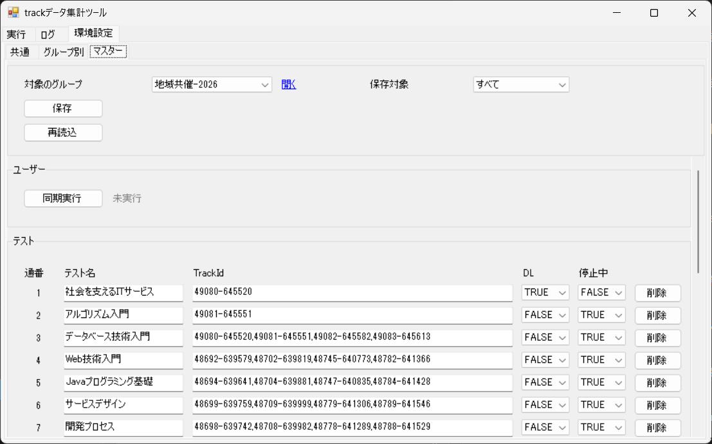
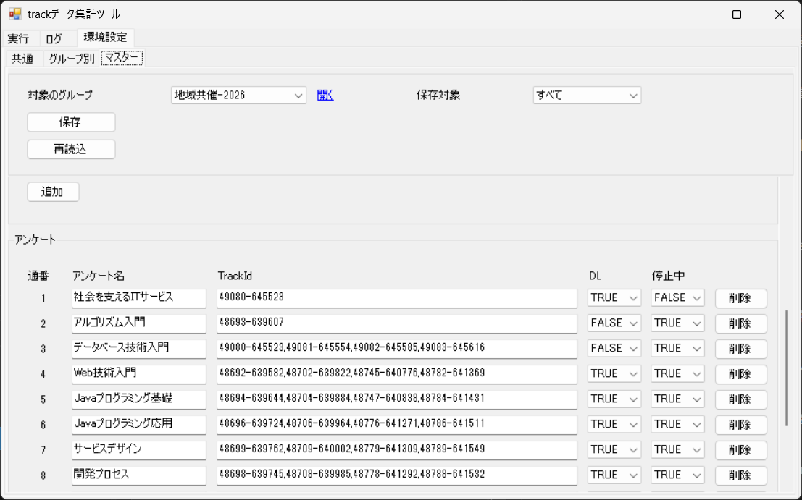

# 画面設計

## 1. 概要

本ツールの操作画面は、1 つのウィンドウに「実行」「ログ」「環境設定」のタブを置いた構成です。本書では、各タブの画面と、その中の項目や操作を示します。

- 画面の一覧

| 通番 | 画面 | 内容 |
|---|---|---|
| 1 | 実行（一括実行） | 対象のグループを指定し、選んだ処理をまとめて実行します。 |
| 2 | 実行（実施結果取得） | 対象のグループを指定して、track から実施結果を取得します。 |
| 3 | 実行（実施状況確認） | 対象のグループを指定して、取得した結果を統合します。 |
| 4 | 実行（実施結果集計） | 対象のグループを指定して、テストとアンケートの集計結果を作成し、投稿します。 |
| 5 | 実行（経年比較） | 対象の会社名と比較年を指定して、経年比較の結果を作成します。 |
| 6 | ログ | 実行ログを表示し、ログを削除します。 |
| 7 | 環境設定（共通） | 共通の設定を編集します。 |
| 8 | 環境設定（グループ別） | グループごとの設定を編集します。 |
| 9 | 環境設定（マスター） | テストとアンケートの対象、ユーザーの同期を編集します。 |

## 2. 画面遷移図

## 3. 各画面

### 3.1 実行（一括実行）

#### 一括実行

  

| 通番 | 項目 | 種類 | 内容 |
|---|---|---|---|
| 1 | 対象のグループ | コンボボックス | 対象のグループを選びます。 |
| 2 | 実施結果取得-テスト | チェックボックス | 処理を実行するかを選びます。チェックを外した処理はスキップします。 |
| 3 | 状態（実施結果取得-テスト） | ラベル | 実施結果取得-テストの結果を表示します。 |
| 4 | 開く（実施結果取得-テスト） | リンク | 出力先のフォルダを開きます。 |
| 5 | 実施結果取得-アンケート | チェックボックス | 処理を実行するかを選びます。チェックを外した処理はスキップします。 |
| 6 | 状態（実施結果取得-アンケート） | ラベル | 実施結果取得-アンケートの結果を表示します。 |
| 7 | 開く（実施結果取得-アンケート） | リンク | 出力先のフォルダを開きます。 |
| 8 | 実施状況確認-テスト・アンケート | チェックボックス | 処理を実行するかを選びます。チェックを外した処理はスキップします。 |
| 9 | 状態（実施状況確認-テスト・アンケート） | ラベル | 実施状況確認-テスト・アンケートの結果を表示します。 |
| 10 | 開く（実施状況確認-テスト・アンケート） | リンク | 出力先のフォルダを開きます。 |
| 11 | 実施結果集計-テスト | チェックボックス | 処理を実行するかを選びます。チェックを外した処理はスキップします。 |
| 12 | 状態（実施結果集計-テスト） | ラベル | 実施結果集計-テストの結果を表示します。 |
| 13 | 開く（実施結果集計-テスト） | リンク | 出力先のフォルダを開きます。 |
| 14 | 実施結果集計-アンケート | チェックボックス | 処理を実行するかを選びます。チェックを外した処理はスキップします。 |
| 15 | 状態（実施結果集計-アンケート） | ラベル | 実施結果集計-アンケートの結果を表示します。 |
| 16 | 開く（実施結果集計-アンケート） | リンク | 出力先のフォルダを開きます。 |
| 17 | 実施結果集計-投稿 | チェックボックス | 処理を実行するかを選びます。チェックを外した処理はスキップします。 |
| 18 | 状態（実施結果集計-投稿） | ラベル | 実施結果集計-投稿の結果を表示します。 |
| 19 | 開く（実施結果集計-投稿） | リンク | 投稿先のスレッドを開きます。 |
| 20 | 経年比較-アンケート・テスト | チェックボックス | 処理を実行するかを選びます。チェックを外した処理はスキップします。 |
| 21 | 状態（経年比較-アンケート・テスト） | ラベル | 経年比較-アンケート・テストの結果を表示します。 |
| 22 | 開く（経年比較-アンケート・テスト） | リンク | 出力先のフォルダを開きます。 |
| 23 | 実行 | ボタン | 選んだ処理を順に実行します。 |
| 24 | 状態 | ラベル | 一括実行の全体の結果を表示します。 |
| 25 | ログ | テキストエリア | 実行結果のログを表示します。 |

- 「状態」と「開く」は、処理ごとの行に表示します。

### 3.2 実行（実施結果取得）

#### テスト

  

| 通番 | 項目 | 種類 | 内容 |
|---|---|---|---|
| 1 | 対象のグループ | コンボボックス | 対象のグループを選びます。 |
| 2 | 実行（テスト） | ボタン | track からテストの実施結果を取得します。 |
| 3 | 状態（テスト） | ラベル | 処理の結果を表示します。 |
| 4 | 開く（テスト） | リンク | 取得した出力先のフォルダを開きます。 |
| 5 | ログ | テキストエリア | 実行結果のログを表示します。 |

#### アンケート

  

| 通番 | 項目 | 種類 | 内容 |
|---|---|---|---|
| 1 | 対象のグループ | コンボボックス | 対象のグループを選びます。 |
| 2 | 実行（アンケート） | ボタン | track からアンケートの実施結果を取得します。 |
| 3 | 状態（アンケート） | ラベル | 処理の結果を表示します。 |
| 4 | 開く（アンケート） | リンク | 取得した出力先のフォルダを開きます。 |
| 5 | ログ | テキストエリア | 実行結果のログを表示します。 |

#### 取得状況確認

  

| 通番 | 項目 | 種類 | 内容 |
|---|---|---|---|
| 1 | 対象のグループ | コンボボックス | 対象のグループを選びます。 |
| 2 | 実行（取得状況確認） | ボタン | 取得の状況を確認します。 |
| 3 | 状態（取得状況確認） | ラベル | 処理の結果を表示します。 |
| 4 | 開く（取得状況確認） | リンク | 取得した出力先のフォルダを開きます。 |
| 5 | ログ | テキストエリア | 実行結果のログを表示します。 |

### 3.3 実行（実施状況確認）

#### テスト・アンケート

  

| 通番 | 項目 | 種類 | 内容 |
|---|---|---|---|
| 1 | 対象のグループ | コンボボックス | 対象のグループを選びます。 |
| 2 | 実行 | ボタン | 取得した結果を統合します。 |
| 3 | 状態 | ラベル | 処理の結果を表示します。 |
| 4 | 開く | リンク | 統合出力先のフォルダを開きます。 |
| 5 | ログ | テキストエリア | 実行結果のログを表示します。 |

### 3.4 実行（実施結果集計）

#### テスト

  

| 通番 | 項目 | 種類 | 内容 |
|---|---|---|---|
| 1 | 対象のグループ | コンボボックス | 対象のグループを選びます。 |
| 2 | 実行（テスト） | ボタン | テストの集計結果を作成します。 |
| 3 | 状態（テスト） | ラベル | 処理の結果を表示します。 |
| 4 | 開く（テスト） | リンク | テスト集計出力先のフォルダを開きます。 |
| 5 | ログ | テキストエリア | 実行結果のログを表示します。 |

#### アンケート

  

| 通番 | 項目 | 種類 | 内容 |
|---|---|---|---|
| 1 | 対象のグループ | コンボボックス | 対象のグループを選びます。 |
| 2 | 実行（アンケート） | ボタン | アンケートの集計結果を作成します。 |
| 3 | 状態（アンケート） | ラベル | 処理の結果を表示します。 |
| 4 | 開く（アンケート） | リンク | アンケート集計出力先のフォルダを開きます。 |
| 5 | ログ | テキストエリア | 実行結果のログを表示します。 |

#### 投稿

  

| 通番 | 項目 | 種類 | 内容 |
|---|---|---|---|
| 1 | 対象のグループ | コンボボックス | 対象のグループを選びます。 |
| 2 | 実行（投稿） | ボタン | 集計結果を、投稿先のスレッドに投稿します。 |
| 3 | 状態（投稿） | ラベル | 処理の結果を表示します。 |
| 4 | 開く（投稿） | リンク | 投稿先のスレッドを開きます。 |
| 5 | ログ | テキストエリア | 実行結果のログを表示します。 |

### 3.5 実行（経年比較）

#### アンケート・テスト

  

| 通番 | 項目 | 種類 | 内容 |
|---|---|---|---|
| 1 | 対象のグループ | コンボボックス | 対象のグループを選びます。 |
| 2 | 対象の会社名 | テキスト | 集計の対象とする会社名を入力します。 |
| 3 | 比較年 | テキスト | 比較する年数を入力します。 |
| 4 | 表示順 | コンボボックス | 年度の表示順を選びます。 |
| 5 | 実行 | ボタン | 経年比較の結果を作成します。 |
| 6 | 状態 | ラベル | 処理の結果を表示します。 |
| 7 | 開く | リンク | 経年比較の出力先のフォルダを開きます。 |
| 8 | ログ | テキストエリア | 実行結果のログを表示します。 |

### 3.6 ログ

  

| 通番 | 項目 | 種類 | 内容 |
|---|---|---|---|
| 1 | すべて削除 | ボタン | 実行ログのファイルをすべて削除します。削除の前に確認を求めます。 |
| 2 | 対象のグループ | コンボボックス | 表示するログのグループを選びます。 |
| 3 | 実施結果取得-テスト | ラジオボタン | 表示するログの処理を選びます。 |
| 4 | 実施結果取得-アンケート | ラジオボタン | 表示するログの処理を選びます。 |
| 5 | 実施結果取得-取得状況確認 | ラジオボタン | 表示するログの処理を選びます。 |
| 6 | 実施状況確認-テスト・アンケート | ラジオボタン | 表示するログの処理を選びます。 |
| 7 | 実施結果集計-テスト | ラジオボタン | 表示するログの処理を選びます。 |
| 8 | 実施結果集計-アンケート | ラジオボタン | 表示するログの処理を選びます。 |
| 9 | 実施結果集計-投稿 | ラジオボタン | 表示するログの処理を選びます。 |
| 10 | 経年比較-アンケート・テスト | ラジオボタン | 表示するログの処理を選びます。 |
| 11 | マスター同期 | ラジオボタン | 表示するログの処理を選びます。 |
| 12 | ログ | テキストエリア | 選んだグループと処理の実行結果のログを表示します。 |

### 3.7 環境設定（共通）

#### ヘッダー

  

| 通番 | 項目 | 種類 | 内容 |
|---|---|---|---|
| 1 | 保存 | ボタン | 入力した内容を保存します。 |
| 2 | 状態（保存） | ラベル | 保存の結果を表示します。 |
| 3 | 再読込 | ボタン | 保存されている内容を読み込み直します。 |
| 4 | 状態（再読込） | ラベル | 再読込の結果を表示します。 |

#### 基本設定

  

| 通番 | 項目 | 種類 | 内容 |
|---|---|---|---|
| 1 | グループデータのフォルダ | テキスト | グループごとのデータを置くフォルダを入力します。 |
| 2 | テンプレートのフォルダ | テキスト | テンプレートのファイルを置くフォルダを入力します。 |
| 3 | ログの出力先 | テキスト | 実行ログを出力するフォルダを入力します。 |
| 4 | 実施結果の取得先（共通） | テキスト | track から取得した実施結果を保存するフォルダを入力します。 |
| 5 | テスト結果の取得先 | テキスト | テストの実施結果を保存するフォルダを入力します。 |
| 6 | アンケート結果の取得先 | テキスト | アンケートの実施結果を保存するフォルダを入力します。 |
| 7 | 集計結果の出力先（共通） | テキスト | 集計結果を出力するフォルダを入力します。 |
| 8 | テスト集計結果の出力先 | テキスト | テストの集計結果を出力するフォルダを入力します。 |
| 9 | テスト結果ファイル名の接尾語 | テキスト | テストの結果ファイル名の末尾に付ける文字を入力します。 |
| 10 | アンケート集計結果の出力先 | テキスト | アンケートの集計結果を出力するフォルダを入力します。 |
| 11 | アンケート結果ファイル名の接尾語 | テキスト | アンケートの結果ファイル名の末尾に付ける文字を入力します。 |
| 12 | 統合結果の出力先 | テキスト | 統合結果を出力するフォルダを入力します。 |
| 13 | 統合結果ファイル名の接尾語 | テキスト | 統合結果のファイル名の末尾に付ける文字を入力します。 |
| 14 | 経年比較結果の出力先 | テキスト | 経年比較の結果を出力するフォルダを入力します。 |
| 15 | 経年比較結果ファイル名の接尾語 | テキスト | 経年比較の結果のファイル名の末尾に付ける文字を入力します。 |
| 16 | 経年比較の比較年数 | テキスト | 経年比較で比べる年数を入力します。 |
| 17 | 経年比較の年度表示順 | ラジオボタン | 経年比較の年度の表示順を選びます。 |
| 18 | 経年比較のコースグループ | テキスト | 経年比較で使うコースグループを入力します。 |
| 19 | trackログインURL | テキスト | track にログインする URL を入力します。 |
| 20 | trackダウンロード用スクリプトのパス | テキスト | track からダウンロードするスクリプトのパスを入力します。 |
| 21 | trackダウンロード用実行ファイルのパス | テキスト | track からダウンロードする実行ファイルのパスを入力します。 |
| 22 | 合格点 | テキスト | 合格点を入力します。 |

### 3.8 環境設定（グループ別）

#### ヘッダー

  

| 通番 | 項目 | 種類 | 内容 |
|---|---|---|---|
| 1 | 対象のグループ | コンボボックス | 対象のグループを選びます。 |
| 2 | 新規作成 | ボタン | 新しいグループを作成します。 |
| 3 | コピー | ボタン | 既存のグループの設定をコピーして、新しいグループを作成します。 |
| 4 | 保存 | ボタン | 入力した内容を保存します。 |
| 5 | 状態（保存） | ラベル | 保存の結果を表示します。 |
| 6 | 再読込 | ボタン | 保存されている内容を読み込み直します。 |
| 7 | 状態（再読込） | ラベル | 再読込の結果を表示します。 |

#### 認証情報

  

| 通番 | 項目 | 種類 | 内容 |
|---|---|---|---|
| 1 | サブドメイン | テキスト | kintone のサブドメインを入力します。 |
| 2 | ログイン名 | テキスト | kintone にログインするための名前を入力します。 |
| 3 | パスワード | テキスト | kintone にログインするためのパスワードを入力します。 |
| 4 | テスト接続（認証情報） | ボタン | kintone に接続できるかを確認します。 |
| 5 | 状態（認証情報） | ラベル | テスト接続の結果を表示します。 |

#### 投稿先

  

| 通番 | 項目 | 種類 | 内容 |
|---|---|---|---|
| 1 | 投稿先スペースID | テキスト | 投稿先の kintone スペースのIDを入力します。 |
| 2 | 投稿先スレッドID | テキスト | 投稿先のスレッドのIDを入力します。 |
| 3 | メンション対象 | 表 | メンションする対象を、種類（USER など）とコードの組で一覧にして設定します。 |
| 4 | 追加（メンション対象） | ボタン | メンション対象の行を追加します。 |
| 5 | 削除（メンション対象） | ボタン | 各行の「削除」を押すと、その行を削除します。 |
| 6 | 投稿コメント文言 | テキストエリア | 投稿するコメントの文言を入力します。 |
| 7 | テスト投稿 | ボタン | テスト用のコメントを、投稿先のスレッドに投稿します。 |
| 8 | 状態（テスト投稿） | ラベル | テスト投稿の結果を表示します。 |
| 9 | 開く | リンク | 投稿先のスレッドを開きます。 |

#### 経年比較の個別設定

  

| 通番 | 項目 | 種類 | 内容 |
|---|---|---|---|
| 1 | 経年比較の比較年数 | テキスト | 経年比較で比べる年数を入力します。 |
| 2 | 経年比較の年度表示順 | ラジオボタン | 経年比較の年度の表示順を選びます。 |

#### ユーザー

  

| 通番 | 項目 | 種類 | 内容 |
|---|---|---|---|
| 1 | 対象アプリID | テキスト | 接続するアプリのIDを入力します。 |
| 2 | テスト接続（ユーザー） | ボタン | kintone のアプリに接続できるかを確認します。 |
| 3 | 状態（ユーザー） | ラベル | テスト接続の結果を表示します。 |

### 3.9 環境設定（マスター）

#### ヘッダー

  

| 通番 | 項目 | 種類 | 内容 |
|---|---|---|---|
| 1 | 対象のグループ | コンボボックス | 対象のグループを選びます。 |
| 2 | 開く | リンク | 対象のグループの Excel を開きます。 |
| 3 | 保存対象 | コンボボックス | 保存する範囲を選びます。 |
| 4 | 保存 | ボタン | 入力した内容を保存します。 |
| 5 | 再読込 | ボタン | 保存されている内容を読み込み直します。 |
| 6 | 状態（保存） | ラベル | 保存の結果を表示します。 |
| 7 | 状態（再読込） | ラベル | 再読込の結果を表示します。 |

#### ユーザー

  

| 通番 | 項目 | 種類 | 内容 |
|---|---|---|---|
| 1 | 同期実行 | ボタン | ユーザーマスターの内容を、受講生一覧のシートに書き込みます。 |
| 2 | 状態（同期実行） | ラベル | 同期実行の結果を表示します。 |

#### テスト

  

| 通番 | 項目 | 種類 | 内容 |
|---|---|---|---|
| 1 | テスト | 表 | 通番、テスト名、TrackId、DL、停止中の列で、テストの対象を表示し、編集します。 |
| 2 | 削除（テスト） | ボタン | 各行の「削除」を押すと、その行を削除します。 |
| 3 | 追加（テスト） | ボタン | 表の末尾に、空の行を追加します。 |

#### アンケート

  

| 通番 | 項目 | 種類 | 内容 |
|---|---|---|---|
| 1 | アンケート | 表 | 通番、アンケート名、TrackId、DL、停止中の列で、アンケートの対象を表示し、編集します。 |
| 2 | 削除（アンケート） | ボタン | 各行の「削除」を押すと、その行を削除します。 |
| 3 | 追加（アンケート） | ボタン | 表の末尾に、空の行を追加します。 |
