# 画面設計

## 1. 概要

本ツールの操作画面は、1 つのウィンドウに「実行」「ログ」「環境設定」のタブを置いた構成です。本書では、各タブの画面と、その中の項目や操作を示します。

- 画面の一覧

| 通番 | 画面 | 内容 |
|---|---|---|
| 1 | 実行（一括実行） | 対象のグループを指定し、選んだ処理をまとめて実行します。 |
| 2 | 実行（実施結果取得） | 対象のグループを指定して、track から実施結果を取得します。 |
| 3 | 実行（実施状況確認） | 対象のグループを指定して、取得した結果を統合します。 |
| 4 | 実行（実施結果集計） | 対象のグループを指定して、テストとアンケートの集計結果を作成し、投稿します。 |
| 5 | 実行（経年比較） | 対象の会社名と比較年を指定して、経年比較の結果を作成します。 |
| 6 | ログ | グループを選び、実行ログを表示します。 |
| 7 | 環境設定（共通） | 共通のフォルダ、出力先、合格点などを編集します。 |
| 8 | 環境設定（グループ別） | グループごとの接続情報、投稿先、対象アプリを編集します。 |
| 9 | 環境設定（マスター） | テストとアンケートの対象、ユーザーの同期を編集します。 |

## 2. 画面遷移図

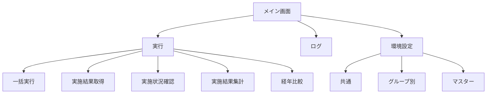

## 3. 各画面

### 3.1 実行（一括実行）

  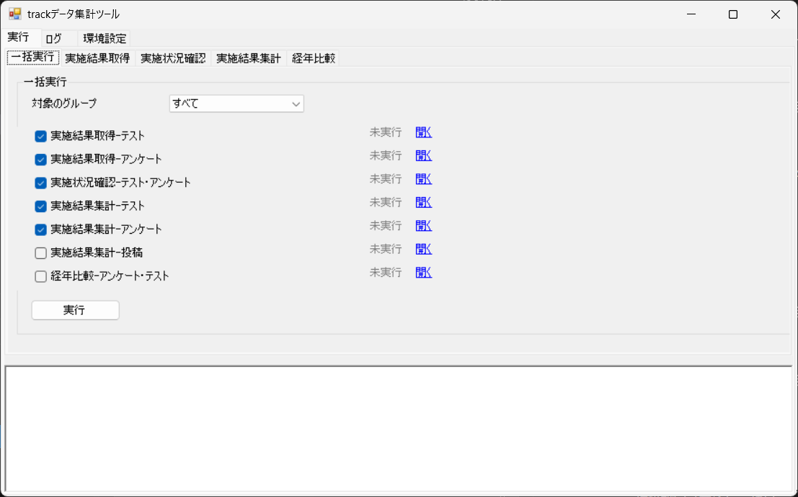

| 通番 | 項目 | 種類 | 内容 |
|---|---|---|---|
| 1 | 対象のグループ | コンボボックス | 対象のグループを選びます。 |
| 2 | 実施結果取得-テスト | チェックボックス | 実行する処理を選びます。 |
| 3 | 実施結果取得-アンケート | チェックボックス | 実行する処理を選びます。 |
| 4 | 実施状況確認-テスト・アンケート | チェックボックス | 実行する処理を選びます。 |
| 5 | 実施結果集計-テスト | チェックボックス | 実行する処理を選びます。 |
| 6 | 実施結果集計-アンケート | チェックボックス | 実行する処理を選びます。 |
| 7 | 実施結果集計-投稿 | チェックボックス | 実行する処理を選びます。 |
| 8 | 経年比較-アンケート・テスト | チェックボックス | 実行する処理を選びます。 |
| 9 | 実行 | ボタン | 選んだ処理を順に実行します。 |
| 10 | 状態 | ラベル | 処理の状態を表示します。初期表示は「未実行」と表示します。 |
| 11 | 開く | リンク | 処理ごとに、結果のフォルダや投稿先を開きます。 |
| 12 | ログ | テキストエリア | 実行の結果のログを表示します。 |

- 「状態」と「開く」は、処理ごとの行に表示します。

### 3.2 実行（実施結果取得）

#### テスト

  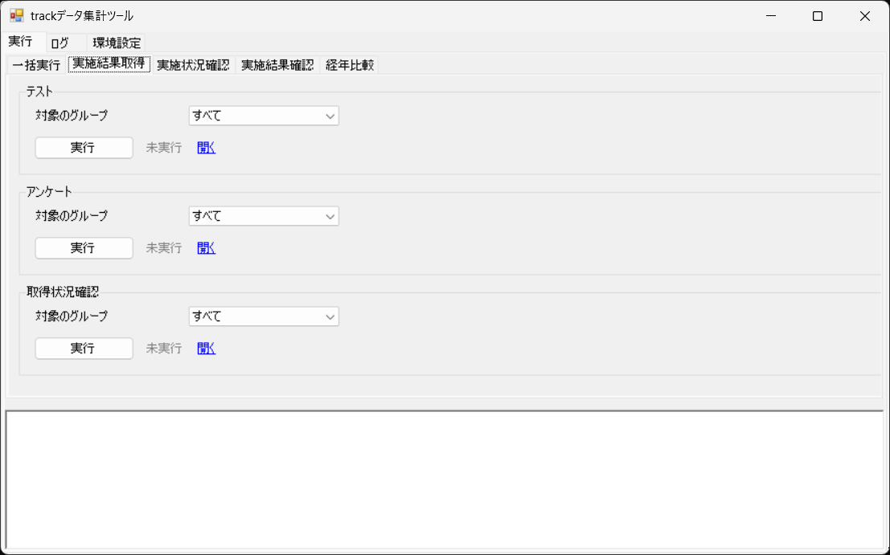

| 通番 | 項目 | 種類 | 内容 |
|---|---|---|---|
| 1 | 対象のグループ | コンボボックス | 対象のグループを選びます。 |
| 2 | 実行 | ボタン | track からテストの実施結果を取得します。 |
| 3 | 状態 | ラベル | 処理の状態を表示します。初期表示は「未実行」と表示します。 |
| 4 | 開く | リンク | 取得した結果のフォルダを開きます。 |
| 5 | ログ | テキストエリア | 実行の結果のログを表示します。 |

#### アンケート

  

| 通番 | 項目 | 種類 | 内容 |
|---|---|---|---|
| 1 | 対象のグループ | コンボボックス | 対象のグループを選びます。 |
| 2 | 実行 | ボタン | track からアンケートの実施結果を取得します。 |
| 3 | 状態 | ラベル | 処理の状態を表示します。初期表示は「未実行」と表示します。 |
| 4 | 開く | リンク | 取得した結果のフォルダを開きます。 |
| 5 | ログ | テキストエリア | 実行の結果のログを表示します。 |

#### 取得状況確認

  

| 通番 | 項目 | 種類 | 内容 |
|---|---|---|---|
| 1 | 対象のグループ | コンボボックス | 対象のグループを選びます。 |
| 2 | 実行 | ボタン | 取得の状況を確認します。 |
| 3 | 状態 | ラベル | 処理の状態を表示します。初期表示は「未実行」と表示します。 |
| 4 | 開く | リンク | 取得した結果のフォルダを開きます。 |
| 5 | ログ | テキストエリア | 実行の結果のログを表示します。 |

### 3.3 実行（実施状況確認）

#### テスト・アンケート

  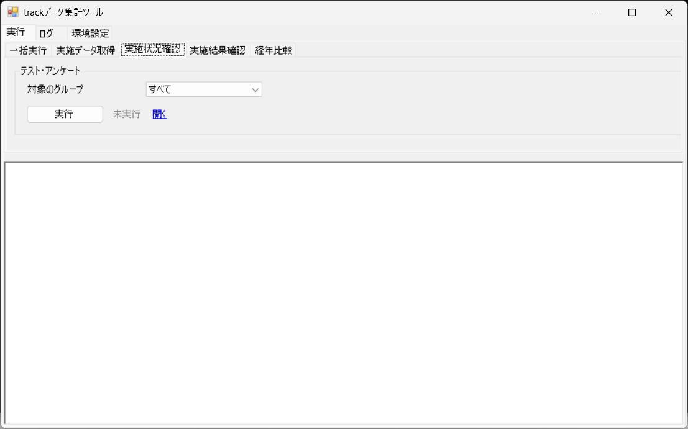

| 通番 | 項目 | 種類 | 内容 |
|---|---|---|---|
| 1 | 対象のグループ | コンボボックス | 対象のグループを選びます。 |
| 2 | 実行 | ボタン | 取得した結果を統合します。 |
| 3 | 状態 | ラベル | 処理の状態を表示します。初期表示は「未実行」と表示します。 |
| 4 | 開く | リンク | 統合結果のフォルダを開きます。 |
| 5 | ログ | テキストエリア | 実行の結果のログを表示します。 |

### 3.4 実行（実施結果集計）

#### テスト

  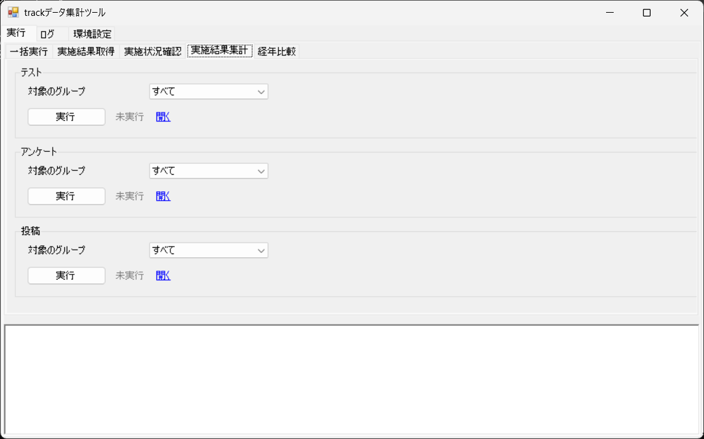

| 通番 | 項目 | 種類 | 内容 |
|---|---|---|---|
| 1 | 対象のグループ | コンボボックス | 対象のグループを選びます。 |
| 2 | 実行 | ボタン | テストの集計結果を作成します。 |
| 3 | 状態 | ラベル | 処理の状態を表示します。初期表示は「未実行」と表示します。 |
| 4 | 開く | リンク | テスト集計結果のフォルダを開きます。 |
| 5 | ログ | テキストエリア | 実行の結果のログを表示します。 |

#### アンケート

  

| 通番 | 項目 | 種類 | 内容 |
|---|---|---|---|
| 1 | 対象のグループ | コンボボックス | 対象のグループを選びます。 |
| 2 | 実行 | ボタン | アンケートの集計結果を作成します。 |
| 3 | 状態 | ラベル | 処理の状態を表示します。初期表示は「未実行」と表示します。 |
| 4 | 開く | リンク | アンケート集計結果のフォルダを開きます。 |
| 5 | ログ | テキストエリア | 実行の結果のログを表示します。 |

#### 投稿

  

| 通番 | 項目 | 種類 | 内容 |
|---|---|---|---|
| 1 | 対象のグループ | コンボボックス | 対象のグループを選びます。 |
| 2 | 実行 | ボタン | 集計結果を、投稿先のスレッドに投稿します。 |
| 3 | 状態 | ラベル | 処理の状態を表示します。初期表示は「未実行」と表示します。 |
| 4 | 開く | リンク | 投稿先のスレッドを開きます。 |
| 5 | ログ | テキストエリア | 実行の結果のログを表示します。 |

### 3.5 実行（経年比較）

#### アンケート・テスト

  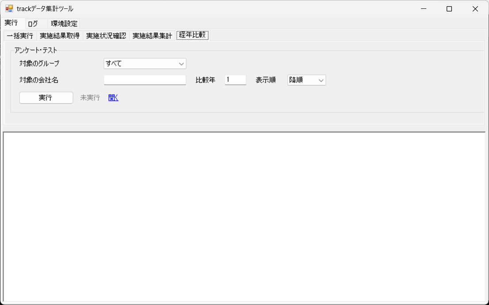

| 通番 | 項目 | 種類 | 内容 |
|---|---|---|---|
| 1 | 対象のグループ | コンボボックス | 対象のグループを選びます。 |
| 2 | 対象の会社名 | テキスト | 集計の対象とする会社名を入力します。 |
| 3 | 比較年 | テキスト | 比較する年数を入力します。 |
| 4 | 表示順 | コンボボックス | 年度の表示順を選びます。 |
| 5 | 実行 | ボタン | 経年比較の結果を作成します。 |
| 6 | 状態 | ラベル | 処理の状態を表示します。初期表示は「未実行」と表示します。 |
| 7 | 開く | リンク | 経年比較の結果のフォルダを開きます。 |
| 8 | ログ | テキストエリア | 実行の結果のログを表示します。 |

### 3.6 ログ

  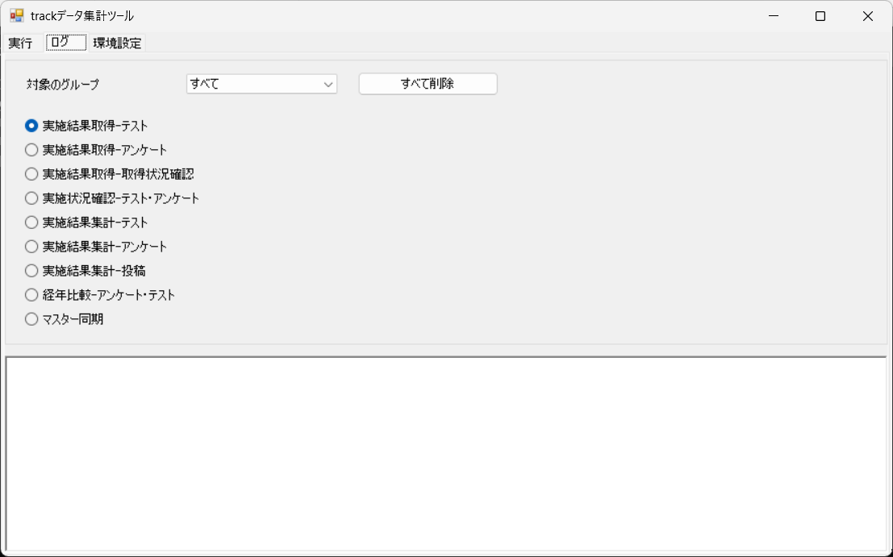

| 通番 | 項目 | 種類 | 内容 |
|---|---|---|---|
| 1 | 対象のグループ | コンボボックス | 表示するログのグループを選びます。 |
| 2 | すべて削除 | ボタン | 実行ログのファイルをすべて削除します。削除の前に確認を求めます。 |
| 3 | 実施結果取得-テスト | ラジオボタン | 表示するログの処理を選びます。 |
| 4 | 実施結果取得-アンケート | ラジオボタン | 表示するログの処理を選びます。 |
| 5 | 実施結果取得-取得状況確認 | ラジオボタン | 表示するログの処理を選びます。 |
| 6 | 実施状況確認-テスト・アンケート | ラジオボタン | 表示するログの処理を選びます。 |
| 7 | 実施結果集計-テスト | ラジオボタン | 表示するログの処理を選びます。 |
| 8 | 実施結果集計-アンケート | ラジオボタン | 表示するログの処理を選びます。 |
| 9 | 実施結果集計-投稿 | ラジオボタン | 表示するログの処理を選びます。 |
| 10 | 経年比較-アンケート・テスト | ラジオボタン | 表示するログの処理を選びます。 |
| 11 | マスター同期 | ラジオボタン | 表示するログの処理を選びます。 |
| 12 | ログ | テキストエリア | 選んだグループと処理の実行ログを表示します。 |

### 3.7 環境設定（共通）

  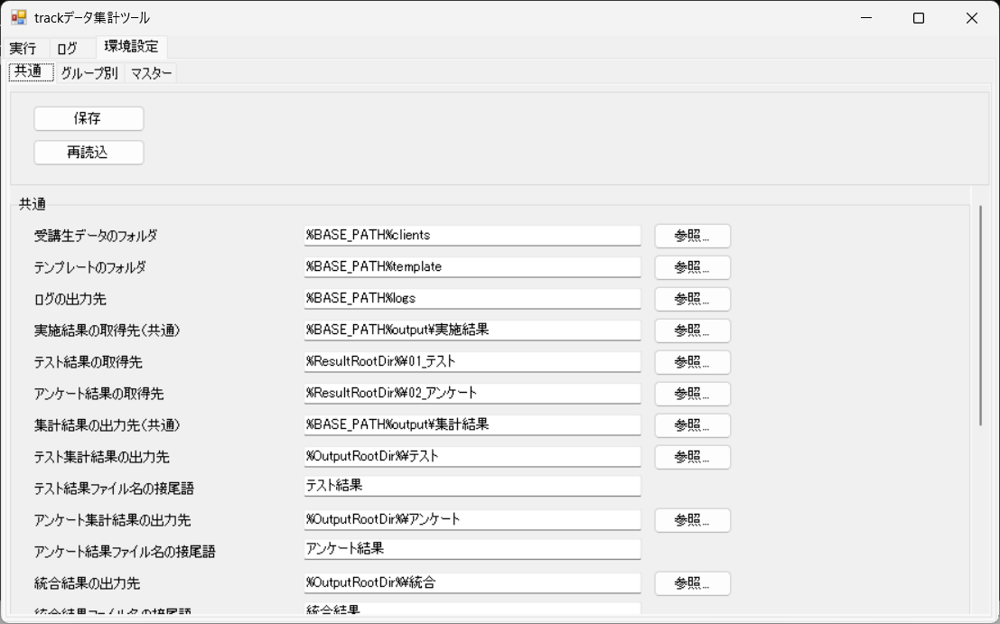

  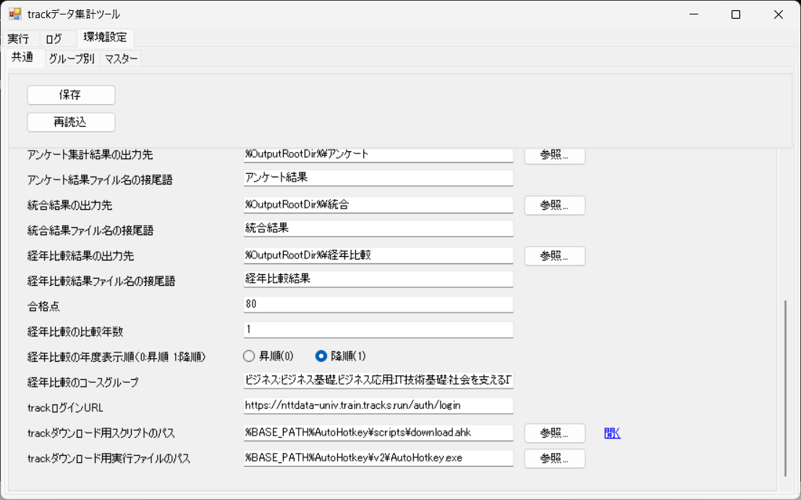

| 通番 | 項目 | 種類 | 内容 |
|---|---|---|---|
| 1 | 保存 | ボタン |
| 2 | 再読込 | ボタン |

#### 共通

  

  

| 通番 | 項目 | 種類 | 内容 |
|---|---|---|---|
| 1 | 受講生データのフォルダ | テキスト |
| 2 | テンプレートのフォルダ | テキスト |
| 3 | ログの出力先 | テキスト |
| 4 | 実施結果の取得先（共通） | テキスト |
| 5 | テスト結果の取得先 | テキスト |
| 6 | アンケート結果の取得先 | テキスト |
| 7 | 集計結果の出力先（共通） | テキスト |
| 8 | テスト集計結果の出力先 | テキスト |
| 9 | テスト結果ファイル名の接尾語 | テキスト |
| 10 | アンケート集計結果の出力先 | テキスト |
| 11 | アンケート結果ファイル名の接尾語 | テキスト |
| 12 | 統合結果の出力先 | テキスト |
| 13 | 統合結果ファイル名の接尾語 | テキスト |
| 14 | 経年比較結果の出力先 | テキスト |
| 15 | 経年比較結果ファイル名の接尾語 | テキスト |
| 16 | 合格点 | テキスト |
| 17 | 経年比較の比較年数 | テキスト |
| 18 | 経年比較の年度表示順 | ラジオボタン |
| 19 | 経年比較のコースグループ | テキスト |
| 20 | trackログインURL | テキスト |
| 21 | trackダウンロード用スクリプトのパス | テキスト |
| 22 | trackダウンロード用実行ファイルのパス | テキスト |

### 3.8 環境設定（グループ別）

  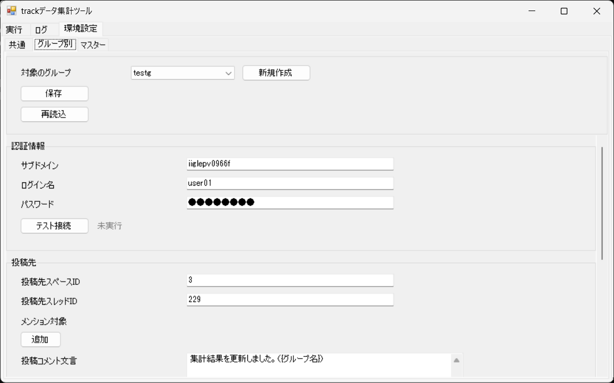

  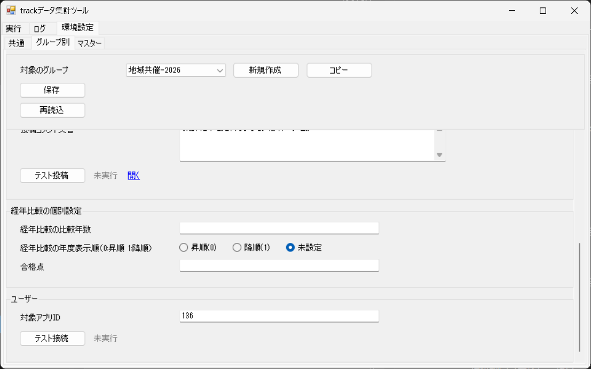

| 通番 | 項目 | 種類 | 内容 |
|---|---|---|---|
| 1 | 対象のグループ | コンボボックス |
| 2 | 新規作成 | ボタン |
| 3 | コピー | ボタン |
| 4 | 保存 | ボタン |
| 5 | 再読込 | ボタン |

「新規作成」を押すと、グループ名を入力するダイアログを表示します。

- 「OK」を押すと、入力した名前のグループを一覧に追加して、選んだ状態にします。
- 入力した名前が既存のグループと重複しているときは、「（入力した名前）は既に存在します。」と表示し、追加しません。
- 名前が空のとき、または「キャンセル」を押したときは、何も作らずに閉じます。

#### 認証情報

  

  

| 通番 | 項目 | 種類 | 内容 |
|---|---|---|---|
| 1 | サブドメイン | テキスト |
| 2 | ログイン名 | テキスト |
| 3 | パスワード | テキスト |
| 4 | テスト接続（認証情報） | ボタン |

#### 投稿先

  

  

| 通番 | 項目 | 種類 | 内容 |
|---|---|---|---|
| 1 | 投稿先スペースID | テキスト |
| 2 | 投稿先スレッドID | テキスト |
| 3 | メンション対象 | テキスト |
| 4 | 投稿コメント文言 | テキストエリア |
| 5 | テスト投稿 | ボタン |

#### 経年比較の個別設定

  

  

| 通番 | 項目 | 種類 | 内容 |
|---|---|---|---|
| 1 | 経年比較の比較年数 | テキスト |
| 2 | 経年比較の年度表示順 | ラジオボタン |
| 3 | 合格点 | テキスト |

#### ユーザー

  

  

| 通番 | 項目 | 種類 | 内容 |
|---|---|---|---|
| 1 | 対象アプリID | テキスト |
| 2 | テスト接続（ユーザー） | ボタン |

### 3.9 環境設定（マスター）

  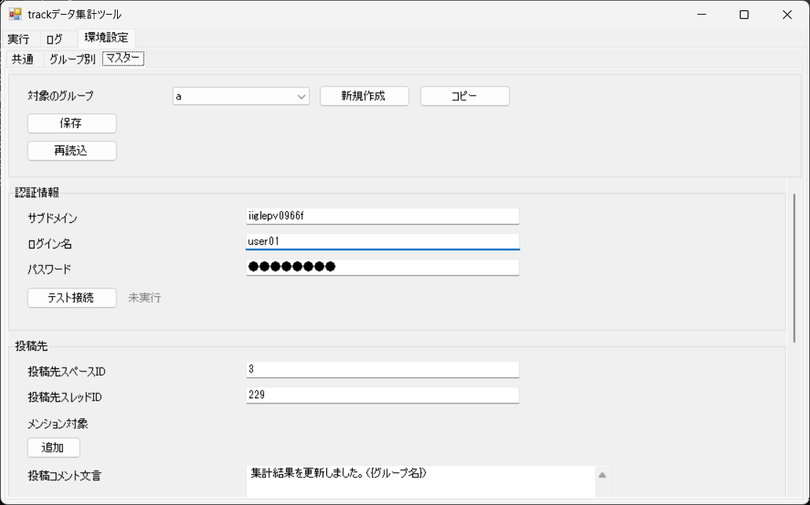

| 通番 | 項目 | 種類 | 内容 |
|---|---|---|---|
| 1 | 対象のグループ | コンボボックス | 対象のグループを選びます。 |
| 2 | 開く | リンク | 対象のグループの Excel を開きます。 |
| 3 | 保存対象 | コンボボックス | 保存する範囲を選びます。 |
| 4 | 保存 | ボタン | 入力した内容を保存します。 |
| 5 | 再読込 | ボタン | 保存されている内容を読み込み直します。 |

#### ユーザー

  

| 通番 | 項目 | 種類 | 内容 |
|---|---|---|---|
| 1 | 同期実行（ユーザー） | ボタン | ユーザーマスターを受講生一覧に同期します。 |

#### テスト

  

  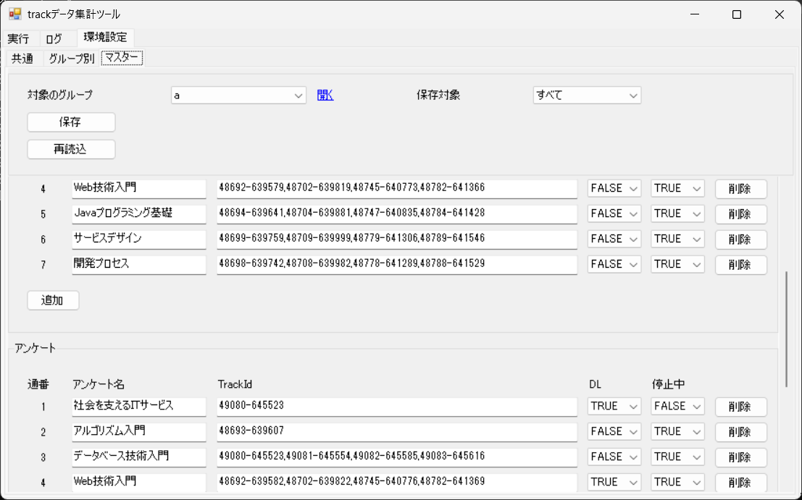

| 通番 | 項目 | 種類 | 内容 |
|---|---|---|---|
| 1 | テスト | 表 | 通番、テスト名、TrackId、DL、停止中の列で、テストの対象を編集します。 |
| 2 | 削除（テスト） | ボタン | 表の行を削除します。 |
| 3 | 追加（テスト） | ボタン | 表に行を追加します。 |

#### アンケート

  

  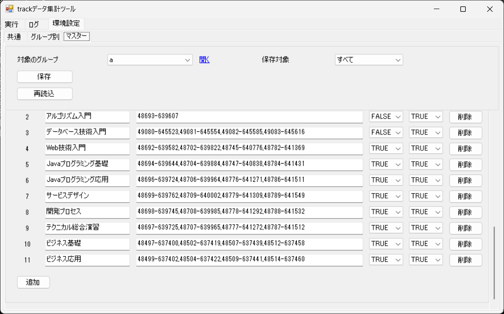

| 通番 | 項目 | 種類 | 内容 |
|---|---|---|---|
| 1 | アンケート | 表 | 通番、アンケート名、TrackId、DL、停止中の列で、アンケートの対象を編集します。 |
| 2 | 削除（アンケート） | ボタン | 表の行を削除します。 |
| 3 | 追加（アンケート） | ボタン | 表に行を追加します。 |
