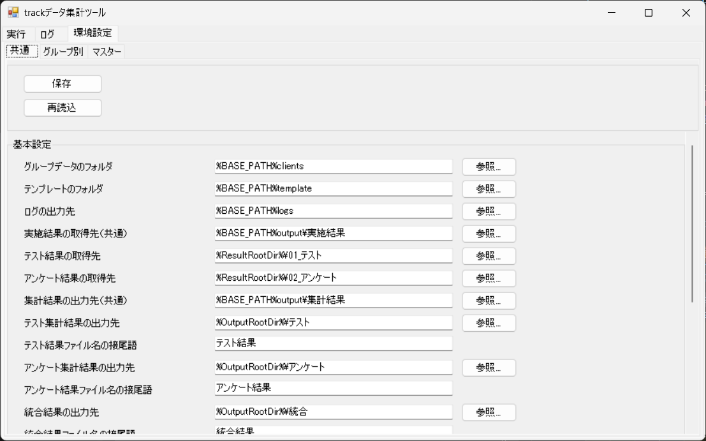
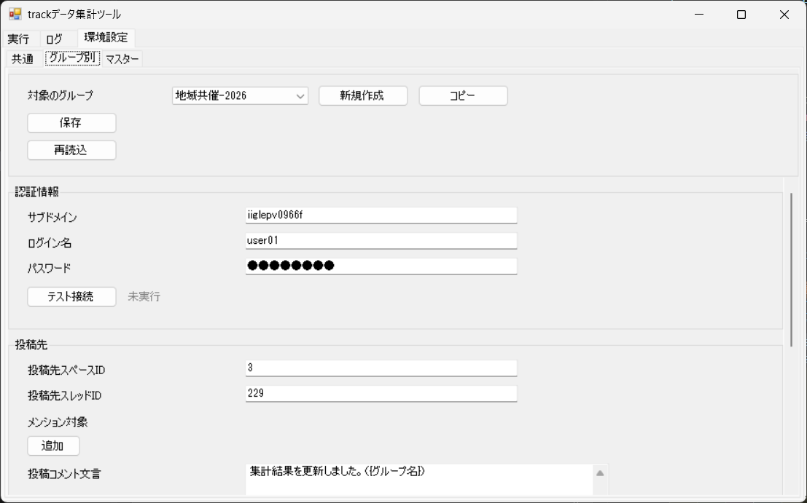
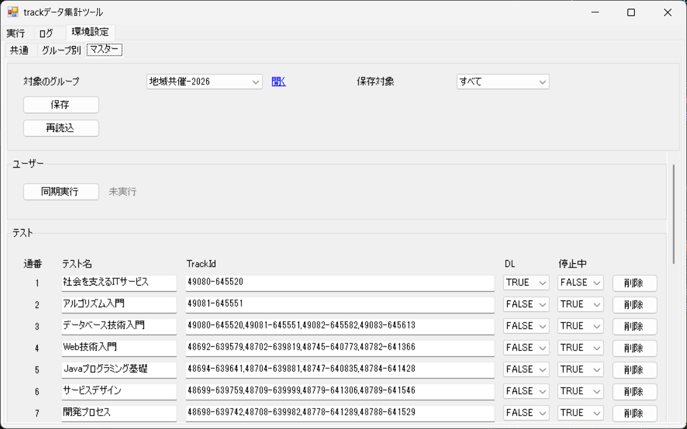
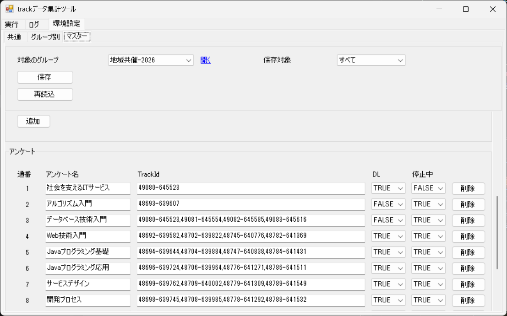
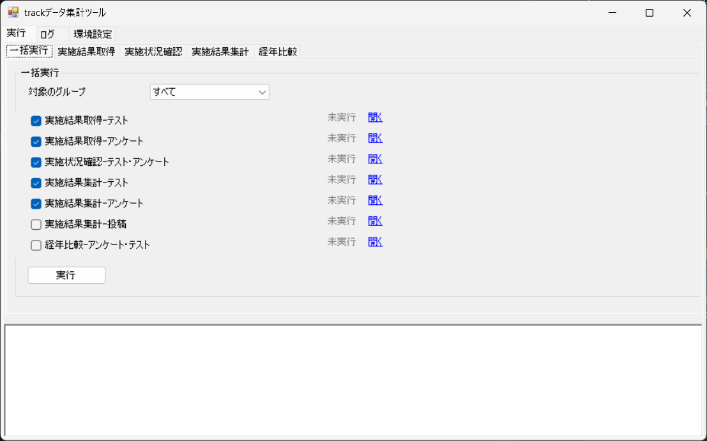
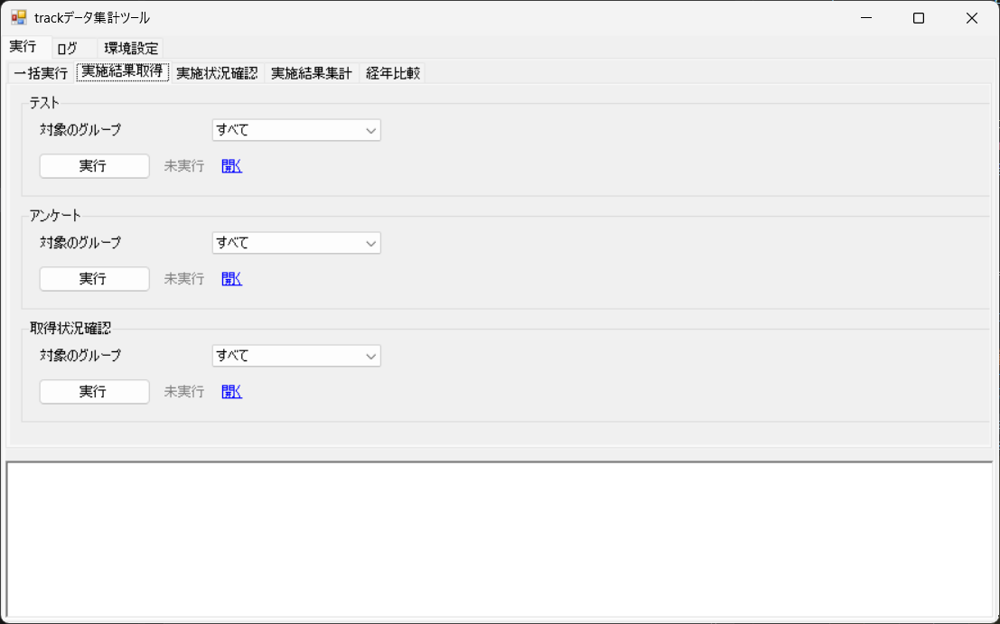
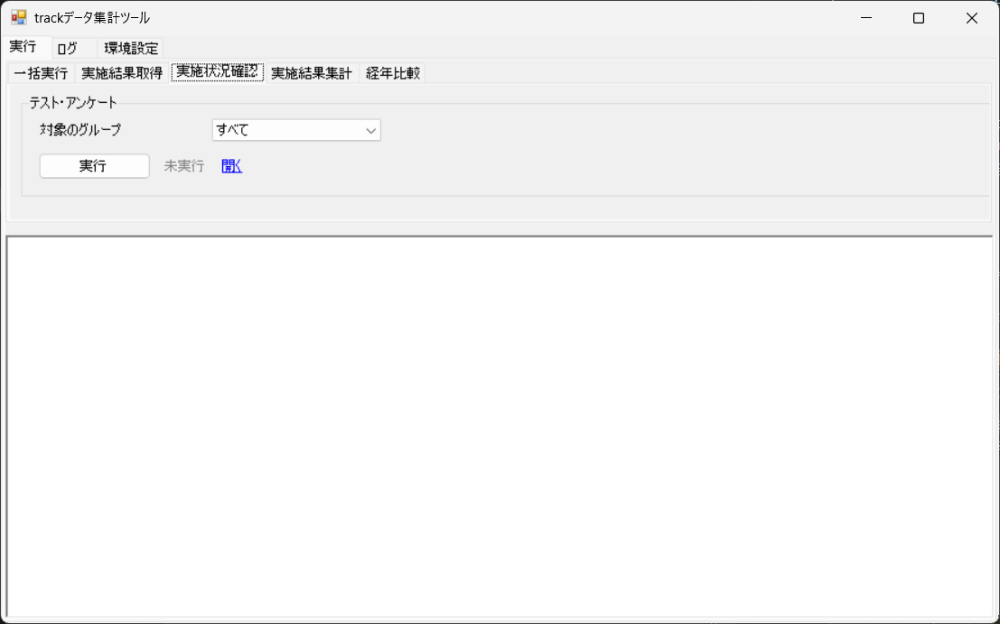
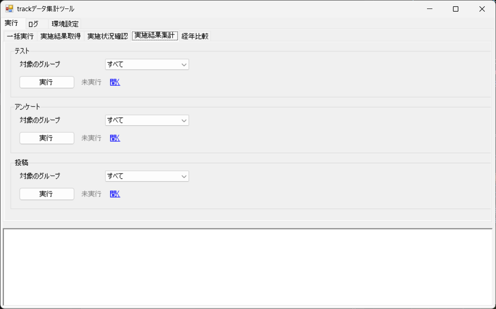
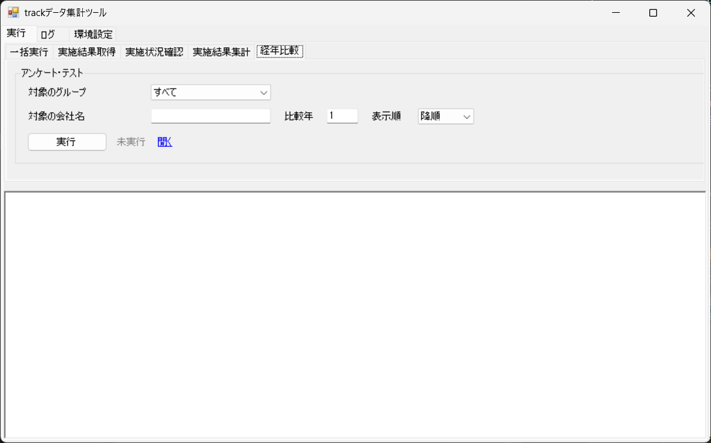
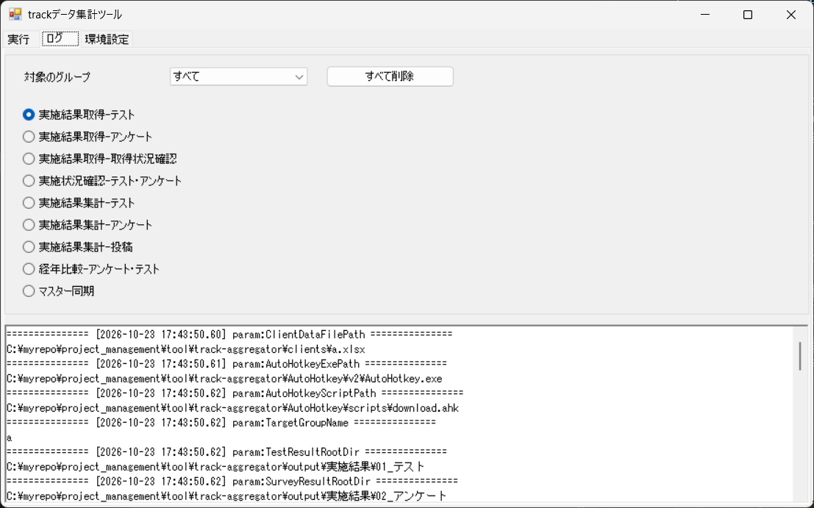

# 操作マニュアル

## 1. 目的と対象

　対象は、trackデータ集計ツール（track の実施結果を集計して、kintone に投稿するツール）です。 
　ツールの画面の操作と、集計の確認方法を説明します。

## 2. 画面の構成

　ツールの画面は、次のタブで構成されています。

- 画面の一覧

| 通番 | メインタブ名 | サブタブ名 | 内容 |
|---|---|---|---|
| 1 | 実行 | 一括実行 | 対象のグループを指定し、選んだ処理をまとめて実行します。 |
| 2 | 実行 | 実施結果取得 | 対象のグループを指定して、track から実施結果を取得します。 |
| 3 | 実行 | 実施状況確認 | 対象のグループを指定して、取得した結果を統合します。 |
| 4 | 実行 | 実施結果集計 | 対象のグループを指定して、テストとアンケートの集計結果を作成し、投稿します。 |
| 5 | 実行 | 経年比較 | 対象の会社名と比較年を指定して、経年比較の結果を作成します。 |
| 6 | ログ |  | 実行ログを表示し、ログを削除します。 |
| 7 | 環境設定 | 共通 | 共通の設定を編集します。 |
| 8 | 環境設定 | グループ別 | グループごとの設定を編集します。 |
| 9 | 環境設定 | マスター | テストとアンケートの対象、ユーザーの同期を編集します。 |

## 3. 初期設定

　環境設定の「共通」「グループ別」「マスター」の各タブで、ツールの設定を行います。

### 3.1 共通

　環境設定の「共通」タブで、「基本設定」の項目を設定します。

  

#### 項目

| 通番 | 区分 | 項目 | 種類 | 内容 |
|---|---|---|---|---|
| 1 | 共通 | 保存 | ボタン | 設定を保存します。 |
| 2 | 共通 | 状態（保存） | 表示 | 保存の状態を表示します。 |
| 3 | 共通 | 再読込 | ボタン | 保存した内容を読み直します。 |
| 4 | 共通 | 状態（再読込） | 表示 | 再読込の状態を表示します。 |
| 5 | 基本設定 | グループデータのフォルダ | 入力欄 | グループごとのデータを置くフォルダを指定します。 |
| 6 | 基本設定 | テンプレートのフォルダ | 入力欄 | テンプレートのファイルを置くフォルダを指定します。 |
| 7 | 基本設定 | ログの出力先 | 入力欄 | 実行ログを出力するフォルダを指定します。 |
| 8 | 基本設定 | 実施結果の取得先（共通） | 入力欄 | track から取得した実施結果を保存するフォルダを指定します。 |
| 9 | 基本設定 | テスト結果の取得先 | 入力欄 | テストの実施結果を保存するフォルダを指定します。 |
| 10 | 基本設定 | アンケート結果の取得先 | 入力欄 | アンケートの実施結果を保存するフォルダを指定します。 |
| 11 | 基本設定 | 集計結果の出力先（共通） | 入力欄 | 集計結果を出力するフォルダを指定します。 |
| 12 | 基本設定 | テスト集計結果の出力先 | 入力欄 | テストの集計結果を出力するフォルダを指定します。 |
| 13 | 基本設定 | テスト結果ファイル名の接尾語 | 入力欄 | テストの結果ファイル名の末尾に付ける文字を入力します。 |
| 14 | 基本設定 | アンケート集計結果の出力先 | 入力欄 | アンケートの集計結果を出力するフォルダを指定します。 |
| 15 | 基本設定 | アンケート結果ファイル名の接尾語 | 入力欄 | アンケートの結果ファイル名の末尾に付ける文字を入力します。 |
| 16 | 基本設定 | 統合結果の出力先 | 入力欄 | 統合結果を出力するフォルダを指定します。 |
| 17 | 基本設定 | 統合結果ファイル名の接尾語 | 入力欄 | 統合結果のファイル名の末尾に付ける文字を入力します。 |
| 18 | 基本設定 | 経年比較結果の出力先 | 入力欄 | 経年比較の結果を出力するフォルダを指定します。 |
| 19 | 基本設定 | 経年比較結果ファイル名の接尾語 | 入力欄 | 経年比較の結果のファイル名の末尾に付ける文字を入力します。 |
| 20 | 基本設定 | 経年比較の比較年数 | 入力欄 | 経年比較で比べる年数を入力します。 |
| 21 | 基本設定 | 昇順(0) | ラジオボタン | 経年比較の年度を昇順に表示します。 |
| 22 | 基本設定 | 降順(1) | ラジオボタン | 経年比較の年度を降順に表示します。 |
| 23 | 基本設定 | 経年比較のコースグループ | 入力欄 | 経年比較で使うコースグループを入力します。 |
| 24 | 基本設定 | trackログインURL | 入力欄 | track にログインする URL を入力します。 |
| 25 | 基本設定 | trackダウンロード用スクリプトのパス | 入力欄 | track からダウンロードするスクリプトのファイルを指定します。 |
| 26 | 基本設定 | 開く（trackダウンロード用スクリプトのパス） | リンク | スクリプトのファイルを開きます。 |
| 27 | 基本設定 | trackダウンロード用実行ファイルのパス | 入力欄 | track からダウンロードする実行ファイルを指定します。 |
| 28 | 基本設定 | 合格点 | 入力欄 | 合格点を入力します。 |

#### 操作方法

1. 設定を変えたら、「保存」を押します。
   - 保存した内容を読み直すときは、「再読込」を押します。

### 3.2 グループ別

　環境設定の「グループ別」タブで、グループごとの接続情報と、投稿先、対象のアプリを設定します。

  

  

  

#### 項目

| 通番 | 区分 | 項目 | 種類 | 内容 |
|---|---|---|---|---|
| 1 | 共通 | 対象のグループ | プルダウン | 設定するグループを選びます。 |
| 2 | 共通 | 新規作成 | ボタン | 新しいグループを作成します。 |
| 3 | 共通 | コピー | ボタン | 対象のグループの設定をコピーして、新しいグループを作成します。 |
| 4 | 共通 | 保存 | ボタン | 設定を保存します。 |
| 5 | 共通 | 状態（保存） | 表示 | 保存の状態を表示します。 |
| 6 | 共通 | 再読込 | ボタン | 保存した内容を読み直します。 |
| 7 | 共通 | 状態（再読込） | 表示 | 再読込の状態を表示します。 |
| 8 | 認証情報 | サブドメイン | 入力欄 | kintone のサブドメインを入力します。 |
| 9 | 認証情報 | ログイン名 | 入力欄 | kintone にログインするための名前を入力します。 |
| 10 | 認証情報 | パスワード | 入力欄 | kintone にログインするためのパスワードを入力します。 |
| 11 | 認証情報 | テスト接続 | ボタン | kintone に接続できるかを確認します。 |
| 12 | 認証情報 | 状態（テスト接続） | 表示 | テスト接続の状態を表示します。 |
| 13 | 投稿先 | 投稿先スペースID | 入力欄 | 投稿先の kintone スペースの ID を入力します。 |
| 14 | 投稿先 | 投稿先スレッドID | 入力欄 | 投稿先のスレッドの ID を入力します。 |
| 15 | 投稿先 | メンション対象 | 表示 | 投稿するときにメンションする対象を指定します。 |
| 16 | 投稿先 | 追加 | ボタン | メンション対象の行を追加します。 |
| 17 | 投稿先 | 削除 | ボタン | 各行の「削除」を押すと、その行を削除します。 |
| 18 | 投稿先 | 投稿コメント文言 | 入力欄 | 投稿するコメントの文言を入力します。 |
| 19 | 投稿先 | テスト投稿 | ボタン | テスト用のコメントを、投稿先のスレッドに投稿します。 |
| 20 | 投稿先 | 状態（テスト投稿） | 表示 | テスト投稿の状態を表示します。 |
| 21 | 経年比較の個別設定 | 経年比較の比較年数 | 入力欄 | 経年比較で比べる年数を入力します。 |
| 22 | 経年比較の個別設定 | 昇順(0) | ラジオボタン | 経年比較の年度を昇順に表示します。 |
| 23 | 経年比較の個別設定 | 降順(1) | ラジオボタン | 経年比較の年度を降順に表示します。 |
| 24 | ユーザー | 対象アプリID | 入力欄 | 接続するアプリの ID を入力します。 |
| 25 | ユーザー | テスト接続 | ボタン | kintone のアプリに接続できるかを確認します。 |
| 26 | ユーザー | 状態（テスト接続） | 表示 | テスト接続の状態を表示します。 |

#### 操作方法

1. 「対象のグループ」で、設定するグループを選びます。
   - 「新規作成」「コピー」を押すと、グループを作れます。
2. 認証情報の「テスト接続」と、「対象アプリID」の各項目の「テスト接続」を押します。
   - kintone に接続できるかを確認します。
3. 設定を変えたら、「保存」を押します。

> 注意
> - 「テスト投稿」は kintone のスレッドに投稿されます。投稿先のスレッドを確認してから押してください。

### 3.3 マスター

　環境設定の「マスター」タブで、テストとアンケートの対象の編集と、ユーザーの同期を行います。

  

  

#### 項目

| 通番 | 区分 | 項目 | 種類 | 内容 |
|---|---|---|---|---|
| 1 | 共通 | 対象のグループ | プルダウン | 設定するグループを選びます。 |
| 2 | 共通 | 開く | リンク | 対象のグループの Excel ファイルを開きます。 |
| 3 | 共通 | 保存対象 | プルダウン | 保存する範囲を選びます。 |
| 4 | 共通 | 保存 | ボタン | 設定を保存します。 |
| 5 | 共通 | 状態（保存） | 表示 | 保存の状態を表示します。 |
| 6 | 共通 | 再読込 | ボタン | 保存した内容を読み直します。 |
| 7 | 共通 | 状態（再読込） | 表示 | 再読込の状態を表示します。 |
| 8 | ユーザー | 同期実行 | ボタン | ユーザーマスターの内容を、受講生一覧のシートに書き込みます。 |
| 9 | ユーザー | 状態（同期実行） | 表示 | 同期実行の状態を表示します。 |
| 10 | テスト | 通番 | 表示 | 行の番号を表示します。 |
| 11 | テスト | テスト名 | 入力欄 | テストの名前を入力します。 |
| 12 | テスト | TrackId | 入力欄 | track のテストの ID を入力します。 |
| 13 | テスト | DL | チェックボックス | チェックを入れると、テストの結果を track から取得する対象にします。初期値は選ばれていません。 |
| 14 | テスト | 停止中 | チェックボックス | チェックを入れると、テストを対象外にし、取得と集計から外します。初期値は選ばれています。 |
| 15 | テスト | 追加 | ボタン | 表の末尾に、空の行を追加します。 |
| 16 | テスト | 削除 | ボタン | 各行の「削除」を押すと、その行を削除します。 |
| 17 | アンケート | 通番 | 表示 | 行の番号を表示します。 |
| 18 | アンケート | アンケート名 | 入力欄 | アンケートの名前を入力します。 |
| 19 | アンケート | TrackId | 入力欄 | track のアンケートの ID を入力します。 |
| 20 | アンケート | DL | チェックボックス | チェックを入れると、アンケートの結果を track から取得する対象にします。初期値は選ばれていません。 |
| 21 | アンケート | 停止中 | チェックボックス | チェックを入れると、アンケートを対象外にし、取得と集計から外します。初期値は選ばれています。 |
| 22 | アンケート | 追加 | ボタン | 表の末尾に、空の行を追加します。 |
| 23 | アンケート | 削除 | ボタン | 各行の「削除」を押すと、その行を削除します。 |

#### 操作方法

1. 「対象のグループ」で、設定するグループを選びます。
2. 「テスト」の表で、テストの対象を入力します。
   - 「追加」を押すと、表の末尾に空の行が追加されます。
3. 「アンケート」の表で、アンケートの対象を入力します。
4. 「同期実行」を押して、ユーザーを受講生一覧に書き込みます。
5. 「保存対象」で、保存する範囲を選びます。
6. 「保存」を押します。
   - 保存した内容を読み直すときは、「再読込」を押します。

## 4. 実行

　「実行」タブには、次のサブタブがあります。

### 4.1 一括実行

　「一括実行」で、対象のグループを指定して、選んだ処理をまとめて実行します。

  

#### 項目

| 通番 | 区分 | 項目 | 種類 | 内容 |
|---|---|---|---|---|
| 1 | 共通 | 対象のグループ | プルダウン | 処理するグループを選びます。 |
| 2 | 共通 | 実施結果取得-テスト | チェックボックス | 処理を実行するかを選びます。チェックを外した処理はスキップします。初期値は選ばれています。 |
| 3 | 共通 | 状態（実施結果取得-テスト） | 表示 | 実施結果取得-テストの状態を表示します。 |
| 4 | 共通 | 開く（実施結果取得-テスト） | リンク | 出力先のフォルダを開きます。 |
| 5 | 共通 | 実施結果取得-アンケート | チェックボックス | 処理を実行するかを選びます。チェックを外した処理はスキップします。初期値は選ばれています。 |
| 6 | 共通 | 状態（実施結果取得-アンケート） | 表示 | 実施結果取得-アンケートの状態を表示します。 |
| 7 | 共通 | 開く（実施結果取得-アンケート） | リンク | 出力先のフォルダを開きます。 |
| 8 | 共通 | 実施状況確認-テスト・アンケート | チェックボックス | 処理を実行するかを選びます。チェックを外した処理はスキップします。初期値は選ばれています。 |
| 9 | 共通 | 状態（実施状況確認-テスト・アンケート） | 表示 | 実施状況確認-テスト・アンケートの状態を表示します。 |
| 10 | 共通 | 開く（実施状況確認-テスト・アンケート） | リンク | 出力先のフォルダを開きます。 |
| 11 | 共通 | 実施結果集計-テスト | チェックボックス | 処理を実行するかを選びます。チェックを外した処理はスキップします。初期値は選ばれています。 |
| 12 | 共通 | 状態（実施結果集計-テスト） | 表示 | 実施結果集計-テストの状態を表示します。 |
| 13 | 共通 | 開く（実施結果集計-テスト） | リンク | 出力先のフォルダを開きます。 |
| 14 | 共通 | 実施結果集計-アンケート | チェックボックス | 処理を実行するかを選びます。チェックを外した処理はスキップします。初期値は選ばれています。 |
| 15 | 共通 | 状態（実施結果集計-アンケート） | 表示 | 実施結果集計-アンケートの状態を表示します。 |
| 16 | 共通 | 開く（実施結果集計-アンケート） | リンク | 出力先のフォルダを開きます。 |
| 17 | 共通 | 実施結果集計-投稿 | チェックボックス | 処理を実行するかを選びます。初期値は選ばれていません。 |
| 18 | 共通 | 状態（実施結果集計-投稿） | 表示 | 実施結果集計-投稿の状態を表示します。 |
| 19 | 共通 | 開く（実施結果集計-投稿） | リンク | 投稿先のスレッドを開きます。 |
| 20 | 共通 | 経年比較-アンケート・テスト | チェックボックス | 処理を実行するかを選びます。初期値は選ばれていません。 |
| 21 | 共通 | 状態（経年比較-アンケート・テスト） | 表示 | 経年比較-アンケート・テストの状態を表示します。 |
| 22 | 共通 | 開く（経年比較-アンケート・テスト） | リンク | 出力先のフォルダを開きます。 |
| 23 | 共通 | 実行 | ボタン | 選んだ処理を順に実行します。 |
| 24 | 共通 | 状態（実行） | 表示 | 一括実行の状態を表示します。 |

#### 操作方法

1. 「対象のグループ」で、グループを選びます。
2. 実行する処理にチェックを入れます。
   - チェックを外した処理は、スキップされます。
3. 「実行」を押します。
   - 状態が「成功」と表示されたら、処理は完了しています。
4. 実行した処理の「開く」を押すと、結果を開けます。

> 注意
> - 「実施結果集計-投稿」は kintone に投稿されます。投稿先のスレッドを確認してから実行してください。

### 4.2 実施結果取得

　「実施結果取得」で、対象のグループを指定して、track から実施結果を取得します。

  

#### 項目

| 通番 | 区分 | 項目 | 種類 | 内容 |
|---|---|---|---|---|
| 1 | テスト | 対象のグループ | プルダウン | 処理するグループを選びます。 |
| 2 | テスト | 実行 | ボタン | track からテストの実施結果を取得します。 |
| 3 | テスト | 状態（実行） | 表示 | テストの実施結果の取得の状態を表示します。 |
| 4 | テスト | 開く | リンク | 取得した結果の出力先のフォルダを開きます。 |
| 5 | アンケート | 対象のグループ | プルダウン | 処理するグループを選びます。 |
| 6 | アンケート | 実行 | ボタン | track からアンケートの実施結果を取得します。 |
| 7 | アンケート | 状態（実行） | 表示 | アンケートの実施結果の取得の状態を表示します。 |
| 8 | アンケート | 開く | リンク | 取得した結果の出力先のフォルダを開きます。 |
| 9 | 取得状況確認 | 対象のグループ | プルダウン | 処理するグループを選びます。 |
| 10 | 取得状況確認 | 実行 | ボタン | 取得の状況を確認します。 |
| 11 | 取得状況確認 | 状態（実行） | 表示 | 取得の状況の確認の状態を表示します。 |
| 12 | 取得状況確認 | 開く | リンク | 取得した結果の出力先のフォルダを開きます。 |

#### 操作方法

1. 「テスト」の枠で、「対象のグループ」を選びます。
2. 「テスト」の枠の「実行」を押します。
   - 状態が「成功」と表示されたら、処理は完了しています。
3. 「アンケート」の枠で、「対象のグループ」を選びます。
4. 「アンケート」の枠の「実行」を押します。
   - 状態が「成功」と表示されたら、処理は完了しています。
5. 「取得状況確認」の枠で、「対象のグループ」を選びます。
6. 「取得状況確認」の枠の「実行」を押します。
   - 状態が「成功」と表示されたら、処理は完了しています。
7. 「開く」を押すと、取得した結果を開けます。

### 4.3 実施状況確認

　「実施状況確認」で、取得した結果を統合します。

  

#### 項目

| 通番 | 区分 | 項目 | 種類 | 内容 |
|---|---|---|---|---|
| 1 | テスト・アンケート | 対象のグループ | プルダウン | 処理するグループを選びます。 |
| 2 | テスト・アンケート | 実行 | ボタン | 取得した結果を統合します。 |
| 3 | テスト・アンケート | 状態（実行） | 表示 | 統合の状態を表示します。 |
| 4 | テスト・アンケート | 開く | リンク | 統合の出力先のフォルダを開きます。 |

#### 操作方法

1. 「対象のグループ」で、グループを選びます。
2. 「実行」を押します。
   - 状態が「成功」と表示されたら、処理は完了しています。
3. 「開く」を押すと、統合した結果を開けます。

### 4.4 実施結果集計

　「実施結果集計」で、テストとアンケートの集計結果を作成し、投稿します。

  

#### 項目

| 通番 | 区分 | 項目 | 種類 | 内容 |
|---|---|---|---|---|
| 1 | テスト | 対象のグループ | プルダウン | 処理するグループを選びます。 |
| 2 | テスト | 実行 | ボタン | テストの集計結果を作成します。 |
| 3 | テスト | 状態（実行） | 表示 | テストの集計の状態を表示します。 |
| 4 | テスト | 開く | リンク | テストの集計結果の出力先のフォルダを開きます。 |
| 5 | アンケート | 対象のグループ | プルダウン | 処理するグループを選びます。 |
| 6 | アンケート | 実行 | ボタン | アンケートの集計結果を作成します。 |
| 7 | アンケート | 状態（実行） | 表示 | アンケートの集計の状態を表示します。 |
| 8 | アンケート | 開く | リンク | アンケートの集計結果の出力先のフォルダを開きます。 |
| 9 | 投稿 | 対象のグループ | プルダウン | 投稿するグループを選びます。 |
| 10 | 投稿 | 実行 | ボタン | 集計結果を、投稿先のスレッドに投稿します。 |
| 11 | 投稿 | 状態（実行） | 表示 | 投稿の状態を表示します。 |
| 12 | 投稿 | 開く | リンク | 投稿先のスレッドを開きます。 |

#### 操作方法

1. 「テスト」の枠で、「対象のグループ」を選びます。
2. 「テスト」の枠の「実行」を押します。
   - 状態が「成功」と表示されたら、処理は完了しています。
3. 「アンケート」の枠で、「対象のグループ」を選びます。
4. 「アンケート」の枠の「実行」を押します。
   - 状態が「成功」と表示されたら、処理は完了しています。
5. 「投稿」の枠で、「対象のグループ」を選びます。
6. 「投稿」の枠の「実行」を押します。
   - 状態が「成功」と表示されたら、処理は完了しています。
7. 「開く」を押すと、集計結果を開けます。

> 注意
> - 「投稿」は kintone に投稿されます。投稿先のスレッドを確認してから実行してください。

### 4.5 経年比較

　「経年比較」で、対象の会社名と比較年を指定して、経年比較の結果を作成します。

  

#### 項目

| 通番 | 区分 | 項目 | 種類 | 内容 |
|---|---|---|---|---|
| 1 | アンケート・テスト | 対象のグループ | プルダウン | 処理するグループを選びます。 |
| 2 | アンケート・テスト | 対象の会社名 | 入力欄 | 集計の対象とする会社名を入力します。 |
| 3 | アンケート・テスト | 比較年 | 入力欄 | 比較する年数を入力します。 |
| 4 | アンケート・テスト | 表示順 | プルダウン | 年度の表示順を選びます。 |
| 5 | アンケート・テスト | 実行 | ボタン | 経年比較の結果を作成します。 |
| 6 | アンケート・テスト | 状態（実行） | 表示 | 経年比較の結果の作成の状態を表示します。 |
| 7 | アンケート・テスト | 開く | リンク | 経年比較の出力先のフォルダを開きます。 |

#### 操作方法

1. 「対象のグループ」で、グループを選びます。
2. 「対象の会社名」を入力します。
3. 「比較年」を入力します。
4. 「表示順」で、年度の表示順を選びます。
5. 「実行」を押します。
   - 状態が「成功」と表示されたら、処理は完了しています。
6. 「開く」を押すと、経年比較の結果を開けます。

## 5. ログ

　「ログ」タブで、実行した処理の結果を確認できます。

  

#### 項目

| 通番 | 区分 | 項目 | 種類 | 内容 |
|---|---|---|---|---|
| 1 | 共通 | 対象のグループ | プルダウン | 結果を表示するグループを選びます。 |
| 2 | 共通 | すべて削除 | ボタン | 実行ログのファイルをすべて削除します。削除の前に確認を求めます。 |
| 3 | 共通 | 実施結果取得-テスト | ラジオボタン | 実施結果取得-テストの結果を表示します。 |
| 4 | 共通 | 実施結果取得-アンケート | ラジオボタン | 実施結果取得-アンケートの結果を表示します。 |
| 5 | 共通 | 実施結果取得-取得状況確認 | ラジオボタン | 実施結果取得-取得状況確認の結果を表示します。 |
| 6 | 共通 | 実施状況確認-テスト・アンケート | ラジオボタン | 実施状況確認-テスト・アンケートの結果を表示します。 |
| 7 | 共通 | 実施結果集計-テスト | ラジオボタン | 実施結果集計-テストの結果を表示します。 |
| 8 | 共通 | 実施結果集計-アンケート | ラジオボタン | 実施結果集計-アンケートの結果を表示します。 |
| 9 | 共通 | 実施結果集計-投稿 | ラジオボタン | 実施結果集計-投稿の結果を表示します。 |
| 10 | 共通 | 経年比較-アンケート・テスト | ラジオボタン | 経年比較-アンケート・テストの結果を表示します。 |
| 11 | 共通 | マスター同期 | ラジオボタン | マスターの同期の結果を表示します。 |

#### 操作方法

1. 「対象のグループ」で、グループを選びます。
2. 処理のラジオボタンから、表示する処理を選びます。
3. 表示された結果を見ます。
4. 不要になったログは、「すべて削除」を押して削除します。

## 6. 困ったとき

- **出力されたファイルが開けない**: 対象の Excel ファイルが、別のアプリで開かれていないかを確認します。開いている場合は、閉じてから実行します。
- **投稿に失敗する**: 「環境設定」の「グループ別」タブの「テスト接続」で、接続情報と対象アプリIDを確認します。
- **状態が「失敗」になった**: 「ログ」タブで、その処理の結果を確認します。
- **状態が「警告」になった**: 「ログ」タブで、その処理の結果を確認します。
- **出力先のファイルが上書きされた**: 出力フォルダ内の既存のファイルは、実行すると上書きされます。残したい結果は、別の場所に保存してください。
